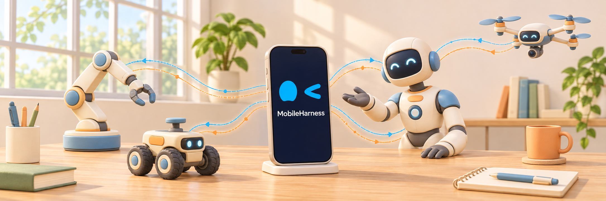

<h1 align="center"> MobileHarness</h1>

<p align="center"><em>Your phone is the best robot brain!</em></p>

MobileHarness is an Apple-native, bio-inspired multimodal Agent app that turns your iPhone into a harness for independent, stateful Agents. Built around a **Perception → Cognition → Action** loop, it coordinates the phone's hardware and sensors, such as its camera, microphone and speaker, so Agents can perceive the world, understand users, reason, converse and act. Its current robotic-body integration targets **NexArm**, allowing the phone to serve as the brain of an embodied Agent.

<p align="center">
  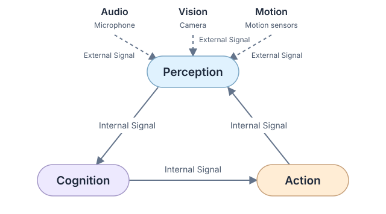
</p>

_In MobileHarness, every input is a Signal; every output is an Action._ Signals carry information through the **Perception → Cognition → Action** loop. External Signals bring observations from the world and user interactions into perception; Internal Signals connect the three stages, carrying interpreted information, intent and feedback. Native inputs reach their responsible Agents through typed ports, while Gateway coordinates inter-Agent communication and Action execution. Agents interpret inputs, decide what to do and act through the phone's capabilities; actual outcomes feed back into the loop. See the [Signal flow design](MobileHarness/README.md#native-input-and-internal-signals) for delivery paths and execution feedback. The ultimate goal is human-like interaction: _receiving multi-channel Signal input while producing multi-channel Action output_.

<p align="center">
  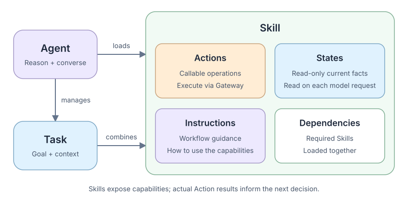
</p>

**Tasks** preserve goals and context across conversation turns, while **Skills** provide the capabilities needed to pursue them. Each Skill declares **Actions** (operations), **States** (current facts), **Instructions** (workflow guidance) and **dependencies** (other Skills). Agents load Skills as needed and use actual results to guide their next decisions.

States give Agents a form of **proprioception**: awareness of current capabilities and conditions, such as camera activity or a robotic arm's target and measured position. Selected facts refresh on each model request; the underlying modules retain ownership of live state. See the [Skill catalog](MobileHarness/Resources/Skills/README.md) and [Agent design](MobileHarness/Agents/README.md).

<p align="center">
  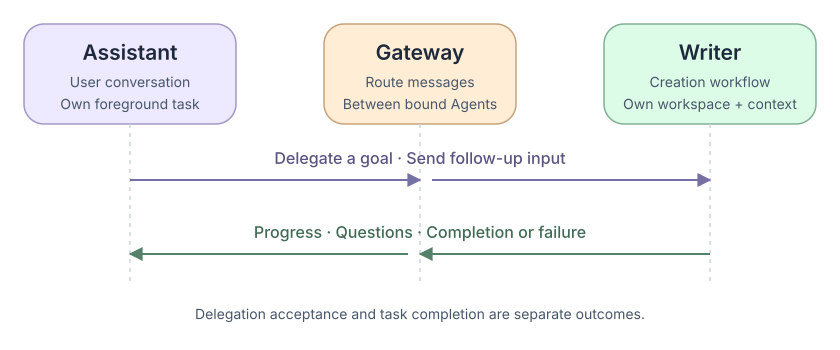
</p>

**Multi-Agent collaboration** lets specialized Agents exchange messages and delegate work through **Gateway**, within their declared communication permissions. For example, **Assistant** understands a user's request to write an illustrated article and delegates that goal to **Writer**, which owns its creation workflow, context and workspace. Assistant remains available for conversation and can forward the user's follow-up requirements; Writer sends progress, asks for clarification when needed and reports completion or failure so Assistant can respond to the user. Accepting a delegation means the work has been admitted, not that it is finished. Each Agent retains ownership of its own work, and Writer's delegation does not replace Assistant's foreground Task. See the [Agent communication flow](MobileHarness/README.md#assistant-agent-delegation).

Biological inspiration runs throughout MobileHarness. **Agents** resemble specialized parts of the human brain, processing observations and **Signals** through capabilities such as speech recognition, visual pose detection and reasoning. **Gateway** provides nervous-system coordination for Agent communication and execution. **UI**, **PlatformKit**, **ModelKit** and **Storage** provide independent presentation, native I/O, inference and storage capabilities; **App** assembles the modules and owns their lifetimes.

**Keywords:** Apple-native · Bio-inspired · Embodied Agent · Multimodal · Multi-Agent · Agent Harness · Mobile Agent

[Quick Start](#quick-start) · [Documentation](docs/README.md) · [Technical Design](MobileHarness/README.md) · [Contributing](CONTRIBUTING.md)

## Quick Start

### Requirements

- A Mac with **Xcode 27+**, matching SDKs and **Swift 6.4+** tooling.
- **Python 3** for optional model provisioning and repository checks.
- An **iOS 27+ physical device** and development signing for the complete application.

The app deployment target is iOS 27; the shared package declares iOS/macOS 26, with CoreAI execution requiring OS 27 and supported hardware. That package floor does not make the full app compatible with older iOS. XcodeGen and CocoaPods are not required.

The current local Gemma iOS graph supports only hardware identifiers `iPhone18,1` and `iPhone18,2`. Other devices require explicitly configured cloud chat for conversation. See [Gemma compatibility](MobileHarness/ModelKit/Language/LLM/Gemma4/README.md#local-gemma-engine).

### 1. Get the project

```sh
git clone https://github.com/devilyouwei/MobileHarness.git
cd MobileHarness
```

Launch Xcode once to complete setup and select the full developer tools:

```sh
sudo xcode-select -s /Applications/Xcode.app/Contents/Developer
```

### 2. Open in Xcode

```sh
open MobileHarness.xcodeproj
```

Use the physical-device **MobileHarness** scheme for the complete local-inference configuration. For simulator builds, `./scripts/build-ios.sh` selects **MobileHarnessSimulator** and sets `MOBILEHARNESS_BUILD_VARIANT=simulator` during package resolution to exclude the device-only Gemma backend. Local Gemma chat is unavailable in that variant; conversation requires an explicitly configured cloud provider. See [Gemma4](MobileHarness/ModelKit/Language/LLM/Gemma4/README.md) for the platform boundary.

### 3. Configure device signing

```sh
cp Config/Local.xcconfig.example Config/Local.xcconfig
```

Set `DEVELOPMENT_TEAM` and `PRODUCT_BUNDLE_IDENTIFIER` in the ignored local file. Builds bundle the pinned model catalog and notices, not inference weights; no model download is required before building.

### 4. Choose capabilities and run

Select the **MobileHarness** scheme, choose your connected iPhone, then build and run.

- Open Settings → **AI Models** to manage **Speech Recognition**, **Speech Synthesis**, **Agent Brains** and **Vision Recognition** resources. Custom recognition/synthesis default off; Apple ASR/TTS can run without Nemotron/MOSS weights. Silero/Energy selection is independent of that switch.
- Download compatible **Gemma 4 E2B** for local text conversation, or explicitly configure a provider implementing the **Responses API**. A provider offering only Chat Completions is insufficient. Photo understanding requires an image-capable cloud model; local Gemma does not support images or native Tools. Cloud chat replaces chat only.
- Camera preview starts off. Use the camera controls to open preview and grant permission; install YOLO for pose inference. Voice preparation is independent of camera preview. Saving a captured photo requests add-only Photos permission.
- **Press and hold the companion's eyes for half a second** to enable continuous listening, prepare the selected speech capabilities and request microphone permission. Release after activation; speak, then pause to end the utterance. Partial captions become a final input and spoken reply.
- Press and hold the eyes again to withdraw listening consent and stop microphone capture. Camera controls independently switch lenses or close preview.

Listening pauses during recognition completion and replies, then resumes through the App's native audio completion barriers. The current frontend has no text-entry field. Native/model failures are explicit; active inference never silently switches to another provider.

Model downloads use an explicit official Hugging Face, HF-Mirror or custom HTTPS source; YOLO retains its declared ZIP source. Production revisions remain pinned. Background transfer and resume depend on the OS and server; force-quit does not guarantee continued transfer. See [model resources](MobileHarness/Resources/Models/README.md) and the [Hub adapter](MobileHarness/ModelKit/Support/Management/HuggingFace/README.md) for acquisition, compatibility and recovery details.

For offline development and opt-in Mac/model tests, existing `scripts/download-*.py` wrappers provision ignored local artifacts; Hugging Face wrappers accept `--endpoint`. Gemma Mac tests use a separate decoder profile. For voice experiments and acceptance procedures, see [Voice](docs/validation/Voice.md) and [MOSS validation](docs/validation/Moss-Validation.md).

## Development

```sh
./scripts/check.sh
./scripts/build-ios.sh
```

`check.sh` runs static dependency/ownership checks, Python provisioning tests, strict Swift formatting, shared-package tests and project/privacy/entitlement metadata checks. `build-ios.sh` builds four unsigned simulator schemes with full Xcode using the explicit simulator variant and validates packaged Agent/Skill resources after the app build. Build results and real-model/native/device acceptance are recorded separately; see the [State validation record](docs/validation/Container-Reflexivity.md).

[Package.swift](Package.swift) maps the existing source tree into independent targets; tests live in [Tests](Tests/README.md). ModelKit, PlatformKit, Storage and UI are foundational modules; base capability targets have no upper-layer project dependencies, while domain/adaptor targets retain their explicit internal dependencies. AgentCore and FunctionContracts are independent contracts. The complete target map, queue limits, cancellation and completion rules belong to [MobileHarness/README.md](MobileHarness/README.md).

## Features

| Feature | What you can do today |
| --- | --- |
| **Everyday interaction** | Have multi-turn voice conversations with the Assistant, with live captions, spoken replies and expressive eyes and gaze. |
| **Interactive UI** | Interact with generated pages, charts and small tools, manage content windows, and follow task progress in the in-app Island. |
| **NexArm robotic-arm control** | Control a **NexArm** by voice, move individual joints, perform gestures such as nodding and waving, and aim using visual pose tracking. |
| **Intelligent photography and album** | Take photos and videos by voice or on-screen controls, adjust countdown, flash and zoom, and use NexArm for pose-driven aiming. Browse, replay, export and delete saved photos and videos in the app album. |
| **Writer text and visual authoring** | Create articles, illustrated layouts, diagrams and interactive content. Preview results as they develop, refine them through conversation, and reopen or export saved work. |
| **Web browsing** | Ask the Assistant to open and read web pages, inspect page content and navigate in an in-app browser. |

## Examples

Click any preview to view it at full size.

<table>
  <tr>
    <td align="center" valign="top" width="25%">
      <strong>Everyday interaction</strong><br><br>
      <a href="docs/imgs/everyday-voice-interaction.png">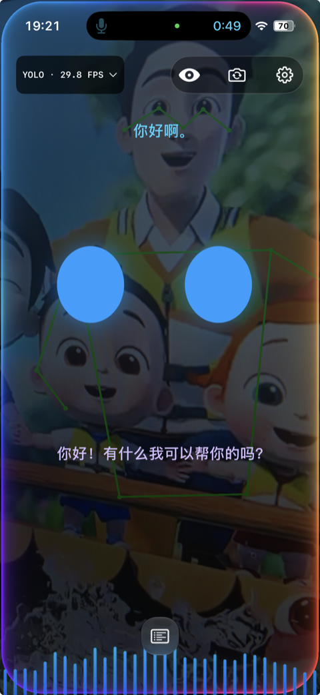</a>
    </td>
    <td align="center" valign="top" width="25%">
      <strong>Multiple windows</strong><br><br>
      <a href="docs/imgs/interactive-multiwindow.png">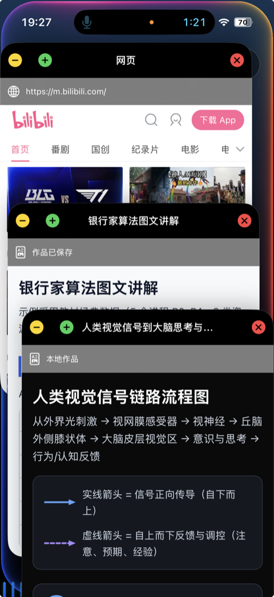</a>
    </td>
    <td align="center" valign="top" width="25%">
      <strong>Voice-controlled windows</strong><br><br>
      <a href="docs/imgs/interactive-minimized-windows.png">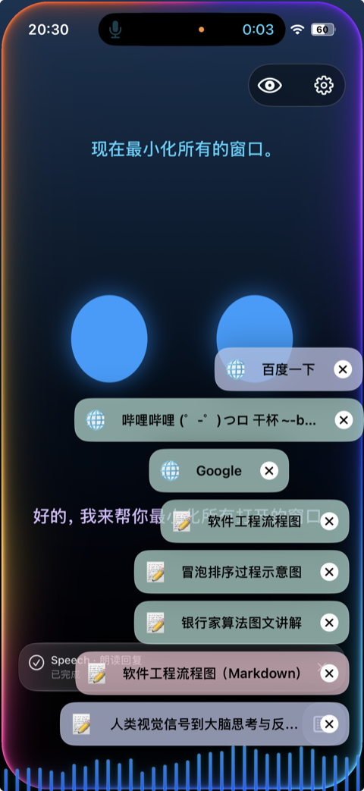</a>
    </td>
    <td align="center" valign="top" width="25%">
      <strong>Web browsing</strong><br><br>
      <a href="docs/imgs/web-browsing.png">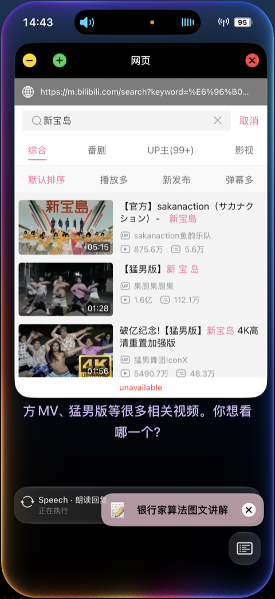</a>
    </td>
  </tr>
  <tr>
    <td align="center" valign="top" width="25%">
      <strong>Photography</strong><br><br>
      <a href="docs/imgs/photography-camera.png">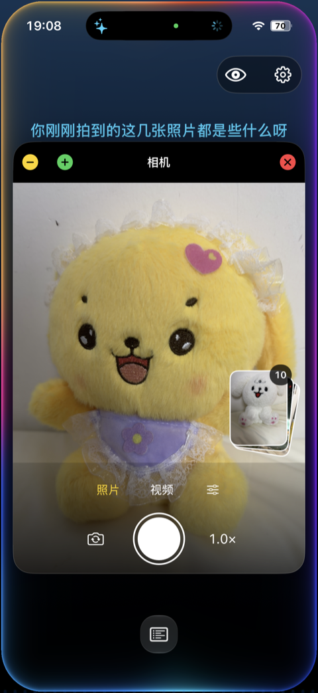</a>
    </td>
    <td align="center" valign="top" width="25%">
      <strong>Photo album</strong><br><br>
      <a href="docs/imgs/photography-album.png">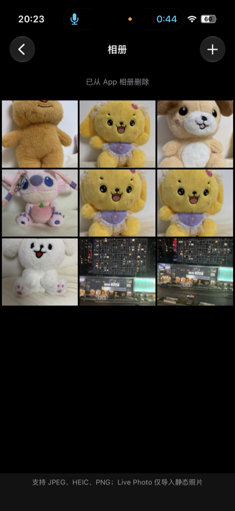</a>
    </td>
    <td align="center" valign="top" width="25%">
      <strong>Illustrated writing</strong><br><br>
      <a href="docs/imgs/writer-illustrated-article.png">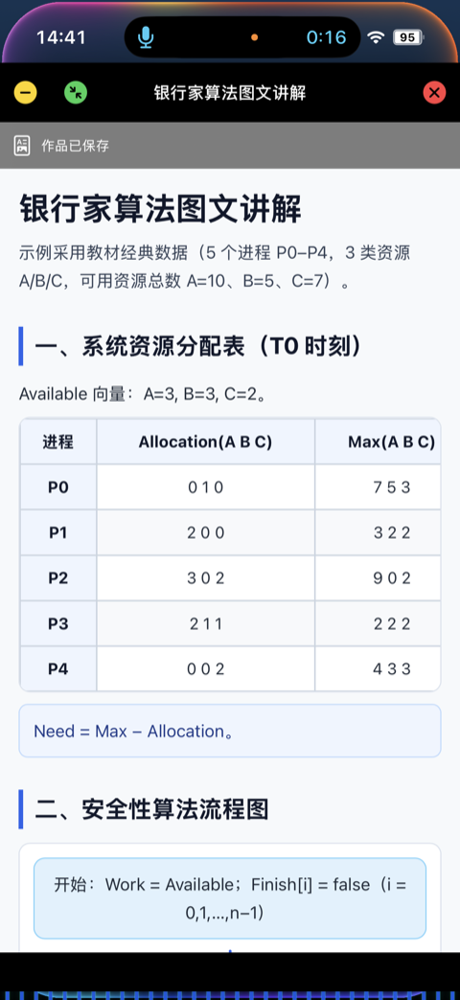</a>
    </td>
    <td align="center" valign="top" width="25%">
      <strong>Visual diagrams</strong><br><br>
      <a href="docs/imgs/writer-visual-flowchart.png">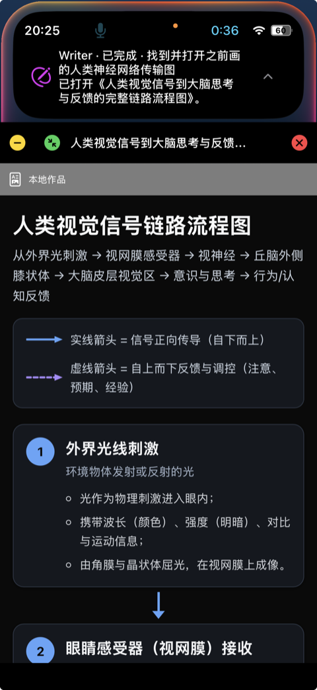</a>
    </td>
  </tr>
  <tr>
    <td align="center" valign="top" width="25%">
      <strong>NexArm control</strong><br><br>
      <a href="docs/imgs/nexarm-control-demo.gif">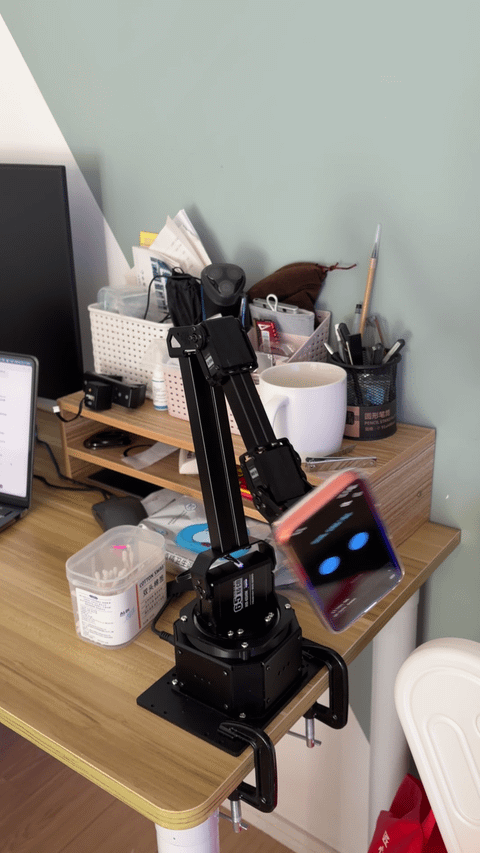</a>
    </td>
    <td align="center" valign="top" width="25%">
      <strong>NexArm motion</strong><br><br>
      <a href="docs/imgs/nexarm-motion-demo.gif">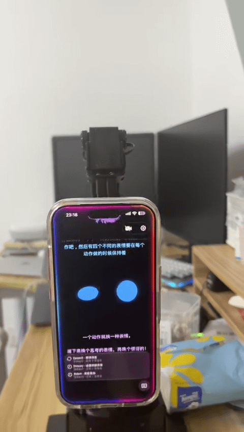</a>
    </td>
  </tr>
</table>

## Planned and Ongoing Work

- **Full-duplex interaction:** Keep listening while the Assistant thinks or speaks, distinguish user interruptions from echo and noise, and hand over to a new utterance without losing its beginning. See [speech interaction plan](docs/requirements/product/Model-Web-Speech-Plan.md).
- **Long-term memory:** Remember user preferences and important experiences, organize diary-style memories, and recall past conversations and creations. See [unified memory](docs/requirements/Unified-Memory-Plan.md).
- **Autonomous photography:** Compose shots, follow subjects and move the camera according to the user's intent, with manual takeover when needed. See [photography plan](docs/requirements/Photographer-Proposal.md).
- **Media understanding and search:** Describe and organize photos and videos, then find relevant images or video moments through natural-language requests. See [album extensions](docs/requirements/product/User-Album-Memory-Plan.md).

## Documentation

| Entry                                                                    | Purpose                                                                        |
| ------------------------------------------------------------------------ | ------------------------------------------------------------------------------ |
| [Documentation index](docs/README.md)                                     | Document categories and ownership.                                             |
| [Pending requirements](docs/requirements/README.md)                       | Unimplemented technical, product and combined requirements.                    |
| [Completed requirements](docs/completed/README.md)                       | Whole requirements archived after their original delivery scope is complete.   |
| [Product scope](docs/Product-Scope.md) / [Concepts](docs/Concepts.md)       | Delivered product scope, biological analogy and architectural vocabulary.      |
| [Public architecture](docs/Architecture.md)                               | Public system explanation and retained architecture context.                   |
| [Technical design](MobileHarness/README.md)                               | Current framework, module boundaries, target map and complete technical flows. |
| [Module READMEs](MobileHarness/README.md#part-ii--module-responsibilities) | Current local interfaces, algorithms, lifecycle, bounds and failure contracts. |
| [Roadmap](docs/Roadmap.md)                                                | Pending work and proposed directions.                                          |
| [Change log](docs/history/Change-Log.md) / [ADRs](docs/adr/README.md)              | Changes, decisions and supersession.                                           |
| [Validation](docs/README.md#experiments-tests-and-acceptance)             | Recorded experiments, tests, native/device observations and measurements.      |

This root README introduces the project and its concepts. Source READMEs define current implementation; docs holds requirements, plans, decisions, history and validation. The [original Word design](docs/Technical_Design.docx) remains preserved.

## Contributing

Issues and pull requests are welcome. Start with [CONTRIBUTING.md](CONTRIBUTING.md), use the issue/PR templates and discuss substantial architecture or dependency changes before implementing them.

Useful contributions include reproducible device reports, focused fixes, tests, documentation and concrete capability integrations. Include the device/toolchain, expected and actual behavior, and sanitized reproduction steps. Keep foundational modules independent, declare effective Agent grants and update owning-module design documents with implementation changes.

## Security and Privacy

The default inference configuration uses on-device speech and local chat; no cloud inference key is required for that mode. Model acquisition and Apple language-asset installation are separate network operations. Explicit cloud chat sends the selected request context, messages and any authorized attached photo content to the configured provider. Microphone processing, synthesis and YOLO pose inference remain local. The cloud adapter requests `store=false`; provider retention remains governed by that provider's policy.

Credentials are retained in device Keychain; preferences, role contexts and captured-photo evidence use device-local storage. Provider drafts/keys are staged privately rather than inserted into model arguments or histories. Microphone, camera, Photos and Bluetooth operations check their actual platform capability/permissions. User consent controls listening; immediate native lifecycle fences do not wait for model decisions.

Do not commit or post credentials, signing settings, model weights, recordings or private media. Follow [SECURITY.md](SECURITY.md) for sensitive reports; the repository has no configured private reporting channel yet. Physical control requires independent hardware protections and cannot rely on iOS background execution.

## License and Acknowledgments

MobileHarness is source-available under the standard [PolyForm Noncommercial License 1.0.0](LICENSE). Noncommercial use, modification and redistribution are permitted under its terms. The license also expressly permits use by specified charitable, educational, public research, public safety or health, environmental protection and government organizations, regardless of funding source or resulting funding obligations. Uses outside the license's permitted purposes require separate authorization from the relevant rights holders; contact the [project owner](https://github.com/devilyouwei) for commercial licensing. This is a source-available license, not an OSI-approved open-source license.

Required Notice: Copyright (c) 2026 devilyouwei (https://github.com/devilyouwei)


MobileHarness builds on Apple frameworks, CoreAI, Gemma 4 E2B, Nemotron, Silero, MOSS-TTS-Nano and Ultralytics YOLO. Kokoro remains an optional adapter/test integration rather than the production default. Dependencies and model artifacts retain their own redistribution conditions; the configured YOLO26 pose artifact declares AGPL-3.0. See [license notices](docs/licenses/README.md) and [resource profiles](MobileHarness/Resources/Models/README.md).
