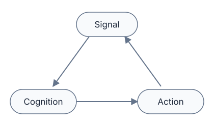

<p align="center">
  
</p>

<h1 align="center">MobileHarness</h1>

<p align="center"><em>Your phone is the best brain for a robot!</em></p>


MobileHarness is an Apple-native, bio-inspired multimodal Agent app that turns your iPhone into a harness for independent, stateful Agents. Built around a **Signal → Cognition → Action** loop, it coordinates the phone's hardware and sensors, such as its camera, microphone and speaker, so Agents can perceive the world, understand users, reason, converse and act. Its current robotic-body integration targets **NexArm**, allowing the phone to serve as the brain of an embodied Agent. The banner illustrates the broader vision of coordinating different kinds of robots.

**In MobileHarness, every input is a _Signal_, and every output is an _Action_.** Human interaction requests, multimodal data from the real world, system events, _inter-Agent_ messages and _Action_ results are all unified as _Signals_. _InputGateway_ delivers these _Signals_ to the _Agents_, which interpret them and decide what _Action_ to take next through direct logic or model reasoning. _OutputGateway_ coordinates execution through the _Actions_ module, and execution results return through _InputGateway_ as new _Signals_, closing the loop.

The **Assistant** owns user conversation and can load bundled **Skills** for photography, history queries and application control. Skills combine callable functions with workflow instructions. One foreground **Task** keeps a goal, context and loaded Skills across turns, including while waiting for the user; actual execution results guide the next decision. Specialized Agents own camera/tracking, history, application transactions and media processing. See the [Agent design](MobileHarness/Agents/README.md) and [Skill catalog](MobileHarness/Resources/Skills/README.md).

The biological inspiration comes from the feedback between perception, cognition and behavior, and from the division of labor across brain regions. Perception informs cognition, while behavior changes what can be perceived next. Each Agent resembles a specialized brain region, with its own context, state and role, cooperating with others while making independent decisions.



**Keywords:** Apple-native · Bio-inspired · Embodied Agent · Multimodal · Multi-Agent · Agent Harness · Mobile Agent

[Quick Start](#quick-start) · [Documentation](docs/README.md) · [Technical Design](MobileHarness/README.md) · [Contributing](CONTRIBUTING.md)

## Quick Start

### Requirements

- A Mac with **Xcode 27+**, matching SDKs and **Swift 6.4+** tooling.
- **Python 3** for optional model provisioning and repository checks.
- An **iOS 27+ physical device** and development signing for the complete application.

The app deployment target is iOS 27; the shared package declares iOS/macOS 26, with CoreAI execution requiring OS 27 and supported hardware. That package floor does not make the full app compatible with older iOS. XcodeGen and CocoaPods are not required.

The current local Gemma iOS graph supports only hardware identifiers `iPhone18,1` and `iPhone18,2`. Other devices require explicitly configured cloud chat for conversation. See [Gemma compatibility](MobileHarness/ModelKit/Language/LLM/Gemma4/README.md#local-gemma-engine).

### 1. Get the project

```sh
git clone https://github.com/devilyouwei/MobileHarness.git
cd MobileHarness
```

Launch Xcode once to complete setup and select the full developer tools:

```sh
sudo xcode-select -s /Applications/Xcode.app/Contents/Developer
```

### 2. Open in Xcode

```sh
open MobileHarness.xcodeproj
```

The complete app's CoreAILM dependency currently requires CoreAI APIs unavailable in the simulator SDK. Use the physical-device **MobileHarness** scheme. Independent UI/shared-package clients can be checked on Mac where their dependencies permit; a separate working full simulator assembly remains outstanding. See [Gemma4](MobileHarness/ModelKit/Language/LLM/Gemma4/README.md) for the platform boundary.

### 3. Configure device signing

```sh
cp Config/Local.xcconfig.example Config/Local.xcconfig
```

Set `DEVELOPMENT_TEAM` and `PRODUCT_BUNDLE_IDENTIFIER` in the ignored local file. Builds bundle the pinned model catalog and notices, not inference weights; no model download is required before building.

### 4. Choose capabilities and run

Select the **MobileHarness** scheme, choose your connected iPhone, then build and run.

- Open Settings → **音频识别 / 语音合成 / 大模型 / 视觉识别** to manage the relevant resources. Custom recognition/synthesis default off; Apple ASR/TTS can run without Nemotron/MOSS weights. Silero/Energy selection is independent of that switch.
- Download compatible **Gemma 4 E2B** for local text conversation, or explicitly configure a provider implementing the **Responses API**. A provider offering only Chat Completions is insufficient. Photo understanding requires an image-capable cloud model; local Gemma does not support images or native Tools. Cloud chat replaces chat only.
- Camera preview starts off. Use the camera controls to open preview and grant permission; install YOLO for pose inference. Voice preparation is independent of camera preview. Saving a captured photo requests add-only Photos permission.
- **Press and hold the companion's eyes for half a second** to enable continuous listening, prepare the selected speech capabilities and request microphone permission. Release after activation; speak, then pause to end the utterance. Partial captions become a final input and spoken reply.
- Press and hold the eyes again to withdraw listening consent and stop microphone capture. Camera controls independently switch lenses or close preview.

Listening pauses during recognition completion and replies, then resumes through the App's native audio completion barriers. The current frontend has no text-entry field. Native/model failures are explicit; active inference never silently switches to another provider.

Model downloads use an explicit official Hugging Face, HF-Mirror or custom HTTPS source; YOLO retains its declared ZIP source. Production revisions remain pinned. Background transfer and resume depend on the OS and server; force-quit does not guarantee continued transfer. See [model resources](MobileHarness/Resources/Models/README.md) and the [Hub adapter](MobileHarness/ModelKit/Support/Management/HuggingFace/README.md) for acquisition, compatibility and recovery details.

For offline development and opt-in Mac/model tests, existing `scripts/download-*.py` wrappers provision ignored local artifacts; Hugging Face wrappers accept `--endpoint`. Gemma Mac tests use a separate decoder profile. For voice experiments and acceptance procedures, see [Voice](docs/Voice.md) and [MOSS validation](docs/Moss-Validation.md).

## Development

```sh
./scripts/check.sh
./scripts/build-ios.sh
```

`check.sh` runs static dependency/ownership checks, Python provisioning tests, strict Swift formatting, shared-package tests and project/privacy/entitlement metadata checks. `build-ios.sh` attempts four unsigned simulator schemes with full Xcode and validates packaged Agent/Skill resources after the app build. The known CoreAI simulator boundary can stop that script before later schemes; invocation alone is not a successful build result. Real-model/native/device trials use their separate opt-in resources and recorded procedures.

[Package.swift](Package.swift) maps the existing source tree into independent targets; tests live in [Tests](Tests/README.md). ModelKit, PlatformKit, Storage and UI are foundational modules; base capability targets have no upper-layer project dependencies, while domain/adaptor targets retain their explicit internal dependencies. AgentCore and FunctionContracts are independent contracts. The complete target map, queue limits, cancellation and completion rules belong to [MobileHarness/README.md](MobileHarness/README.md).

## Documentation

| Entry                                                                    | Purpose                                                                        |
| ------------------------------------------------------------------------ | ------------------------------------------------------------------------------ |
| [Documentation index](docs/README.md)                                     | Document categories and ownership.                                             |
| [Requirements](docs/Requirements.md) / [Concepts](docs/Concepts.md)        | User goals, biological analogy and architectural vocabulary.                   |
| [Public architecture](docs/Architecture.md)                               | Public system explanation and retained architecture context.                   |
| [Technical design](MobileHarness/README.md)                               | Current framework, module boundaries, target map and complete technical flows. |
| [Module READMEs](MobileHarness/README.md#part-ii--module-responsibilities) | Current local interfaces, algorithms, lifecycle, bounds and failure contracts. |
| [Roadmap](docs/Roadmap.md)                                                | Pending work and proposed directions.                                          |
| [Change log](docs/Change-Log.md) / [ADRs](docs/adr/README.md)              | Changes, decisions and supersession.                                           |
| [Validation](docs/README.md#experiments-tests-and-acceptance)             | Recorded experiments, tests, native/device observations and measurements.      |

This root README introduces the project and its concepts. Source READMEs define current implementation; docs holds requirements, plans, decisions, history and validation. The [original Word design](docs/Technical_Design.docx) remains preserved.

## Contributing

Issues and pull requests are welcome. Start with [CONTRIBUTING.md](CONTRIBUTING.md), use the issue/PR templates and discuss substantial architecture or dependency changes before implementing them.

Useful contributions include reproducible device reports, focused fixes, tests, documentation and concrete capability integrations. Include the device/toolchain, expected and actual behavior, and sanitized reproduction steps. Keep foundational modules independent, declare effective Agent grants and update owning-module design documents with implementation changes.

## Security and Privacy

The default inference configuration uses on-device speech and local chat; no cloud inference key is required for that mode. Model acquisition and Apple language-asset installation are separate network operations. Explicit cloud chat sends the selected request context, messages and any authorized attached photo content to the configured provider. Microphone processing, synthesis and YOLO pose inference remain local. The cloud adapter requests `store=false`; provider retention remains governed by that provider's policy.

Credentials are retained in device Keychain; preferences, role contexts and captured-photo evidence use device-local storage. Provider drafts/keys are staged privately rather than inserted into model arguments or histories. Microphone, camera, Photos and Bluetooth operations check their actual platform capability/permissions. User consent controls listening; immediate native lifecycle fences do not wait for model decisions.

Do not commit or post credentials, signing settings, model weights, recordings or private media. Follow [SECURITY.md](SECURITY.md) for sensitive reports; the repository has no configured private reporting channel yet. Physical control requires independent hardware protections and cannot rely on iOS background execution.

## License and Acknowledgments

**A project license has not yet been selected.** There is no root LICENSE granting an open-source license; a license must be chosen before an open-source release.

MobileHarness builds on Apple frameworks, CoreAI, Gemma 4 E2B, Nemotron, Silero, MOSS-TTS-Nano and Ultralytics YOLO. Kokoro remains an optional adapter/test integration rather than the production default. Dependencies and model artifacts retain their own redistribution conditions; the configured YOLO26 pose artifact declares AGPL-3.0. See [license notices](docs/licenses/README.md) and [resource profiles](MobileHarness/Resources/Models/README.md).
