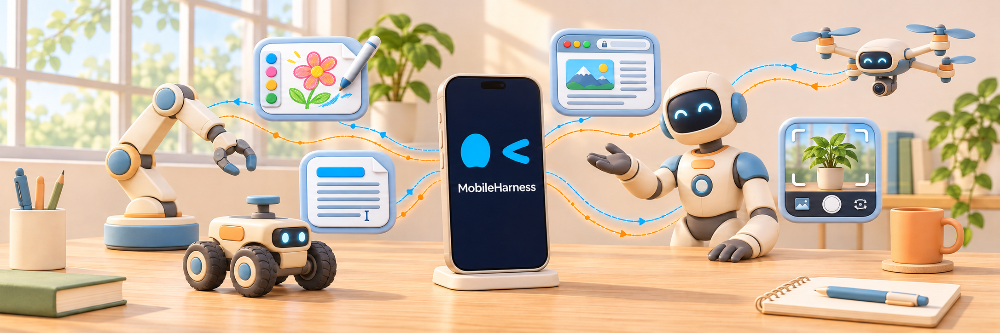

<h1 align="center"> MobileHarness</h1>

<p align="center"><em>The phone is the best gateway to robotics.</em></p>

<p align="center">Apple-native · Bio-inspired · Embodied Agent · Full-duplex · Multimodal · Multi-Agent · Mobile Agent</p>

MobileHarness is a bio-inspired agentic app that makes your smartphone an embodied agent capable of serving as a robot’s brain and controlling its movements. Built around a **Perception → Cognition → Action** agent loop, it coordinates the phone's hardware and sensors, such as its camera, microphone and speaker, so Agents can perceive the world, understand users, reason, converse and act. You can now use **MobileHarness** to connect your iPhone to a **NexArm** robotic arm and control it to carry out grounded tasks.

<p align="center">
  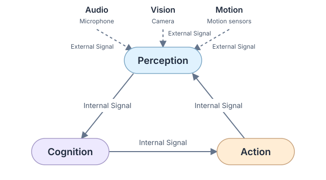
</p>

In MobileHarness, _every input is a Signal; every output is an Action_. Signals carry information through the **Perception → Cognition → Action** loop. External Signals bring observations from the world and user interactions into perceptions. Internal Signals connect the three stages, carrying interpreted information, intent and feedback. **Gateway** is the Signal highway, carrying processed information between Agents. Agents interpret Signals, decide what to do and take Actions; the outcomes return as Signals to close the loop. For humans, interaction is full-duplex: receiving multi-channel Signal input while producing multi-channel Action output. This is the interaction pattern we aim to emulate.

<p align="center">
  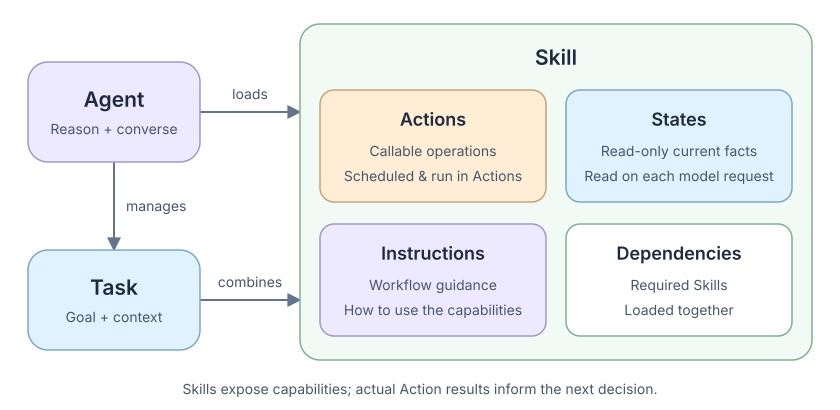
</p>

**Tasks** preserve goals and context across conversation turns, while **Skills** provide the capabilities needed to pursue them. Each Skill declares **Actions** (operations), **States** (current facts), **Instructions** (workflow guidance) and **dependencies** (other Skills). Agents load Skills as needed and use actual results to guide their next decisions.

**States** give Agents a form of **proprioception**: awareness of current capabilities and conditions, such as camera activity or a robotic arm's target and measured position. Selected facts refresh on each model request; the underlying modules retain ownership of live state.

<p align="center">
  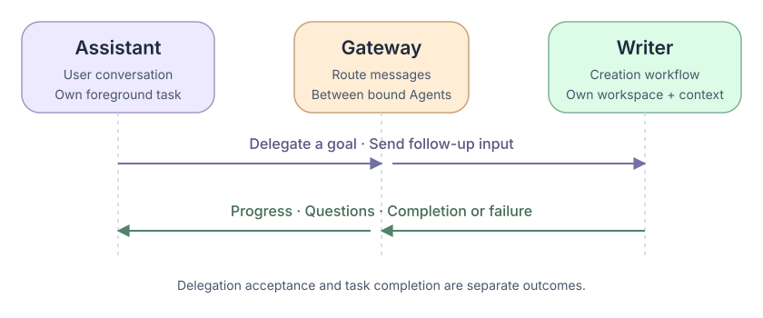
</p>

**Multi-Agent collaboration** lets specialized Agents exchange messages and delegate work through **Gateway**, within their declared communication permissions. For example, **Assistant** can relay a request to write an illustrated article to **Writer**, which decides whether to take it on and owns the creation workflow, context and workspace. Assistant remains available for conversation and can relay follow-ups or a request to stop. Writer reports acceptance, selected milestones, questions and the final outcome. Message delivery, task acceptance and task completion each have their own confirmation.

Biological inspiration runs throughout MobileHarness. **Agents** resemble specialized parts of the human brain, processing observations and **Signals** through capabilities such as speech recognition, visual pose detection and reasoning. **Gateway** provides nervous-system coordination for Agent communication and execution. **UI**, **PlatformKit**, **ModelKit** and **Storage** provide independent presentation, native I/O, inference and storage capabilities; **App** assembles the modules and owns their lifetimes.

[Quick Start](#quick-start) · [Documentation](docs/README.md) · [Technical Design](MobileHarness/README.md) · [Contributing](CONTRIBUTING.md)

## Quick Start

### Requirements

- A Mac with **Xcode 27+**, matching SDKs and **Swift 6.4+** tooling.
- **Python 3** for repository checks, model provisioning and Python experiments; install experiment dependencies for the selected backend separately.
- An **iOS 27+ physical device** and development signing for the complete application.

The app deployment target is iOS 27; the shared package declares iOS/macOS 26, with CoreAI execution requiring OS 27 and supported hardware. That package floor does not make the full app compatible with older iOS. XcodeGen and CocoaPods are not required.

The current local Gemma iOS graph supports only hardware identifiers `iPhone18,1` and `iPhone18,2`. Other devices require explicitly configured cloud chat for conversation. See [Gemma compatibility](MobileHarness/ModelKit/Language/LLM/Gemma4/README.md#local-gemma-engine).

### 1. Get the project

```sh
git clone https://github.com/devilyouwei/MobileHarness.git
cd MobileHarness
```

Launch Xcode once to complete setup and select the full developer tools:

```sh
sudo xcode-select -s /Applications/Xcode.app/Contents/Developer
```

### 2. Open in Xcode

```sh
open MobileHarness.xcodeproj
```

Use the physical-device **MobileHarness** scheme for the complete local-inference configuration. For simulator builds, `./scripts/build-ios.sh` selects **MobileHarnessSimulator** and sets `MOBILEHARNESS_BUILD_VARIANT=simulator` during package resolution to exclude the device-only Gemma backend. Local Gemma chat is unavailable in that variant; conversation requires an explicitly configured cloud provider. See [Gemma4](MobileHarness/ModelKit/Language/LLM/Gemma4/README.md) for the platform boundary.

### 3. Configure device signing

```sh
cp Config/Local.xcconfig.example Config/Local.xcconfig
```

Set `DEVELOPMENT_TEAM` and `PRODUCT_BUNDLE_IDENTIFIER` in the ignored local file. Builds bundle the pinned model catalog and notices, not inference weights; no model download is required before building.

### 4. Choose capabilities and run

Select the **MobileHarness** scheme, choose your connected iPhone, then build and run.

- Open Settings → **AI Models** to manage **Speech Recognition**, **Speech Synthesis**, **Agent Brains** and **Vision Recognition** resources. Custom recognition/synthesis default off; Apple ASR/TTS can run without Nemotron/MOSS weights. Silero/Energy selection is independent of that switch.
- Download compatible **Gemma 4 E2B** for local text conversation, or explicitly configure a provider implementing the **Responses API**. A provider offering only Chat Completions is insufficient. Photo understanding requires an image-capable cloud model; local Gemma does not support images or native Tools. Cloud chat replaces chat only.
- Camera preview starts off. Use the camera controls to open preview and grant permission; install YOLO for pose inference. Voice preparation is independent of camera preview. Saving a captured photo requests add-only Photos permission.
- **Press and hold the companion's eyes for half a second** to enable continuous listening, prepare the selected speech capabilities and request microphone permission. Release after activation; speak, then pause to end the utterance. Partial captions become a final input and spoken reply.
- Press and hold the eyes again to withdraw listening consent and stop microphone capture. Camera controls independently switch lenses or close preview.

On an audio route with active echo cancellation, the Assistant keeps listening while it thinks or speaks. Configure a local D3 or cloud Decision model under **Agent Brains → Decision** to classify interruptions. Other audio routes pause recognition during replies and resume it while listening consent remains active. See [full-duplex interaction](MobileHarness/README.md#assistant-full-duplex-interaction).

The current frontend has no text-entry field. Native and model failures are reported explicitly. An active inference request stays with its selected provider.

Model downloads use an explicit Hugging Face, HF-Mirror or custom HTTPS source; YOLO retains its declared ZIP source. Production revisions remain pinned. Background transfer and resume depend on the OS and server; force-quit does not guarantee continued transfer. See [model resources](MobileHarness/ModelKit/Support/Config/README.md) and the [Hub adapter](MobileHarness/ModelKit/Support/Management/HuggingFace/README.md) for acquisition, compatibility and recovery details.

For local Gemma development, `python3 scripts/models/model_download.py gemma4-e2b --platform macos` provisions `Models/Gemma4`; `--endpoint` selects the download source. Other downloader profiles still use the legacy `MobileHarness/Resources/Models` destination, so check the [script inventory](scripts/README.md) before provisioning. Research and engineering should reuse verified artifacts in root [Models](Models/README.md) through their explicit resource settings. App-managed downloads are separate from this development workspace. See [Voice](docs/validation/Voice.md) and [MOSS validation](docs/validation/Moss-Validation.md) for native acceptance procedures.

## Development

```sh
./scripts/check.sh
./scripts/build-ios.sh
```

Run these commands from the repository root. `check.sh` runs engineering boundary checks, Python tooling regressions, Swift formatting, package tests and project metadata checks. Timing-sensitive runtime tests run in a separate serial phase. `build-ios.sh` builds five unsigned simulator schemes and verifies packaged Agent/Skill, Island and localization resources.

Research runner checks and model evaluations run separately from `check.sh`; use the commands in [experiments](experiments/README.md) and its task directories. For focused module tests, model communication checks and simulator acceptance, use the [Tests guide](Tests/README.md) and [script inventory](scripts/README.md). Report engineering tests, builds and real-model/native/device acceptance separately in [validation reports](docs/validation/README.md).

[Package.swift](Package.swift) maps the existing source tree into independent targets; tests live in [Tests](Tests/README.md). ModelKit, PlatformKit, Storage and UI are foundational modules; base capability targets have no upper-layer project dependencies, while domain/adaptor targets retain their explicit internal dependencies. AgentCore and FunctionContracts are independent contracts. The complete target map, queue limits, cancellation and completion rules belong to [MobileHarness/README.md](MobileHarness/README.md).

## Tests and experiments

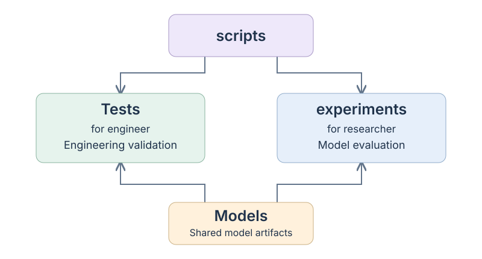

- [scripts/](scripts/README.md): Batch execution for development agents; orchestrates tests and experiments without owning their validation logic.
- [Tests/](Tests/README.md): Swift module and integration tests for engineers, including small model communication checks.
- [experiments/](experiments/README.md): Python model evaluations for researchers, using Apple Core AI / Core ML for local inference; task-owned prompts, scoring, `datasets/` inputs and `results/` raw outputs. Write methods and conclusions in `docs/`.
- [Models/](Models/README.md): Verified artifacts downloaded from Hugging Face or other URLs, stored once per model and reused by both sides. Keep weights out of Git.

Tests and experiments share only model artifacts, never code, configuration, datasets or results. See [AGENTS.md](AGENTS.md#9-agent-validation-workflow-and-directory-ownership) for development rules.

## Features

**Everyday interaction** — Have multi-turn voice conversations with the Assistant, with live captions, spoken replies and expressive eyes and gaze.

**Full-duplex voice interaction** — On supported audio routes, speak while the Assistant is thinking or replying. The configured Decision model can queue a follow-up or confirm an interruption. [Technical design](MobileHarness/README.md#assistant-full-duplex-interaction)

**Interactive UI** — Interact with generated pages, charts and small tools, manage content windows, and follow task progress in the in-app Island.

**NexArm robotic-arm control** — Control a **NexArm** by voice, move individual joints, perform gestures such as nodding and waving, and aim using visual pose tracking.

**Intelligent photography and album** — Take photos and videos by voice or on-screen controls, adjust countdown, flash and zoom, and use NexArm for pose-driven aiming. Browse, replay, export and delete saved photos and videos in the app album.

**Writer text and visual authoring** — Create articles, illustrated layouts, diagrams and interactive content. Preview results as they develop, refine them through conversation, and reopen or export saved work.

**Web browsing** — Ask the Assistant to open and read web pages, inspect page content and navigate in an in-app browser.

## Examples

<table width="100%">
  <tr>
    <td align="center" valign="top" width="25%">
      <strong>Start listening</strong><br><br>
      <a href="imgs/start-listening-demo.gif">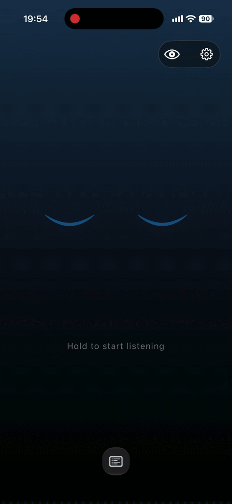</a>
    </td>
    <td align="center" valign="top" width="25%">
      <strong>Everyday interaction</strong><br><br>
      <a href="imgs/everyday-voice-interaction.png">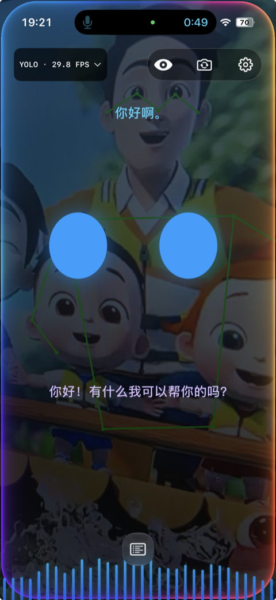</a>
    </td>
    <td align="center" valign="top" width="25%">
      <strong>Multiple windows</strong><br><br>
      <a href="imgs/interactive-multiwindow.png">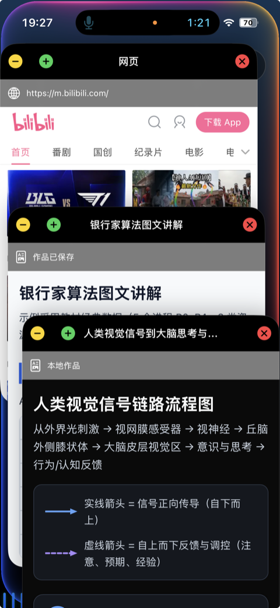</a>
    </td>
    <td align="center" valign="top" width="25%">
      <strong>Window control</strong><br><br>
      <a href="imgs/interactive-minimized-windows.png">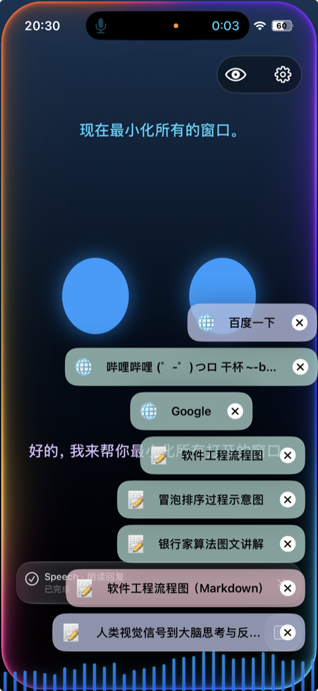</a>
    </td>
  </tr>
  <tr>
    <td align="center" valign="top" width="25%">
      <strong>Web browsing</strong><br><br>
      <a href="imgs/web-browsing.png">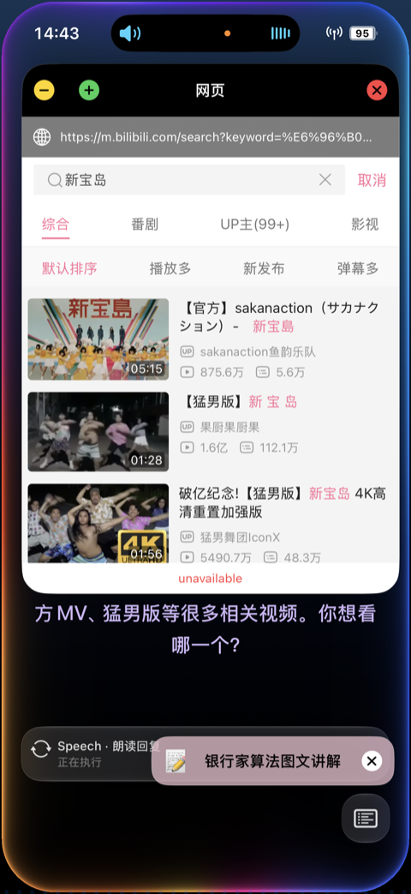</a>
    </td>
    <td align="center" valign="top" width="25%">
      <strong>Photography</strong><br><br>
      <a href="imgs/photography-camera.png">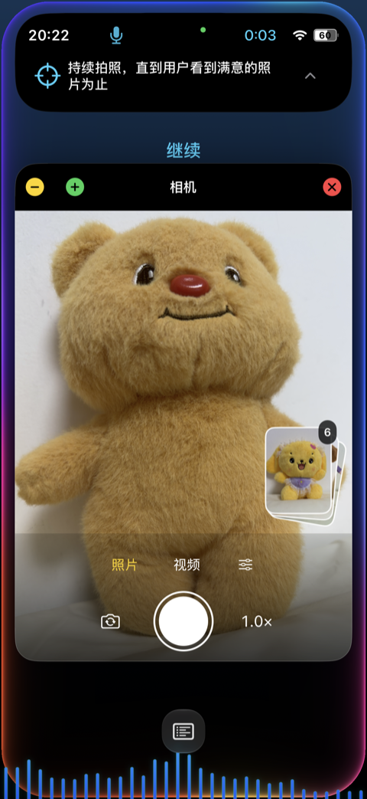</a>
    </td>
    <td align="center" valign="top" width="25%">
      <strong>Photo album</strong><br><br>
      <a href="imgs/photography-album.png">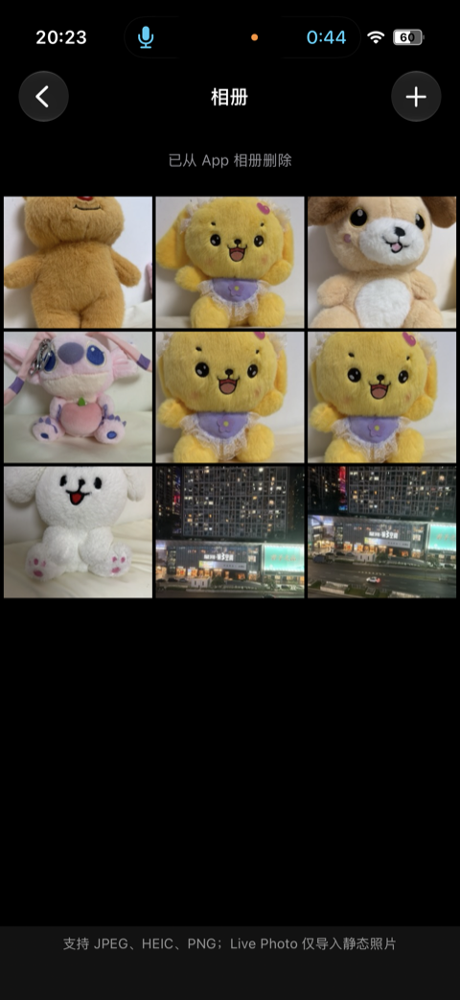</a>
    </td>
    <td align="center" valign="top" width="25%">
      <strong>Illustrated writing</strong><br><br>
      <a href="imgs/writer-illustrated-article.png">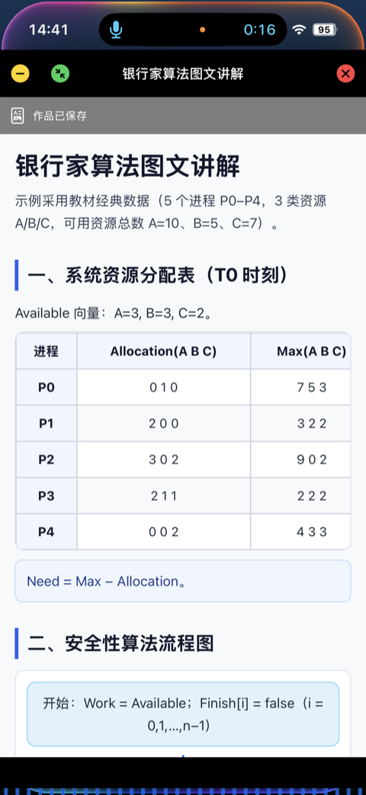</a>
    </td>
  </tr>
  <tr>
    <td align="center" valign="top" width="25%">
      <strong>Visual diagrams</strong><br><br>
      <a href="imgs/writer-visual-flowchart.png">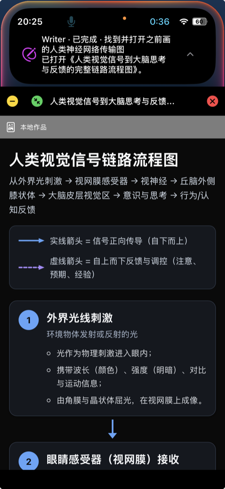</a>
    </td>
    <td align="center" valign="top" width="25%">
      <strong>Drawing in progress</strong><br><br>
      <a href="imgs/writer-drawing-demo.gif">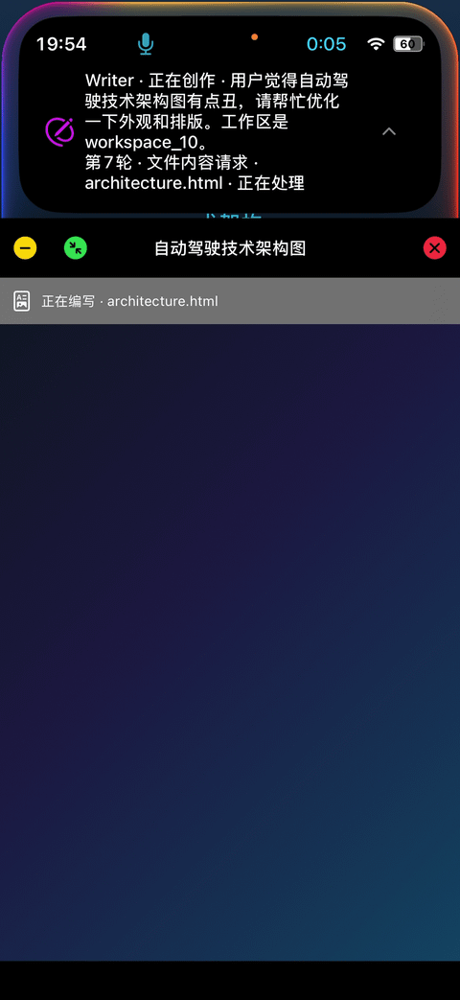</a>
    </td>
    <td align="center" valign="top" width="25%">
      <strong>NexArm control</strong><br><br>
      <a href="imgs/nexarm-control-demo.gif">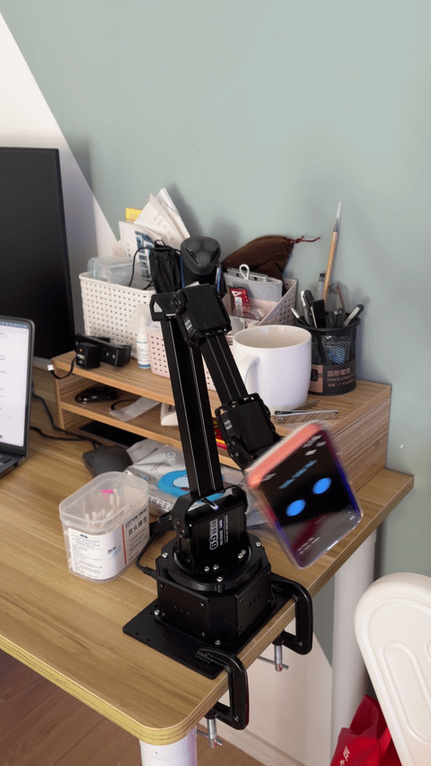</a>
    </td>
    <td align="center" valign="top" width="25%">
      <strong>NexArm motion</strong><br><br>
      <a href="imgs/nexarm-motion-demo.gif">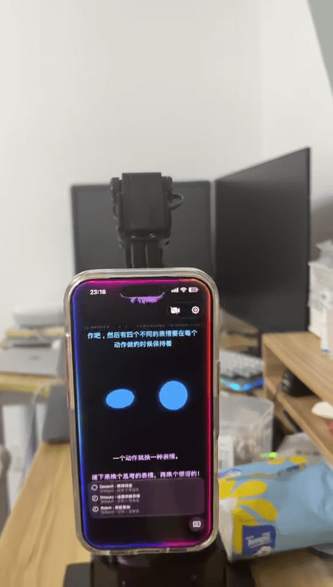</a>
    </td>
  </tr>
</table>

## Planned and Ongoing Work

- **Long-term memory:** Remember user preferences and important experiences, organize diary-style memories, and recall past conversations and creations. See [unified memory](docs/requirements/Unified-Memory-Plan.md).
- **Autonomous photography:** Compose shots, follow subjects and move the camera according to the user's intent, with manual takeover when needed. See [photography plan](docs/requirements/Photographer-Proposal.md).
- **Media understanding and search:** Describe and organize photos and videos, then find relevant images or video moments through natural-language requests. See [album extensions](docs/requirements/product/User-Album-Memory-Plan.md).

## Documentation

| Entry                                                                      | Purpose                                                                        |
| -------------------------------------------------------------------------- | ------------------------------------------------------------------------------ |
| [Documentation index](docs/README.md)                                      | Document categories and ownership.                                             |
| [Pending requirements](docs/requirements/README.md)                        | Unimplemented technical, product and combined requirements.                    |
| [Completed requirements](docs/completed/README.md)                         | Whole requirements archived after their original delivery scope is complete.   |
| [Product scope](docs/Product-Scope.md) / [Concepts](docs/Concepts.md)      | Delivered product scope, biological analogy and architectural vocabulary.      |
| [Public architecture](docs/Architecture.md)                                | Public system explanation and retained architecture context.                   |
| [Technical design](MobileHarness/README.md)                                | Current framework, module boundaries, target map and complete technical flows. |
| [Module READMEs](MobileHarness/README.md#part-ii--module-design) | Current local interfaces, algorithms, lifecycle, bounds and failure contracts. |
| [Roadmap](docs/Roadmap.md)                                                 | Pending work and proposed directions.                                          |
| [Change log](docs/history/Change-Log.md) / [ADRs](docs/adr/README.md)      | Changes, decisions and supersession.                                           |
| [Validation](docs/README.md#experiments-tests-and-acceptance)              | Recorded experiments, tests, native/device observations and measurements.      |

This root README introduces the project and its concepts. Source READMEs define current implementation; docs holds requirements, plans, decisions, history and validation. The [original Word design](docs/Technical_Design.docx) remains preserved.

## Contributing

Issues and pull requests are welcome. See [CONTRIBUTING.md](CONTRIBUTING.md) for contribution guidelines and [AGENTS.md](AGENTS.md) for development rules.

## Security and Privacy

See [SECURITY.md](SECURITY.md) for data handling, platform permissions and sensitive-report guidance. Never include credentials or private user data in public reports.

## License and Acknowledgments

MobileHarness is source-available under [PolyForm Noncommercial 1.0.0](LICENSE). See [licensing details and third-party notices](docs/licenses/README.md) for usage terms and acknowledgments.

Required Notice: Copyright (c) 2026 devilyouwei (https://github.com/devilyouwei)
