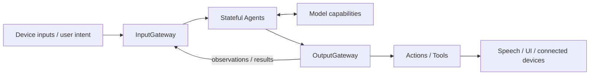

<p align="center">
  
</p>

<h1 align="center">MobileHarness</h1>

<p align="center"><em>An Apple-native, bio-inspired Agent harness.</em></p>

MobileHarness uses an iPhone as a host for stateful Agents, shared model capabilities and connected-device behavior. Its organizing loop is **Signal → Cognition → Action**: perceive input, interpret it and produce observable effects.

[Quick Start](#quick-start) · [Documentation](docs/README.md) · [Technical Design](MobileHarness/README.md) · [Roadmap](docs/Roadmap.md) · [Contributing](CONTRIBUTING.md)

## Current capabilities

| Area | Implementation |
| --- | --- |
| Voice | Nemotron recognition, Silero VAD and MOSS-TTS-Nano synthesis with progressive captions. |
| Chat | Local Gemma 4 E2B CoreAI or explicitly configured OpenAI-compatible cloud chat. |
| Camera | Foreground preview, lens switching and YOLO26n-Pose perception. |
| Presentation | Recognition/reply captions, expressions/gaze, spectrum and pose overlay. |
| Robot | Foreground NexArm discovery/connection, manual controls and permitted Agent-selected movement. |
| History/settings | Device-local configuration/credentials and persistent current/archived conversations. |
| Runtime | Independent stateful Agents, validated communication, scheduled Actions and direct Tools. |



App owns composition and application/session lifetime. Read-only History.list/read Tools expose bounded local conversation previews to configured cloud chat; history load/refresh now crosses both Gateways through a deterministic ConversationMemory Agent. Remaining UI intents and model continuation are planned. ModelKit supplies processing, PlatformKit supplies device I/O, and UI receives state and typed operations. The [public architecture](docs/Architecture.md) and [concepts](docs/Concepts.md) explain these roles; the [technical design](MobileHarness/README.md) provides dependency maps and full technical flows.

General fast/slow orchestration, automatic compute escalation and unattended/background robot control are not implemented. Evidence for quality/performance is recorded separately in [validation documents](docs/README.md#experiments-tests-and-acceptance).

## Quick Start

### Requirements

- A Mac with **Xcode 27+**, its matching SDKs, and **Swift 6.4+** tooling.
- **Python 3** for model provisioning and repository checks.
- For the full experience, an **iOS 27+ physical device**, local model downloads and development signing.

The app targets iOS 27+. The shared package has an iOS/macOS 26 dependency floor; CoreAI operations require OS 27; that does not make the full app compatible with older iOS releases. XcodeGen and CocoaPods are not required.

### 1. Get the project

```sh
git clone https://github.com/devilyouwei/MobileHarness.git
cd MobileHarness
```

Launch Xcode once to complete setup, install the iOS Simulator runtime, and select the full developer tools:

```sh
sudo xcode-select -s /Applications/Xcode.app/Contents/Developer
```

### 2. Open in Xcode

```sh
open MobileHarness.xcodeproj
```

The current CoreAILM dependency cannot compile against the iOS simulator SDK because that SDK does not expose CoreAI. Use the physical-device MobileHarness scheme for the complete app; independent UI and shared package tests remain available on Mac. A separate simulator assembly is outstanding.

For the full physical-device application, continue below.

### 3. Configure device signing and models

```sh
cp Config/Local.xcconfig.example Config/Local.xcconfig
```

Set your `DEVELOPMENT_TEAM` and `PRODUCT_BUNDLE_IDENTIFIER` in `Config/Local.xcconfig`. This file is ignored by Git.

Model weights are downloaded on the device through **Settings → 本地模型资源**. App builds bundle the pinned catalog and license notices only, so no model downloads are required before building. Choose the Hugging Face official source, the third-party HF-Mirror source, or paste a custom HTTPS download domain; production graph source revisions remain pinned. HF file resolution/metadata is handled by the SDK; only the independent YOLO ZIP has a bundled archive SHA-256. HF tasks survive page navigation but restart after process relaunch. GitHub-hosted YOLO uses its original download source.

For offline development and opt-in Mac/model tests, the existing `scripts/download-*.py` wrappers still provision ignored local files, with `--endpoint` for Hugging Face downloads. See [model resources](MobileHarness/Resources/Models/README.md) for shared production declarations, the separate Gemma Mac test profile, compatibility and notices.

### 4. Run on an iPhone

Select the **MobileHarness** scheme, choose your connected device, and build and run.

- Grant camera permission for preview and pose perception; the camera runs independently of voice readiness.
- Open Settings → 音频识别 / 语音合成 / 大模型 / 视觉识别 to manage Nemotron, Silero, MOSS, Gemma 4 E2B and YOLO respectively. Nemotron and MOSS are optional custom speech providers; Silero is automatically used when installed and available, otherwise Energy. Apple ASR/TTS work without those custom weights. Settings/history and camera preview remain accessible without these resources.
- Tap the central control to load/warm voice models and grant microphone permission.
- Speak, then pause to finish your utterance. Recognition previews become a reply with speech and captions.
- Tap again to stop recording and playback. Camera controls switch the lens or turn the preview off.

Listening pauses while final recognition and the reply complete, then resumes. The current UI has no text-entry field. Missing or incompatible models produce an error; the app does not silently switch to another provider.

For diagnostic and acceptance steps, see [Voice](docs/Voice.md) and [MOSS validation](docs/Moss-Validation.md).

## Development

```sh
./scripts/check.sh
./scripts/build-ios.sh
```

Repository checks cover dependency boundaries, provisioning, formatting, tests and metadata. The build script compiles four unsigned simulator schemes with full Xcode. Real-model and physical-device trials use their documented opt-in resources and procedures.

Root Package.swift maps the shared source tree into independent targets; tests live under root Tests/. ModelKit and PlatformKit own their capability data contracts and have no project dependencies; callers adapt their inputs and outputs explicitly. Module READMEs own implementation contracts, while the [technical design](MobileHarness/README.md) owns cross-module architecture and flows.

## Documentation

| Entry | Purpose |
| --- | --- |
| [Documentation index](docs/README.md) | All document categories and their ownership. |
| [Requirements](docs/Requirements.md) / [Concepts](docs/Concepts.md) | User goals and architectural vocabulary. |
| [Public architecture](docs/Architecture.md) | Current system collaboration for external readers. |
| [Technical design](MobileHarness/README.md) | Directory/target design and complete technical flows. |
| [Roadmap](docs/Roadmap.md) | Current pending work and proposed directions. |
| [Change log](docs/Change-Log.md) / [ADRs](docs/adr/README.md) | Changes and decision rationale. |
| [Validation](docs/README.md#experiments-tests-and-acceptance) | Reproducible experiments, reports and measurements. |

## Contributing

Issues and pull requests are welcome. Start with [CONTRIBUTING.md](CONTRIBUTING.md), use the repository's issue/PR templates, and discuss substantial architecture or dependency changes before implementing them.

Good contributions include reproducible device reports, focused fixes, test coverage, documentation and capability integrations. Include the device/toolchain, expected and actual behavior, and sanitized reproduction steps. Keep AgentCore independent, declare Agent capabilities in JSON, and update owning-module documentation with implementation changes.

## Security and Privacy

The default configuration processes voice and camera inputs on-device and requires no cloud inference API key. Enabling cloud chat in Settings sends chat requests, including the selected conversation context, to the configured provider; speech recognition, synthesis and camera perception remain local. Credentials are stored in the device Keychain, while settings and conversation history use local documents. Settings downloads model artifacts separately from runtime inference, with explicit source selection and integrity verification. Microphone and camera access require platform permission.

Do not commit or post credentials, signing settings, model weights, user recordings or other private media. Consult [SECURITY.md](SECURITY.md) before reporting sensitive issues; a private reporting channel has not yet been configured. Physical-device control requires independent hardware protections and must not rely on iOS background execution.

## License and Acknowledgments

**A project license has not yet been selected.** This repository currently contains no root LICENSE granting an open-source license; the maintainer must choose one before an open-source release.

MobileHarness builds on the work behind Apple frameworks, CoreAI, Gemma 4 E2B, Nemotron, Silero, MOSS-TTS-Nano, Kokoro and Ultralytics YOLO. Dependencies and model artifacts retain their own licenses and redistribution conditions. The configured YOLO26 pose artifact declares AGPL-3.0; model notices are documented with the [resource profiles](MobileHarness/Resources/Models/README.md).

Camera control Tools are registered as Camera.open, Camera.close and Camera.flip through the existing App-owned foreground camera lifecycle. Provider-native model Tool event transport remains unimplemented.

✅ Photographer subscribes to shared pose observations and sends completion-only five-axis BLE aim through Robot.aim. Physical tracking acceptance remains pending.

✅ Local-resource refinement: compact schema-v2 repository/selection declarations replace per-file links/hashes. ModelKitHub wraps swift-huggingface 0.9.0 outside Management; App injects it. Storage-backed receipts record actual installed files/sizes. ✅ Native iOS background transfers persist file plans, generations and available resume data across relaunch. ❌ Real iPhone background/server-resume acceptance remains pending. See [ADR0105](docs/adr/0105-local-model-resource-management.md).

✅ Hub download regression coverage checks regular-file selection, safe remote metadata and optional actual-network progress through the production adapter. Downloads use selected per-file Hub APIs without a permanent SDK cache. ❌ Real iPhone download UI acceptance remains separate.


✅ Speech can run without HF voice-model downloads through Apple ASR/TTS and energy detection. Settings can force this mode without deleting weights; local Gemma 4 E2B or configured cloud chat is still needed for conversation. Apple ASR may need a first-use system language-asset download.


✅ Model settings are grouped by use: 音频识别 (Nemotron+Silero), 语音合成 (MOSS), 大模型 (cloud service and Gemma 4 E2B), 视觉识别 (YOLO). Custom speech switches are independent and require only the respective ASR/TTS installation. Apple ASR uses native internal VAD; Silero is selected automatically when installed and available, otherwise Energy supplies silence scores; this is independent of the ASR switch.

Sound direction: supported built-in microphone routes can provide FOA for SpeechPerception's dominant-direction calculation and sound.source broadcast. Unsupported or failed spatial startup is closed before mono retry; mono routes preserve speech recognition and report direction unavailable. Listening requires an actual validated PCM frame, and capture failures leave the listening presentation. Synthetic tests and builds do not establish physical angle accuracy; no consumer or presentation is connected yet.

✅ Settings → 音频识别 provides an explicit 10-second audio detection section with actual microphone/input mode, spatial support/fallback, level and current sound direction. The session reuses SpeechPerception/Gateway without starting conversation or robot consumers. See [ADR0128](docs/adr/0128-settings-audio-detection.md). ❌ Physical capture/coordinates remain unverified by synthetic tests.
