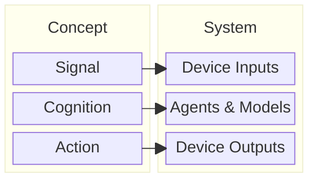
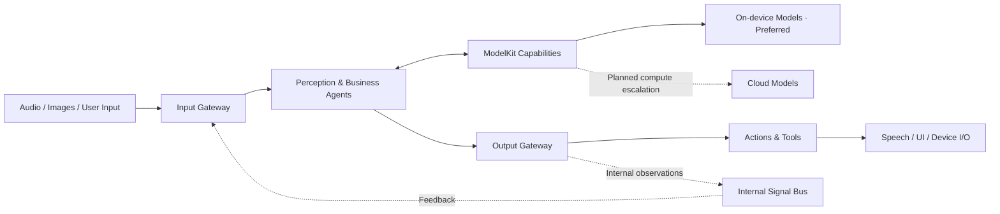

# MobileHarness

*The first bio-inspired Agent Harness.*

Apple-Native · Multi-Modal · Multi-Agent · Embodied Intelligence · Robotics · Biomimetics

MobileHarness aims to build a bio-inspired multi-agent system with an iPhone (iOS 27) as its central host. Agents and models process information from the phone and external devices, make decisions together and turn these decisions into actions, such as updating the UI, playing sound through the speaker and controlling external robots.



[Quick Start](#quick-start) · [Technical Design](MobileHarness/README.md) · [Roadmap](docs/Roadmap.md) · [Contributing](CONTRIBUTING.md)

## The Idea

**Signal → Cognition → Action**

MobileHarness takes inspiration from how human intelligence connects perception, cognition and action:

- **Functional specialization.** Like different functional regions of the brain, specialized agents cooperate, using models to interpret information and make decisions.
- **Sensory integration.** Perception agents turn different kinds of input, such as audio and images, into observations that other agents can bring together to understand a situation.
- **Signal communication.** Inspired by communication in the nervous system, external inputs and messages between agents share a common Signal format while retaining their distinct types and context.
- **Embodied action.** Decisions become outward behavior through the phone and connected devices. Displaying text, speaking and moving a robot are all forms of action.
- **Feedback loops.** Actions affect the environment; their effects can be sensed again, informing the next decision and continuing the loop.

## What Makes It Different

- **Continuous, stateful agents.** Independent Swift actors own their input queues, sessions and domain state.
- **Shared multimodal perception.** SpeechPerception and VisionPerception process inputs once and publish typed observations for other agents.
- **Explicit communication.** Static subscriptions and directed delivery cross validated gateways, with bounded internal transport and per-recipient admission results.
- **Streaming behavior.** Function Tokens combine natural text with registered Action tags; agents resolve capabilities before anything executes.
- **Coordinated execution.** Actions use ordered Channels; Tools execute directly with explicit result or completion semantics.
- **Apple-native capabilities.** ModelKit handles model processing, PlatformKit handles device I/O, and SwiftUI presents the experience.
- **Apple silicon acceleration.** Designed to make effective use of the CPU, GPU and Apple Neural Engine (ANE) through Core ML, CoreAI and MLX, with backend and compute choices suited to each model and workload.
- **Edge-first, device–cloud collaboration.** Keep responsive processing on the device and request cloud compute for demanding tasks; the architecture is designed to combine both.
- **Fast and slow cognition.** Combine a responsive perception/action loop with deliberative reasoning and planning, using complementary models rather than one model for every task.

## What Works Today

| Area | Current implementation |
| --- | --- |
| Voice input | Nemotron streaming ASR and Silero VAD, shared through SpeechPerception |
| Conversation | Qwen3.5-2B through MLX, with bounded conversation history and streaming output |
| Speech and captions | Apple system TTS, sequential playback and progressive reply captions |
| Camera | Foreground preview, front/back switching and local YOLO26n-Pose perception |
| Presentation | Recognition captions, semantic eye expressions, audio spectrum and skeleton overlay |
| Agent runtime | JSON v4 capability declarations, static subscriptions, directed events and session isolation |
| Execution | Function Token parsing, Channel scheduling, Action/Tool validation and cancellation |

The current backend integrations include **Core ML** for Silero VAD and YOLO pose, **CoreAI** for Nemotron ASR and Kokoro diagnostics, and **MLX** for Qwen generation. Silero uses CPU execution; pose defaults to CPU + ANE eligibility; the MLX path uses GPU execution. Actual hardware placement depends on the model, runtime and device—enabling ANE does not mean every operation runs on it. General cross-model CPU/GPU/ANE scheduling remains future work. See [ModelKit Backends](MobileHarness/ModelKit/Backends/README.md).

✅ These paths are implemented, with module and integration tests. Build success does not establish device accuracy, latency or sustained stability.

❌ Cloud inference, fast/slow model orchestration, robot/device control, Photographer motion policy, dynamic subscriptions, general request/reply, persistent messaging and Channel takeover are not implemented. The simulator supports UI development; it does not provide the physical-device model pipeline.

## Architecture at a Glance



External inputs enter InputGateway directly. Internal Agent events use the Bus before returning through InputGateway. ModelKit supplies processing capabilities; PlatformKit acquires device data and performs device output. App assembles these services, and agents receive capability interfaces rather than concrete model engines.

See the [Technical Design](MobileHarness/README.md) for the layered architecture, module responsibilities, communication framework and execution protocols.

## Quick Start

### Requirements

- A Mac with **Xcode 27+**, its matching SDKs, and **Swift 6.4+** tooling.
- The Xcode **Metal Toolchain** for MLX compilation.
- **Python 3** for model provisioning and repository checks.
- For the full experience, an **iOS 27+ physical device compatible with the configured h18p model artifacts**, local model downloads and development signing.

The app targets iOS 27+. Shared package targets have lower base deployment versions; that does not make the full app compatible with older iOS releases. XcodeGen and CocoaPods are not required.

### 1. Get the project

```sh
git clone https://github.com/devilyouwei/MobileHarness.git
cd MobileHarness
```

Launch Xcode once to complete setup, install the iOS Simulator runtime, and select the full developer tools:

```sh
sudo xcode-select -s /Applications/Xcode.app/Contents/Developer
xcodebuild -downloadComponent MetalToolchain
```

### 2. Open in Xcode

```sh
open MobileHarness.xcodeproj
```

For UI development, select **MobileHarnessSimulator** and run on an iOS simulator. This target bundles no model weights and reports ASR/chat as unavailable. It is useful for interface work, not end-to-end voice or camera-model validation. Explicit Debug previews use simulated state.

For the full physical-device application, continue below.

### 3. Configure device signing and models

```sh
cp Config/Local.xcconfig.example Config/Local.xcconfig
```

Set your `DEVELOPMENT_TEAM` and `PRODUCT_BUNDLE_IDENTIFIER` in `Config/Local.xcconfig`. This file is ignored by Git.

Download the artifacts required by the current device resource staging:

```sh
python3 scripts/download-nemotron.py
python3 scripts/download-silero.py
python3 scripts/download-qwen35.py
python3 scripts/download-yolo26-pose.py
python3 scripts/download-kokoro.py
```

Downloads are several gigabytes. Nemotron defaults to the iOS export; Qwen defaults to the 2B model. Kokoro is included for standalone TTS diagnostics; normal conversation uses Apple system TTS. Model weights remain local and are not committed. See [model resources](MobileHarness/Resources/Models/README.md) for profiles, platform variants and redistribution notices.

### 4. Run on an iPhone

Select the **MobileHarness** scheme, choose your connected device, and build and run.

- Grant camera permission for preview and pose perception; the camera runs independently of voice readiness.
- Wait for voice models to load and warm up, then tap the central control and grant microphone permission.
- Speak, then pause to finish your utterance. Recognition previews become a reply with speech and captions.
- Tap again to stop recording and playback. Camera controls switch the lens or turn the preview off.

Listening pauses while final recognition and the reply complete, then resumes. The current UI has no text-entry field. Missing or incompatible models produce an error; the app does not silently switch to another provider.

For device acceptance and troubleshooting context, see [Voice Validation](docs/Voice.md) and [Kokoro Diagnostics](docs/Kokoro-Validation.md).

## Development

Run the repository checks from its root:

```sh
./scripts/check.sh
./scripts/build-ios.sh
```

`check.sh` checks module boundaries, provisioning tests, Swift formatting, Swift tests and project metadata. `build-ios.sh` builds four unsigned simulator schemes and requires full Xcode. Optional real-model evaluations require their documented local artifacts and opt-in settings.

Shared sources are mapped into independently tested targets by root `Package.swift`; tests live in root `Tests/`. SwiftUI state is MainActor-isolated and runtime state is actor-owned. Every queue must document its bound and overflow policy.

Input routing uses explicit `publish` (configured subscriptions) or `send` (named target); there is no default-Agent router. See [ADR 0047](docs/adr/0047-explicit-input-routing.md).

## Documentation

| Start here | Purpose |
| --- | --- |
| [Technical Design](MobileHarness/README.md) | Architecture, directory responsibilities and key techniques |
| [Current Architecture](docs/Architecture.md) | Current implementation scope and runtime boundaries |
| [Repository Structure](docs/Repository-Structure.md) | Source/target mapping and migration exceptions |
| [Agents](MobileHarness/Agents/README.md) | Agent authoring, JSON declarations and input/output conventions |
| [ModelKit](MobileHarness/ModelKit/README.md) | Capability interfaces, providers and model lifecycle |
| [PlatformKit](MobileHarness/PlatformKit/README.md) | Device I/O, permissions and platform boundaries |
| [Architecture Decisions](docs/adr/README.md) | Design rationale and contract changes |
| [Roadmap](docs/Roadmap.md) | Implementation stages and outstanding acceptance work |

Detailed algorithms and limits live in each module's README. The original `docs/Technical_Design.docx` is preserved as a historical design source.

## Roadmap

Planned work includes cloud capability adapters and task routing for compute-intensive requests, coordination between fast and slow model loops, sustained iPhone voice/camera validation, runtime supervision and request/reply, additional perception capabilities, and embodied behavior with explicit device-side protection. These are planned areas, not delivery-date commitments; see the [Roadmap](docs/Roadmap.md) for scope and status.

## Contributing

Issues and pull requests are welcome. Start with [CONTRIBUTING.md](CONTRIBUTING.md), use the repository's issue/PR templates, and discuss substantial architecture or dependency changes before implementing them.

Good contributions include reproducible device reports, focused fixes, test coverage, documentation and capability integrations. Include the device/toolchain, expected and actual behavior, and sanitized reproduction steps. Keep AgentCore independent, declare Agent capabilities in JSON, and update owning-module documentation with implementation changes.

## Security and Privacy

The current implementation processes voice and camera inputs on-device and requires no cloud inference API key. This is the current deployment, not a local-only architectural constraint. Future cloud requests will require explicit data-transfer and credential policies. Model provisioning downloads artifacts separately from runtime inference. Microphone and camera access require platform permission.

Do not commit or post credentials, signing settings, model weights, user recordings or other private media. Consult [SECURITY.md](SECURITY.md) before reporting sensitive issues; a private reporting channel has not yet been configured. Future physical-device control requires independent hardware protections and must not rely on iOS background execution.

## License and Acknowledgments

**A project license has not yet been selected.** This repository currently contains no root LICENSE granting an open-source license; the maintainer must choose one before an open-source release.

MobileHarness builds on the work behind Apple frameworks, MLX, Qwen, Nemotron, Silero, Kokoro and Ultralytics YOLO. Dependencies and model artifacts retain their own licenses and redistribution conditions. The configured YOLO26 pose artifact declares AGPL-3.0; model notices are documented with the [resource profiles](MobileHarness/Resources/Models/README.md).
