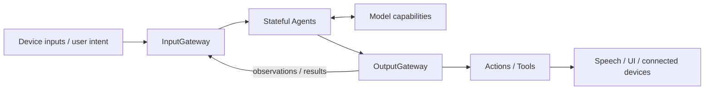

# MobileHarness

*An Apple-native, bio-inspired Agent harness.*

MobileHarness uses an iPhone as a host for stateful Agents, shared model capabilities and connected-device behavior. Its organizing loop is **Signal → Cognition → Action**: perceive input, interpret it and produce observable effects.

[Quick Start](#quick-start) · [Documentation](docs/README.md) · [Technical Design](MobileHarness/README.md) · [Roadmap](docs/Roadmap.md) · [Contributing](CONTRIBUTING.md)

## Current capabilities

| Area | Implementation |
| --- | --- |
| Voice | Nemotron recognition, Silero VAD and MOSS-TTS-Nano synthesis with progressive captions. |
| Chat | Local Qwen3.5-2B MLX or explicitly configured OpenAI-compatible cloud chat. |
| Camera | Foreground preview, lens switching and YOLO26n-Pose perception. |
| Presentation | Recognition/reply captions, expressions/gaze, spectrum and pose overlay. |
| Robot | Foreground NexArm discovery/connection, manual controls and permitted Agent-selected movement. |
| History/settings | Device-local configuration/credentials and persistent current/archived conversations. |
| Runtime | Independent stateful Agents, validated communication, scheduled Actions and direct Tools. |



App owns composition and application/session lifetime. ModelKit supplies processing, PlatformKit supplies device I/O, and UI receives state and typed operations. The [public architecture](docs/Architecture.md) and [concepts](docs/Concepts.md) explain these roles; the [technical design](MobileHarness/README.md) provides dependency maps and full technical flows.

General fast/slow orchestration, automatic compute escalation and unattended/background robot control are not implemented. Evidence for quality/performance is recorded separately in [validation documents](docs/README.md#experiments-tests-and-acceptance).

## Quick Start

### Requirements

- A Mac with **Xcode 27+**, its matching SDKs, and **Swift 6.4+** tooling.
- The Xcode **Metal Toolchain** for MLX compilation.
- **Python 3** for model provisioning and repository checks.
- For the full experience, an **iOS 27+ physical device compatible with the configured h18p model artifacts**, local model downloads and development signing.

The app targets iOS 27+. Shared package targets have lower base deployment versions; that does not make the full app compatible with older iOS releases. XcodeGen and CocoaPods are not required.

### 1. Get the project

```sh
git clone https://github.com/devilyouwei/MobileHarness.git
cd MobileHarness
```

Launch Xcode once to complete setup, install the iOS Simulator runtime, and select the full developer tools:

```sh
sudo xcode-select -s /Applications/Xcode.app/Contents/Developer
xcodebuild -downloadComponent MetalToolchain
```

### 2. Open in Xcode

```sh
open MobileHarness.xcodeproj
```

For UI development, select **MobileHarnessSimulator** and run on an iOS simulator. This target bundles no model weights; local ASR/chat are unavailable, while explicitly configured cloud chat is supported. It is useful for interface work, not end-to-end voice or camera-model validation. Explicit Debug previews use simulated state.

For the full physical-device application, continue below.

### 3. Configure device signing and models

```sh
cp Config/Local.xcconfig.example Config/Local.xcconfig
```

Set your `DEVELOPMENT_TEAM` and `PRODUCT_BUNDLE_IDENTIFIER` in `Config/Local.xcconfig`. This file is ignored by Git.

Download the artifacts required by the current device resource staging:

```sh
python3 scripts/download-nemotron.py
python3 scripts/download-silero.py
python3 scripts/download-qwen35.py
python3 scripts/download-yolo26-pose.py
python3 scripts/download-moss-tts-nano.py
```

Downloads are several gigabytes. Nemotron defaults to the iOS export; Qwen defaults to the 2B model. MOSS-TTS-Nano supplies normal conversation speech and standalone diagnostics. Replies follow the user language; Mandarin/English speech and mixed-script segmentation are supported. Other speech languages remain unavailable. Model weights remain local and are not committed. See [model resources](MobileHarness/Resources/Models/README.md) for profiles, platform variants and redistribution notices.

### 4. Run on an iPhone

Select the **MobileHarness** scheme, choose your connected device, and build and run.

- Grant camera permission for preview and pose perception; the camera runs independently of voice readiness.
- Wait for voice models to load and warm up, then tap the central control and grant microphone permission.
- Speak, then pause to finish your utterance. Recognition previews become a reply with speech and captions.
- Tap again to stop recording and playback. Camera controls switch the lens or turn the preview off.

Listening pauses while final recognition and the reply complete, then resumes. The current UI has no text-entry field. Missing or incompatible models produce an error; the app does not silently switch to another provider.

For diagnostic and acceptance steps, see [Voice](docs/Voice.md) and [MOSS validation](docs/Moss-Validation.md).

## Development

```sh
./scripts/check.sh
./scripts/build-ios.sh
```

Repository checks cover dependency boundaries, provisioning, formatting, tests and metadata. The build script compiles four unsigned simulator schemes with full Xcode. Real-model and physical-device trials use their documented opt-in resources and procedures.

Root Package.swift maps the shared source tree into independent targets; tests live under root Tests/. Module READMEs own implementation contracts, while the [technical design](MobileHarness/README.md) owns cross-module architecture and flows.

## Documentation

| Entry | Purpose |
| --- | --- |
| [Documentation index](docs/README.md) | All document categories and their ownership. |
| [Requirements](docs/Requirements.md) / [Concepts](docs/Concepts.md) | User goals and architectural vocabulary. |
| [Public architecture](docs/Architecture.md) | Current system collaboration for external readers. |
| [Technical design](MobileHarness/README.md) | Directory/target design and complete technical flows. |
| [Roadmap](docs/Roadmap.md) | Current pending work and proposed directions. |
| [Change log](docs/Change-Log.md) / [ADRs](docs/adr/README.md) | Changes and decision rationale. |
| [Validation](docs/README.md#experiments-tests-and-acceptance) | Reproducible experiments, reports and measurements. |

## Contributing

Issues and pull requests are welcome. Start with [CONTRIBUTING.md](CONTRIBUTING.md), use the repository's issue/PR templates, and discuss substantial architecture or dependency changes before implementing them.

Good contributions include reproducible device reports, focused fixes, test coverage, documentation and capability integrations. Include the device/toolchain, expected and actual behavior, and sanitized reproduction steps. Keep AgentCore independent, declare Agent capabilities in JSON, and update owning-module documentation with implementation changes.

## Security and Privacy

The default configuration processes voice and camera inputs on-device and requires no cloud inference API key. Enabling cloud chat in Settings sends chat requests, including the selected conversation context, to the configured provider; speech recognition, synthesis and camera perception remain local. Credentials are stored in the device Keychain, while settings and conversation history use local documents. Model provisioning downloads artifacts separately from runtime inference. Microphone and camera access require platform permission.

Do not commit or post credentials, signing settings, model weights, user recordings or other private media. Consult [SECURITY.md](SECURITY.md) before reporting sensitive issues; a private reporting channel has not yet been configured. Physical-device control requires independent hardware protections and must not rely on iOS background execution.

## License and Acknowledgments

**A project license has not yet been selected.** This repository currently contains no root LICENSE granting an open-source license; the maintainer must choose one before an open-source release.

MobileHarness builds on the work behind Apple frameworks, MLX, Qwen, Nemotron, Silero, MOSS-TTS-Nano, Kokoro and Ultralytics YOLO. Dependencies and model artifacts retain their own licenses and redistribution conditions. The configured YOLO26 pose artifact declares AGPL-3.0; model notices are documented with the [resource profiles](MobileHarness/Resources/Models/README.md).

Camera control Tools are registered as Camera.open, Camera.close and Camera.flip through the existing App-owned foreground camera lifecycle. Provider-native model Tool event transport remains unimplemented.

✅ Photographer subscribes to shared pose observations and sends completion-only five-axis BLE aim through Robot.aim. Physical tracking acceptance remains pending.
