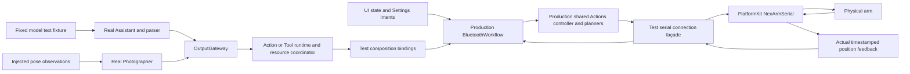

# NexArm tests

## Supervised serial App/Agent acceptance

Serial acceptance calls the same explicit workflow connection operation as the list button and asserts matching native connectivity; it does not claim to exercise SwiftUI navigation.

`NexArmSerialAcceptanceTests` supplies opt-in read-only preflight, Settings/Assistant motor control, Photographer Tool/Settings takeover and full preset trials. `SerialSettingsLink` is a test-only connection façade for App's currently BLE-specific injection seam; every write, query and position receipt goes through the real PlatformKit serial transport. It reuses the SDK's 30 ms budget, keeps one latest telemetry/snapshot/target and no command queue, rejects more than 512 writes or 1024 logged samples, and fences observation/live owners. No motor feedback, IK response, motion success or ATT acknowledgment is fabricated.

Tests use the real Assistant/Gateway scheduler, domain Action/Tool registration, production business workflow and shared Action recipes. Model text, pose observations and non-device presentation handlers are explicit fixtures; App's private application assembly and native SwiftUI touches are outside this test seam. Finite Agent success requires terminal execution records and measured movement. Tool acceptance is checked separately from measured tracking. Manual submission, cancellation/replacement, an Agent lease bypass, release hold, invalid arguments and disconnected admission have separate checks. No gripper, torque, firmware or calibration change is part of these trials. Failures stop software owners and close the port without movement replay or automatic return home.

Run one explicitly selected physical test per process with `NEXARM_PORT=/dev/cu.usbserial-110` and its gate: `NEXARM_SERIAL_PREFLIGHT`, `NEXARM_SERIAL_ACCEPTANCE`, `NEXARM_SERIAL_TRACKING_ACCEPTANCE`, or `NEXARM_SERIAL_PRESETS_ACCEPTANCE` set to `1`. Default repository checks leave all gates disabled. Stop phone control and clear the physical workspace first. Serial results do not certify CoreBluetooth, radio recovery, native UI hit-testing, real model decisions, YOLO perception or sustained tracking under load. Dated observations belong to [physical acceptance](../../../docs/validation/NexArm_Physical_Acceptance.md).

## 文件归属

- [NexArmAimTests.swift](NexArmAimTests.swift)
- [NexArmArrivalPolicyTests.swift](NexArmArrivalPolicyTests.swift)
- [NexArmCausalTests.swift](NexArmCausalTests.swift)
- [NexArmLegacyArrivalTracker.swift](NexArmLegacyArrivalTracker.swift)
- [NexArmLegacyDiagnosticController.swift](NexArmLegacyDiagnosticController.swift)
- [NexArmSerialAcceptanceTests.swift](NexArmSerialAcceptanceTests.swift)
- [NexArmTelemetryTests.swift](NexArmTelemetryTests.swift)
- [NexArmTests.swift](NexArmTests.swift)

## 测试分层

| 文件 | 层级与边界 |
| --- | --- |
| [NexArmConnectionPolicyTests.swift](NexArmConnectionPolicyTests.swift) | Unit Tests：独立运动规划、速度/限位、发现/恢复策略及错误投影；无注册、数据库和设备连接。 |
| [NexArmBluetoothIntegrationTests.swift](NexArmBluetoothIntegrationTests.swift) | Integration Tests：真实 BluetoothWorkflow、控制器、Gateway/Agent 与 SQLite；BluetoothArmFixture 明确模拟原生 link；保留 LiveRuntimeTests 串行隔离。 |
| [PlatformKit BLE 单元测试](../../PlatformKit/Connectivity/NexArmBluetoothTests.swift) | Unit Tests：协议/ACK、写入准入与连接预算由底层模块拥有。 |

其他 NexArm 文件混合规划/反馈单元与执行集成；串口 gate 是运行条件和验收目的，不是独立测试层。默认回归不动硬件。
