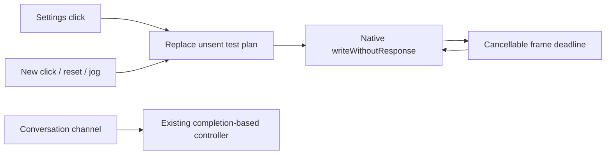

```mermaid
flowchart LR
    Manual[UI state and Settings intents] --> Workflow[Production BluetoothWorkflow]
    Model[Fixed model text fixture] --> Assistant[Real Assistant and parser]
    Pose[Injected pose observations] --> Input[InputGateway]
    Input --> Photographer[Real Photographer]
    Assistant --> Output[OutputGateway]
    Photographer --> Output
    Output --> Runtime[Action or Tool runtime and resource coordinator]
    Runtime --> Bindings[Test composition bindings]
    Bindings --> Workflow
    Workflow --> Actions[Production shared Actions controller and planners]
    Actions --> Facade[Test serial connection façade]
    Facade --> SDK[PlatformKit NexArmSerial]
    SDK --> Arm[Physical arm]
    Arm --> SDK
    SDK --> Feedback[Actual timestamped position feedback]
    Feedback --> Facade
    Facade --> Workflow
```

# IntegrationTests

Purpose: verify composed Agent, Gateway, Action, Tool, Storage and voice contracts with injected model/device substitutes. Design goals: exercise real boundaries and failure paths without presenting a simulator or test double as physical-device acceptance.

## Supervised serial App/Agent acceptance

✅ Serial acceptance calls the same explicit workflow connection operation as the list button and asserts matching native connectivity; it does not claim to exercise SwiftUI navigation.

✅ `NexArmSerialAcceptanceTests` supplies opt-in read-only preflight, Settings/Assistant motor control, Photographer Tool/Settings takeover and full preset trials. `SerialSettingsLink` is a test-only connection façade for App's currently BLE-specific injection seam; every write, query and position receipt goes through the real PlatformKit serial transport. It reuses the SDK's 30 ms budget, keeps one latest telemetry/snapshot/target and no command queue, rejects more than 512 writes or 1024 logged samples, and fences observation/live owners. No motor feedback, IK response, motion success or ATT acknowledgment is fabricated.

✅ Tests use the real Assistant/Gateway scheduler, domain Action/Tool registration, production App workflow and shared Action recipes. Model text, pose observations and non-device presentation handlers are explicit fixtures; App's private application assembly/behavior adapter and native SwiftUI touches are outside this test seam. Finite Agent success requires terminal execution records and measured movement. Tool acceptance is checked separately from measured tracking. Manual submission, cancellation/replacement, an Agent lease bypass, release hold, invalid arguments and disconnected admission have separate checks. No gripper, torque, firmware or calibration change is part of these trials. Failures stop software owners and close the port without movement replay or automatic return home.

Run one explicitly selected physical test per process with `NEXARM_PORT=/dev/cu.usbserial-110` and its gate: `NEXARM_SERIAL_PREFLIGHT`, `NEXARM_SERIAL_ACCEPTANCE`, `NEXARM_SERIAL_TRACKING_ACCEPTANCE`, or `NEXARM_SERIAL_PRESETS_ACCEPTANCE` set to `1`. Default repository checks leave all gates disabled. Stop phone control and clear the physical workspace first. ❌ Serial results do not certify CoreBluetooth, radio recovery, native UI hit-testing, real model decisions, YOLO perception or sustained tracking under load. Dated observations belong to [physical acceptance](../../docs/NexArm_Physical_Acceptance.md).

## Current coverage

- ✅ `FunctionTokenParserTests` covers fragmented UTF-8, escaped text, nested Channels, malformed and oversized input, Action resolution and native Tool syntax.
- ✅ `AgentConfigurationTests` covers packaged JSON v4 declarations, metadata, examples, capability visibility, path/Channel validation and malformed or missing configuration. Production permission lists remain in Agent JSON.
- ✅ `ActionExecutionTests` and `RuntimeTests` cover Channel ordering, resource exclusion, bounded admission, cancellation, failure isolation and completion barriers.
- ✅ `CommunicationTests` covers static and directed routing, schema/source checks, admission deadlines, state replacement and independent session cleanup.
- ✅ `VoiceTests`, `SentenceFunctionTests`, `SpeechPlaybackTests`, `PCMResamplerTests` and `StorageTests` cover VAD/ASR observations, captions, Assistant output segmentation, synthesis requests, audio-ID playback, starvation/timeout, resampling, cache leases and expiration. `FixedTextChat` and `SpeechRequestProbe` are test fixtures only.
- ✅ `AudioCaptureReadinessTests` covers startup without PCM, pre-wait frame arrival, first-format failure, cancellation without hardware callbacks, a single concurrent waiter and independent stop/replacement attempts. These tests do not open a microphone.
- ✅ `AudioSampleBufferReaderTests` constructs native CoreMedia Float32 sample buffers and verifies four interleaved channels in one buffer, four planar buffers with preserved samples, the four-buffer storage bound and reader-error cleanup/retry. These are native-format regression tests, not recorded user media or acoustic accuracy acceptance.
- ✅ `PhotographyPipelineTests` and `CameraSamplingTests` cover native sample transport and pixel-independent capture-time cadence, shared pose inference, current VisionPerception publication and completion-only `UI.showPose` Tool delivery with zero or multiple subscribers.
- ✅ `NexArmAimTests` covers the five-axis aim packet, rejection of a gripper value, Photographer's subscribed aim, the visible-joint fallback, empty observations, the time throttle, and rejection of a non-finite angle before send. No socket is opened.
- ✅ `EyeTrackingTests` covers pose-derived eye movement and related presentation Actions with injected services.
- ✅ `AssistantChatTests` verifies chat request context, history, expression metadata, hidden capability visibility, malformed output recovery and later-turn continuity.

## Acceptance still required

- ❌ Real microphone/camera behavior, model accuracy, playback and expression appearance, hardware latency, thermal stability and sustained conversation require physical-device testing. Passing this suite establishes protocol behavior with controlled inputs only.

Update this README when test responsibilities change; dated run results belong in [validation history](../../docs/Validation-History.md).

✅ PromptTemplateTests 直接提取 BasicSkill/Photography 的生产 xml 示例，用当前组合目录与真实 GenerationTrace 解析；验证静默 startTask 无 Speech/Display、副作用按反馈分轮、准备文本只在 wait 中映射一次。检查默认及已加载摄影请求均含最新规则，摄影 revision 快照预期已更新至16。仅验证资源、解析及调用映射，不证明真实模型遵循率或物理相机效果。

✅ Local document tests cover reopen, cached reads, explicit refresh/invalidation, stale and concurrent writers, size bounds and corrupt-file cache preservation. ❌ Keychain migration requires device acceptance.

✅ FunctionTokenParserTests also covers GenerationTrace: exact raw/fragment preservation, equivalent production parsing and Channel resolution, continuing collection after parser failure, incomplete markup at finish and explicit byte/fragment overflow without eviction.

✅ Structured wait coverage includes byte-fragmentation invariance, lexical nesting/cross-close errors, empty and consecutive groups, reserved aliases, group/depth limits, ordered Assistant speech conversion, entry/exit joins, streaming nested execution, dormant-capacity accounting, task Action limits, module exclusion, independent-task progress and cancellation cleanup. Gates and handler signals verify execution dependencies without timing-based assertions. ❌ Live model syntax compliance and physical timing require device acceptance.

✅ Prompt regression verifies English production guidance, visible Action details grouped by default Channel, stable audio-Channel guidance independent of mapping order, hidden-call/text-effect/Tool exclusion and explicit invalid-mapping failures. ❌ These checks do not measure live-model instruction following.

✅ ConversationHistoryTests covers durable raw/request restoration, interrupted generation, exact ten-round context, failed-round exclusion, atomic archive/reset, raw overflow preservation, parser-failure recording, cancellation and isolated title generation. Assistant request tests now expect history across voice sessions. ❌ These fixtures do not establish real-provider title quality or device performance.

✅ JSON v5 uses Channel-grouped callable Actions; Assistant text interpretation uses Assistant.mapText rather than JSON aliases. Regression coverage checks internal permissions cannot be called through model markup and preserves wait event order. ❌ Live-model/device acceptance is separate from automated checks.

✅ Chat output-token budgets are optional and default to nil. Assistant/cloud requests omit max_tokens so the provider chooses its default; local Gemma 4 E2B uses remaining room in its existing 4096-token context. History omits max tokens display and preserves older explicit budgets on disk. The separate 2000-byte whole-reply cap is removed; parser, queue, timeout and per-segment bounds remain. Explicit title/warmup budgets are unchanged. ❌ Live-provider/device acceptance remains separate.

✅ Runtime tests import the unified Actions and Tools targets. AgentCore is compiled from Agents/Core; test files remain under root Tests. Existing scheduler, conversation, perception and cancellation regressions verify the unchanged chain. ❌ Directory migration alone does not establish device timing.

## Action runtime stage 1

✅ ActionContractTests covers duplicate/invalid/oversized definitions, model/internal startup coverage, non-Action rejection, typed decoding, unknown-key rejection before UI effects, finite lane ownership versus state acceptance, fresh admission IDs, diagnostic overflow without losing Actions, failure propagation and cancellation after commit versus queued cancellation. Synchronization uses bounded single-waiter gates and explicit acknowledgments; no physical timing is inferred. ActionTestRegistry supplies explicit finite-operation metadata for pre-existing scheduler fixtures. Existing integration tests migrated to consistent invocation construction and Gateway-owned scheduling errors.

❌ These fixtures do not establish hardware completion, persistent activity ownership or resource takeover.

## Action runtime stage 2

✅ ActionLifecycleTests covers message-only retry, reserved feedback capacity, owner reincarnation, activity completion, atomic group takeover, stale leases, cleanup timeout/automatic unlock, automatic expiry, protected Tools and owner/session cleanup. All device acknowledgments are controlled test doubles. ❌ These tests do not establish physical device safety.

## Domain-owned behavior assembly

✅ BehaviorAssemblyTests verifies complete production capability coverage, invalid arguments before effects, returning/completion Tool semantics, duplicate/invalid/bounded module catalogs, missing internal Tools and extension modules that execute without an App host. ❌ Hardware acceptance remains separate.

## Action implementation audit

✅ ActionAuthoringTests verifies Speech entry validation and cancellation/error semantics. Existing speech tests use a test-only service convenience that enters through SpeechActions.speak before invoking typed playback.

## Storage domain organization

✅ ConversationHistoryTests imports StorageChat for journal behavior and Storage for durable document fixtures. Core StorageTests remains independent of chat and audio domains.

❌ Image/video/semantic-memory stores remain planned; this migration adds no storage behavior.

## NexArm diagnostics

✅ NexArmTests covers framing, corruption, fragmentation, bounds, Action validation, firmware/stationarity gates, single-motion admission, no retries after uncertain writes and joined cancellation. The opt-in `nexArmUSBPhysicalWristDiagnostic` calls the PlatformKit controller directly; the unused diagnostic Action, parameter test and synthetic Agent/Gateway fixture were removed. Production base/gesture tests retain Agent and Gateway coverage; default test runs never move hardware. ❌ TCP and independent physical-stop acceptance remain pending; BLE implementation and separate iPhone acceptance are described below.

✅ Base tests cover count/extra-argument rejection, firmware/motion preflight, uncertain-write fault latching, cancellation joining one committed leg, and real Assistant JSON/parser/Gateway dispatch of two cycles. `nexArmUSBPhysicalBaseAction` is separately gated by NEXARM_BASE_TEST=1, NEXARM_PORT and NEXARM_CYCLES=1...3. Model and presentation fixtures are test-only; USB and Action execution are real when enabled.

✅ Packaged configuration and prompt regression assertions now include Robot/shakeBase. Physical base acceptance passed one cycle (2114 → 2092 → 2133 → 2117); an earlier convergence timeout remains documented in the platform README.

✅ Base extension final validation: scripts/check.sh passed (182 IntegrationTests, hardware tests skipped by default), and scripts/build-ios.sh passed all four unsigned simulator schemes with full Xcode. Physical acceptance ran separately and the USB port was closed.

✅ NexArmBluetoothTests covers bounded BLE ACK/reply decoding and full Assistant → Action → BluetoothWorkflow → simulated arm, settings navigation/persistence/forget, protocol failures, explicit background cancellation, independent recovery and no automatic replay after unknown effect. Fixtures are explicit simulations; default checks never scan or move hardware. ❌ iPhone radio/UI and real-model selection require separate physical acceptance.

✅ iPhone BLE validation (2026-09-29): `scripts/check.sh` passed, including 188 IntegrationTests; `scripts/build-ios.sh` passed all four simulator schemes. The signed iPhone build installed and launched on the connected iPhone 17 Pro. Real iPhone settings/radio and spoken-model-to-motion acceptance remain pending user interaction.

✅ Regression coverage verifies that Bluetooth disconnect does not stop unrelated voice work, while reconnection retains its old-session barrier. Vision receipt delivery through InputGateway must succeed before another frame is admitted. BLE timeout messages distinguish connection/service/notification/reply stages.

Regression validation: `scripts/check.sh` passed with 191 IntegrationTests, including three added regression checks. Signed iPhone build and all four simulator schemes passed. The repair build was installed and launched on the connected iPhone 17 Pro; physical camera/audio/BLE recovery remains pending user verification.

✅ Firmware regression tests cover three missing-AT32 replies followed by verified firmware, per-controller reuse, exhaustion after four reads and no retry after transport failure. No hardware moves during these tests.

2026-09-30 verification: `scripts/check.sh` passed (193 IntegrationTests), all four `scripts/build-ios.sh` schemes passed, and the signed iPhone build succeeded. The first update installation failed with CoreDevice/RSD allocation; retry succeeded and the updated app launched on iPhone. iPhone BLE acceptance has not been established.

✅ Simulated BLE tests cover retaining a connection after four missing AT32 replies, explicit capacity-one revalidation without reconnection, no motor writes or replay of rejected Actions, and background cancellation of revalidation. ❌ These do not establish physical iPhone control.

Validation of readiness separation: `scripts/check.sh` passed (195 IntegrationTests), all four `scripts/build-ios.sh` schemes passed, and the signed iPhone build passed. Physical iPhone acceptance remains pending.

✅ Simulated connection tests assert exactly one reset followed by ID5 −23/+23/home targets, no replay on navigation/revalidation, no motion with missing firmware, no ready state on indication failure, and background cancellation joining reset without starting ID5. ATT-only write completion remains distinct from position feedback. ❌ Physical reset and servo timing are not validated by these fixtures.

Connection-indication validation: `scripts/check.sh` passed with 198 IntegrationTests and all four simulator schemes passed `scripts/build-ios.sh`. Physical reset/ID5/iPhone acceptance remains pending.

✅ Current BLE compatibility tests require stationary valid telemetry for the exact known missing-AT32 response, verify truthful firmware labeling, one reset/ID5 ±8° indication and real Assistant/Gateway/Action fixture dispatch, reject invalid/moving pose and other explicit versions without any motor writes, and retain strict firmware behavior by default. ❌ Fixtures do not establish iPhone physical movement.

✅ The BLE fixture now reflects observed reset residuals (Z −3 mm, pitch −1.2°), with a separate stable-but-outside-home test ensuring no ID5 movement and a latched fault. ❌ Fixture convergence is not physical clearance evidence.

Latest compatibility/home-tolerance validation: `scripts/check.sh` passed (200 IntegrationTests), all four `scripts/build-ios.sh` schemes passed. Production Mac connection indication completed reset/ID5 ±8°/center with sampled convergence; iPhone physical acceptance remains pending.

✅ Current BLE UX tests cover no firmware-version queries, renamed-device connection, priority sorting without excluding unrelated/unnamed rows, background/foreground recovery outside Settings with no additional motor commands, cold-start read-only recovery, persisted manual-disconnect/forget behavior, and manual disconnect during background motion cleanup. Service/protocol and movement checks remain covered. ❌ Mock tests do not establish OS radio discovery or suspended-device timing.

Bluetooth UX validation: `scripts/check.sh` passed with 204 IntegrationTests and all four simulator schemes passed `scripts/build-ios.sh`. Real-device discovery/recovery acceptance remains pending.

## NexArm entertainment skills (2026-09-30)

✅ Entertainment gesture tests exercise Assistant alias resolution, Gateway execution, typed validation, real controller packet/telemetry logic with explicitly simulated links, ACK-without-arrival failure, joint disturbance, capacity rejection, cancellation join, maximum repetitions and workflow background recovery without replay. ❌ Simulators do not establish physical gesture acceptance.

## Peripheral details coverage

✅ Simulated Bluetooth telemetry covers every motor ID, target/delta validation before writes, repeatable reset without indication, measured UI refresh, shared Action/manual admission, navigation-independent movement and uncertain-write fault latching. Existing foreground/disconnect tests exercise the shared motion lifecycle. ❌ No physical hardware is moved by these tests; layout and mechanical acceptance remain separate.

## Unconfirmed motion recovery

✅ Simulated tests check retained connection/control UI after failure, no implicit replay, read-only refresh recovery, next-request recovery on the same controller, moving-feedback rejection and real disconnect rejection. ❌ These tests do not establish physical completion or iPhone acceptance.

## Full Bluetooth lifecycle regression coverage

✅ Name filtering, connect-time native/visible discovery cleanup, forget with delayed scan snapshots, persisted-empty relaunch, retry of a selected failed connection, nonfatal connection gesture failure, initial-gesture transport recovery, established-link recovery without replay and one-attempt failure bounds use explicit simulated telemetry.

❌ These tests do not exercise iOS-managed pairing or prove physical RF stability.

## Live joystick regression coverage

✅ Simulated tests cover all six channels without telemetry, velocity scaling and joint endpoints, release without reset, background cancellation, backpressure without queued travel, reset before preset settlement, retiring a blocked observation, and manual control after an uncertain preset. Existing preset tests continue to verify completion and cancellation. ❌ Simulated writes do not establish physical latency, clearance or stopping distance.

✅ NexArm choreography coverage now decodes six-joint sync packets, compares absolute targets from different initial poses, checks speed bounds and final home, exercises 22-waypoint repetition bounds, ACK-without-arrival failure, cancellation and live reset fencing. ❌ Real device clearance/timing acceptance is separate.

✅ Preset fixtures now reject raw register broadcasts and accept only controller CMD51 packets, including six-target waypoint grouping and132-write maximum. Regression covers reset with no completion response followed by a successful preset on the same connection, and preservation of detailed UI errors. ❌ No physical-motion tests run by default.

✅ Pose-choreography fixture rejects CMD51/raw-register performance writes and models a calibrated home ID3=1225, differing from vendor1198. It checks fixed physical endpoints from different starting poses, fast large base sway, failed body arrival, no-reset-ACK recovery and reset fencing. ❌ These are simulations, not physical-motion evidence.

✅ Added opt-in `nexArmUSBPhysicalPresetsSharedWithPhone` (`NEXARM_PRESETS_TEST=1`, explicit `NEXARM_PORT`). It opens the real serial adapter, verifies firmware, executes all seven production presets in order through the same controller as iPhone, prints bounded packet/telemetry evidence and stops/closes on first failure. Default checks skip physical motion. Regression tests model measured raised-pose error and assert native absolute CMD8 targets do not accumulate it. ❌ BLE transport performance is not inferred from USB.

✅ 2026-09-30: shared NexArm jog planner uses bounded acceleration/jerk, finite look-ahead, 30 ms scheduling and native servo position writes without per-write pose queries. Tests cover smoothing, duplicate suppression, six-axis streaming, congestion and reset preemption. See ADR 0079. ❌ BLE physical cadence/visual smoothness require phone acceptance.

✅ Explicit NexArm preset requests are independent of prior unconfirmed motion: no recovery/stationary-feedback gate before an already validated connection starts its fixed 3000ms approach. A failed segment stops only that invocation; subsequent user requests can start. Current-request completion feedback, exclusive ownership, reset preemption and connection validation remain. Regression tests cover missing old feedback and a later successful request. ❌ No claim that ignoring an old result physically stops servo holding or repairs transport loss.

✅ Tilt regression verifies both directions retain ready height,40° roll and all five approach/body/return waypoints. Opt-in NEXARM_PRESETS_FILTER=tilt limits the existing USB acceptance test to both tilts. ❌ Physical runs require avoiding concurrent phone commands; default tests do not move hardware.

## Settings test control (current)

✅ Settings Play uses native CMD8 writeWithoutResponse without telemetry/ATT completion waits. Fixed ready400ms → body800ms per frame → home600ms, maximum8 frames. These are cancellable playback deadlines, not arrival gates. One latest test slot replaces all unsent old frames; no command backlog. New Play/reset/jog can take over within the30ms worker cadence (subject to native transport admission). Buttons remain enabled while connected. Native congestion retains only the latest request, fails visibly after2s, and never replays skipped old frames. Page exit/background/disconnect discard unsent test frames. UI says sent, never physically completed. Conversation/channel performGesture retains its existing feedback-based contract.

❌ Wireless delivery and physical arrival are not established by local send admission. Optional NEXARM_SETTINGS_TEST validates the shared frame plan on USB, separate from default tests.

✅ NexArmTelemetryTests covers unsolicited/fragmented telemetry with a latest-only bound, stable-time vs wall-time, independent feedback/total deadlines, notification-only completion without queries, limited query fallback, missing-feedback recovery without replay, and session takeover cancellation. Optional USB preset acceptance exercises the same observable-link path through NexArmPhysicalTrace. ❌ No device-firmware watchdog verification is claimed.

✅ USB preset diagnostics support `NEXARM_PRESETS_FILTER=dance` for isolated dance reproduction and print segment numbers, elapsed receipt time, decoded targets and measured pose/joints. Unknown filters fail before movement. ❌ A trace is physical evidence only when the opt-in run is performed without concurrent phone control.

✅ Dance timing regression replays the observed leg8 timing past the old13.6s deadline and checks the per-segment timeout still wins over the larger aggregate budget.

✅ ActionObservationTests covers simultaneous channels, queued work, presentation without Agent feedback opt-in, cancellation pending until committed cleanup joins, full-snapshot coalescing, terminal immutability, active retention under terminal eviction, structured failures, subscriber capacity and shutdown stream completion. Fixtures are deterministic and never move hardware. ❌ USB/BLE acceptance is independent.

✅ Invalid NexArm dance repetitions are verified to report a structured/localized argument failure without invoking the device binding.

## Action and Tool presentation boundary

✅ Immediate UI Tool routing, append versus replacement validation, native-tool/Action permission separation, mixed generation event ordering, cancellation and bounded snapshots are covered. Failure observation asserts the thrown LocalizedError description survives scheduler projection. ❌ Device animation timing is not established by these fixtures.

## Head gestures

✅ Head regressions verify exact single-motor IDs, large symmetric targets, settings/live and serial/BLE observation admission, model markup-to-controller completion, and encoder arrival rather than stale Cartesian success. The opt-in USB preset test accepts NEXARM_PRESETS_FILTER=head. ❌ Simulated completion does not prove mechanical clearance or iPhone wireless timing.

## Head preparation gate correction

✅ Head preparation now uses the same intermediate arrival contract as all other presets (XYZ15mm, pitch4deg, roll/claw2deg, fresh stable feedback for200ms). Previously it incorrectly selected final-home tolerances before sending any motor4/5 body command. A stationary approach within the normal intermediate envelope could therefore time out without visible movement. Encoder-based body completion and strict final home (XYZ5mm, pitch/roll/claw2deg,300ms fresh stability) remain unchanged. Regression fixtures reproduce a Z-10mm/pitch-3deg preparation and require both gestures to execute; the same error at the ending must still fail. ❌ This fixture establishes the code-path defect, not the exact physical measurements of the reported phone run.

## Head trajectory handoff regression

✅ The NexArm fixture can emulate Cartesian ownership until its commanded deadline and a retained Cartesian target across native servo writes. Repeated nod/shake tests require zero overwritten motor writes and a verified ending home. A deterministic tracker test rejects early stable feedback and wall-clock-only expiry: a fresh converged sample after the handoff duration is required. Physical USB acceptance reproduced the old no-motion timeout and passed the corrected16-segment nod/shake sequence. ❌ The fixture is a regression model of observed hardware behavior, not a firmware simulator.

✅ Reply-owned speech cache tests retain both queued and completed audio past the former 60-second TTL, verify Gateway completion joins an active Action before remaining-audio cleanup, and verify per-reply/session isolation, explicit release/capacity reuse and shutdown. Generic Storage TTL behavior remains independently covered. ❌ These fixtures do not establish phone latency or audible output.

✅ Action metadata coverage rejects blank/oversized UTF-8 names and exercises an unfamiliar Action through registration → scheduler snapshot → root Workflow → UI with its own display name and an unknown Channel. Retained terminal names and feedback-independent observation are verified. Existing scheduling, completion and cancellation tests retain their behavior. ❌ These fixtures perform no physical effects.

✅ NexArm all-segment handoff regressions cover early telemetry, fresh feedback after the nominal duration, final/body gates, a later movement after an early plateau, and independent silence deadlines. Push-only tilt/celebration/dance and query-only fixtures detect commands sent before the previous trajectory duration; cancellation and takeover remain covered. ❌ No hardware motion is performed by these fixtures.

✅ SpeechPlaybackTests exercises production-default playback through SpeechSynthesisAgent with both first-audio and midstream delays longer than the former three-second read deadline, verifies ordered complete frame delivery and lease release, and checks cancellation without a read timer. Explicit read-timeout and synthesis-deadline regression tests remain. ❌ Audible hardware continuity requires device acceptance.

## Settings-matched Channel playback

✅ `NexArmCausalTests` adds supervised USB comparisons for dance/celebrate: current production playback, legacy playback, and isolated query, arrival-wait or preparation/ending changes. Normal checks validate packet plans only. Physical trials require `NEXARM_CAUSAL_TEST=1`, `NEXARM_CAUSAL_TRIAL=preflight|home|baseline|queries|wait|extra|legacy`, `NEXARM_CAUSAL_GESTURE=dance|celebrate`, and `NEXARM_PORT`. Run only with phone control stopped and the workspace cleared. Each invocation executes at most one gesture cycle; variant execution has a45-second deadline, no motion replay or automatic recovery. A separately selected `home` mode sends one3000ms home target under supervision; failed comparisons never invoke it automatically. Post-trial checks allow up to3s for fresh stable home. A retained actor task drains existing serial feedback every20ms without sending queries; logs cap at4096 rows and fail on overflow. Query variants use the former quiet200ms fallback, so a run with zero queries does not exercise that factor. ❌ Encoder samples alone cannot establish visible vibration or reproduce iPhone BLE timing; record observer feedback separately.

✅ Cartesian regressions compare Settings packets against actual Channel controller writes, check400/800/600ms cadence, exclude motion-time queries, reject stale/cached final home and blocked admission, and retain cancellation/manual-takeover behavior. ✅ The NexArm final-home and finite-expression restoration tests use the same task Channel to verify queued execution through joined completion. Cross-Channel concurrency and resource conflict failures have separate regressions. Updated tests describe final-home completion rather than intermediate arrival. Head calibration/handoff tests remain unchanged. ❌ These fixtures do not move hardware or reproduce physical oscillation.

## Performance completion excludes unrelated gripper state

✅ Tracker regressions keep the default six-axis contract strict, exercise arm-only Cartesian/native target completion with a biased/moving claw, and reject arm joint instability or missed arm targets. A production-controller fixture completes a full finite gesture with claw−6° and varying motor6 feedback while preserving measured telemetry. Supervised causal-trial postflight checks now use the same arm-only home scope; legacy experimental intermediate trackers remain strict. ❌ These tests do not establish gripper function or physical smoothness.

## Arm-only motion regression

✅ NexArm fixtures emulate read-only IK separately from addressed motor writes. Tests cover all preset packets excluding motor6, unchanged output with different claw feedback, home/reset scope, injected motor6 rejection, invalid IK, native diagnostics, Settings takeover, preserved timing and final completion. The fixture IK is deliberately simplified and does not certify physical kinematics. USB historical six-axis causal modes remain data-only; physical home and baseline use the production arm-only controller. The optional `ik` causal mode is read-only.

❌ Long-duration BLE and loaded-arm smoothness are physical acceptance work, not simulated test claims.

## NexArm feedback execution — 2026-10-01

✅ NexArm simulated regressions cover motor scope, fresh feedback, prompt progression, skipped intermediate targets with aggregate failure, feedback loss without query fallback, shared Settings execution and joined replacement. Hardware cases remain opt-in and must not automatically replay failed motions.

❌ Sustained real-device acceptance remains pending.

## Atomic composition — ADR0092

✅ Composition tests cover nested error retention, continuation after failure, resource union/conflict, bounded expansion, cancellation history and Channel feedback. Motor tests cover options, configured reset, stable-off-target deadlines and all unavailable-device child records.

❌ Sustained real-device acceptance and durable result delivery remain outstanding.

✅ ADR0093: NexArm controller/gesture/completion tests now import Actions; native packet and transport checks still exercise PlatformKit. NexArmLegacyArrivalTracker.swift preserves the old policy solely for historical causal fixtures, never production. Static boundary checks reject PlatformKit→business dependencies and Action policy types in NexArm SDK.

✅ The congestion/no-replay fixture now explicitly rejects admission throughout the operation; its former two-second unblock raced the next child admission and could legitimately allow a later target. This removes a wall-clock test race without changing production motion behavior.

✅ PlatformKit responsibility tests distinguish neutral device-name extraction and structured BLE failures from App sorting/localization, and exercise the Action-owned jog/reset policy. Packet checks use single/synchronous position-write terminology. No physical motion is triggered by these default tests.

✅ `NexArmArrivalPolicyTests` covers immediate fresh arrival, sample-based off-target stability, dynamic budgets, macro factories and deadline cleanup/report preservation. Physical gesture checks are opt-in with `NEXARM_ARRIVAL_TEST=1 NEXARM_PORT=/dev/cu.usbserial-…`; `NEXARM_COMPLEX_ONLY=1` limits them to celebration/dance. They move hardware and stop the test on any failed gesture.

✅ `NexArmLegacyDiagnosticController` isolates retired query/settle wrist and base diagnostics from production. Their opt-in USB tests retain historical timing for reproduction; current behavior is covered by the shared production gesture/controller tests. Native admission tests reject targets outside per-motor hardware limits for both live and observed writes.

✅ Contract fixtures translate Agent intents through Gateway. Regression coverage preserves resource arbitration, independent invocation IDs, macro budgets, composition errors and cancellation across the new boundary.

✅ SpeechPlaybackTests uses opaque storage source strings and retains wrong-owner, independent-sender, scoped cancellation and reply-cleanup regressions.

✅ ADR0098: Fixtures explicitly import FunctionContracts/ToolRuntime where execution contracts are used. Behavior coverage is validated separately from assembly, and history title operations are injected without changing real journal/title regression behavior.

✅ Shared audio storage regressions consume Types after the category layout migration (ADR0099); ownership and cancellation coverage are unchanged.

✅ BehaviorAssemblyTests covers Camera Tool production coverage, empty-argument controls, rejection before effects, completion-only feedback, cancellation and host failure propagation with injected capabilities. ❌ These tests do not establish camera permission or physical lens acceptance.

✅ Tracking regressions cover five-motor Tool metadata, malformed decoded pose rejection, eight-output overflow with retained accepted calls, and latched write failure with read-only recovery and no replay.

✅ BLE diagnostic fixtures distinguish position-query/no-notification timeouts from IK-query/unmatched-data timeouts. Hardware response remains a separate acceptance step.

✅ A rejecting Photographer subscriber is tested with two real VisionPerception frames: both produce showPose and perception remains running.

✅ Position-query timeout preserves connected state without granting control or sending a提示动作; explicit recovery is tested after notification health returns.

✅ Isolation regressions cover completion Tool failure results, bounded message delivery failure receipts, independent subsequent Tool execution and Photographer offline suppression/fresh-pose resumption.

✅ main-sh incremental tracking tests cover dead-zone hold, continuing off-center steps, previous-target speed and existing offline/overflow/write-fault regressions. The new decoder assertion reads its mutating value before Testing macro expansion.

✅ Expression contract tests prove finite UI.express blocks the shared module through target and restoration acknowledgments, cancellation awaits cleanup, and state setting completes while animation remains pending. Validation rejects clear for finite performance while allowing it for base-state clearing. ❌ Offline fixtures do not prove SwiftUI/device animation timing.

✅ ConversationHistoryTests covers durable Tool declarations/inputs/results and usage, late archived outcomes, and mixed XML/native Assistant output with provider/runtime correlation. ❌ Fixtures do not establish physical Camera success.

## Local model resources — current contract

✅ LocalFileStoreTests covers path traversal/descendant symlinks, atomic non-overwriting directory publication, preserved prior install and explicit deletion.

❌ Full device/background acceptance and remaining enhancement items are tracked in [Management](../../MobileHarness/ModelKit/Support/Management/README.md). Earlier planned sections describe the full proposal; this current contract supersedes claims that downloads are entirely unimplemented.

✅ Concurrent authoritative-document replacement verifies atomic complete snapshots and preserves stale-revision rejection and payload-size bounds. ❌ iOS file protection under lock needs device acceptance.

✅ Native directory enumeration regression checks that trusted filesystem aliases preserve model/weights.bin relative paths and reject outside-root files. ❌ App receipt migration is additionally verified through the actual adapter in an isolated host probe, not inferred from these mechanism tests.

✅ Regressions cover valid Action/wait preservation around unknown aliases and invalid parameters, same-turn Assistant completion after rejected Actions/native Tools, and shared Gateway error history with continued outputs. ❌ Live-provider acceptance remains separate.

✅ Regression coverage now checks stored Action reports plus later errors/cancellation, resource admission rejection inside waits, successful Tool values retained after feedback rejection, cooperative Tool timeout cleanup and true versus operation-local cancellation. ❌ Uncooperative handlers and physical-device acceptance are separate.

✅ Function-defined timeout takes precedence over the intrinsic FunctionContracts default: Action keeps request-dependent budget resolvers (including NexArm); Tool stores optional Duration in its definition/registry and @Action factories. Unspecified Actions/Tools use30 seconds; invalid explicit declarations fail without fallback. ❌ Deadlines cannot forcibly interrupt uncooperative cleanup.

✅ Controlled inference regression verifies a newer capture with insignificant grayscale change replaces the pending frame and never overlaps model operations.

✅ Vision statistics regressions verify monotonic timing consistency, optional legacy decoding, invalid-statistics rejection and six-person payload bounds through UI.showPose. Only explicitly filtered vision/UI tests are run for this change; robot motion tests are excluded.

✅ Cadence regressions verify moving frames cannot bypass the interval and stationary frames remain eligible; invalid intervals fail. Retired grayscale-percentage tests are replaced, while native sample orientation/transport coverage remains.

✅ Deterministic adaptive-cadence tests cover stable-to-motion/low-confidence acceleration, reorder/jitter tolerance, person arrivals/loss/search, cost rise/decay, geometry reset, invalid configuration and monotonic burst throttling. Existing latest-slot, non-overlap, Tool timing and crowd-bound tests remain selected; robot tests are excluded.

✅ Fused-cadence tests cover ROI prioritization/global discovery, slow accumulated motion across skipped frames, contrast/exposure/noise suppression, geometry reset, cost/freshness precedence, upstream versus compute latency and late-result suppression with continued fresh-frame inference. Only visual/UI filters run; robot tests stay excluded.

✅ Urgent cadence admits consecutive fresh frames 8ms apart with a measured 7ms inference cost and no artificial interval; compute-pressure budgeting and its immediate release remain covered. Existing controlled-worker tests cover non-overlap and newest-slot replacement. No robot tests are run.

✅ Pose payload/statistics regressions import Types explicitly; projection tests import UI. Legacy decoding, six-person byte bounds and all four rotations remain covered.

✅ Fixtures import shared pose/speech values from Types and built-in identities from Agents. Scheduler fixtures specify owner identity explicitly. Regression checks generic prompt guidance excludes automatic audio effects while Assistant still supplies them; existing wire, vision and speech behavior is retained. Robot motion tests remain excluded from this migration validation.

✅ Registry tests route a custom typed contract without adding Core cases, verify forwarded versus generated deadlines, and reject unknown/spoofed/oversized content and invalid registry assembly. Existing domain payload JSON and byte limits are tested through business content. Media fixtures supply explicit phone sources and unwrap Agent-owned samples. Robot motion tests stay excluded.

✅ VoiceTests directly verifies internal TranscriptAccumulator revision ordering, final sealing, cross-chunk preview prefix and transactional rejection of oversized results and sample-bounded variable-window endpoint padding after the SpeechPerception file separation. ❌ Real-model recognition quality remains device acceptance.

✅ Generic result tests cover opaque provider errors/details and configurable sentence limits; device fixtures compile against producer-owned details. Only selected non-robot tests are executed for Core decoupling. ❌ No physical robot acceptance in this stage.

✅ SDK-boundary migration coverage uses caller-selected resampler rates and distinct model/storage PCM contracts. ❌ Real microphone/camera acceptance remains opt-in and device-specific.

✅ Communication JSON validation, speech synthesis, pose observation/cadence and session/order tests consume Agents-owned domain values. Ordering/session assertions use CommunicationError; wire payload shapes remain unchanged. ❌ No compatibility alias under Types is accepted.

✅ Types removal is checked through zero-dependency AgentCore, StorageChat-only UI, retired-target/import rejection, and existing vision payload/PCM integration tests. ❌ Simulator validation remains subject to CoreAI availability.

✅ ADR0122: Runtime resource values contain no camera constants. ActionFailure and ActionReport.Entry.Code are bounded opaque identifiers (1–64 UTF-8 bytes); Runtime provides generic execution codes only. NexArm owns its result vocabulary, BluetoothWorkflowError owns its failure-to-report mapping, and Gateway preserves producer identifiers. Existing device failure/report identifiers and presentation are unchanged.

❌ Runtime must not classify pose, foreground, control-readiness or device-feedback failures. Producers provide actionReportCode through ActionExecutionFailureProviding; the generic default handles invalid arguments/resource unavailability and otherwise reports handlerFailed. CancellationError remains cancellation.

✅ Invalid BLE connection pose coverage verifies stage-specific diagnostics and device coordinates while retaining zero motion writes.

✅ BLE pacing tests exercise six competing producers, no accumulated burst credit after a stall, system backpressure without committing unsent packets, and raw-notification versus valid-feedback diagnostics. A throttled Workflow fixture verifies all four aim motors receive commands and cancellation stops future writes. These tests are simulations, not hardware endurance evidence.

✅ SoundSourceTests covers synthetic FOA axes, ACN order, sample-rate/cadence and packet independence, activity/quality states, invalid values, transport bounds, mono fallback, W-only VAD input, independent non-speech broadcast, optional/rejected subscribers, Gateway identity/deadline propagation, latest-state replacement, stale capture rejection and reply/resume gating. ❌ These fixtures do not establish real microphone angles or physical accuracy.

✅ ADR0125 BLE simulations cover feedback loss, congestion, query quarantine, cancellation/manual disconnect, radio power recovery, three-attempt exhaustion/manual retry, unconfirmed disconnect, monotonic snapshot rejection and bounded per-device event cache. Earlier tests that retained a failed sending owner/manual-only feedback recovery now assert cleanup and verified reconnection without physical replay. ❌ No hardware traffic or native iOS layout acceptance is inferred.

✅ ADR0126 tests dispatch repeated Robot.aim calls through real OutputGateway/ToolRegistry into the simulated BLE workflow with one shared ResourceCoordinator. They verify target updates while the worker holds motors, exclusion of competing writes, originating-session cancellation, joined release/new admission, and cached recoverable resource-busy errors without BLE reconnect.

✅ ADR0127 simulations verify that Settings reset/jog works while all six resources are held and telemetry is unavailable, Agent cleanup leaves manual playback alive, preset/reset/jog replaces old unsent frames, manual controls remain enabled during busy/refresh state, and manual takeover cancels Agent motion/aim while reusing identical Action packets. ❌ These tests do not establish physical stop/arrival or native gesture feel.

✅ Manual takeover additionally covers retiring a held native refresh before cancellation and a later slider superseding a preset already waiting on held aim cleanup. A single simulated end-session latch models that software join; no physical-stop behavior is assumed.

✅ Sound-source diagnostic regression runs source-only SpeechPerception through real InputGateway/OutputGateway with forbidden VAD and ASR fixtures and no Tools/presentation grants or business subscribers. Mono produces unavailable; FOA produces the synthesized axis direction; shutdown emits no presentation output. ❌ Synthetic axes do not establish physical device accuracy.

✅ ADR0128: Settings preset/reset submission returns immediately; a cancellable background worker uses the shared Actions segment-feedback executor. Replacement joins software cleanup without waiting for arrival. ❌ Physical takeover/rhythm acceptance remains pending.

✅ ADR0129 regressions use actual Assistant generation, InputGateway/OutputGateway and ChannelScheduler with simulated disconnect, congestion, radio loss and retry exhaustion. They verify continued generation/speech/other Actions and ordinary device failures/Tool errors. A gated failed handler proves recovery completes independently, the next accepted Action remains queued and executes once after reconnection, and disconnected motor reports reach the Agent. Obsolete resource-suspension tests are removed. ❌ No physical voice/BLE coexistence is inferred.

## Passive BLE connection — ADR0130

✅ Native connection/subscription completion makes Settings controls available immediately. App performs no connection pose/version/IK probe, stationary validation or indication movement. It listens to unsolicited position packets and publishes measured state; refresh reads the latest received packet only. Feedback silence remains visible but does not disable manual commands, disconnect or start recovery. Native write/connection failures remain explicit. Actions uses passive BLE compatibility for this App connection; recipe IK resolution is deferred to an explicit preset request, not connection verification. Manual jog can start from the existing configured reference when no sample has arrived; that reference is not measured telemetry. Segment arrival observation and cancellable replacement remain in Actions/App.

❌ Physical feedback cadence, preset IK availability and sustained manual takeover require real-device acceptance. Passive connection does not establish physical clearance or target arrival.

✅ ADR0131 migrates legacy connection-indication, active-refresh, feedback-reconnect and mixed resource-error assumptions to the independent passive/native contracts. Manual segment, takeover, fault recovery and Assistant/speech coexistence regressions pass. ❌ Full-suite failure remains in two existing aim-planner tests and an intermittent vision deadline test; see Validation-History. Physical acceptance is not inferred.

✅ Bluetooth connection-page cleanup regressions verify cancellation of a held connection sends no indication, and reconnect becomes connected while an old Action is deliberately held in observation cleanup; its eventual disconnected result cannot replace the new connection status.

✅ Late aim worker validation failure reaches only home execution observation; completed startup is not retroactively changed and healthy device history/connection remain unchanged. Tool error capture preserves bounded producer descriptions independently of native diagnostics.

✅ Business-rejection regression first completes a real simulated Action, then rejects a new invalid call and requires no stale motor report, Bluetooth incident or reconnect.

✅ Gated late-native-aim failure verifies recovery can fence a connection before its write caller returns while the execution error still reaches home exactly once; native device records remain independent. Observation admission preserves the original dependency error and does not manufacture a disconnect event. ❌ Physical timing acceptance remains pending.

✅ ADR0132: Regression coverage distinguishes observation admission and feedback-read failures without fake native incidents, proves original dependency Error preservation, timeout root/child causes, Tool producer/dispatch/delivery codes, worker provenance after recovery and evidence-based retry rejection. Fixtures never open a real Bluetooth manager.

❌ Sustained physical-device acceptance and durable error history remain pending.

✅ ADR0133: Simulated regressions reject all IK queries while requiring passive simple gestures/reset to send and stay connected, exercise Settings replacement outside held resource admission, verify requested-pose-only incremental caching, supported write-mode selection and capacity-one acknowledgment admission, and preserve terminal failed reports/root errors through the real scheduler. Native interrupted-query presentation remains separate from Action cancellation. Fixtures never instantiate CoreBluetooth or move hardware. ❌ Native radio/firmware/touch acceptance remains pending.

✅ ADR0134: Bluetooth exception history is removed at SDK/App/UI layers. Latest native connection, communication issue and recovery state alone appear in Settings; healthy snapshots/new connections replace prior faults. Explicit connection admission is independent of native detail navigation (ADR0136); an already-open disconnected detail disables actions/motor gestures. Execution results/home issues and bounded automatic recovery remain independently owned. ❌ Physical BLE/navigation/touch acceptance remains pending.

✅ ADR0137 regressions check exact ordinary whole-arm and motor3/4 reset packets, Settings submission under refused Agent resource admission, rejected IK queries, tracking-feedback and partial-IK cache independence, gripper exclusion and explicit single-motor home precedence. Opt-in serial ordinary reset now expects the legacy home; Photographer setup explicitly sends its own tracking-rest motor targets through Assistant Actions. ❌ These software regressions are not new physical motion results.

✅ ADR0138: The real workflow persistence regression now requires a successful explicit connection to save automaticallyReconnect=true; cold-start restoration, disconnected Forget and explicit manual-stop persistence regressions remain covered. No native CoreBluetooth manager or hardware movement is used by these fixtures. ❌ Native compact-list touch acceptance remains pending.

## Tracking freshness and takeover — ADR0139

✅ ActionLifecycleTests covers configured takeover of a disjoint ID in one writer group, cleanup gating, joined admission, reverse/equal-owner rejection, later readmission and whole-writer occupancy until late cleanup joins after timeout. NexArmBluetoothTests exercises shared Action definitions plus ChannelScheduler against simulated BLE: Assistant motor1/motor5 commands preempt tracking, wait for live-session closure, retain subsequent queued Actions, complete through feedback and resume only new aim input without reconnect. Pose-expiry tests retain the guard through joined cleanup then release it. NexArmAimTests covers monotonic usable-pose reception, empty/centered observations and pause/stop freshness.

❌ These fixtures do not certify physical robot stop or native camera/Bluetooth takeover.

## Cancelled owner cleanup — ADR0140

✅ ActionLifecycleTests reproduces Agent/session/shutdown cleanup entered from an already-cancelled task, retains the transitioning gate until stop acknowledgment and checks later Assistant admission. Lease release/acquisition cancellation likewise preserves confirmed cleanup, without granting a cancelled requester a new lease. A real AgentManager removal and OutputGateway stop observer simulate CameraCoordinator cancelling VisionSession before Photographer removal; subsequent Assistant output crosses the Gateway/Channel and completes. Cancelled-owner and existing timeout tests retain actual occupancy until late cleanup automatically unlocks.

❌ Fixtures establish software lifetime behavior only; no radio, physical stop or loaded-arm movement is inferred.

✅ Optional `NEXARM_SERIAL_AIM_STRESS=1` extends the tracking acceptance gate with three supervised six-second Robot.aim fixtures: 5Hz bounded base sweep (−0.08…0.08 rad), 50Hz identical target, then 5Hz ±0.01 rad target alternation. Centered poses pass InputGateway to maintain real Photographer freshness; explicit internal Tool envelopes pass OutputGateway into the production worker. SDK 30ms pacing and 512-write bound remain active. Stress mode skips the unrelated manual takeover trial. ❌ Encoder samples do not determine visible/high-frequency vibration; user observation and BLE acceptance remain separate.

## Resource ownership only — ADR0141

✅ ActionLifecycleTests checks transient locked(owner) snapshots, ordinary failure followed by a successful next use, completed stop errors without a persistent fault, cancelled lease/owner cleanup, stale permits before/after takeover, late timeout cleanup unlocking the whole writer, stale lease release and expiry. Existing Assistant tracking takeover/queue preservation, resource-free effects and Settings bypass remain covered. NexArmBluetoothTests rejects an obsolete held-context permit before any native command or reconnect. Fixtures use controlled completion gates and simulated devices.

❌ These tests do not prove physical stop, BLE recovery endurance or native I/O forcible termination.

✅ ADR0142 Bluetooth fixtures verify successful-recovery budget reset, repeated foreground episodes after three actual failures, cancellation during backoff without attempt consumption, repeated healthy connection reuse, background loss deferred to foreground, joined writer cleanup before new control, and manual disconnect/forget with no motion replay. ❌ Fixtures do not validate native iOS suspension, delayed delegate delivery, physical connection survival or robot stop.

✅ History regressions cover exact caller requests, stale/foreign tokens, archive races, persistence failure before model calls and Assistant ten-round policy. Speech tests assert producer-owned timeout/invalid-output errors and existing playback cleanup. ❌ Physical audio acceptance remains separate.

✅ HistoryToolTests covers pagination, raw non-executing records, Unicode preview truncation, oversized results, invalid arguments, native string-call resolution and correlated execution. ❌ UI intent and physical conversation acceptance remain separate.

✅ HistoryIntentTests verifies both-Gateway history refresh without voice/models, overlap rejection, cancellation cleanup and retry, bounded Agent output and foreign-scope rejection. Startup coverage includes Memory. ❌ Native page/navigation and conversational continuation acceptance remain pending.

✅ History intent tests add actual archive deletion and success-only refresh, current/missing-ID failures with retry, source/callID/duplicate feedback fencing, and cancellation after durable commit with joined cleanup. ❌ Native confirmation/gesture acceptance remains separate.

✅ ADR0149: composed regression tests reject forged internal origin and disguised Tool feedback, verify success/error causal continuity after original admission expiry, fence replacement Agents in held execution, and preserve committed values without replay on hop exhaustion. Agent messaging assertions verify internal origin. Fixtures are bounded and do not claim model/device acceptance.
❌ Action/activity full-root propagation tests follow their next migration stage.

✅ ADR0152: production registers one six-domain CapabilityModules catalog, with unified UI/NexArm ownership and unchanged call paths/permissions. Registry projections preserve existing execution policy; regression coverage checks expression and gaze through the same UI catalog. ❌ Unified call definitions and compatibility removal remain pending.

✅ ADR0213 fixtures verify same-function concurrency across Channels, same-name Channel independence across tasks/Agents, and resource busy failures without starting the conflicting handler or blocking later lane work. Same-Channel FIFO/wait/cancellation and configured takeover regressions remain.

❌ Three-level runtime paths and unified Action/Tool definitions are not completed by this stage.

✅ ADR0156: canonical execution addresses use domain/module/function; Agent v6 bindings resolve native names separately. Canonical resource requirements and output permissions are preserved.

✅ ADR0157: canonical executable definitions and shared outcomes replace duplicate protocol metadata; consumers import Actions/FunctionContracts. Protocol request views remain adapters, and production permission/resource boundaries are preserved.

❌ Physical acceptance and additional business capability exposure are not established by this migration.

✅ UnifiedCapabilityTests verifies one returned-value implementation and one gaze function through both projections, independent permission grants, shared scheduled native exclusion, original handler context, single typed feedback and joined cancellation. ActionLifecycleTests checks resolved canonical resources before native effect execution. ❌ These fixtures establish no physical-device or model acceptance.

✅ The controlled vision-result budget fixture retains capture timestamps, uses small RGB inputs and widens its wall-clock margin under parallel suite load; production latency policy is unchanged.

✅ Composition freezes CapabilityCatalog once before projection: at most32 domains/256 canonical definitions, shared metadata validation before filtering, and duplicate addresses rejected across protocols. The same handler/metadata snapshot feeds both registries; invalid unexposed definitions cannot disappear silently.

✅ ADR0159 unifies @Action metadata and invocation contracts; all business and injected endpoints receive one FunctionInput/ActionExecutionContext. Three-level ownership, existing availability/resources/deadlines and independent Agent grants are preserved.

✅ ADR0159 — Unified invocation: all business functions, injected capabilities and registered handlers receive FunctionInput with ActionExecutionContext. Native request/result normalization stays in Runtime/Gateway; no protocol-specific implementation signature remains.

✅ ADR0160: callable functions and shared producer failures are independent of call protocols. This directory consumes the appropriate pure function/shared invocation or registration adapter at its existing boundary; host profiles own protocol selection. ❌ Broader feature Signal migration and physical acceptance remain separate.

✅ ADR0161: standard callable inputs use FunctionInput/FunctionContracts; common execution and call protocols belong to independent Gateway targets. This directory retains its existing ownership, resource/permission and lifecycle boundaries. ❌ Remaining feature Signal/continuation and physical acceptance are separate work.

✅ Unified capability regressions cover structured thrown reports, producer codes and successful later native calls after an invocation failure.

✅ ADR0163 regressions verify scheduled feedback with a non-root input and expired original admission, retained root/parent/turn/sequence, fresh feedback deadline and hop closure for Action/activity results. History regressions reject wrong typed content and retired strings while preserving refresh/delete/cancel behavior.

✅ Implemented: typed Assistant control regression coverage for full/paused cancellation, session isolation, malformed/provenance/expired/legacy rejection and cancellation of unfinished generation.

✅ Implemented: real HistoryIntentRuntime/Gateway/Actions regressions cover commit-before-inference, cancellation/retry, empty/current/missing archives, bounded schema arguments, correlated result handling and unchanged raw model data.

✅ History title failure coverage includes simultaneous inference and retry-state persistence failure, preserving both causes in a bounded ActionReport.

✅ Implemented: resource routing tests use real Agent/Gateways/functions with controlled capability fixtures; verify admission vs eventual installation, correlated errors, concurrent IDs, explicit cancel, capacity overflow and joined shutdown.

✅ ADR0167: regressions verify speech preference delivery through both Gateways, strict booleans before effects, configuration overlap rejection and invocation-local failure followed by successful later binding.

✅ ADR0168: resource preference coverage uses real stores, functions, Agent and Gateways. Verify legacy wire compatibility, validation-before-write, missing-model normalization, commit-before-binding, failure/retry and malformed feedback retirement.

✅ ADR0169: real Agent/Gateway/function inventory regressions cover progress/group preservation, failure followed by successful read, duplicate/negative/overflow rejection and encoded byte bounds. Shared prerequisite tests retain optional-VAD behavior.

✅ ADR0169 validation extension: a valid inventory above48 KiB returns intact through the actual Agent/Gateway path; an over64 KiB inventory fails locally and a later read succeeds. The standard observation registry size is not the returning ToolResult value bound.

✅ ADR0170: add actual Agent/Gateway/UI-function tests for snapshot presentation, bounded argument rejection, query failure presentation, secondary presentation failure and successful later request. Fixture endpoints are not native UI acceptance.

✅ ADR0170 refinement tests: combining-character failures still produce a valid bounded presentation call; unavailable failure-presentation dispatch retains primary query failure and permits later refresh.

✅ ADR0171: verify real sequenced native-state routing through Agent/Gateways/UI functions, failed fact presentation without query, wrong source/replayed sequence rejection and later recovery.

✅ ADR0172: Add command failure/presentation regressions for all three operations, no device replay, subsequent request recovery, missing/failed presentation, retained causes and strict arguments. Fixture endpoints implement the required capability explicitly.

✅ ADR0173: Verify real preference code propagation, exact reason selection, binding-stage distinction, third-call failure presentation, gate exclusion/release, durable commits, missing/failed endpoint and subsequent explicit retry. Pure function tests reject unknown reasons and oversized messages.

ADR0173 gate regression runs both preference-validation and post-commit binding failures while presentation is suspended; neither path admits an overlapping preference/configuration request.

✅ ADR0174 regressions: typed host schema/source/causality, non-returning dispatch without native effects, diagnostic acknowledgment/failure, no recursive presentation, joined request cleanup and continued resource use. Test-only bindings may select completionOnly; production registration remains returning.

ADR0174 diagnostic regressions also verify that an acknowledged UI commit retains its presented marker if correlated feedback delivery subsequently fails.

## Provider discovery

✅ Provider discovery regressions: real Agent/Gateway/result transport, secret-free envelopes/calls/errors, one-use/session/expiry/capacity staging, invalid result rejection, no query replay and continued resource operation. Production catalog fixtures must inject an explicit provider capability.

Provider fixtures verify that page cancellation does not revoke an admitted root-owned query, and inspect the actual Agent call parameters for requestID-only routing.

Provider compatibility regression verifies a valid256-model SDK result reaches the caller completely, retaining the pre-migration discovery capacity.

## Provider configuration transactions

❌ Pending provider transaction regressions: validate-before-write/barrier, persistence-before-apply, rollback-before-release, primary+rollback causes, private request/results, root Gateway execution, shared configuration exclusion, cancellation cleanup and continued use after failure. Replace production-catalog fixture dependencies with explicit unused throwing settings capability. Store migration gets injected credential/document fixtures.

Cancellation rollback fixtures cancel a separate invoking Task, not the test runner, and assert rollback persistence runs uncancelled before barrier release. Private completed results count against staging capacity until taken, including after unclaimed deadlines.

## Completion batch — provider presentation and capability policy

✅ Implemented: provider discovery model-family eligibility belongs to Actions ProviderModelList; ModelKit validates/decodes raw IDs only. Preserve filtering/dedup/order and bounds at the app boundary. SettingsState becomes a passive editable snapshot, with no tasks or injected execution; SettingsInteractionWorkflow in the existing Settings directory owns bounded form admission, revision and page-independent saves. UI forwards edits/discovery/cancellation/save through SettingsControlling.

✅ Implemented: presentation-enabled provider intents select a second registered UI.ResourcePresentation.showProviderResult call after the business call, on success or failure. Headless requests retain one call. Private result lookup and revision/session fences prevent credentials in protocol payloads and stale form updates. One attempt only, no recursive presentation/replay; producer and presentation failure chains remain distinct. App injects the native UI endpoint; business functions remain independent of UI and call protocols.

## Bounded native result continuation

✅ Implemented: Assistant correlates model-native calls with runtime-only feedback under the original turn, awaits complete results and requests the next model round. Finite per-generation/queue bounds apply; no default cumulative model/native-call limits or Agent timer. A failed call becomes data for the model, never an automatic function retry. Cancellation clears owned feedback state and joins model cleanup; unknown/stale/duplicate feedback cannot resume a turn. Internal UI receipts retain their handling; the static /status shortcut is retired.

✅ Implemented: ModelKit ChatMessage gains provider-neutral assistant tool-call declarations and tool-result messages. OpenAI serializes request-local aliases consistently across declarations and prior calls; Gemma rejects native transcripts explicitly. Storage keeps optional exact continuation request JSON bytes as data, with bounded records and unchanged v1 compatibility. Camera native model calls use returning protocol registration so actual completion/error can continue reasoning. No change to camera or NexArm function implementation.

## Typed device, navigation and environment entry points

✅ Implemented: app.interaction/1 maps explicit device commands and navigation destinations to fixed registered functions through ApplicationControl and the shared root transport. This Agent now coordinates native resource interactions as well as model resources; it performs no native I/O. UI controls emit typed intent through a root-owned BluetoothInteractionWorkflow; native BluetoothWorkflow remains the injected connection/recovery/manual worker host. Existing arrival tolerance, timeouts, pacing and takeover algorithms stay unchanged.

✅ Implemented: System.Device.control validates bounded string arguments and invokes neutral DeviceControlCapability; successful submission reports acceptance, not physical arrival. Read-only status and selected connection commands are explicitly model-granted. UI.Navigation.open commits native route state; manual taps and model requests share that function. A bounded latest motor-intent worker sends only changed values, with reset/stop priority and explicit failure display. No queued motion replay.

✅ Implemented: app.environment/1 stores latest sequenced scene/device/capability facts in the root Agent, with finite categories and bounded data. App still performs synchronous background/native safety fencing before reporting facts; physical safety cannot wait on Agent admission or iOS background execution. Native back navigation remains platform-owned and reports a fact, rather than replaying navigation effects. Photo-library creation and physical acceptance are feature/acceptance boundaries, not implied by navigation support.

## Camera command entry

✅ Implemented: CameraInteractionWorkflow emits typed open/close/flip/retry intents through Photographer and existing Camera functions. Root presentation accepts Photographer in the dedicated camera root session or validated active voice delegation; Assistant calls delegate through the bound Gateway context. Native capture, permission, lifecycle fences and joined cleanup remain CameraCoordinator responsibilities. Retry uses a canonical callable and the native explicit settings/permission request. UI receives controls and passive camera state, not the native coordinator. One command slot rejects overlap, no replay.

## Manual worker terminal feedback

✅ Implemented: accepted device-control calls acknowledge submission only. Preset/jog native workers capture their own origin and report sink, retain one latest structured terminal failure, publish independent home issues and deliver a trusted ActionResult through InputGateway after non-cancellation failure. Root ApplicationControl accepts runtime-owned Action results into a bounded128-result inbox; environment context exposes the latest result summary. No accepted Tool receipt is rewritten, no movement replay, and no tolerance/arrival/timeout algorithm changes. Ordinary failure stops only its worker and keeps subsequent intents admissible. Diagnostic delivery rejection is reported separately.

✅ Implemented bound regression: the fourth model round must await its already-issued native calls before reporting the round limit, preserve actual outcomes, and admit a subsequent input. It must not start a fifth request or fabricate completion for outstanding work.

✅ Implemented failure-data correction: native continuation Tool messages wrap failed outcomes as bounded JSON containing isError, failureCode and the exact value. Successful values remain unchanged. Error metadata is model data and is never passed through Action parsing.

✅ Implemented admission hardening: the native device endpoint validates its existing foreground, connection and worker admission conditions before accepting scan/connect/reconnect/preset/jog. Rejected void UI commands must become explicit call errors, without changing native recovery/motion algorithms. Device facts include the current native issue. Motor arguments reject unrelated preset fields.

✅ Implemented error-chain preservation: failed native continuation messages must also include any producer report, with every child outcome, execution failure and retained description. Preserve partial failure; a scalar error message must not replace the structured chain. The existing transcript byte bound rejects oversized data.

✅ ADR0180: Memory / memory identity and MemoryHistoryIntent are used consistently in configuration, host transport, presentation source guards and regression fixtures; preserve history.intent/1 and runtime behavior. Enforce the two reorganized roles’ directory/actor/configuration naming and isolated business components.

ADR0180 validation coverage: canonical Memory/Photographer configuration identities and identity-mismatch rejection, plus Memory output overflow retaining accepted outputs and failing only its own actor. Existing history correlation/cancellation/title and Photographer freshness/throttle/overflow/target-commit regressions cover the extracted components.

ADR0181 regression coverage: camera open/close/flip/retry through both Gateways, authorized bound Assistant delegation, full errors, overlap/cancel recovery, invalid provenance/result rejection, vision detach leaving root camera service alive and original tracking regressions.

✅ ADR0182: canonical applicationControl identity and role-directory packaging checks; existing resource/provider/device/navigation/failure regressions now exercise ApplicationControl. All concrete Agent configurations require canonical role directories; no root exception remains.

✅ Prompt regression verifies default-routing guidance and parse the concurrent expression/motion example into Display/Robot Actions without scheduling boundaries.

✅ Interaction refinement: Camera regressions cover required facing validation, both targets and delegated target preservation with existing failures/cancellation. Caption fixture retains finalized text and rejects late transcript updates.

## Action/Tool generation rounds — ADR0183

✅ Implemented: text/XML resolves to ActionCall; Assistant maps natural text to Speech playback and Display caption Actions. Only Actions enter Channel/wait. Native ToolCalls execute directly, with at most four concurrent calls and sixteen total per Assistant input. Registration declares recordOnly/observation independently of return values. Separate ActionResult/ToolResult feedback is correlated by call and round, merged in emission order after all calls settle, and only observation enables another model request. Four requests,120 generated calls,64 KiB feedback/transcript and a30-second joined input deadline bound the loop.

✅ GenerationRoundTests exercises Action-only, Tool-only and mixed rounds, value/void/failure policy, full-round barriers, wait bypass, concurrency limits, cancellation and native-call exhaustion with real Gateways and a stub model. Fixture-only parser tests synthesize receipts explicitly.

❌ Live-model, native UI and physical-device acceptance remain pending; local native Tools and generic Agent request/reply are not implemented. See [ADR0183](../../docs/adr/0183-generation-round-observations.md).

✅ Final regression: mismatched round seal is rejected without model continuation or successful acknowledgment.

✅ Delivery regression: rejected terminal Action feedback stops continuation after the effect runs once.

✅ Registration regression: changing handler return shape cannot implicitly opt in to observation.

## Assistant photo observation — ADR0184

✅ Implemented: Photo loop regressions use real Gateway/ActionResult and stub camera/image model, including mixed native Tool, failures and ownership; storage bounds/restart decoding and no image bytes in history.

❌ Real camera/shutter/animation and configured-model vision acceptance remain pending; video recording remains outside this iteration; system Photos export is implemented by ADR0185.

## Photo save and ignore — ADR0185

✅ Photo disposition regressions cover root Photographer identity, real Gateway receipt values, repeated-save result, stale identity rejection, permission failure/retry, Assistant Action delegation, argument rejection before native effects and observation-driven continuation without new captures/images. Effects/providers are fixtures; native acceptance remains separate.

## Independent protocol consumers — 2026-10-08

✅ Implemented: Assistant regression proves suspended speech preparation does not delay native Tool parsing/emission and complete feedback still gates downstream model continuation. An open-model-stream fixture also proves malformed Action parsing cancels the transport reader without waiting for another event or generation timeout. Existing mixed-round, stale feedback and failure coverage remains required.

## Per-request conversation history

✅ Implemented: ConversationHistoryTests and GenerationRoundTests cover per-request outputs and observations, immutable first-text-token arrival, native-only missing timing, per-request usage and late archived outcomes, restart/interruption/cancellation, four-request admission and image-metadata-only journals. Aggregate context remains covered.

❌ Native UI, live-provider and physical-device acceptance remain separate from automated validation.

## History image thumbnails

✅ Implemented: Photo store regressions verify archived input-scoped reads, mismatch rejection and missing images; generation photo history tests verify structured metadata and absence of attachment bytes. Existing history controller fixtures supply the required reader explicitly.

❌ Native image/layout and live-model acceptance remain separate from automated verification.

## Agent composition migration — ADR0187

✅ ADR0187 implemented: adopt Agent-owned Signal preprocessing, structured context and context builders; common Foundation-only queue/round/task mechanisms live in existing Core directories. Communication becomes output-stream Actions with owner-directed delivery receipts. Execution owner, task parent and causal root remain distinct; replies require active task/session authorization. Assistant rounds yield to FIFO user inputs, with listening gated by actual playback. Persist business records, retain media/DSP in bounded memory, and never replay interrupted device work. Existing business responsibilities and JSON v6 grants remain unchanged. See [ADR0187](/Users/devil/Pro/MobileHarness/docs/adr/0187-agent-composition-and-react.md) for the complete pending contract.

## Agent composition contract coverage

AgentArchitectureTests uses a separately configured model-backed child with its own Context and shared AgentChatDriver. Real Gateway routing verifies child-only ActionResult, explicit parent reports, admission/completion distinction, instance replacement fences and joined parent/child stop. Core tests verify bounded fusion, receipt deduplication, write failure, repository restart interruption, foreign/corrupt state and evidence deletion with active-work protection. GenerationRoundTests verifies that an admitted second user task executes before the first task's ready continuation while preserving provider call/result blocks.

FixtureCommunications is test transport only: it consumes communication Actions from legacy standalone fixtures, produces trusted synthetic admission receipts and exposes the remaining output stream. Production uses bound GatewayOutputConsumer and16-pending/four-way communication consumption. These fixtures do not claim physical camera, BLE, speech, UI or real-model acceptance.

✅ Regression coverage: sound-source publication context-write failure terminates perception without an emitted communication Action or publisher self-join; ordinary subscriber rejection remains nonterminal.

Verified source organization: existing architecture/context commit-failure, history projection, transcript ordering, synthesis failure/cancellation and application/provider/resource suites passed in the full check. The existing rejected-commit regression now verifies the shared admission transaction leaves no evidence, consumption or task state after persistence failure; file consolidation adds no mirror tests.

## Assistant Skill/task-mode contract — ADR0212

✅ Assistant is the sole ordinary conversational executor, with bundled Skills and one local foreground task. Three specialist Chat workers are retired. Fixed UI/business transactions and independent typed background delegation retain real executor ownership; send admission, task completion and native effects remain distinct.

The actual TaskControlModule is exercised through Gateway and Channel execution. Task/default contexts select separate histories; per-request mode/Skill/catalog evidence remains immutable, native call/result pairs and ReACT are preserved. Late ASR rejects closed task association, failed persistence leaves committed mode/catalog unchanged, and idle fixed controls do not invoke Chat. Legacy specialist records remain readonly, not merged or resumed.

App owns stable consumers, actual endpoint authorization and bounded presentation. Microphone capture remains an independent lifetime. Restart interrupts without replay. [Migration plan](../../docs/Agents-Skills-Task-Modes-Plan.md) records remaining real-provider/native/device acceptance.

Bluetooth simulated initial connections wait for the existing restoration/recovery idle barrier after discovery; list appearance alone is not startup completion. Generic communication fixtures preserve explicit parent validity without assigning default transport TTLs.

## One-way publication and listening admission correction

✅ Implemented: regressions cover one-way publication/no receipts, subscriber failures and joined shutdown; ASR failure recovery, final reply admission, first-frame pause/resume; Assistant-only listening permissions, user-off precedence and queued cancellation; registered behavior bindings and independent business error presentation. Physical microphone/playback acceptance remains separate.

✅ Implemented: speech pause/resume before the first capture frame accepts the next frame without inputBusy or a fabricated utterance.

✅ Listening Action completion acknowledges policy while physical pause work remains independently owned; a newer off command completes without waiting for that pause, and stale completion cannot restore the old policy.

## Listening policy ownership

✅ Listening regressions verify resident consent across capture epochs, full reply snapshot combination, stale revision/incarnation fencing, bounded loss recovery, forged/cross-session controls, native-stop fencing and actual Gateway publication/Action ownership. Isolated sound fixtures include the subscribed Agent declarations without starting them. Mixed round outcomes validate protocol-result pairing independently of concurrent registration order.

❌ True-device acoustic echo, tail, route/interruption and native UI acceptance remain pending.

✅ Camera-command regressions cover concurrent environment admission during a held durable commit, waiting-input cancellation/stop, authorized communication schema, XML/native invalid-kind correction, and a Photographer-owned Camera.close tool with child-only result/context and explicit parent task completion. Endpoints/models are synthetic; physical camera, ASR and model acceptance remain separate.

✅ Execution-log tabs: Add production Gateway observation regressions for successful/rejected/one-way publication, no subscribers, overflow, feedback, media aggregation, observer shutdown and task receipt/result separation.

✅ Robot Action ownership correction: Role/prompt assertions and the Assistant-to-Gateway synthetic robot Action regression verify Assistant execution and owner-directed feedback while Photographer rejects general motion capabilities and ApplicationControl retains equivalent shared registrations.

✅ Robot regression fixture alignment: NexArmTests, NexArmBluetoothTests and opt-in NexArmSerialAcceptanceTests Assistant gesture/recovery fixtures use Assistant identity, context and shared writer grants, preserving their native recovery, queued-action and speech coexistence assertions.

✅ Shared Action registration: Action implementations support many-to-many Agent registration. ApplicationControl registers the 11 Robot Actions for Settings command tests; retain Assistant basic interaction registration and Photographer camera-only model permissions. Each role calls canonical functions under its own identity; no inter-Agent delegation is needed to reuse an Action.

✅ Device regression fix: Regressions cover startup/scene transition overlap, structured successful camera command feedback and active-task/requester plus explicit photo-question reporting data. Retain continuation-budget, native pairing and scoped save follow-up tests.

✅ Camera model exposure: Photographer declares openCamera/closeCamera/flipCamera/retryCamera alongside takePhoto/savePhoto/ignorePhoto as scheduled Camera Actions; no camera native Tool is exposed to the model. Host binds the canonical camera functions to both protocols only for explicit fixed UI transaction reuse. Model camera Actions keep observed owner-directed results and same-Channel ordering/wait groups.

✅ Frontend/backend separation: Fixtures use production subscriptions without patching catalogs. Regression verifies each typed user contract has only its business owner, touch camera execution leaves Assistant context/tasks empty, and conversational delegation/UI Action coverage remain available.

✅ Home-log regression: ordinary publication traffic leaves task observers silent through shutdown. Synthetic specialist delegation verifies task-only history/revision survives300 unrelated Signals; native/model/performance acceptance remains separate.

✅ Interface timing regressions: synthetic model rounds emit before consumer attachment, and stored timing must exactly equal provider evidence for each initial/ReACT request. Native-only rounds retain request start without text TTFT. Storage preserves optional timing through Codable and rejects invalid latency; provider timing remains optional.

## Responses and Action-only Assistant migration

✅ Implemented: Verify production Assistant exposes no native Tools, environment observation uses Action, communication remains XML Action even with native-capable providers, and old native history cannot request undeclared functions. Existing native protocol tests use explicitly synthetic native-capable test Agent catalogs, separate from production Assistant grants.

✅ Fixture alignment: Robot-only Assistant assemblies declare an unavailable environment Action handler to satisfy complete grant validation without performing environment reads. Native-history tests accept independent Action/native consumer ordering and use synthetic native state for snapshot assertions. These fixes preserve the tested behavior and do not weaken production permission checks.

✅ Reply/lifecycle regression correction: caption focus is presentation only and cannot cancel an authorized queued/playing reply from another Agent. Playback checks active session and explicit task cancellation, retaining Gateway owner/task/function authorization and task-local Speech Channel ordering. ApplicationControl accepts environment facts and correlated feedback while paused; fresh business commands still require running. Assistant delegation prompts emit send without redundant spoken acknowledgments and leave specialist speech to its executor. Scope/result delivery failures retain actual evidence; no silent error suppression or action replay is added. Add owner-switch playback admission and paused environment regressions.

✅ Round feedback delivery failures report execution ID, Action path and delivery state (closed), separately from task or presentation scope closure. Preserve failure, stop dependent continuation and never replay completed effects.

✅ Publication audit correction: publish validates its own payload/source and submits bounded one-way work, never awaiting subscriber or App observer completion and never returning recipient errors. Observer work shares bounded Gateway publication lifetime; overflow is diagnostic loss without publisher acknowledgment. Environment facts bypass request/result waiters and emit no completion acknowledgment; ApplicationControl errors still flow through its independent output consumer. Directed send retains correlated admission receipt (not task completion). Explicit UI data-operation result waits remain business completion contracts, not publish receipts.

✅ Resource-fact extension of the same audit: model-resource observations are also one-way facts. Their registered presentation functions and runtime feedback execute under the root-owned ApplicationControl consumer independently of request slots. Sampling never retries because the subscriber rejected or its presentation failed. Tests await observable business state, not a publication receipt.

✅ Camera perception/context change (2026-10-10): Add camera-state regressions for permissions/routing, latest revision, paused observation, recovery, bounded validation, task-phase projection and model-visible state on initial/continuation requests. Synthetic model/device fixtures do not establish native camera acceptance.

Camera observation request coverage inspects the complete message list for the owned image, because role state facts may follow the image message; image identity/bytes, native pairing and recorded request evidence remain required.

✅ Send Action-only audit (2026-10-10): remove automatic Agent.send native Tool declarations and the per-role exposesNativeCommunicationTools switch. Every role keeps authorized send Action declarations, target/kind/parameter documentation and receipt/task ownership contracts. Existing business Tools and historical native call/result evidence remain unchanged. Reject an explicit communication Tool registration instead of silently exposing it. Regression tests check all seven effective model catalogs and task request/progress/input/result flows using Action-call send, including roles with business Tools.

✅ Duplicate model registration audit (2026-10-10): Audit all seven packaged configurations plus shared communication catalogs for Action/Tool path overlap, duplicate paths within each model protocol and native send leakage. Verify ApplicationControl openPage resolves as an Action while App.openPage no longer resolves as a model Tool; fixed internal navigation remains authorized.

✅ Regression: dry-run GenerationTrace with the same effective role catalogs as production/history preview accepts split-fragment Assistant task.request and specialist task.progress/result send Actions, while retaining rejection for unknown aliases and invalid parameters. This verifies parser behavior, not live delivery or the native history screen.

✅ Prompt regressions cover: strict JSON/template failure cases, exact variable contracts, single-pass insertion, independent role/style prompts, generic wait guidance without speech policy, role workflow rendering, title/camera context and packaged resource availability. Existing generation, continuation and parsing tests retain their observable contracts.

✅ Skill/task-mode regression covers atomic loading, permissions, immutable request snapshots, local photography multi-input ReACT, terminal cleanup, late ASR, request evidence and UI projections. Retired product conversational delegation tests are replaced; generic task transport tests remain.

✅ AgentSkillTests uses the actual TaskControlModule through Gateway/Channel execution for multi-input photography and ReACT. It also covers atomic transitions, immutable catalogs, permission bounds, restart interruption, late ASR rejection, persistence rollback and idle fixed controls without a conversational request.

## 泛化 Task 与独立 Skill（实施中）

❌ 本次替换固定 Task Mode：Task 保存目标、前台/后台执行身份与生命周期；Skill 提供流程和函数，按基础/交互链/任务作用域管理。startTask(goal, skills?, execution?) 原子组合任务创建与 Skill 加载，loadSkills/releaseSkills 独立支持数组；后台通过现有 send 和父子协议，不抢占前台。删除生效 task-modes，基础 Skill 移至 Agent 资源。请求目录和历史证据保持不可变，旧 Mode 仅作历史证据。UI 显示任务状态、目标、实际加载 Skill 及后台数量。

✅ Resource-path contract: pure Agent and Skill assets move to MobileHarness/Resources/{agents,skills} with Catalog.json. Agents retains loading and policy ownership. Package sources remain limited to Agents; explicit copies exclude unrelated app/model assets. Bundle catalog lookup establishes the runtime root without repeating Resources. Regression covers flat and Resources-containing Bundle lookup plus missing catalog failure; final packaging checks compare indexed asset bytes. Device acceptance is recorded separately.

✅ 2026-10-11 correction: TaskControl functions are finite committed transactions returning a bounded value, not state/completed-only operations. Regression executes each through FunctionExecutor. Task reports move out of system instructions into data messages; include only same-session live declared background tasks or the exact current directed task, not legacy terminal delegation records. Completed local outcomes are selected only for the current input. Persistent/UI task history is retained.

✅ Source organization audit (2026-10-11): Update packaged resource regressions to canonical names and preserve old serialized task/Skill state decoding after type-only rename.

## Skill 函数目录

✅ 回归验证无静态业务权限也可加载 Skill、加载前调用拒绝、旧快照不变及摄影/保存 ReACT 的 Gateway 执行；解析器 fixture 显式组合所需 Skill，不再使用静态角色目录模拟业务目录。

## Action-owned documentation and Skill instruction contract

✅ ActionCatalogFixture 在每项集成测试作用域安装相同不可变生产目录。ActionDeclarationTests 验证宏与函数声明一致、Skill Tool 参数一致、缺失/重复/替换拒绝、examples 不进入新投影。真实模型遵循指令与物理摄影另行验收。

## Channel-owned Action ordering

✅ Channel/task concurrency and resource-conflict regressions replace the retired key fixtures. Test/build evidence is recorded in [Validation-History.md](../../docs/Validation-History.md).

## Task controls through Action Calls

✅ BasicSkill 的五个 Task/Skill 控制函数使用 Control Channel Action Call；App 通过 ChannelScheduler 返回已提交状态。startTask/loadSkills/releaseSkills 的 observation 在结果屏障后重建目录并 ReACT，finishTask/cancelTask 加入回复及清理屏障后恢复默认。新目录仅影响后续请求，不允许加载轮提前调用新函数。可信固定调用复用同一实现。

## Agent → Skill → Function registration

✅ Implemented: Agent.json declares baseSkills and communication, never functions/actions/tools. Base and dynamic Skills are the single model function registration source. BasicSkill owns Task/Skill native Tools, environment reading and orchestration teaching; ExpressionInteraction owns expression Actions. Photographer, Memory and ApplicationControl reuse their existing business Skills for fixed catalog composition. Role instructions define identity/responsibilities/style; workflows and named function teaching belong to Skill Instructions. Internal trusted code bindings remain separate. Persisted request evidence is not rewritten.

## Startup publication and foreground task regression

✅ 回归覆盖前台任务混入后台字段时原子拒绝、合法前台 Task 成功、启动期 publish 不调用未启动订阅者、send 仍返回 notRunning，以及未启动 Assistant 不输出伪运行异常。

## Task/history regression correction

✅ 本次增加生产 record-only 注入下的摄影续轮回归、任务历史投影、新对话任务取消与真实 OpenAI Responses Task/Skill/标题 opt-in 测试。真实接口测试需 MH_OPENAI_ACCEPTANCE=1 和 OPENAI_API_KEY；设备效果使用明确标记的合成执行端。

✅ 合成与真实 Responses 验收使用 Task 控制 Action Call，验证启动→真正捕获→等待保存→保存→结束；保留历史查询的原生 Tool，并核对加载后的不可变目录与结果配对。

✅ 回归先输出尚未加载的 takePhoto、收到拒绝后正确 startTask，再加载目录并拍摄；真实接口使用普通“你好，帮我拍张照”请求，不能依赖用户显式要求保存确认来触发任务。

## Agent request failure continuation

✅ 已实现：GenerationRoundTests 覆盖 HTTP 请求失败后带错误重试、流部分输出/已执行动作结果加入、解析修正、重复失败四请求上限、取消不重试及失败尝试历史；ConversationHistoryTests 覆盖失败请求不提前结束用户 turn。测试使用受控模型/HTTP 错误，不声明真实服务或设备验收。

✅ Agent-only reply-activity 回归使用 FixtureGenerationOutputs 模拟调用/round 回执，同时通过可选观察回调记录原始输出。单向广播不制造通信回执。纯记录输出的旧 pump 不能验证需要屏障的错误重试。

## Lifecycle-owned conversation and audio (2026-10-12)

✅ 已移除对话生成、ReACT、收件箱排队、结果屏障、ASR 收尾、TTS 合成及回复占用租约的计时终止。Signal 默认无过期时间，框架不再按通信契约附加 TTL。保留显式实时感知数据的新鲜度和网络传输自身超时；它们不作为对话/语音缓存生命周期。Action 自身超时通过原始执行者的 ActionResult 返回。请求/调用数及队列/PCM 容量仍有界，不以计时自动删除已接纳输入。语音句柄无读等待或错误记录 TTL，按播放完成、输入/会话正常结束、异常或显式取消清理；取消加入生成和播放工作。

✅ 摄影回归的播放单次持续 31 秒，验证未声明超时的 Speech Action 不再被执行器 30 秒默认值取消；用户可取消开放模型流，语音缓存按轮次清理。

✅ Channel 是 input/task-local；取消等待加入所属输入的清理并抑制同输入未执行动作，但不能要求其他输入在无共享资源仲裁的合成 Scheduler 中全局串行。取消回归验证各输入内顺序与 cleanup join，避免以跨输入日志顺序推断错误。

## Result-driven ReACT (ADR0214)

✅ ADR0214：删除反馈策略 fixture/断言，覆盖 Action/Tool/混合路径的成功有值、空字符串有值、成功无值、报告/句柄、失败、拒绝调用和复合结果。继续验证混合屏障、失败真实效果、原生配对、Task 终态与既有 HTTP/解析重试。

✅ 拒绝原生调用的模型 fixture 在首轮失败后给出修正回复，不在所有请求重复同一个错误调用 ID；回归验证实际带错续轮而非策略阻断。

✅ Bluetooth 恢复期间的受控流模型在执行结果续轮给出确认回复，不再次开启未结束的相同动作流；回归按实际错误/业务输出断言续轮，并验证没有机械臂重放。

✅ 最终完整检查与通用 iOS 真机构建通过；模拟器受外部 CoreAI 依赖阻断。详细范围、日志和未执行的真实模型/设备验收见 [验证记录](../../docs/Validation-History.md#2026-10-12--result-driven-react-without-registration-feedback-flags)。

✅ 本次回归：任务失败原因持久化及日志真实时间，不把历史恢复时间当作执行时间。

✅ 提示词回归：核对原始资源与最终system的段落顺序、Skill ID与函数目录区分、startTask可调用而photography不可调用；真实Responses测试使用模拟设备效果，不视为真机验收。

✅ 运行事实新增后，Chat fixture 按 user 内容与原生 role/callID 匹配，不以消息列表末项或固定总长度推断输入；仍验证历史完整性、取消及原生结果配对。

✅ 摄影修正 fixture 首轮输出未注册 Skill 标签 photography，验证真实拒绝后仍可通过 startTask、capture 和保存完成，不新增别名兼容或副作用重放。

✅ 提示词精简已实现：验证目录别名/类型/参数/Channel不变、事实投影无重复、角色和规则单一、原生配对、Skill误调用及等待边界；现有Responses摄影有/无相机事实各三次，补充忽略/重拍/关闭与机械臂模拟执行，统计usage及接口首token。

## Action timeout contract (2026-10-12)

✅ 覆盖默认/静态/动态预算优先级和无效配置、共享 Action/Tool 超时、缺省组合叶子/空树预算、串行/并行/重复合成、函数叶子和组合整体 deadline，验证取消清理及部分成功报告。长摄影流程测试区分单 Action 超时与全流程时长。

✅ 提示词精简验收从确定性摄影回归导出当前完整请求证据到/tmp，与真实API usage分别统计，不把合成请求当成模型验收。

❌ 上述真实Responses矩阵尚未全部通过，当前API额度耗尽；按用户选择等待原账户恢复后复测，详见[本轮验收](../../docs/Validation-History.md#2026-10-12--assistant-prompt-compaction)。

✅ 回归补充：等待任务主动finish、关闭中的重复start拒绝、同输入关闭后开始新任务、新输入再次开始摄影，以及finish结果续轮。

✅ ApplicationControl注册调整：Bluetooth.control、ModelResources.download/cancel改为System Channel的Action Call；snapshot/readSettings/readStatus保持原生Tool，11个NexArm保持Robot Action并与常驻Skill合并。别名、参数、函数实现与内部固定调用不变；模型加载后的XML教学、revision和组合/解析回归同步更新。

✅ Task上下文回归已更新：进入Task保留普通背景/启动轮/完整调用结果；结束Task才将原始过程收敛为终态摘要。完整持久化历史仍独立验证；照片事实以相机快照为准。

✅ Implemented: closed expression regressions exercise finite enter/restore and persistent setter, inspect generated catalog constraints and preserve rejection of clear/unknown values.

✅ Implemented: host cancellation interrupts a held model, emits its original input/round terminal, clears occupancy and preserves other-session work. PCM continuity fixtures distinguish queue bounds from gaps/rate changes without real hardware.

✅ Implemented: explicit repeated off intent remains off across late reply activity and legacy empty intent retains toggle behavior. Active inference cancellation emits its original round terminal before queued cancellations and retained other-session work.

✅ Implemented: a real Agent/Gateway/scheduler fixture verifies the explicit host cancellation terminal cancels an admitted native Action, joins handler cleanup, records cancellation without an error, and makes no model continuation.

✅ Implemented: a direct host cancellation port must release already-sealed native Action waits. The Gateway fixture will invoke producer/session cancellation concurrently with model cancellation, and verify retained other-session work.

✅ Implemented: producer/session cancellation regression keeps another Assistant session and another Agent in the same session running, then verifies a late finish reports cancellation and shutdown joins the retained work. Sealed reply tests cover interruption both before and after the round boundary is entered.

✅ Task关闭续轮修正：finishTask默认在收尾后结束当前决策，不重新提交已处理用户输入。仅显式continueDecision=true允许同一输入中尚未执行的新目标续轮；cancelTask始终结束。该可选参数在Action声明和Task状态中严格验证，默认false。跨边界模型回执使用实际终态/default目录，保留原始执行回执为历史证据。

✅ Implemented: FeedbackActionTests verify strict enum/range/unknown-key rejection before effects, all five bounded finite/continuous PCM profiles, capability absence, catalog/Skill aliases and listening feedback argument forwarding. Shared finite report semantics must retain real child failure.

✅ Implemented: shared NexArmAssistantUIModule registers canonical feedback definitions with an explicit unavailable capability, so expanded ExpressionInteraction coverage validates while unused native sound/haptic effects cannot fabricate success. Physical robot tests retain their existing handler/permission scope.

✅ Implemented: Expanded cue/catalog tests cover all seven finite ramped profiles and new enum metadata. Photo feedback receipt compatibility and bounded WAV conversion/invalid format cases get observable regression coverage; native mixing/Photos permission acceptance remains separate.

✅ Photo archive regression migrates an existing full 32-record default store to explicit host limits and admits record 33 with earlier owner reads intact; caller limits remain enforced and failures leave prior evidence readable.

✅ Implemented: cover more than four result-driven rounds/more than sixteen total native calls, >16 native calls in one generation, rolling complete-pair context, cancellation and repeated actual-error termination. Photo FIFO regressions verify retired historical absence/newest bytes/restart and rollback before index commit.

✅ Updated expectations: repeated malformed no-effect responses retain two failed attempts and the real error; a full oversized generation retains its existing single-request terminal behavior, distinct from unlimited successful decision continuations.

✅ Migrated legacy fixture: the native-continuation fixture terminates successfully after 32 actual result-bearing calls, then verifies the next user input; it no longer waits for a removed four-round error.

✅ 2026-10-13 回归已实现：Action/Tool/混合路径验证非空成功 report 不续轮、失败/部分失败 report 仍续轮，纯取消 report 不续轮，显式空 value 续轮；验证成功 report 日志保留、混合 report/value 的结果屏障/原生配对和活动句柄不续轮。NexArm 蓝牙恢复仍验证错误续轮及无动作重放。

✅ 成功执行证据不续轮的最终全量检查和通用 iOS 真机构建通过；模拟器受外部 CoreAI 依赖阻断。实际日志、测试数量与合成/真机范围见 [验证记录](../../docs/Validation-History.md#2026-10-13--successful-execution-reports-and-activity-handles-do-not-trigger-react)。

## 历史记录收敛（2026-10-13）

✅ 回归更新：历史 fixture 使用实际 modelRequests 与 Assistant repository，不再依赖导入或 turn 汇总回退；覆盖独立旧文件不参与加载、重启中断、当前原文/请求保留、冲突/失败与固定执行者仅持久化任务状态。构建与完整检查结果见 docs/Validation-History.md。

❌ 历史记录页面板块重新设计及原生 UI/真机验收。

✅ Implemented regressions: independent Notice/Light canonical metadata, strict argument rejection, expiry/replacement/session fencing, error priority and light/eye/consent separation regressions. Native physical appearance remains separate acceptance.

✅ Implemented: UIModule.effectDefinitions exposes the same canonical factories for isolated hosts, with nil capability explicitly unavailable. Robot Assistant fixtures no longer register unrelated feedback/light/notice paths; effect tests use explicit isolated capabilities. Clearing a decorative override restores an already-active listening rim without replaying its wake burst; its new generation still replays normally.

✅ Implemented (2026-10-13 Skill scope review): canonical Actions unify trusted business calls and model calls; Skill exposure is optional and must serve an actual procedure. ExpressionInteraction retains two expression functions; Feedback/Notice/Light model exposure is removed while implementations and business bindings remain. ApplicationControl keeps navigation/status/resource/Bluetooth operations, removing duplicate robot functions; RobotInteraction owns them. BasicSkill removes unused send while production background contracts are absent. Affected instructions/revisions and explicit communication-only test catalogs are aligned; all six Skills were audited for prerequisites, result handling and cross-Skill references.

✅ Task 上下文回归覆盖普通对话和 native call/result 在 startTask 续轮、waitingUser 后新输入中保留；仅终态旧 Task 原始过程退出模型投影，摘要保留为新任务背景。同输入替换不恢复旧任务原始调用/图片消息；当前相机事实仍可以提供实际残留预览供操作，启动回执/新目录及历史原文仍完整。

✅ Implemented (2026-10-13 caption/error lifecycle): mask bottom ASR and reply/status immediately while a notice is visible, restore retained text after dismissal, and preserve pinned Task/promoted ASR layout. Consent-off clears both captions; root HomeEffectsWorkflow owns one UUID/text-fenced350ms reply fade/removal task, cancelled by new text/turn/off/shutdown, scheduled only after reply-policy/playback/native-resume barriers. Agent errors stay in factual root failure notices, not persistent voiceStatus copies. App root contexts explicitly choose afterFirstUnlock file protection, including their directory; repository persistent factory accepts protection while its SDK default remains whileUnlocked. This mitigates lock-boundary writes, without claiming the screenshot proves that cause or hiding other storage failures.

✅ 用 Assistant/Gateway 合成设备 fixture 验证 loadSkills→openCamera→takePhoto 在无 Task 模式完成，图片结果进入续轮且没有重复拍摄/Task/保存忽略。移除旧 Task 照片鉴权断言，改为验证注册函数可直接调用及相机实际 photoID 投影。

✅ RuntimeTests 用 speechPerception→UI.VoiceState.setVoiceState 的真实 Gateway/ToolExecutor 路径验证局部取消被保留为取消结果但不进入异常快照、后续正常状态更新可执行；取消合并其他叶子失败及取消后的反馈投递失败仍属于异常。已有调用方取消/清理回归保持。

## Live cloud title generation probe

✅ Implemented: an explicitly opted-in HARNESS_LIVE_CHAT test uses process-supplied URL/key/model with a synthetic archived conversation and the actual ConversationTitleGenerator + OpenAIChat capability. Capture provider timing and title completion/failure; on failure, a separate diagnostic of the exact title request reports only sanitized provider codes, event types, terminal status and usage/reasoning counts. Never load user history/media or print/write credentials. Normal runs remain offline; live evidence and model limits belong in docs/Validation-History.md.

## Non-thinking title regression

✅ Implemented: retain observable incomplete/empty title failures with deterministic streams, and use the actual title generator plus configured cloud capability in the live opt-in probe. Inspect its identical synthetic title request in a separate explicit wire probe for completed status, zero reasoning tokens and no reasoning-text events. The 64-token budget is retained. Timing observations are single-provider synthetic samples, not a comparative benchmark or native-device acceptance.

## Streaming TTS latency

✅ SentenceFunctionTests covers early first segments, later steady chunks, fragmentation equivalence, English safe words and first-emission state across scope flushes; retain existing sentence-only/explicit-policy checks.

✅ Regression coverage includes Action/Tool/mixed cancellation reports and wrapped throws without ReACT, mixed real failures, presentation without cancellation issues, active/waiting Task cancellation and fresh input, native host cancellation before the round boundary, paused/queued cancellation terminals, and HTTP/parser/observation errors terminating without retry or effect replay. Fixture entry waits use an event barrier; dated check/build evidence is in docs/Validation-History.md.

## Immediate post-reply listening

✅ VoiceTests verifies that an explicit terminal reply immediately emits an enabled/unpaused listening Action, preserving perception execution ownership and user-off behavior. Existing streaming PCM/native-drain/lease/cancellation checks remain. No physical microphone or acoustic latency claim.
