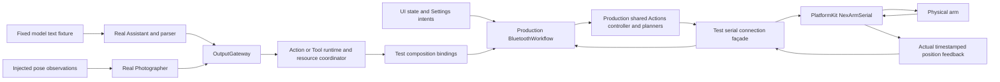

# IntegrationTests

## 职责与构造边界

通过真实 Agent/Gateway/Action/Tool/Storage 接口和注入模型、设备及呈现端点验证跨模块契约。ActionCatalogFixture 在每个作用域安装相同不可变生产声明；并发、失败与完成使用显式 gate/反馈同步。常规用例不推理真实模型、不控制硬件；真实 provider 和串口验收必须单独启用。

## 当前覆盖

SpeechPlaybackTests 通过真实 AudioCache／SpeechPlayback 与显式退出 gate 验证 VoiceReplyCancellation；播放取消加入前、原生停止加入前均保留未播放句柄，最后会话清理无 missingAudio 故障；中断正常返回、失败或取消时均完成清理并保留原错误。PCM／原生停止为替身，不宣称真机或真实合成验收。

PromptTemplateTests 通过生产目录和增量解析器读取 ExpressionInteraction 的子集串行/全量语音并行示例，核对每个 wait 的表情、默认 Channel、语音对应关系及全量示例对所有合法 express 值的覆盖，并检查默认请求包含教学。现有调度器 wait 回归验证组内跨 Channel 并行和组间完成屏障；合成测试不代表 Flash 真实模型遵循验收。

| 文件/用例组 | 主要边界 |
| --- | --- |
| AgentTaskSkillTests | 基础/近期/Task Skill 所有权、五次完整 Decision 闲置回收、使用续期、Task 接管及终态、等待/替换、依赖预算、在途保护、LRU、会话/重启与原子提交 |
| AssistantChatTests / GenerationRoundTests | 多轮上下文、原生配对、Action/Tool/混合屏障、第二输入优先、真实业务输出与完成证据、拒绝/取消/异常、长 ReACT 链 |
| PromptTemplateTests | 生产 XML 示例、静默 Task 入口、单次有序话术、无 Task 不关闭、目标转移询问/释放教学、模板变量及目录投影 |
| GenerationRoundTests 的 compact 用例 | JSON/文本/scalar/空值、业务 null、同名多调用序号、拒绝未执行、未知效果、部分成功/取消、内部完整 journal 与 provider ID 隔离 |
| ConversationHistoryTests / HistoryToolTests | 完整消息/请求证据、SQLite 重开、终态 Task 原位压缩、窗口、分页、原生结果及晚到写入、并发冲突与不重放 |
| HistoryIntentTests / ResourceIntentTests | 类型化历史/资源意图、两条 Gateway、提交与呈现、来源/会话隔离、删除/归档及取消 |
| FunctionTokenParserTests / GenerationTrace | UTF-8 分片、XML/实体/作用域、参数、容量、原始证据与无执行解析 |
| AgentConfigurationTests / ActionDeclarationTests | 资源 Catalog、canonical 声明、Skill 绑定、别名/Channel 冲突、固定与模型目录、最终声明覆盖 |
| RuntimeTests / AgentArchitectureTests / CommunicationTests | 接纳、incarnation/来源/会话、root/parent 关联、原子状态、根服务清理与有界输出 |
| ActionContractTests / ActionLifecycleTests / ActionObservationTests | 函数预算、共享执行、资源 lease/fence、Channel/wait、结果预留/重投递、接管、纯取消及完整终态 |
| VoiceTests / SentenceFunctionTests / SpeechPlaybackTests | VAD/ASR、冷加载期间前缀完整性/有序衔接、缓冲时长/内存/包数上限及取消隔离、分段、字幕/合成、PCM handle、播放与半双工边界 |
| AudioCaptureReadinessTests / AudioSampleBufferReaderTests | 首帧准备、格式、mono/FOA/planar PCM、溢出/失败与取消 |
| PhotographyPipelineTests / CameraSamplingTests | 原生帧输入、最新态替换、共享姿态推理、skeleton/gaze 投影 |
| Resource/Provider/Settings 用例 | 私有参数暂存、保存/绑定/呈现顺序、版本冲突、资源准入及失败后状态 |
| Storage 用例 | domain 仓库、配置文档、提交身份、完整消息 checkpoint、容量/损坏/并发与缓存 |
| NexArm/Bluetooth 用例 | 包与几何、反馈／归位、断连与恢复、资源接管、机械臂状态和协议隔离；首次肩／肘水平准备、电机1／4速度模式进入、准入重试／替换、目标变化后的速度保持、静止停止及退出恢复；取消／后台清理和最新手动意图的加入／接管 |

Task/Skill 的边界矩阵包括四种预加载接管方式（指定、加载、操作 Action、查询 Action）和完成/失败/取消终态；最后一次闲置时使用/重载、零后重载、独立计数、错误快照、32 个在途 Decision、精确字节/数量预算、批量失败回滚、跨会话取消权及失败提交重试。通过实际 Assistant 请求检查后续目录到期、历史证据保留与内部 ReACT 单次结算。用例数量从源码/测试运行报告获取，不在 README 保存某次执行的计数或通过结论。

## 容器与直接输入覆盖

✅ AgentContainerTests 使用生产 AgentContainerLifecycle 和可控 gate，覆盖冷根失效、真实 ApplicationLifecycle 初始 inactive → active 组合、启动在途取消、并发启停、部分启动回滚、必须暂停、迟到恢复围栏、终态拒绝及原始／清理失败。AgentSpecialistTests 验证 Assistant 前后台切换不控制平级角色。

iOS 条件用例验证 ApplicationContainer 同根缓存、七个子能力身份和跨根隔离，需要 iOS 测试宿主；macOS check.sh 不执行这些用例。具体执行状态归[容器验证](../../docs/validation/Agent-Containers.md)，README 只定义覆盖范围。

| 用例边界 | 观察行为 |
| --- | --- |
| 角色 UI 输入 | 真实子容器请求／回执、单消费者、容量、独立控制、暂停恢复、取消加入、版本／来源隔离；设置私密参数暂存与失败呈现 |
| 存储／公开 State | 无效果构造、打开恢复失败、停止与读写竞争、旧仓库拒绝；公开编码／作用域／代际／预算，完整 Context 不进入公开事实 |
| 原生媒体 | 只读 PCM／CameraFrame 直接消费、原采集序号、布局与新鲜度、唯一有界缓冲、半双工丢弃、停止加入及旧回调围栏 |
| 视觉输出 | latest 替换／会话隔离、离散结果保留、慢消费者、真实溢出、终态排空、输入结束／输出失败、错误证据及呈现 |
| 容器异常 | 同根注入、原始错误与清理错误、取消分类、去重／容量、来源与关联；真实 Gateway／ApplicationControl／Actions 呈现和防递归 |
| 首页准备 | loading／checking／ready 事实、真实呈现调用完成类型、代际及乱序版本、验证失败的完整错误链 |
| 原生执行替身 | 语音权限／准备／停止围栏、播放清理、设备连接恢复和旧反馈隔离；替身不证明物理完成 |

FeedbackActionTests 的 iOS 原生触觉用例通过 HAPTIC_DEVICE_ACCEPTANCE=1 显式启用，保留共享会话还原和清理失败；平台 API 接纳不代表实际震感已确认。其他真实模型／设备 gate 同样必须独立报告。

## 执行与时钟隔离

普通用例并发执行，LiveRuntimeTests 与原生窗口用例在独立阶段串行执行；任一阶段失败仍执行另一阶段并返回失败。涉及真实捕获新鲜度、机械期限、媒体到期和进程级 AppKit 状态的用例使用该阶段，用例内部业务并发仍保留。合成突发用例可显式注入采样间隔；默认 cadence／freshness 用例继续校验生产预算。

## 资源和历史约束

参数容错回归覆盖 XML 未声明属性过滤、无参查询、必填缺失/拼写错误和原始容量拒绝、Tool/固定调用严格授权；设备回归验证 disconnect 附带 id/value/action 仍执行且不向端口透传，适用参数非法值仍失败。模型输出与设备端点使用合成替身，不代表真实 BLE 或物理机械臂验收。

生产 Skill 均由显式 Catalog 加载；模型函数绑定由 Skill 选择，真实参数来自 @Action。请求快照、旧原文及内部关联不被后来的加载或投影改写。Schema、revision、媒体和业务 ID 的断言应取实际资源/提交结果，不用已失效的文档示例代替权限。

模型文字、PCM、图片和执行结果替身必须标明合成。保存/捕获次数、错误后不重放、等待用户、原生配对与持久化失败都应断言真实边界。生产资源当前没有 Skill 依赖，现有资产不能冒充共享/循环依赖图的验收。

## 千问 Action / Tool 回归

QwenWorkflowEvaluationTests 通过实际 Assistant／Gateway 链路运行显式启用的云模型场景，设备反馈和非设备呈现使用合成替身。检查生产 Skill 的 Action-only 请求、协议解析、顺序／wait 与业务流程，不将 HTTP 探针当作完整链路验证。场景数据归 [AgentModelEvaluationTests](../AgentModelEvaluationTests/README.md)，运行入口与凭据隔离见 [scripts](../../scripts/README.md#千问显式实验工具)，结果和已知失败只归 [千问报告](../../docs/validation/Qwen-Workflow-Regression.md)。

## Supervised serial App/Agent acceptance

Serial acceptance calls the same explicit workflow connection operation as the list button and asserts matching native connectivity; it does not claim to exercise SwiftUI navigation.

`NexArmSerialAcceptanceTests` supplies opt-in read-only preflight, Settings/Assistant motor control, Photographer Tool/Settings takeover and full preset trials. `SerialSettingsLink` is a test-only connection façade for App's currently BLE-specific injection seam; every write, query and position receipt goes through the real PlatformKit serial transport. It reuses the SDK's 30 ms budget, keeps one latest telemetry/snapshot/target and no command queue, rejects more than 512 writes or 1024 logged samples, and fences observation/live owners. No motor feedback, IK response, motion success or ATT acknowledgment is fabricated.

Tests use the real Assistant/Gateway scheduler, domain Action/Tool registration, production business workflow and shared Action recipes. Model text, pose observations and non-device presentation handlers are explicit fixtures; App's private application assembly and native SwiftUI touches are outside this test seam. Finite Agent success requires terminal execution records and measured movement. Tool acceptance is checked separately from measured tracking. Manual submission, cancellation/replacement, an Agent lease bypass, release hold, invalid arguments and disconnected admission have separate checks. No gripper, torque, firmware or calibration change is part of these trials. Failures stop software owners and close the port without movement replay or automatic return home.

Run one explicitly selected physical test per process with `NEXARM_PORT=/dev/cu.usbserial-110` and its gate: `NEXARM_SERIAL_PREFLIGHT`, `NEXARM_SERIAL_ACCEPTANCE`, `NEXARM_SERIAL_TRACKING_ACCEPTANCE`, or `NEXARM_SERIAL_PRESETS_ACCEPTANCE` set to `1`. Default repository checks leave all gates disabled. Stop phone control and clear the physical workspace first. Serial results do not certify CoreBluetooth, radio recovery, native UI hit-testing, real model decisions, YOLO perception or sustained tracking under load. Dated observations belong to [physical acceptance](../../docs/validation/NexArm_Physical_Acceptance.md).

## 待实现

- 真实模型对目标转移、无 Task 完成、主动释放及多轮工作流的遵循验收。
- 相机/Photos、麦克风/声源、声学竞争、持续 BLE/USB/视觉跟踪与原生 UI 验收。
- 可注入 Skill 依赖图及跨进程/持久活跃 worker 的独立验证环境。

执行方法与结果归 [validation](../../docs/validation/README.md)，不在本文件追加运行/安装记录。
