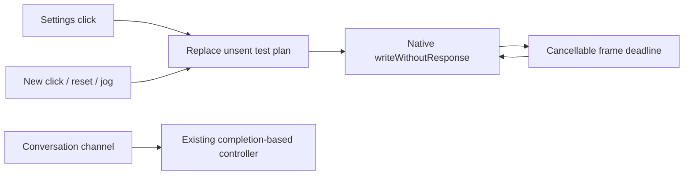

# IntegrationTests

Purpose: verify composed Agent, Gateway, Action, Tool, Storage and voice contracts with injected model/device substitutes. Design goals: exercise real boundaries and failure paths without presenting a simulator or test double as physical-device acceptance.

## Current coverage

- ✅ `FunctionTokenParserTests` covers fragmented UTF-8, escaped text, nested Channels, malformed and oversized input, Action resolution and native Tool syntax.
- ✅ `AgentConfigurationTests` covers packaged JSON v4 declarations, metadata, examples, capability visibility, path/Channel validation and malformed or missing configuration. Production permission lists remain in Agent JSON.
- ✅ `ActionExecutionTests` and `RuntimeTests` cover Channel ordering, resource exclusion, bounded admission, cancellation, failure isolation and completion barriers.
- ✅ `CommunicationTests` covers static and directed routing, schema/source checks, admission deadlines, state replacement and independent session cleanup.
- ✅ `VoiceTests`, `SentenceFunctionTests`, `SpeechPlaybackTests`, `PCMResamplerTests` and `StorageTests` cover VAD/ASR observations, captions, Assistant output segmentation, synthesis requests, audio-ID playback, starvation/timeout, resampling, cache leases and expiration. `FixedTextChat` and `SpeechRequestProbe` are test fixtures only.
- ✅ `PhotographyPipelineTests` and `CameraSamplingTests` cover frame sampling/filtering, shared pose inference, current VisionPerception publication and completion-only `UI.showPose` Tool delivery with zero or multiple subscribers. The photography test filename reflects an earlier design; no Photographer Agent is packaged.
- ✅ `EyeTrackingTests` covers pose-derived eye movement and related presentation Actions with injected services.
- ✅ `AssistantChatTests` verifies chat request context, history, expression metadata, hidden capability visibility, malformed output recovery and later-turn continuity.

## Acceptance still required

- ❌ Real microphone/camera behavior, model accuracy, playback and expression appearance, hardware latency, thermal stability and sustained conversation require physical-device testing. Passing this suite establishes protocol behavior with controlled inputs only.

Update this README when test responsibilities change; dated run results belong in [validation history](../../docs/Validation-History.md).

✅ Local document tests cover reopen, cached reads, explicit refresh/invalidation, stale and concurrent writers, size bounds and corrupt-file cache preservation. ❌ Keychain migration requires device acceptance.

✅ FunctionTokenParserTests also covers GenerationTrace: exact raw/fragment preservation, equivalent production parsing and Channel resolution, continuing collection after parser failure, incomplete markup at finish and explicit byte/fragment overflow without eviction.

✅ Structured wait coverage includes byte-fragmentation invariance, lexical nesting/cross-close errors, empty and consecutive groups, reserved aliases, group/depth limits, ordered Assistant speech conversion, entry/exit joins, streaming nested execution, dormant-capacity accounting, task Action limits, module exclusion, independent-task progress and cancellation cleanup. Gates and handler signals verify execution dependencies without timing-based assertions. ❌ Live model syntax compliance and physical timing require device acceptance.

✅ Prompt regression verifies English production guidance, visible Action details grouped by default Channel, stable audio-Channel guidance independent of mapping order, hidden-call/text-effect/Tool exclusion and explicit invalid-mapping failures. ❌ These checks do not measure live-model instruction following.

✅ ConversationHistoryTests covers durable raw/request restoration, interrupted generation, exact ten-round context, failed-round exclusion, atomic archive/reset, raw overflow preservation, parser-failure recording, cancellation and isolated title generation. Assistant request tests now expect history across voice sessions. ❌ These fixtures do not establish real-provider title quality or device performance.

✅ JSON v5 uses Channel-grouped callable Actions; Assistant text interpretation uses Assistant.mapText rather than JSON aliases. Regression coverage checks internal permissions cannot be called through model markup and preserves wait event order. ❌ Live-model/device acceptance is separate from automated checks.

✅ Chat output-token budgets are optional and default to nil. Assistant/cloud requests omit max_tokens so the provider chooses its default; local Qwen uses remaining room in its existing 4096-token context. History shows 模型默认 for omitted values and preserves older explicit budgets. The separate 2000-byte whole-reply cap is removed; parser, queue, timeout and per-segment bounds remain. Explicit title/warmup budgets are unchanged. ❌ Live-provider/device acceptance remains separate.

✅ Runtime tests import the unified Actions and Tools targets. AgentCore is compiled from Agents/Core; test files remain under root Tests. Existing scheduler, conversation, perception and cancellation regressions verify the unchanged chain. ❌ Directory migration alone does not establish device timing.

## Action runtime stage 1

✅ ActionContractTests covers duplicate/invalid/oversized definitions, model/internal startup coverage, non-Action rejection, typed decoding, unknown-key rejection before UI effects, finite lane ownership versus state acceptance, fresh admission IDs, diagnostic overflow without losing Actions, failure propagation and cancellation after commit versus queued cancellation. Synchronization uses bounded single-waiter gates and explicit acknowledgments; no physical timing is inferred. ActionTestRegistry supplies explicit finite-operation metadata for pre-existing scheduler fixtures. Existing integration tests migrated to consistent invocation construction and Gateway-owned scheduling errors.

❌ These fixtures do not establish hardware completion, persistent activity ownership or resource takeover.

## Action runtime stage 2

✅ ActionLifecycleTests covers message-only retry, reserved feedback capacity, owner reincarnation, activity completion, atomic group takeover, stale leases, cleanup timeout/recovery, automatic expiry, protected Tools and owner/session cleanup. All device acknowledgments are controlled test doubles. ❌ These tests do not establish physical device safety.

## Domain-owned behavior assembly

✅ BehaviorAssemblyTests verifies complete production capability coverage, invalid arguments before effects, returning/completion Tool semantics, duplicate/invalid/bounded module catalogs, missing internal Tools and extension modules that execute without an App host. ❌ Hardware acceptance remains separate.

## Action implementation audit

✅ ActionAuthoringTests verifies Speech entry validation and cancellation/error semantics. Existing speech tests use a test-only service convenience that enters through SpeechActions.speak before invoking typed playback.

## Storage domain organization

✅ ConversationHistoryTests imports StorageChat for journal behavior and Storage for durable document fixtures. Core StorageTests remains independent of chat and audio domains.

❌ Image/video/semantic-memory stores remain planned; this migration adds no storage behavior.

## NexArm diagnostics

✅ NexArmTests covers framing, corruption, fragmentation, bounds, Action validation, firmware/stationarity gates, single-motion admission, no retries after uncertain writes and joined cancellation. The opt-in `nexArmUSBPhysicalAction` enters through both gateways and the real Action registry; default test runs never move hardware. ❌ TCP and independent physical-stop acceptance remain pending; BLE implementation and separate iPhone acceptance are described below.

✅ Base tests cover count/extra-argument rejection, firmware/motion preflight, uncertain-write fault latching, cancellation joining one committed leg, and real Assistant JSON/parser/Gateway dispatch of two cycles. `nexArmUSBPhysicalBaseAction` is separately gated by NEXARM_BASE_TEST=1, NEXARM_PORT and NEXARM_CYCLES=1...3. Model and presentation fixtures are test-only; USB and Action execution are real when enabled.

✅ Packaged configuration and prompt regression assertions now include Robot/shakeBase. Physical base acceptance passed one cycle (2114 → 2092 → 2133 → 2117); an earlier convergence timeout remains documented in the platform README.

✅ Base extension final validation: scripts/check.sh passed (182 IntegrationTests, hardware tests skipped by default), and scripts/build-ios.sh passed all four unsigned simulator schemes with full Xcode. Physical acceptance ran separately and the USB port was closed.

✅ NexArmBluetoothTests covers bounded BLE ACK/reply decoding and full Assistant → Action → BluetoothWorkflow → simulated arm, settings navigation/persistence/forget, version refusal, background cancellation joining one leg, connection quiescence and no retry after unknown effect. Fixtures are explicit simulations; default checks never scan or move hardware. ❌ iPhone radio/UI and real-model selection require separate physical acceptance.

✅ iPhone BLE validation (2026-09-29): `scripts/check.sh` passed, including 188 IntegrationTests; `scripts/build-ios.sh` passed all four simulator schemes. The signed iPhone build installed and launched on the connected iPhone 17 Pro. Real iPhone settings/radio and spoken-model-to-motion acceptance remain pending user interaction.

✅ Regression coverage verifies that Bluetooth disconnect does not stop unrelated voice work, while reconnection retains its old-session barrier. Vision receipt delivery through InputGateway must succeed before another frame is admitted. BLE timeout messages distinguish connection/service/notification/reply stages.

Regression validation: `scripts/check.sh` passed with 191 IntegrationTests, including three added regression checks. Signed iPhone build and all four simulator schemes passed. The repair build was installed and launched on the connected iPhone 17 Pro; physical camera/audio/BLE recovery remains pending user verification.

✅ Firmware regression tests cover three missing-AT32 replies followed by verified firmware, per-controller reuse, exhaustion after four reads and no retry after transport failure. No hardware moves during these tests.

2026-09-30 verification: `scripts/check.sh` passed (193 IntegrationTests), all four `scripts/build-ios.sh` schemes passed, and the signed iPhone build succeeded. The first update installation failed with CoreDevice/RSD allocation; retry succeeded and the updated app launched on iPhone. iPhone BLE acceptance has not been established.

✅ Simulated BLE tests cover retaining a connection after four missing AT32 replies, explicit capacity-one revalidation without reconnection, no motor writes or replay of rejected Actions, and background cancellation of revalidation. ❌ These do not establish physical iPhone control.

Validation of readiness separation: `scripts/check.sh` passed (195 IntegrationTests), all four `scripts/build-ios.sh` schemes passed, and the signed iPhone build passed. Physical iPhone acceptance remains pending.

✅ Simulated connection tests assert exactly one reset followed by ID5 −23/+23/home targets, no replay on navigation/revalidation, no motion with missing firmware, no ready state on indication failure, and background cancellation joining reset without starting ID5. ATT-only write completion remains distinct from position feedback. ❌ Physical reset and servo timing are not validated by these fixtures.

Connection-indication validation: `scripts/check.sh` passed with 198 IntegrationTests and all four simulator schemes passed `scripts/build-ios.sh`. Physical reset/ID5/iPhone acceptance remains pending.

✅ Current BLE compatibility tests require stationary valid telemetry for the exact known missing-AT32 response, verify truthful firmware labeling, one reset/ID5 ±8° indication and real Assistant/Gateway/Action fixture dispatch, reject invalid/moving pose and other explicit versions without any motor writes, and retain strict firmware behavior by default. ❌ Fixtures do not establish iPhone physical movement.

✅ The BLE fixture now reflects observed reset residuals (Z −3 mm, pitch −1.2°), with a separate stable-but-outside-home test ensuring no ID5 movement and a latched fault. ❌ Fixture convergence is not physical clearance evidence.

Latest compatibility/home-tolerance validation: `scripts/check.sh` passed (200 IntegrationTests), all four `scripts/build-ios.sh` schemes passed. Production Mac connection indication completed reset/ID5 ±8°/center with sampled convergence; iPhone physical acceptance remains pending.

✅ Current BLE UX tests cover no firmware-version queries, renamed-device connection, priority sorting without excluding unrelated/unnamed rows, background/foreground recovery outside Settings with no additional motor commands, cold-start read-only recovery, persisted manual-disconnect/forget behavior, and manual disconnect during background motion cleanup. Service/protocol and movement checks remain covered. ❌ Mock tests do not establish OS radio discovery or suspended-device timing.

Bluetooth UX validation: `scripts/check.sh` passed with 204 IntegrationTests and all four simulator schemes passed `scripts/build-ios.sh`. Real-device discovery/recovery acceptance remains pending.

## NexArm entertainment skills (2026-09-30)

✅ Entertainment gesture tests exercise Assistant alias resolution, Gateway execution, typed validation, real controller packet/telemetry logic with explicitly simulated links, ACK-without-arrival failure, joint disturbance, capacity rejection, cancellation join, maximum repetitions and workflow background recovery without replay. ❌ Simulators do not establish physical gesture acceptance.

## Peripheral details coverage

✅ Simulated Bluetooth telemetry covers every motor ID, target/delta validation before writes, repeatable reset without indication, measured UI refresh, shared Action/manual admission, navigation-independent movement and uncertain-write fault latching. Existing foreground/disconnect tests exercise the shared motion lifecycle. ❌ No physical hardware is moved by these tests; layout and mechanical acceptance remain separate.

## Unconfirmed motion recovery

✅ Simulated tests check retained connection/control UI after failure, no implicit replay, read-only refresh recovery, next-request recovery on the same controller, moving-feedback rejection and real disconnect rejection. ❌ These tests do not establish physical completion or iPhone acceptance.

## Full Bluetooth lifecycle regression coverage

✅ Name filtering, connect-time native/visible discovery cleanup, forget with delayed scan snapshots, persisted-empty relaunch, retry of a selected failed connection, nonfatal connection gesture failure, initial-gesture transport recovery, established-link recovery without replay and one-attempt failure bounds use explicit simulated telemetry.

❌ These tests do not exercise iOS-managed pairing or prove physical RF stability.

## Live joystick regression coverage

✅ Simulated tests cover all six channels without telemetry, velocity scaling and joint endpoints, release without reset, background cancellation, backpressure without queued travel, reset before preset settlement, retiring a blocked observation, and manual control after an uncertain preset. Existing preset tests continue to verify completion and cancellation. ❌ Simulated writes do not establish physical latency, clearance or stopping distance.

✅ NexArm choreography coverage now decodes six-joint sync packets, compares absolute targets from different initial poses, checks speed bounds and final home, exercises 22-waypoint repetition bounds, ACK-without-arrival failure, cancellation and live reset fencing. ❌ Real device clearance/timing acceptance is separate.

✅ Preset fixtures now reject raw register broadcasts and accept only controller CMD51 packets, including six-target waypoint grouping and132-write maximum. Regression covers reset with no completion response followed by a successful preset on the same connection, and preservation of detailed UI errors. ❌ No physical-motion tests run by default.

✅ Pose-choreography fixture rejects CMD51/raw-register performance writes and models a calibrated home ID3=1225, differing from vendor1198. It checks fixed physical endpoints from different starting poses, fast large base sway, failed body arrival, no-reset-ACK recovery and reset fencing. ❌ These are simulations, not physical-motion evidence.

✅ Added opt-in `nexArmUSBPhysicalPresetsSharedWithPhone` (`NEXARM_PRESETS_TEST=1`, explicit `NEXARM_PORT`). It opens the real serial adapter, verifies firmware, executes all seven production presets in order through the same controller as iPhone, prints bounded packet/telemetry evidence and stops/closes on first failure. Default checks skip physical motion. Regression tests model measured raised-pose error and assert native absolute CMD8 targets do not accumulate it. ❌ BLE transport performance is not inferred from USB.

✅ 2026-09-30: shared NexArm jog planner uses bounded acceleration/jerk, finite look-ahead, 30 ms scheduling and native servo position writes without per-write pose queries. Tests cover smoothing, duplicate suppression, six-axis streaming, congestion and reset preemption. See ADR 0079. ❌ BLE physical cadence/visual smoothness require phone acceptance.

✅ Explicit NexArm preset requests are independent of prior unconfirmed motion: no recovery/stationary-feedback gate before an already validated connection starts its fixed 3000ms approach. A failed segment stops only that invocation; subsequent user requests can start. Current-request completion feedback, exclusive ownership, reset preemption and connection validation remain. Regression tests cover missing old feedback and a later successful request. ❌ No claim that ignoring an old result physically stops servo holding or repairs transport loss.

✅ Tilt regression verifies both directions retain ready height,40° roll and all five approach/body/return waypoints. Opt-in NEXARM_PRESETS_FILTER=tilt limits the existing USB acceptance test to both tilts. ❌ Physical runs require avoiding concurrent phone commands; default tests do not move hardware.

## Settings test control (current)

✅ Settings Play uses native CMD8 writeWithoutResponse without telemetry/ATT completion waits. Fixed ready400ms → body800ms per frame → home600ms, maximum8 frames. These are cancellable playback deadlines, not arrival gates. One latest test slot replaces all unsent old frames; no command backlog. New Play/reset/jog can take over within the30ms worker cadence (subject to native transport admission). Buttons remain enabled while connected. Native congestion retains only the latest request, fails visibly after2s, and never replays skipped old frames. Page exit/background/disconnect discard unsent test frames. UI says sent, never physically completed. Conversation/channel performGesture retains its existing feedback-based contract.

❌ Wireless delivery and physical arrival are not established by local send admission. Optional NEXARM_SETTINGS_TEST validates the shared frame plan on USB, separate from default tests.

✅ NexArmTelemetryTests covers unsolicited/fragmented telemetry with a latest-only bound, stable-time vs wall-time, independent feedback/total deadlines, notification-only completion without queries, limited query fallback, missing-feedback recovery without replay, and session takeover cancellation. Optional USB preset acceptance exercises the same observable-link path through NexArmPhysicalTrace. ❌ No device-firmware watchdog verification is claimed.

✅ USB preset diagnostics support `NEXARM_PRESETS_FILTER=dance` for isolated dance reproduction and print segment numbers, elapsed receipt time, decoded targets and measured pose/joints. Unknown filters fail before movement. ❌ A trace is physical evidence only when the opt-in run is performed without concurrent phone control.

✅ Dance timing regression replays the observed leg8 timing past the old13.6s deadline and checks the per-segment timeout still wins over the larger aggregate budget.
