# IntegrationTests

✅ 覆盖 Worker 等待标记在首个有效输出及失败／取消的结束边界，继续保留真实模型和物理设备独立验收。

✅ 宿主准备验证失败通过真实 ContainerFailureChannel／Gateway／ApplicationControl／呈现函数记录异常并显示 Toast，保留原始 ValidationError，不由 UI 或 App 决定 Toast。

## 职责与构造边界

通过真实 Agent/Gateway/Action/Tool/Storage 接口和注入模型、设备及呈现端点验证跨模块契约。ActionCatalogFixture 在每个作用域安装相同不可变生产声明；并发、失败与完成使用显式 gate/反馈同步。常规用例不推理真实模型、不控制硬件；真实 provider 和串口验收必须单独启用。

## 当前覆盖

✅ SpeechPlaybackTests 通过真实 AudioCache／SpeechPlayback 与显式退出 gate 验证 VoiceReplyCancellation；播放取消加入前、原生停止加入前均保留未播放句柄，最后会话清理无 missingAudio 故障；中断正常返回、失败或取消时均完成清理并保留原错误。PCM／原生停止为替身，不宣称真机或真实合成验收。

✅ PromptTemplateTests 通过生产目录和增量解析器读取 ExpressionInteraction 的子集串行/全量语音并行示例，核对每个 wait 的表情、默认 Channel、语音对应关系及全量示例对所有合法 express 值的覆盖，并检查默认请求包含教学。现有调度器 wait 回归验证组内跨 Channel 并行和组间完成屏障；合成测试不代表 Flash 真实模型遵循验收。

| 文件/用例组 | 主要边界 |
| --- | --- |
| AgentTaskSkillTests | 基础/近期/Task Skill 所有权、五次完整 Decision 闲置回收、使用续期、Task 接管及终态、等待/替换、依赖预算、在途保护、LRU、会话/重启与原子提交 |
| AssistantChatTests / GenerationRoundTests | 多轮上下文、原生配对、Action/Tool/混合屏障、第二输入优先、真实业务输出与完成证据、拒绝/取消/异常、长 ReACT 链 |
| PromptTemplateTests | 生产 XML 示例、静默 Task 入口、单次有序话术、无 Task 不关闭、目标转移询问/释放教学、模板变量及目录投影 |
| GenerationRoundTests 的 compact 用例 | JSON/文本/scalar/空值、业务 null、同名多调用序号、拒绝未执行、未知效果、部分成功/取消、内部完整 journal 与 provider ID 隔离 |
| ConversationHistoryTests / HistoryToolTests | 完整消息/请求证据、SQLite 重开、终态 Task 原位压缩、窗口、分页、原生结果及晚到写入、并发冲突与不重放 |
| HistoryIntentTests / ResourceIntentTests | 类型化历史/资源意图、两条 Gateway、提交与呈现、来源/会话隔离、删除/归档及取消 |
| FunctionTokenParserTests / GenerationTrace | UTF-8 分片、XML/实体/作用域、参数、容量、原始证据与无执行解析 |
| AgentConfigurationTests / ActionDeclarationTests | 资源 Catalog、canonical 声明、Skill 绑定、别名/Channel 冲突、固定与模型目录、最终声明覆盖 |
| RuntimeTests / AgentArchitectureTests / CommunicationTests | 接纳、incarnation/来源/会话、root/parent 关联、原子状态、根服务清理与有界输出 |
| ActionContractTests / ActionLifecycleTests / ActionObservationTests | 函数预算、共享执行、资源 lease/fence、Channel/wait、结果预留/重投递、接管、纯取消及完整终态 |
| VoiceTests / SentenceFunctionTests / SpeechPlaybackTests | VAD/ASR、冷加载期间前缀完整性/有序衔接、缓冲时长/内存/包数上限及取消隔离、分段、字幕/合成、PCM handle、播放与半双工边界 |
| AudioCaptureReadinessTests / AudioSampleBufferReaderTests | 首帧准备、格式、mono/FOA/planar PCM、溢出/失败与取消 |
| PhotographyPipelineTests / CameraSamplingTests | 原生帧输入、最新态替换、共享姿态推理、skeleton/gaze 投影 |
| Resource/Provider/Settings 用例 | 私有参数暂存、保存/绑定/呈现顺序、版本冲突、资源准入及失败后状态 |
| Storage 用例 | domain 仓库、配置文档、提交身份、完整消息 checkpoint、容量/损坏/并发与缓存 |
| NexArm/Bluetooth 用例 | 包与几何、反馈／归位、断连与恢复、资源接管、机械臂状态和协议隔离；首次肩／肘水平准备、电机1／4速度模式进入、准入重试／替换、目标变化后的速度保持、静止停止及退出恢复；取消／后台清理和最新手动意图的加入／接管 |

Task/Skill 的边界矩阵包括四种预加载接管方式（指定、加载、操作 Action、查询 Action）和完成/失败/取消终态；最后一次闲置时使用/重载、零后重载、独立计数、错误快照、32 个在途 Decision、精确字节/数量预算、批量失败回滚、跨会话取消权及失败提交重试。通过实际 Assistant 请求检查后续目录到期、历史证据保留与内部 ReACT 单次结算。用例数量从源码/测试运行报告获取，不在 README 保存某次执行的计数或通过结论。

## 资源和历史约束

✅ 参数容错回归覆盖 XML 未声明属性过滤、无参查询、必填缺失/拼写错误和原始容量拒绝、Tool/固定调用严格授权；设备回归验证 disconnect 附带 id/value/action 仍执行且不向端口透传，适用参数非法值仍失败。模型输出与设备端点使用合成替身，不代表真实 BLE 或物理机械臂验收。

生产 Skill 均由显式 Catalog 加载；模型函数绑定由 Skill 选择，真实参数来自 @Action。请求快照、旧原文及内部关联不被后来的加载或投影改写。Schema、revision、媒体和业务 ID 的断言应取实际资源/提交结果，不用已失效的文档示例代替权限。

模型文字、PCM、图片和执行结果替身必须标明合成。保存/捕获次数、错误后不重放、等待用户、原生配对与持久化失败都应断言真实边界。生产资源当前没有 Skill 依赖，现有资产不能冒充共享/循环依赖图的验收。

## Supervised serial App/Agent acceptance

Serial acceptance calls the same explicit workflow connection operation as the list button and asserts matching native connectivity; it does not claim to exercise SwiftUI navigation.

`NexArmSerialAcceptanceTests` supplies opt-in read-only preflight, Settings/Assistant motor control, Photographer Tool/Settings takeover and full preset trials. `SerialSettingsLink` is a test-only connection façade for App's currently BLE-specific injection seam; every write, query and position receipt goes through the real PlatformKit serial transport. It reuses the SDK's 30 ms budget, keeps one latest telemetry/snapshot/target and no command queue, rejects more than 512 writes or 1024 logged samples, and fences observation/live owners. No motor feedback, IK response, motion success or ATT acknowledgment is fabricated.

```mermaid
flowchart LR
    Manual[UI state and Settings intents] --> Workflow[Production BluetoothWorkflow]
    Model[Fixed model text fixture] --> Assistant[Real Assistant and parser]
    Pose[Injected pose observations] --> Input[InputGateway]
    Input --> Photographer[Real Photographer]
    Assistant --> Output[OutputGateway]
    Photographer --> Output
    Output --> Runtime[Action or Tool runtime and resource coordinator]
    Runtime --> Bindings[Test composition bindings]
    Bindings --> Workflow
    Workflow --> Actions[Production shared Actions controller and planners]
    Actions --> Facade[Test serial connection façade]
    Facade --> SDK[PlatformKit NexArmSerial]
    SDK --> Arm[Physical arm]
    Arm --> SDK
    SDK --> Feedback[Actual timestamped position feedback]
    Feedback --> Facade
    Facade --> Workflow
```

Tests use the real Assistant/Gateway scheduler, domain Action/Tool registration, production App workflow and shared Action recipes. Model text, pose observations and non-device presentation handlers are explicit fixtures; App's private application assembly/behavior adapter and native SwiftUI touches are outside this test seam. Finite Agent success requires terminal execution records and measured movement. Tool acceptance is checked separately from measured tracking. Manual submission, cancellation/replacement, an Agent lease bypass, release hold, invalid arguments and disconnected admission have separate checks. No gripper, torque, firmware or calibration change is part of these trials. Failures stop software owners and close the port without movement replay or automatic return home.

Run one explicitly selected physical test per process with `NEXARM_PORT=/dev/cu.usbserial-110` and its gate: `NEXARM_SERIAL_PREFLIGHT`, `NEXARM_SERIAL_ACCEPTANCE`, `NEXARM_SERIAL_TRACKING_ACCEPTANCE`, or `NEXARM_SERIAL_PRESETS_ACCEPTANCE` set to `1`. Default repository checks leave all gates disabled. Stop phone control and clear the physical workspace first. Serial results do not certify CoreBluetooth, radio recovery, native UI hit-testing, real model decisions, YOLO perception or sustained tracking under load. Dated observations belong to [physical acceptance](../../docs/validation/NexArm_Physical_Acceptance.md).

## 待实现

- 真实模型对目标转移、无 Task 完成、主动释放及多轮工作流的遵循验收。
- 相机/Photos、麦克风/声源、声学竞争、持续 BLE/USB/视觉跟踪与原生 UI 验收。
- 可注入 Skill 依赖图及跨进程/持久活跃 worker 的独立验证环境。

执行方法与结果归 [validation](../../docs/validation/README.md)，不在本文件追加运行/安装记录。

## 历史只读请求接入

✅ UI 的记录分页、消息、归档及授权图片读取也经 MemoryHistoryIntent.query 的实际 Gateway/Memory 接入；不再由 UI 请求适配器直接读仓库。MemoryHistoryReadRequests 为根持有的类型化只读请求暂存，最多四个请求，每个请求一个结果等待者；Signal 只携带随机 ID，结果保留规范仓库返回值。请求/结果有界，120 秒未返回明确超时，取消/停止加入实际读取，迟到结果不更新 UI；不新增模型函数或重放副作用。

## Storage 生命周期回归

✅ StorageRuntimeTests 覆盖构造无数据库效果、重复启停、恢复、原始失败、启动取消/停止竞争、停止等待在途读写、旧仓库关闭拒绝及根图回滚。显式 gate 控制执行顺序；媒体延迟注入覆盖 notReady 不被缓存。

Storage 生命周期回归同时覆盖停止先于启动、损坏数据库无后端回退，以及实际 Storage 启动期间 Scene 非活跃的正常暂停和回滚。

## Storage 依赖

✅ 存储访问使用独立的 State、Cache、Database 和 Files 接口；App 注册根实例，消费者通过构造器获得所需能力。存储容器不接管本目录的业务验证、执行和完成语义。

GenerationRoundTests 的 native-only 模型夹具报告合成参数首样本，验证 driver 到历史仓库保留原始计时，不把工具完成时间作为首 token。

## 公开 State 边界

✅ State 回归覆盖公开编码、作用域隔离、代际/容量/失败、Task 投影与每轮请求。Assistant fixture 显式注入隔离的公开事实源；测试替身和自动化结果不等于真实模型或物理设备验收。

[公开 State 契约](../../MobileHarness/Storage/State/README.md)

✅ 补充会话 interrupt/pause 与真实 close 的区别回归，覆盖近期 Skill 续期保留、运行/等待 Task、公开 task 作用域及恢复后新输入；中断不重放、不累计 idle，关闭仍拒绝旧代际。

✅ 验证静态 system 稳定、每轮唯一最新 State、历史/工具配对不被拆分、上下文预算，以及精简教学后的 Task/Skill/相机既有契约；缓存计数保留并兼容旧证据。

## 千问 Action / Tool 回归

✅ 连续表情专项在真实 Flash/Max 调用中验证指定顺序、全量覆盖、静默串行与逐项语音/表情并行。QwenWorkflowEvaluationTests 保存每个已解析调用的 round 内 wait 路径及合成语音请求的原文映射；专项断言介绍版每项唯一独立 wait、同项语音/表情同组、默认 Channel 和同轮完整输出；纯静默版同 Display Channel 已保证串行，不强制多余 wait。全量无指定顺序时允许枚举重排，语音名称接受中英文常用同义词；执行端继续使用合成设备，不宣称原生动画/音频验收。新增结构判定另用离线反例覆盖遗漏、错组和错名称。执行方法与证据见[连续动作专项](../../docs/validation/Action-Sequence-Prompts.md)。

✅ 显式 `MH_QWEN_EVAL=1` gate 使用生产 Assistant、公开 State、Task/Skill 控制及 Gateway，注入真实阿里 Responses 模型和合成设备/仓库执行者。共用场景位于 AgentModelEvaluationTests/Scenarios/qwen-workflows.json；每场景独立会话，按用户轮次断言调用协议、参数、顺序、Task/Skill 及禁止效果。普通检查不访问网络。每场景最多32模型请求、每用户输入最多10请求、每输入180秒；超限失败，取消并加入工作，不自动重试。证据仅含合成输入、实际请求/响应/调用和用量，不含凭据；通过不等于真实设备验收。

相机替身同步发布事实，busy/权限/未开启/照片不可操作使用现有 CameraControlError；拍照不能在 busy 时被替身伪造成功。查询旁支保留 Task，替换确认单独测试；强制 Tool 查询需请求 State 未公开的电源/发现列表，避免把合理的 State 直接回答判错。

✅ 针对 Qwen 实测失败补充调用教学守卫、普通忽略与重拍分支的可解析示例，以及无模板变量/无伪 native 函数示例检查；在有界静态正文预算内允许必要教学。既有53场景保留业务判定，另有6个连续表情专项；全 Action 迁移另外断言调用协议及实际请求无 native 声明。历史三模型结果保留，当前迁移回归只选择 flash/max。

静态 system 正文预算分别为基础 Skill 23,500 UTF-8 bytes、含摄影30,500 bytes（不含 State/历史），包含常驻连续表情的完整示例及通用串行教学；完整请求继续执行现有64KiB总预算。示例由生产解析器验证，不把声明名称保护当作真实模型遵循证明。

定向模板/示例检查已通过；完整云回归及全量自动化失败分别见[优化验证报告](../../docs/validation/Qwen-Prompt-Optimization.md)，不以定向通过替代全量验收。

## 分类异常诊断

✅ 注入确定性模型协议失败，验证 Agent 终止控制、类别/代码/轮次、请求证据和无执行/无重试；保留原取消及部分效果行为。

✅ Implemented: bundled Skill regressions assert Action-only queries, Query Channel, value feedback, retention and Task adoption. Generic native/mixed protocol tests remain. Qwen full-suite assertions require all Skill calls to be Actions and every actual request to have no native declarations; original 53-case business expectations remain unchanged.

✅ Implemented: FixtureGenerationOutputs accepts explicit synthetic Action completion/failure outcomes, so query-retention fixtures feed exactly one correlated value result instead of a completion followed by duplicate feedback. Generic native fixtures stay independent of bundled Skill registration.

## Platform 根、设备接入与同帧呈现

PlatformContainerTests 验证注册隔离、根失效/恢复、重复停止和保留断开失败；DeviceInputTests 验证原生媒体适配、独立订阅、FIFO 溢出和输入取消加入；NativeAttachmentTests 验证字符串参数不能伪造附件；MediaTransportTests 验证慢媒体呈现只保留最新包且不阻塞离散输出。构建与运行证据见 [专项验证](../../docs/validation/PlatformKit-Containers.md)。

## 视觉停顿恢复修复

✅ 新增媒体过期后继续输出/新鲜媒体拒绝仍失败、模型忙后恢复/连续三次停止/永久错误立即停止/恢复等待可取消的回归。

✅ 验证原生回调单代围栏在关闭后拒绝迟到包，慢观察者溢出不影响另一个消费者，广播错误保留。

## 视觉静默停止与诊断补齐

✅ 新增视觉会话输入结束/错误等待终态排空、输出失败取消加入输入、用户取消不报故障、卡住/过期健康快照和视觉异常 Agent 分类与 toast 的行为回归。

✅ 图像接纳只做会话、新鲜度、单调序号及类型验证，原子替换 latest 槽；移除接纳前未使用的上下文快照读取，避免帧接纳等待上下文持久化写锁。真正开始推理时仍读取已提交快照。回归使用被阻塞的真实仓库 commit 验证接纳能独立返回。

✅ 真实 VisionPerception 终态经绑定 Gateway consumer、失败快照订阅映射到 Agent 异常与 toast，验证原始错误、会话和输入关联保留。

## 视觉 queueFull 修复

✅ 增加慢视线/姿态广播消费下数百次更新只交付首个和最新值、离散输出不受阻、原始派发错误不被 queueFull 覆盖、FIFO 真溢出携带队列详情、不允许 Action/定向通信误标 latest 的回归。

✅ 最新状态替换键在不同会话间隔离；超过 16 个不同键明确拒绝，验证不会通过最新态策略引入无界缓存。

## UI 容器与相机能力注入

✅ 补充 AppStorage 的 UI 根/子能力缓存一致性、跨根隔离及 CameraCapturing 替身接口回归；不将 iOS-only Coordinator 的编译或主机替身当作真机功能验收。

## 统一输入专项

✅ DeviceInputTests 覆盖统一草稿/信封、业务身份与因果、内容/反馈伪造拒绝、合成传感器 schema、静态/动态合并、容量/取消/关闭与会话/incarnation 隔离。既有业务意图回归验证兼容；替身不证明硬件采集。

## 统一容器异常通道

✅ 容器故障专项：Foundation 回调到真实 Gateway/Assistant、无模型接收、原始错误保留、启动前积累、连接/断连、关闭后拒绝、清理阶段、同根注入、日志/待投递容量/重复计数和观察者限制。用合成故障，不宣称真实设备或进程崩溃已验收。

## ApplicationControl 异常展示

✅ ContainerFailureTests 使用真实 Gateway、ApplicationControlIntentRuntime 与内部呈现函数验证容器/执行异常的首页记录和 Toast；覆盖重复、陈旧、暂停、伪造/过期/停止、容量、关联信息及呈现失败防递归。原 AppWorkflow 提示策略用例放到此集成路径；合成故障不代替真实设备验收。

## UI 全量容器化

✅ 应用级 UI 状态由八个子容器统一创建，消费者注入所需 Presenting 接口并提交 UI 自有值，不直接写字段。App 注册并管理同一 UI 根；原业务身份/版本校验、原生完成和基础库依赖边界保持。跨模块连接迁移仍是独立待办。

✅ VoiceTests 覆盖离主线程频谱入口与同步 FFT 输出一致、预取消拒绝，不将测试耗时阈值作为真机帧率证明。

✅ 通过真实 CacheContainer/AudioCache/Gateway 故障通道验证正常 PCM 播放完成并 release 无故障；真实 missing 及生产流失败仍报告，单次使用与关闭取消仍成立。

✅ 覆盖同输入/输出设备配置调整与 category/override 变化不触发重开，真实设备插拔、不可用路由、缺少旧快照保守投递；保持路由设备事实与容器错误的边界。

✅ Pose payload 用例检查真实非法输入拒绝；生产网格／方向由原生呈现回归覆盖。UI 根及消费者继续通过原公开协议注入，完整检查失败单独记录。

✅ 设备接入回归覆盖原生事实与 Error 分离、Gateway 音频／相机事件编码；容器故障回归覆盖音频接纳错误的公开操作单次报告。根缓存、停止、独立媒体及语音生命周期继续回归，真机行为单独验收。

✅ 模型回归覆盖 App 同根四子能力／根隔离、流式错误观察者早／晚安装及取消无故障；资源暂停取消加入与权重保留由 Runtime 测试覆盖，默认根生命周期由 Defaults 测试覆盖。

✅ 已实现：录音启动隔离的源码归属守卫；就绪／取消／旧token回归沿用现有测试，原生阻塞改善另行真机采样。

✅ 已实现：回归Gateway稳定连接条件代码、Agent无Toast状态降级、事实→两个呈现Action、重连／连接／断开变更、旧revision与伪造来源拒绝；严重传输故障保留原异常。

✅ 自动化覆盖：完整原始错误及长文本保留、同前缀错误不合并、正常取消／生命周期拒绝保留但不广播，四根统一错误回调与原始抛错。

✅ FoundationFailureTests通过同一测试协议检查四种封装的字段语义、稳定代码集合、NSError身份、来源保留、多项清理错误和取消分类；同时回归Gateway稳定投影、包装后的蓝牙条件及单项清理错误不降级。根容器原有测试改为验证结构化错误与underlying。

✅ modelPreparationLoadingEyesCrossGatewayAgentAndExpressionAction覆盖App环境事实经Gateway／ApplicationControl／独立Expression Tool到UI，未聆听显示及回前台重复loading事实重新开启，ready退出且不产生Toast。

✅ setLoading为state函数，必须使用Void handler产生completed，禁止value完成；回归通过FunctionExecutor校验完成类型和Tool返回成功，不能只检查UI副作用。

✅ 已实现：实际模型 preparing 使用独立加载 Action，checking 不启动加载表情。

✅ 已实现：回归原始及 PlatformFailure 包装的 connect 超时保留证据、无 Toast，并验证同样 timeout 在 write 及清理失败时仍为故障。

✅ 已实现：通过真实 setLoading ToolExecutor 验证检查／ready 后迟到加载和乱序版本正常完成且不改变 UI，错误身份、无效版本及冲突仍拒绝。

✅ ModelKit reportLoading 的真实冷加载／暖模型／无资源／失败区间回归归 [ModelKitRuntimeTests](../ModelKitRuntimeTests/README.md)；本目录继续验证呈现 Action 链路。

✅ 已实现：app.environment 按类别保留最新版本；来源、会话、信封和内容先校验。晚到旧版本及相同版本相同内容不重复呈现、不产生 outOfOrder；同版本不同内容明确拒绝。仅适用于环境快照，不改变 PCM、业务动作和结果的顺序契约。回归覆盖逆序、重复、冲突及 loading 不被旧事实重新打开。

✅ 旧机械臂宿主的窄 UI fixture 补全新增内部等待函数声明，验证完整生产授权目录，不扩大生产模块依赖。

✅ 已实现：FeedbackActionTests提供iOS原生触觉重复请求回归，以HAPTIC_DEVICE_ACCEPTANCE=1显式启用；同一NativeHapticFeedback实例在每次模拟录音重配关闭触觉开关后仍须恢复允许，含stop后重用。测试还原共享会话原值并保留清理失败，需支持触觉的真机；macOS不执行此原生用例，API接纳不等于已实测震感。

✅ PlatformContainerTests的断开未确认替身对所有写入口（含restoreLive）明确返回disconnected，不把恢复写请求当作停机或到位证明；真实原生链路及物理速度／方向／停机仍须单独验收。

✅ BluetoothArmFixture按已准入写入索引区分restoreLive与普通live写入；最新滑杆替换预设回归允许必要的旧跟踪模式恢复，但仍禁止普通旧预设的同步位置包，并断言所有恢复写入都在新滑杆首包之前结束。不会把恢复包从传输日志中移除，也不模拟到位。
