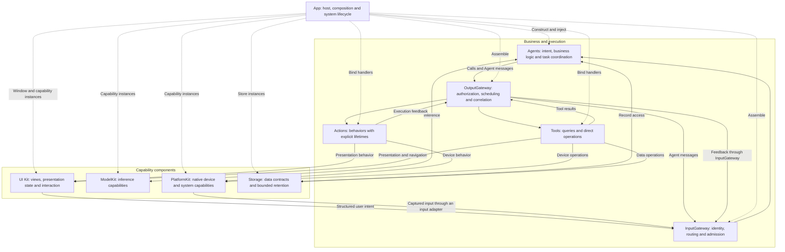

# Agent-Driven App Architecture

Status: proposed target architecture. This document describes a staged direction, not the current implementation contract. See [Architecture](Architecture.md) and the [technical plan](../MobileHarness/README.md) for current boundaries.

## Goal

Make Agents the application's business backend. Buttons and conversation share the same capabilities: a click supplies explicit intent, while an LLM selects capabilities from natural language. Explicit UI requests can execute deterministically without invoking a model.

Conversation can operate every deliberately exposed feature, including navigation, history and device discovery. UI remains available to display progress, collect selections and provide direct controls.

## Architecture

Solid arrows show runtime flow; dashed arrows show composition. They do not prescribe Swift imports. **UI Kit** is the component name; retain the Swift module name `UI` because `UIKit` names Apple's framework.

## Ownership

| Component | Responsibility |
| --- | --- |
| App | Create the system, inject capabilities, host windows and forward system lifecycle events. Business workflows gradually move to Agents. |
| Agents | Own business decisions, context selection, summaries, retrieval strategies and multi-step tasks. |
| Gateway | Validate external inputs, Agent communication and outputs; correlate execution results. |
| Actions / Tools | Implement callable business behavior using injected capability interfaces. |
| UI Kit | Implement presentation endpoints, navigation, rendering, animation and localized wording. Emit structured user intent. |
| ModelKit | Supply independent inference capabilities. |
| PlatformKit | Supply permissions/capability facts, native I/O, connection, protocol encoding and device feedback. |
| Storage | Own schemas, retrieval mechanisms, bounds, ownership, atomic persistence and compatibility. |

Agents drive presentation through OutputGateway and registered Actions/Tools, rather than mutating SwiftUI state directly. UI endpoints execute on MainActor; runtime and stores retain actor isolation. Page-local state such as scrolling, expansion and form drafts stays in UI.

The host role remains necessary even when business coordination leaves App. Device and model sessions must outlive pages where required; foreground eligibility and cleanup must have explicit owners.

## Shared Interaction Contract

User intent enters InputGateway with a request identity. Each Agent declares its model-callable Actions and Tools in versioned JSON v5; fixed internal behavior remains in code. App binds concrete handlers, and Gateway validates coverage and permissions.

Results distinguish admission, ongoing progress, completion, failure and cancellation. Session/request fencing prevents stale results from overwriting current presentation. Every queue has a bound and explicit overflow policy; accepted device actions are never silently discarded.

Multi-step conversation requires result-driven continuation: after a Tool result returns through InputGateway, the Agent can select the next operation. The current Assistant does not yet automatically continue model inference from Tool feedback.

| Intent | Capability sequence |
| --- | --- |
| “Open my photos” | Present the native photo picker; receive the user's selection. |
| “Scan nearby devices” | Start BLE discovery; publish bounded results and display them. |
| “Connect to that arm” | Resolve a device identity from context; connect and report actual status. |
| “Find yesterday's discussion” | Query records; display matches or summarize selected content. |
| “Show my model settings” | Query configuration and navigate to the corresponding page. |

Capabilities expose typed outcomes and operating conditions. System permission prompts still require user interaction; presenting a photo picker does not grant unrestricted library access. Physical robot safety cannot depend on iOS background execution.

## Staged Migration

1. **Clean Storage boundaries — implemented.** Assistant owns ten-turn selection/request assembly, SpeechSynthesis owns producer errors, and UI owns title fallback wording. Exact request admission uses an opaque read token; persisted schemas, atomic writes and audio ownership are preserved. See [ADR0143](adr/0143-storage-consumer-policy-boundaries.md).
2. **Expose shared capabilities — in progress.** History.list/read now provide read-only bounded previews through returning Tools and Assistant JSON. BLE discovery remains pending. Define navigation and picker endpoints in UI. Keep business Action behavior in Actions and native device mechanisms in PlatformKit.
3. **Route UI business intent through Agents — in progress.** History load/refresh now follows InputGateway → ConversationMemory → OutputGateway → UI.showHistory, independent of voice/model inference. Replace remaining direct feature-workflow calls incrementally. Add request correlation, progress and cancellation; maintain page-independent task ownership.
4. **Move business coordination out of App.** ConversationMemory now owns deterministic refresh selection; move archival, summary and mutation policy into it in subsequent stages. Do not create an Agent solely for default title wording. Keep Assistant responsible for its reply context strategy.
5. **Enable conversational task continuation.** Resume decision-making from actual Tool results, with bounded steps/deadlines and per-Agent permissions. Validate equivalent outcomes for button and conversational entry points.

✅ This proposal records the target architecture and migration sequence; the first Storage boundary stage is implemented.

✅ ConversationMemory and its scoped history presentation endpoint implement the first UI intent route. ❌ Other feature intent routing, memory mutations and model continuation remain pending. Each migration must update owning READMEs, dependency checks, the technical plan and an ADR before replacing current contracts.
