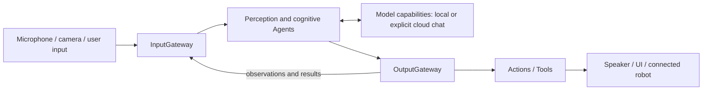

# MobileHarness architecture

MobileHarness uses an iPhone as the host for a **Signal → Cognition → Action** loop. Microphone/camera input becomes observations; stateful Agents use model capabilities to interpret them and select behavior. Validated Actions and Tools produce speech, presentation and connected-device effects.

## Perception and cognition

SpeechPerception and VisionPerception share recognition/pose processing and publish typed observations. Assistant combines recognized input with retained conversation context and produces a streaming response. SpeechSynthesis is a separate directed service preparing PCM; playback follows scheduled Actions.

Agents own their cognitive state and processing. Communication carries trusted source, session and causal context. Gateways validate admission and requested behavior, while Agent inboxes own pending messages.

## Scheduled behavior and direct functions

Actions represent scheduled skills such as speech playback, expression changes and NexArm movement. Channels order Actions within a task; nested wait groups synchronize that task's stages. Shared module/resource coordination prevents conflicting execution.

Tools provide direct functions such as captions, gaze, skeleton display and runtime information. A Tool's registered contract selects result feedback or completion-only behavior. Both kinds cross validated output dispatch; presentation state acceptance and physical completion are distinct boundaries.

## Host, presentation and foundations

| Owner | Responsibility |
| --- | --- |
| App | Compose capabilities and concrete behavior bindings; own voice/camera/application lifecycle and feature effects. |
| UI | Render state and collect user intent through typed operations. |
| ModelKit | Expose processing capabilities; separate management, default assembly and concrete model adapters. |
| PlatformKit | Own capture, native output, connections, device protocol and feedback. |
| Storage | Retain settings/conversation records and bounded transient audio handles. |
| Types | Share immutable value contracts, currently audio values. |

UI pages do not own model/device sessions. Long-lived work belongs to App lifecycle owners and runtime services. ActionRuntime and ToolRuntime are independent execution targets; Gateway depends on their contracts rather than concrete behavior domains. ModelKit and PlatformKit share Types without depending on each other.

## Conversation, settings and devices

Conversation records persist locally across voice sessions and restarts. New Conversation archives the current record before title generation; browsing history cannot replay behavior. Settings persist locally, credentials use the device Keychain, and App supplies provider/title/preview operations to narrow feature workflows.

The default pipeline uses local recognition, synthesis, pose and chat models. Explicit cloud configuration selects an OpenAI-compatible chat capability and sends its chat context to that provider; other perception/output remains local. Model configuration and resource acquisition share a process-wide manager.

Foreground camera perception and NexArm BLE control are implemented. Robot behavior/completion policy belongs to Actions; connection and native command/feedback belong to PlatformKit. Settings and Agent-selected movement share the same Action implementation. Autonomous camera motion belongs to the separate [Photographer proposal](Photographer-Proposal.md).

## Design and evidence entry points

The [technical design](../MobileHarness/README.md) defines dependencies and full technical flows. [Module responsibilities](../MobileHarness/README.md#part-ii--module-responsibilities) link the internal contracts. [Concepts](Concepts.md) explains terminology; [Requirements](Requirements.md) describes user outcomes. [Roadmap](Roadmap.md) lists pending directions, while [validation documents](README.md#experiments-tests-and-acceptance) record observed results.

Camera.open/close/flip Tools request the App camera owner through a typed capability after active Assistant session validation. The same foreground permission and capture lease lifecycle governs UI and Tool controls; Tool dispatch does not create a second device owner.

Cloud chat supports native function declarations from Agent JSON v5. Complete calls are resolved by the Agent and dispatched through OutputGateway; local chat remains text-only. Tool results use the existing InputGateway feedback contract, without automatic model continuation.
