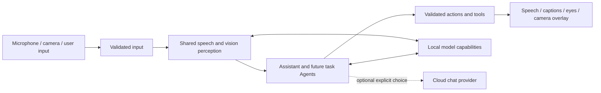

# MobileHarness architecture

MobileHarness turns device signals into Agent decisions and observable actions. An iPhone is the current host: it captures audio and camera frames, runs local perception and language models, and presents speech, captions, eyes and camera overlays. A configured cloud chat provider is optional. The project is designed to add more Agents and external devices, but robot control is not implemented today.

## How the current system works

- **Perception is shared.** Speech recognition and pose estimation produce observations that other Agents can consume. Camera preview remains available independently of voice-model readiness.
- **Agents decide behavior.** The conversational Assistant handles recognized speech and produces text, speech and presentation requests. An independent synthesis Agent prepares speech audio while playback follows the accepted Action order.
- **Outputs are explicit.** Gateways validate incoming signals and requested behavior. Actions provide scheduled behavior such as speech playback and captions; Tools provide direct functions such as skeleton display.
- **Capabilities stay separate.** ModelKit supplies model processing, PlatformKit handles device input/output, Experience presents the UI, and App connects those parts. Current speech audio uses a bounded process-local cache; user settings use synchronized cached local persistence. General persistent media and memory remain planned.

The current repository implementation and source-to-target map are documented in the [internal technical plan](../MobileHarness/README.md#project-structure); exact contracts live in the module READMEs linked from its [module design](../MobileHarness/README.md#part-ii--module-design). This page describes behavior and boundaries for external readers; it does not define code-level limits or target dependencies.

## Current scope

✅ Local speech perception, conversational replies, synthesis and playback, camera pose perception, eye expressions/gaze, captions and explicit cloud chat selection have implementation and automated checks. The [voice acceptance guide](Voice.md) and dated validation reports distinguish test evidence from physical-device experience.

❌ Durable memory, general cross-Agent request/reply, robot motion control, continuous background execution and sustained iPhone latency/thermal acceptance remain open. Future work is tracked in the [roadmap](Roadmap.md); historical decisions are in the [ADR index](adr/README.md). Physical robot safety would have to be enforced by the external controller, not by an iPhone App remaining active in the background.

User settings persist on this device, while credentials remain in protected device storage. The current design does not synchronize settings across devices. [ADR 0057](adr/0057-local-settings-storage.md) records the storage decision; the [Storage README](../MobileHarness/Storage/README.md) owns the implementation contract.
