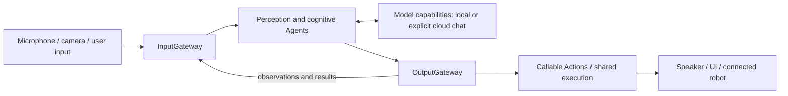

# MobileHarness architecture

MobileHarness uses an iPhone as the host for a **Signal → Cognition → Action** loop. Microphone/camera input becomes observations; stateful Agents use model capabilities to interpret them and select behavior. Authorized Action functions produce speech, presentation and connected-device effects through scheduled/native call protocols.

## Perception and cognition

SpeechPerception and VisionPerception share recognition/pose processing and publish typed observations. Assistant is the default user entry, combines input with its own context and executes Skill decisions; deterministic specialists own fixed transactions and task state. Assistant context supplies chat and task history. SpeechSynthesis is a separate directed service preparing PCM; playback follows scheduled Actions.

Agents own their cognitive state and processing. Communication carries trusted source, session and causal context. Gateways validate admission and requested behavior, while Agent inboxes own pending messages.

## Callable Actions and two call protocols

Actions implements the business functions for UI, speech, camera, history, system and NexArm. Each function accepts protocol-neutral input and returns a shared completion/report. App-owned ActionBinding exposes it through ActionCall, ToolCall or both; Agent configuration/code independently authorizes use. Agents parse registered text tags into ActionCall and native function events into ToolCall before OutputGateway admission.

ActionCall uses Channel scheduling and nested wait groups. ToolCall selects binding-owned direct execution or a scheduled projection into the same ChannelScheduler. Both paths preserve canonical function resources, budgets and joined cleanup. Returning feedback crosses InputGateway; completion-only native calls retain their no-feedback policy. Ordinary handler errors end only their invocation and preserve child outcomes and causes; explicit owner cancellation retains its scope. Presentation acceptance and physical completion remain distinct boundaries. See the [registration and dispatch diagrams](../MobileHarness/Gateway/Output/Protocols/README.md).

## Host, presentation and foundations

| Owner | Responsibility |
| --- | --- |
| App | Compose capabilities and concrete behavior bindings; own voice/camera/application lifecycle and feature effects. |
| UI | Render state and collect user intent through typed operations. |
| ModelKit | Expose processing capabilities; separate management, default assembly and concrete model adapters. |
| PlatformKit | Own capture, native output, connections, device protocol and feedback. |
| Storage | Retain settings/conversation records and bounded transient audio handles. |

UI pages do not own model/device sessions. Long-lived work belongs to App lifecycle owners and runtime services. FunctionContracts is the independent contract leaf under Actions/Support/Contracts. Gateway/Runtime owns ExecutionRuntime; Gateway/Output owns independent CallRuntime registration/adapters. Gateway orchestration depends on these execution/call contracts and AgentCore, while concrete business functions remain in Actions. Legacy runtime/compatibility targets are retired. ModelKit and PlatformKit have no project dependencies, including Types, and own their capability inputs/outputs. App transports native device data; each calling Agent adapts it into ModelKit inputs. StorageAudio owns its own PCM contract.

## Conversation, settings and devices

Conversation records persist locally across voice sessions and restarts. Assistant owns ten-round context selection and exact request assembly; Storage admits that request against an opaque read token. UI owns display-title defaults. SpeechSynthesis owns producer errors; StorageAudio validates PCM and retains audio, while App supplies localized failure wording after cleanup. New Conversation archives the current record before title generation; browsing history cannot replay behavior. Memory exposes History.list/read as returning Tools backed by the same journal; bounded previews cross the existing Gateways. History refresh/delete/archive/title use typed InputGateway intent and root-owned Memory, which selects registered History.Conversation and UI.HistoryPresentation functions through OutputGateway. A scoped adapter projects raw records; the single-operation transport rejects overlap and joins cancellation before retry. MemoryHistoryWorkflow owns sequencing and ConversationTitleGenerator owns bounded title-only inference. Structured memory/semantic recall remain pending. Settings persist locally, credentials use the device Keychain, and App supplies narrow platform/presentation capabilities rather than history/title business decisions.

The default pipeline uses local recognition, synthesis, pose and chat models. Explicit cloud configuration selects an OpenAI-compatible chat capability and sends its chat context to that provider; other perception/output remains local. Model configuration and resource acquisition share a process-wide manager.

Foreground camera perception and NexArm BLE control are implemented. Healthy BLE connections are retained during background control suspension; App joins old effects and checks the current native link on return. Eligible foreground return starts a fresh bounded retry episode, and connection success clears attempts. Inactive does not disconnect; manual disconnect/forget remains authoritative. No background Bluetooth execution or state restoration is configured. Robot behavior/completion policy belongs to Actions; connection and native command/feedback belong to PlatformKit. Settings and Agent-selected movement share the same Action implementation. Autonomous camera motion belongs to the separate [Photographer proposal](Photographer-Proposal.md).

## Design and evidence entry points

The [technical design](../MobileHarness/README.md) defines dependencies and full technical flows. [Module responsibilities](../MobileHarness/README.md#part-ii--module-responsibilities) link the internal contracts. [Concepts](Concepts.md) explains terminology; [Requirements](Requirements.md) describes user outcomes. [Roadmap](Roadmap.md) lists pending directions, while [validation documents](README.md#experiments-tests-and-acceptance) record observed results.

Camera.open/close/flip Tools use Photographer delegation to request the App camera owner after active Assistant session validation. Flip requires facing=front/back and selects that target rather than toggling. The same foreground permission and capture lease lifecycle governs UI and Tool controls; Tool dispatch does not create a second device owner.

Cloud chat supports native declarations from the Assistant effective Skill catalog, bounded by v7 Agent permissions. Complete calls resolve in the Agent and execute through OutputGateway. Result policy controls ReACT after the same round barrier; local providers remain text-only unless they explicitly support native calls.

Photographer subscribes to VisionPerception pose observations and emits internal Robot.aim through OutputGateway. App binds the foreground BLE workflow; Actions owns aim mapping and admission, while PlatformKit supplies native command encoding. Transport acceptance does not establish physical arrival.

Tracking Tool calls publish latest targets after OutputGateway authorization. The App worker holds motors1–4 through ResourceCoordinator (ADR0126), checks current Photographer usable-pose reception and joins/releases after one second without fresh input. All six motors share a physical-writer execution group; App policy lets authorized ApplicationControl actions preempt Photographer after cancellation and joined cleanup (ADR0139), while subsequent Channel work remains queued. Camera close removes its session; old targets never replay. Control admission/expected interruption does not trigger Bluetooth recovery or stop speech/vision.

VisionPerception and Photographer share observations but have independent execution failure scopes. A rejected Robot.aim does not stop showPose. BLE connectivity and control verification are separate states; query timeout retains connectivity while quarantining control queries until App reconnects the link.

✅ Agent fault isolation: delivery failures are receipts; output execution failures are correlated results. Photographer suppresses commands while control is unavailable. Explicit stop/cancellation and invalid startup configuration remain lifecycle/assembly contracts.

Expression Actions have explicit lifetime contracts: UI.express awaits one target transition and restoration; UI.setExpression commits the persistent base. App retains one invocation-fenced override/animation waiter; UI reports transaction completion and visibility. Gaze/following remains a Tool. See [ADR0104](adr/0104-expression-perform-and-state.md).

## Local model resource separation

✅ First release bundles a versioned model catalog rather than inference artifacts; Settings requests download/removal through App into ModelKit Management. Management owns verification and safe mutation; App injects generic Storage primitives and the separate concrete ModelKitHub adapter, preserving Management’s ModelKit-only dependency. Resource admission spans quiescence/unload and disk deletion. Settings/history remain available without weights. See the [technical workflow](../MobileHarness/README.md#local-model-resource-acquisition-and-removal) and [Management current contract](../MobileHarness/ModelKit/Support/Management/README.md#local-model-resources--current-contract).

Conversation history now retains actual native Tool declarations/calls and App-observed Gateway outcomes separately from generation state. Optional usage values retain provider/backend input/generated/total token counts. App adapts StorageChat records into independently owned UI values; no history replay is introduced. See [ADR0106](adr/0106-conversation-tool-diagnostics.md).

✅ Local-resource refinement: compact schema-v2 repository/selection declarations replace per-file links/hashes. ModelKitHub wraps swift-huggingface 0.9.0 outside Management; App injects it. Storage-backed receipts record actual installed files/sizes. ✅ HF native background transfers preserve generations/completed files and available resume data. ❌ Full iPhone/server-resume acceptance remains pending (ADR 0108). See [ADR0105](adr/0105-local-model-resource-management.md).

Local artifact completion has two outcomes: atomic installation publication and transfer-index bookkeeping. A valid settled installation receipt remains authoritative even when task-index persistence fails. App stores the non-sensitive authoritative transfer snapshot through atomic Storage replacement with afterFirstUnlock protection; ordinary revision-checked document clients keep their existing policy.

Installation receipts derive relative paths after normalizing both the trusted directory and enumerated child URLs. This handles native /var and /private/var aliases without relaxing descendant safety checks. The exact earlier staging-prefix receipt defect has a validation-gated migration; unrelated/corrupt receipts remain failures.

✅ Nemotron multilingual recognition uses FluidAudio Core ML with a shared macOS/iOS 2240 ms artifact layout; fresh recurrent state belongs to each leased session. Management provisions resources, App/Storage publishes revision receipts, and Settings exposes incompatible-revision deletion. See ADR 0107.

✅ Native iOS background sessions now carry HF model file transfers. ModelKitHub owns persisted file plans, three active tasks/package and delegate advancement; Management preserves generations on failure/relaunch. App handles OS events and bounded preparation; Storage owns installation publication. See ADR 0108.

✅ [ADR 0109: Optional downloaded speech and modern Apple fallback](adr/0109-system-speech-fallback.md) implements persisted speech-only switching, artifact-aware Defaults facades, SpeechAnalyzer/AssetInventory ASR, Apple PCM TTS and independent energy VAD. ❌ Physical-phone end-to-end acceptance remains pending.

✅ 2026-10-03 user acceptance: phone background downloading now continues successfully and observed speed improved. ❌ Forced-quit/system termination, signed-URL expiry and large-file range-resume traces remain unverified.

✅ Apple ASR input now applies bounded backpressure instead of failing on a burst of pre-roll PCM. The real Chinese fixture test sends 137-sample packets without pacing and verifies final recognition and lease reuse. ❌ Phone ASR/TTS acceptance remains pending.

✅ Single-leaf Action failure presentation retains the captured bounded description; ModelKit capability errors preserve associated diagnostic reasons through LocalizedError. Speech SDK errors do not become business dependencies.

✅ Apple TTS resolves the production auto locale to zh-CN when text contains Han characters, otherwise en-US. Explicit locales retain their requested language/region, with zh/en script aliases normalized. Missing voices remain an explicit error with the resolved language. Consecutive real TTS integration uses auto rather than an explicit zh-CN fixture.

✅ [ADR 0110: Feature model settings and native Apple VAD](adr/0110-feature-model-settings-and-native-vad.md) groups model UI by task, splits validated custom speech choices, preserves the download backend and integrates internal native VAD. Silero or Energy supplies silence endpoint scores independently of ASR because native normal activity events were unavailable. ❌ Physical settings/voice acceptance remains pending.

Model invocation resolution failures (unknown Action/Tool alias or invalid parameters) are non-executable rejected outputs. Assistant continues the turn; OutputGateway retains them in its existing bounded execution results alongside runtime errors. Structural parsing failures and limits still terminate generation.

✅ [ADR 0111: Independent ASR/VAD selection](adr/0111-independent-asr-vad-selection.md) decouples the ASR switch from automatic Silero/Energy selection. Nemotron alone satisfies custom recognition prerequisites; Silero removal preserves ASR preference. ❌ Sustained device combination acceptance remains pending.

✅ Model source selection now automatically persists from the model section, with no network restriction toggle or explicit save action. App normalizes cellular permission to true and migrates legacy restrictions; OS permission remains authoritative. YOLO retains its fixed GitHub source. Endpoint save failure rejects download admission and preserves the draft; download queues and background transport are unchanged.

✅ ADR0103 failure isolation refinement: retained Action reports preserve later exceptions; invocation/resource rejection is call-local; Tools distinguish execution and feedback failures, with joined cooperative deadlines and task-scoped cancellation. ❌ Uncooperative handlers and physical acceptance remain outstanding.

✅ Canonical function budgets and static timeouts apply equally to both protocols before the shared30-second default. Invalid explicit declarations fail without fallback. ❌ Deadlines cannot forcibly interrupt uncooperative cleanup.

✅ [ADR 0112: Gemma CoreAI chat](adr/0112-gemma-coreai-chat.md) replaces local Qwen/MLX with Gemma 4 E2B QAT CoreAI. iOS uses pinned h18p AOT resources; old Qwen downloads are incompatible. Shared package dependencies require OS 26; CoreAI execution requires OS 27. ✅ Mac real inference, cancellation and reload passed. ❌ Sustained device acceptance remains pending.

VisionPerception stores every valid latest camera input. Inference takes the newest available input at worker start and applies expiry plus adaptive image/pose/confidence/cost/freshness cadence (initial 100ms, default bounds 0...250ms); no grayscale percentage trigger or latched request remains.

Vision timing travels with the existing replaceable UI.showPose state through OutputGateway. Native capture-callback ContinuousClock instants remain separate from media timestamps; UI receives values only and owns no model instrumentation.

✅ [ADR 0113](adr/0113-adaptive-pose-cadence.md): VisionPerception owns adaptive detection; App injects bounds, the model capability stays stateless with respect to cadence, and UI renders optional next-interval statistics through existing Tool dispatch. Native monotonic start gaps and one active operation bound scheduling without old-frame queues.

Adaptive image evidence is sampled/processed in VisionPerception using the existing immutable image contract. Inferred-frame reference and bounded pose regions survive cadence-skipped captures, while exposure/noise compensation suppresses nuisance changes. Total-latency pressure feeds scheduling; over-budget native inputs/results are rejected without publishing stale observations. Statistics remain on UI.showPose.

✅ Urgent YOLO detection now permits a zero scheduling interval. The single inference worker processes only the newest pending capture after the active call completes. Normal inference duration adds no scheduling floor; compute-dominated freshness pressure can temporarily impose a bounded cost floor. Camera close already clears skeleton and its statistics; no source-stall timer is added.

✅ UI/Camera owns PoseOverlay and display statistics. VisionPerception owns its Encodable PoseOverlayPayload; Actions.PoseOverlay remains the independently validated callable-function payload. App maps callable payload values into UI values. UI has zero project dependencies; AgentCore has zero project dependencies. See ADR0121.

✅ AgentCore/domain separation places pose and speech message values in Agents/Communication, application Agent names in Agents, and automatic speech guidance in Assistant. Core has zero project dependencies; scheduling completion requires explicit source. ✅ Generic message/schema registration, domain freshness policy, explicit host input adaptation and Agent-owned sample transport are implemented in stage 2. See [ADR0115](adr/0115-agentcore-domain-separation.md).

✅ Application domain contracts and identities are consolidated in Agents/Communication/AgentContracts.swift; Core/Gateway contain no speech/vision/phone contract cases. Image transport belongs to AgentCore/Input and presentation values to UI/Camera; Agent-domain speech/pose values belong to Agents/Communication; Role identity/style and workflow prompt templates are owned by each chat Agent's `.prompts.json` file. Shared Chat renders them, while AgentCore owns generic Function Token protocol guidance. Unknown/spoofed schemas reject admission. ❌ Dynamic registry reload, remote codecs and durable communication remain pending. See [ADR0116](adr/0116-generic-agent-communication.md).

SpeechPerception keeps utterance coordination in one Agent actor. VAD score adaptation, pure sample-count boundary policy, per-utterance ASR sessions and pure transcript accumulation have separate file ownership. Phase state and presentation transition together; resume and delivery recovery explicitly preserve their presentation-only observation contract.

✅ ADR0118 completes the Core boundary: host-owned concrete resource identifiers; bounded producer-owned report details and opaque error identifiers; Agent-supplied validated soft text limits with identical history preview policy. Gateway translates structural values without device semantics. No new dependency, worker or queue is introduced.

✅ Types has been removed. AgentCore/Input owns AudioInput and ImageInput; UI/Camera owns PoseOverlay; VisionPerception owns its output payload. Capability and storage types remain in their owning SDKs. See [ADR0121](adr/0121-remove-shared-types.md).

✅ [ADR0121](adr/0121-remove-shared-types.md): Types is deleted; AgentCore has zero project dependencies, UI has zero project dependencies, and explicit Agent → Tool → App → UI adaptation preserves the pose wire format. ❌ Physical-device acceptance remains outstanding.

✅ ModelKit diagnostic cleanup: availability/errors provide typed capability outcomes and neutral diagnostic text; consumer layers own localized messages and recovery guidance. Native camera gray64 sampling remains in PlatformKit, with motion/cadence decisions in VisionPerception. ✅ Storage context/title/producer-error ownership is separated in [ADR0143](adr/0143-storage-consumer-policy-boundaries.md). ❌ Broader Agent-driven workflows remain planned.

✅ [ADR0122](adr/0122-runtime-opaque-domain-failures.md): execution Runtime owns generic bounded resources and failure/report identifiers only; NexArm and Bluetooth producers own domain vocabulary and classification. Existing output identifiers remain unchanged. ❌ Physical robot acceptance remains outstanding.

✅ BLE writes share one PlatformKit connection-wide pacing budget; Actions keeps trajectory/completion policy and App keeps latest-intent ownership/recovery. Fixed-size transport diagnostics distinguish raw notification traffic from valid feedback. The initial rate requires physical calibration; see [ADR0123](adr/0123-nexarm-ble-shared-pacing.md).

SpeechPerception owns deterministic FOA sound direction alongside its existing VAD/ASR path. PlatformKit supplies spatial PCM only; App transports it; the Agent broadcasts typed sound.source observations through both Gateways. Optional subscribers cannot gate recognition. No Photographer behavior or UI is introduced. See [ADR0124](adr/0124-sound-source-perception.md).

Microphone readiness requires a validated/enqueued PCM callback, not only a running native capture session. PlatformKit bounds first-frame startup and joins failed spatial capture before mono retry; running streams retain their layout. App enters listening after readiness and exits it on capture failure or unexpected completion. See ADR0124's startup correction.

✅ [ADR0125](adr/0125-bluetooth-exception-recovery.md): BluetoothWorkflow unifies abnormal connected and disconnected sessions under bounded cleanup/reconnect. PlatformKit supplies facts, Actions owns behavior, and UI displays bounded diagnostic records; no old motion is replayed.

✅ ADR0127: Settings device controls enter App through UI-owned typed operations, outside InputGateway/OutputGateway. They share Actions geometry/options with Agent behavior but use background manual takeover with segment arrival feedback and without Agent resource locks. App cancels/joins old software writers and suppresses tracking while manual control is active; Gateway session cleanup owns Agent work only. PlatformKit native pacing and exceptional connection recovery remain shared.

## Settings audio detection (ADR0128)

✅ AudioCaptureContext is a PlatformKit-owned native fact value, independent of generic Agent transport and UI. Actual MicrophoneFrame layout establishes capture mode; runtime FOA support and mono startup fallback are separate facts. AudioDetectionSession in App/Lifecycle assembles an isolated source-only SpeechPerception with its own session/manager/Gateways and no conversation, camera or robot consumer. Existing PCM bounds/rejection and latest sound publication remain unchanged.

```mermaid
flowchart LR
    UI[Settings audio detection] --> Workflow[AppDiagnosticWorkflow: one operation and deadline monitor]
    Workflow --> Endpoint[App Lifecycle: isolated session]
    Endpoint --> Capture[PlatformKit: actual input and PCM]
    Capture --> Adapter[MediaInputAdapter / InputGateway]
    Adapter --> Speech[SpeechPerception: source-only mode]
    Speech --> DSP[Existing SoundSourceEstimator]
    DSP --> Broadcast[Bound port / OutputGateway]
    Broadcast --> Observer[App diagnostic observer]
    Observer --> Snapshot[UI display-only snapshot]
```

✅ The feature workflow depends on UI/ModelKit/PlatformKit only and invokes a whole endpoint protocol; it never constructs an Agent or Gateway. No new SDK/model dependency or AgentCore sound value is introduced. Start/stop has one operation, one monitor, no pending queue, and generation-fenced latest UI values. Stop joins hardware, Agent publication and output cleanup before replacement. Voice startup and diagnostics share explicit cleanup barriers. Direction expires at its 500 ms observation deadline; quiet/non-active states have no executable angle. Detection lasts 10 seconds after the first received frame; page departure and background cancel it.

❌ Real device FOA axes, actual acoustic accuracy, camera coexistence and native navigation/background behavior remain acceptance items.

## Bluetooth recovery isolation — ADR0129

✅ Bluetooth connection/recovery has no voice lifecycle or Channel scheduler callback. App resets transport-local state and closes native I/O; old-session operations fail normally and retain Action/Tool results. Gateway keeps accepted queues, wait structures and admission unchanged. A queued Action executes once when its lane becomes eligible: it fails if the device is still unavailable, or can succeed after recovery. Assistant generation, speech and other Actions continue. Failed native commands are never automatically replayed; a queued Action’s first execution is not a replay.

❌ Physical concurrent voice/BLE recovery remains unaccepted. Explicit user stop, session closure, background microphone policy and shutdown retain their existing whole-session cancellation contracts.

## Passive BLE connection — ADR0130

✅ Native connection/subscription completion makes Settings controls available immediately. App performs no connection pose/version/IK probe, stationary validation or indication movement. It listens to unsolicited position packets and publishes measured state; refresh reads the latest received packet only. Feedback silence remains visible but does not disable manual commands, disconnect or start recovery. Native write/connection failures remain explicit. Actions uses passive BLE compatibility for this App connection; recipe IK resolution is deferred to an explicit preset request, not connection verification. Manual jog can start from the existing configured reference when no sample has arrived; that reference is not measured telemetry. Segment arrival observation and cancellable replacement remain in Actions/App.

❌ Physical feedback cadence, preset IK availability and sustained manual takeover require real-device acceptance. Passive connection does not establish physical clearance or target arrival.

✅ Bluetooth discovery/connection presentation depends only on connection/recovery state, independently of Action completion, feedback loss and control readiness. Device detail shows only the latest native reason below its connection status, with measured feedback separate; native reconnect can finish while the old Action is publishing its disconnected result.

## Independent Bluetooth diagnostics — ADR0131

✅ Existing Action/Tool result routing and ADR0129 recovery/session/queue isolation remain implemented.

✅ ADR0133 (`docs/adr/0133-motion-admission-and-terminal-reports.md`): Actions prepares only requested Cartesian poses; passive simple/reset commands require no IK queries. PlatformKit selects supported native write capability with shared pacing and a capacity-one acknowledged-control window, publishes current interrupted-reply failures, and App reports restored connectivity without claiming motion validation. Runtime/Gateway preserve terminal failure entries and descriptions. ❌ Physical repeated-control, characteristic/firmware and UI acceptance remain pending.

✅ ADR0134: Bluetooth exception history is removed at SDK/App/UI layers. Latest native connection, communication issue and recovery state alone appear in Settings; healthy snapshots/new connections replace prior faults. ADR0138 uses one row to connect while unconnected or open detail when already connected; connection success stays on the list, disconnect appears only when connected, and remembered devices remain forgettable; an already-open disconnected detail disables actions/motor gestures. Execution results/home issues and bounded automatic recovery remain independently owned. ❌ Physical BLE/navigation/touch acceptance remains pending.

✅ [ADR0135](adr/0135-nexarm-aim-final-count.md) keeps final-count tracking convergence in Actions. Native admission commits the final proposal; no device receipt or Tool publication is promoted into physical arrival. The opt-in serial acceptance seam reuses production workflows/Actions and real Agent Gateways, with explicit model/pose fixtures; it does not certify BLE radio or native UI behavior.

✅ [ADR0137](adr/0137-nexarm-ordinary-home.md): Actions selects the legacy ordinary reset home independently of Photographer tracking rest. Settings and Agent reset reuse the same query-free recipe; native transport and recovery do not select business poses. ❌ Restored phone posture awaits physical acceptance.

✅ [ADR0141](adr/0141-resource-control-ownership.md): ResourceCoordinator expresses control ownership only as unlocked/locked(owner), including transient execution. Internal handoff retains old work until actual completion; a timeout fails its request and late cleanup automatically unlocks. Joined stop errors do not create persistent resource faults. Cancellation-independent waiting remains from ADR0140. App validates revocable execution permits; Bluetooth recovery, Action/Tool outcomes and Channel queues remain independent. ❌ Physical stop/camera-close timing acceptance remains pending.

✅ Model-resource interaction policy now belongs to AppSettingsWorkflow: bounded admission, ordered cancellation, source save and preference rollback. UI receives passive state and typed controls; App supplies lifetime and injected Management endpoints. ❌ Resource Agent/Gateway routing and cloud SettingsState coordination remain pending (ADR0146).

✅ Memory now selects confirmed archive deletion through History.delete and requests UI.showHistory only after correlated runtime success. Cancellation joins cleanup; committed storage changes remain durable. App transports the bounded chain rather than selecting the next operation. ✅ Archive/title sequencing is implemented in ADR0165 using registered History functions, preserving commit-before-inference and retry evidence. ❌ Model-driven destructive operations remain pending.

## Unified Signal contract

The active [Agent-driven architecture](../MobileHarness/README.md#unified-signal-contract) defines Signal as immutable Agent input carried by AgentInput. Intent, observation, Agent message and execution feedback share envelope/admission rules while retaining domain-owned payloads. ✅ Existing envelopes, schemas and Gateway paths implement the common foundation. ❌ Typed legacy intents and full App entry-point migration remain pending; see [ADR0148](adr/0148-unified-signal-contract.md).

The [scenario flows](../MobileHarness/README.md#signal-and-effect-scenarios) distinguish UI intent, conversational/perception input and Agent collaboration. All Agent-driven presentation uses registered Action functions through authorized call protocols; actual feedback can drive further processing, while rendering alone generates no new Signal. ❌ General conversational continuation and domain request/reply remain pending.

The same design separates external facts, internal Agent messages and internal runtime feedback under one envelope. Independent observation, system/capability changes and execution lifecycle supplement UI/conversation/collaboration. ✅ Typed origin admission and owner-fenced Tool feedback are implemented (ADR0149). ❌ Unified lifecycle/long-task contracts remain pending; host cleanup mechanisms remain App-owned.

✅ [ADR0149](adr/0149-signal-origin-and-tool-feedback.md) implements typed Signal origin and captured-owner returning Tool delivery with causal continuity. ❌ Original Action/activity roots, typed host commands and remaining business entry points await subsequent stages.

✅ ADR0150 begins capability unification with one cooperative execution lifetime for both legacy executors. ❌ A shared business definition and dual ActionCall/ToolCall registration are not yet implemented. The adopted design separates protocol exposure from capability-owned scheduling and resources; configuration cannot bypass execution constraints.

✅ ADR0151 consolidates all executable domains and runtime sources under Actions. Invocation protocols still retain their current definition/result APIs. ❌ Unified definition adapters and removal of compatibility imports remain pending.

✅ ADR0152: production registers one six-domain CapabilityModules catalog, with unified UI/NexArm ownership and unchanged call paths/permissions. Registry projections preserve existing execution policy; regression coverage checks expression and gaze through the same UI catalog. ❌ Unified call definitions and compatibility removal remain pending.

✅ ADR0153 adopts Domain.Module.function (directory, entry file/namespace, function) as the required capability address. ❌ Three-field contract/configuration/registration migration and cohesive entry splitting are pending; current runtime still uses two-field Action paths.

✅ ADR0154 implements cohesive module entry files with one copy of each function and unchanged protocol behavior. File ownership is checked explicitly. ❌ Three-field path/configuration/registration migration remains outstanding.

✅ ADR0213 supersedes ADR0155: definition-owned exclusion is removed; Channels provide task-local ordering and unconfigured resource conflicts fail without queuing. Explicit host takeover retains joined cleanup.

❌ Three-level runtime paths and unified Action/Tool definitions are not completed by this stage.

✅ [ADR0156 — Three-level capability addresses](adr/0156-three-level-capability-addresses.md): explicit fields and Agent configuration v6 bindings implemented; resource scopes preserved. ❌ Unified definitions/adapters and compatibility removal remain pending.

✅ [ADR0157 — Canonical executable definitions](adr/0157-canonical-executable-definitions.md): completes shared definition/outcome/execution, protocol projections, scheduled native routing, typed feedback and compatibility retirement. Remaining work is broader Agent-driven input/feature migration and physical acceptance.

✅ [ADR0158 — Unified Action authoring](adr/0158-unified-action-authoring.md): one @Action attribute for all capabilities; model context supplies text actions and request tools supplies native declarations. Text tags and native events retain distinct ActionCall/ToolCall transports.

✅ [ADR0159 — Protocol-independent invocations](adr/0159-protocol-independent-action-invocations.md) removed native-only business signatures. ADR0161 completes the boundary with one FunctionInput/context/handler and @Action metadata; ActionInvocation remains a Gateway scheduling adapter. Differences remain in registration, model transport/parsing, runtime admission and feedback.

✅ [ADR0160 — Callable functions and protocol bindings](adr/0160-callable-functions-and-protocol-bindings.md): pure ActionFunction catalogs and @Action metadata; host-owned ActionBinding profiles select protocols/runtime feedback. Business errors and UI payloads are protocol-neutral. Shared execution consumes only the function. Remaining work: external feature Signal migration, Agent continuation, additional device/navigation capabilities and physical acceptance.

✅ [ADR0161 — Gateway execution and isolated function contracts](adr/0161-gateway-execution-and-function-contracts.md): standard FunctionInput contracts under Actions/Support/Contracts; common ExecutionRuntime under Gateway/Runtime; isolated CallRuntime registration/adapters under Gateway/Output. Actions has no execution/protocol imports and Channel stays outside the common request. Validation is recorded in Validation-History.md.

✅ ADR0162: invocation-local failures preserve structured reports and terminal causes across both call protocols; explicit cancellation and admission scopes remain unchanged. See [decision](adr/0162-invocation-failure-isolation.md).

✅ [ADR0163 — Typed history and feedback causality](adr/0163-typed-history-and-feedback-causality.md): typed history.intent/1 and explicit Action/activity causal feedback. Unified lifecycle/capability facts and resource/device Agent routes and bounded model continuation stay separate stages.

## Resource command routing (ADR0166)

Settings download, cancel and removal now enter ApplicationControl through typed model.resource.intent/1. Fixed internal System.ModelResources calls return through InputGateway; terminal controls cross OutputGateway. Download success means native admission. Source/preferences/status reads remain staged; no Assistant resource mutation permission is added.

## Speech binding stage (2026-10-07)

✅ ADR0167 routes actual speech model binding through ApplicationControl and both Gateways. A single configuration call rejects overlap; native lifecycle/Defaults adaptation retains prior behavior. Source persistence and installed-resource selection policy remain staged.

## Resource preferences stage (2026-10-07)

✅ ADR0168 moves source/preference transactions into Actions. Agent sequences returning preference JSON into speech binding; App supplies SDK/storage endpoints and view conversion. UI failure rollback/status polling cannot implicitly retry binding.

## Resource inventory stage (2026-10-07)

✅ ADR0169 routes resource inventory through typed ApplicationControl intent and returning System.ModelResources.snapshotResources. Actions validates bounded facts and supplies installed eligibility; App retains view/text conversion and generation-fenced UI assignment. Registered refresh snapshot/query-failure presentation is implemented in ADR0170; other settings presentation routes remain staged.

✅ ADR0170 registers resource refresh snapshot/query-failure presentation. Agent selects shared inventory/presentation function, then failure presentation when needed; App adapts root session and passive revision only. Other settings error routes remain staged.

✅ ADR0171: root foreground sampling emits changed/failed native resource Signals through InputGateway; ApplicationControl selects the same registered presentation functions used by manual refresh. Page polling is removed. Observation does not retry preference binding. Full shared state/native push and native acceptance remain outstanding.

✅ ADR0172: download/cancel/removal failed feedback selects a registered operation-error function before failed termination. Presentation failure retains the original cause and never retries the command. Operation errors survive progress refresh; preference notices and unavailable-Gateway host errors remain staged.

✅ ADR0173: preference-function failure codes select registered notices/source guidance, while binding-stage failures select execution error. Restore/save permits three calls; other requests retain two. The gate releases after failure presentation, and durable commits remain intact. Host fallback/provider/shared-state context and native acceptance remain outstanding.

✅ ADR0174: recoverable resource admission/dispatch failures use a typed host Signal and one Agent-selected registered error function after original worker cleanup. No native retry or recursive presentation; startup/closed/capacity/in-flight diagnostic failures retain explicit infrastructure fallback. ❌ Provider settings, BLE/navigation Agent routes, shared context, bounded model continuation and native acceptance remain subsequent work.

✅ ADR0175: Settings provider model discovery now uses opaque provider.discovery intents, ApplicationControl and System.Provider.discoverModels with session-bound one-use private staging. Query results/errors are bounded and credential-free. ❌ Provider restore/save/rollback, lifecycle switching and registered provider UI effects remain a later migration; real provider/Keychain/native acceptance remains separate.

✅ ADR0176: provider restore/save now uses opaque provider.settings/1 intents and registered Provider functions. Actions owns business schema/store/migration and complete apply/rollback; App only stages/adapts and supplies native SDK, lifecycle and credential primitives. ❌ Registered provider UI effects, SDK model-family eligibility migration, model grants/shared context and native acceptance remain subsequent work.

✅ ADR0177–0179: the current implementation in MobileHarness/README.md now includes registered provider form presentation, cloud native result continuation, Agent-routed device/navigation/camera controls and sequenced environment facts. All four foundational modules have no project dependencies. The separate Resource-State-Plan remains a future store/writer integration, and model configuration handoff/new picker/remote capabilities remain explicit extensions.

## Photographer camera control

✅ Photographer owns camera open/close/lens switch/retry through typed photography.camera Signals and existing Camera.Capture functions. Manual camera data requests publish directly to Photographer through InputGateway, while conversational requests may delegate through Assistant. Photographer invokes the canonical camera function under its actual execution identity. Returned errors retain the complete producer report.

The root service outlives preview. One attached vision session supplies pose tracking; closing capture retires/join-cleans that scope without stopping the camera-command Agent. Native camera permissions, leases, capture cleanup and immediate safety fencing remain App/PlatformKit responsibilities. ❌ Still capture, video recording and richer shooting interaction remain pending. See ADR0181.

## ApplicationControl ownership — ADR0182

✅ Remaining application operations belong to the canonical ApplicationControl service. Its directory owns actor/configuration, fixed function permissions and pure resource-result policy; App owns ApplicationControlIntentRuntime and injected native endpoints. Photographer and Memory retain their domains. Role identity/source/session guards and packaged resources migrate together; domain Signal schemas and Actions algorithms remain unchanged. Generic specialist delegation remains pending.

## Agent composition — ADR0187

✅ Agent 自有预处理、版本化结构化 Context 和 Builder 已接入；共享机制在现有 Agents/Core 与 Agents 目录中。业务职责保持当前分界。函数结果按运行时捕获的执行所有者定向返回，通信投递回执只表示接纳；模型续轮不订阅自身广播。

✅ 上下文采用有界原子提交，重启将未完成工作标为中断，不重放设备动作。普通输入、反馈和控制分别接纳；所有容量或持久化失败显式返回。音视频和原生会话保持有界临时状态。

✅ 第二阶段已实现独立摄影 LLM、正式任务委派及任务定向后续输入。❌ 真实模型、原生 UI、真机语音验收仍待完成。

执行所有者（Agent/incarnation/session）、task/parentTask、Signal 因果 root/parent、decision/call 分别关联。ActionResult 按可信运行时所有者路由；TaskResult 是子任务显式报告，communication receipt 是接纳反馈。反馈旁路、普通输入 FIFO/融合/替换由各 Agent 决定。

参见 [ADR0187](adr/0187-agent-composition-and-react.md) 与 [Agents 当前设计](../MobileHarness/Agents/README.md)。

✅ Phase two specialist ownership implementation: [ADR0188](adr/0188-specialist-task-ownership.md). Implemented; real-model/native-UI/physical-device acceptance pending.

✅ [ADR0189](adr/0189-agent-support-hierarchy.md): reusable Agent sources group under Support/Core, Communication, Chat and Context. Core retains independent Foundation-only compilation; the seven role directories own business decisions. Target names and dependency boundaries are unchanged; full checks and unsigned iOS device build passed.

✅ [ADR0190](adr/0190-assistant-listening-and-one-way-publication.md): SpeechPerception owns listening consent and admission policy through fixed Actions; interactive Agents publish reply occupancy and App executes native/playback barriers. External facts publish one-way, internal send retains admission receipts, and recoverable speech errors do not stop recording. Physical recording stops on user-off/native interruption and after confirmed utterance completion during a reply pause. Consent stays enabled through the pause; App immediately resumes fresh native capture after policy clearance and actual playback/audio cleanup, with no fixed post-playback timer. Manual hold-off also cancels the current Assistant reply and fences late effects.

## Basic mechanical-arm interaction ownership

✅ Assistant directly exposes the 11 NexArm gesture/motor Actions as basic interaction. Photographer exposes camera Actions and retains its internal photographic tracking Tool; ApplicationControl exposes connection/configuration capabilities and retains fixed settings device transactions and also registers the same mechanical-arm Actions for Settings command tests. Action registration is many-to-many; each role executes under its own identity. App grants Assistant the motor writer and joined takeover of Photographer tracking; shared resource exclusion and native safety remain unchanged. ActionResult returns to the actual executor.

✅ Frontend/backend boundary: local page navigation and UI state changes execute in UI/App without submitting Agent work. Explicit backend requests are subscribed directly by the owning Agent; Assistant remains the conversational entry only. Authorized Agent-issued UI Actions reuse the same presentation methods. Page visibility, system-settings opening and native stop fencing do not wait behind backend device transactions.

## Responses transport and Action-only Assistant

✅ Implemented: Cloud Chat uses Responses input/typed SSE under the existing ModelKit capability boundary. Model resource residency owns a reusable HTTP Session; each operation owns cancellation and never invalidates another request. Assistant has no Tool grants: environment observation and directed delegation use Action calls. Other Agent/host protocol grants remain role-owned. Historical native-call pairs stay in storage and become inert text evidence in Assistant requests. No server-side conversation ownership, protocol fallback or new modules/dependencies are introduced.

## Assistant Skills / Task Modes（2026-10-11）

✅ 当前对话入口收敛为 Assistant，通过纯资源 Skill 加载动态函数和单前台任务上下文；三个专用角色保留确定性流程。旧多 Chat Agent 对话委派说明由 [ADR0212](adr/0212-assistant-skills-task-modes.md) 替代。❌ 真机摄影、语音竞争与模式切换验收待完成；没有远程 Skill、任务栈或新第三方依赖。

## 泛化 Task 与独立 Skill（2026-10-11）

✅ 固定模式资源已删除。Task 目标是运行时数据；startTask 原子加载可选 Skill 组。默认临时 Skill 归属决策链，前台 Task Skill 保持到终态清理。Core 任务协议增加 execution 和目标/请求 Skill 证据，最多 16 个非终态后台任务；后台复用通信 Action/send，无前台抢占或自动推理。生产 backgroundTasks 声明为空，公共链由合成执行者验证。当前契约见 Agents README；真机验收仍待完成。

## ModelKit shared support ownership

✅ ModelKit shared infrastructure is grouped under Support. Core owns neutral contracts/concurrency, Backends owns generic native graphs, Management groups separate lifecycle/default-assembly targets and injected artifact transfer, and Speech/Apple owns shared PCM conversion. Concrete model algorithms remain with their providers. Directory consolidation does not broaden ModelKitRuntime dependencies. See [approved migration](ModelKit-Support-Plan.md) and [current design](../MobileHarness/ModelKit/Support/README.md).

✅ [ModelKit Core refinement and decoupling audit](ModelKit-Decoupling-Audit.md) separates opaque inference scopes, Core resource residency and Management registration/construction policy. Core is independently typechecked, and the complete target graph enforces one-way foundational/shared/provider/assembly dependencies.

Current conversation persistence (2026-10-13): schema v3 keeps full response strings in memory during generation. User admission and whole-decision terminal events checkpoint current.json and bounded Agent recovery state. Each archive is a separate conversation-ID file; index.json contains metadata only. Logical conversation identity survives voice restarts. Rotation is recoverable and title jobs are root-owned, independent of history page lifetime. No old schema/import or fragment durability remains. Assistant does not persist its high-frequency context or reload archived bodies on ordinary list/context paths.

✅ Agent records (2026-10-14): Settings uses a generic record-destination hub with one implemented Assistant conversation page. Foreground Task sources/terminal compression are canonical conversation evidence. Delete duplicate task-history pages/projections and their old subset-navigation hook; preserve Agent task lifecycle state and independent execution diagnostics. Other Agent record types remain future work.
