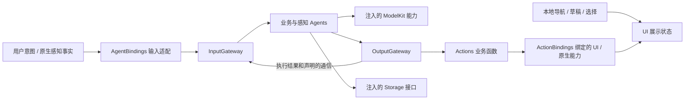
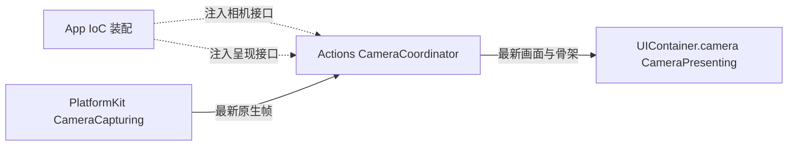

# MobileHarness architecture

MobileHarness 以 iPhone 为宿主，将感知、Agent 决策和受控执行连接起来。本文件说明当前协作边界；完整技术流程见 [整体设计](../MobileHarness/README.md)，用户范围见 [Product scope](Product-Scope.md)，术语见 [Concepts](Concepts.md)。

## 主要数据流

图中是运行时流向，不是编译依赖；实际依赖以 [模块与 target 映射](../MobileHarness/README.md#target-map) 为准。

## 模块职责

| 拥有者 | 责任与边界 |
| --- | --- |
| [App](../MobileHarness/App/README.md) | 应用入口、创建、注册、组合、连接及应用级生命周期；通过模块公开接口启停，不承担业务流程或数据转换。 |
| [Agents](../MobileHarness/Agents/README.md) | 解释输入、拥有业务状态与策略，通过获准的函数表达行为；AgentBindings 负责请求/结果适配及角色运行接入。Assistant 是普通对话入口；Memory、Photographer、ApplicationControl 拥有各自确定性事务。 |
| [Gateway](../MobileHarness/Gateway/README.md) | 校验身份与权限、通信和执行准入，协调排序、结果、资源与取消；不选择业务策略。 |
| [Actions](../MobileHarness/Actions/README.md) | 定义协议中立的业务函数、参数、效果和完成/失败契约；ActionBindings 实现原生执行与直接 UI 绑定。 |
| [UI](../MobileHarness/UI/README.md) | 拥有独立展示值、页面导航和本地交互；通过注入接口提交业务操作。 |
| [ModelKit](../MobileHarness/ModelKit/README.md) | 提供独立推理 SDK、模型生命周期及制品管理，不拥有应用决策或设备效果。 |
| [PlatformKit](../MobileHarness/PlatformKit/README.md) | 提供原生音视频、连接、设备协议和真实反馈。 |
| [Storage](../MobileHarness/Storage/README.md) | 提供存储契约、领域记录、内存机制与具体后端；不决定模型或业务流程。 |

## 输入与决策

SpeechPerception 拥有聆听同意和输入准入策略，VisionPerception 提供共享视觉观测，SpeechSynthesis 独立准备语音数据。Assistant 结合自己的上下文、当前 Task 和已加载 Skill 的函数目录进行决策；业务角色不读取其他 Agent 的内部可写状态。

Skill 组织可复用流程及函数绑定，Task 组织持续目标与上下文。实际调用权限由当前作用域与冻结的请求目录验证。Task 是业务组织方式，不是已注册相机函数的额外调用前提。当前角色、固定事务及后台能力边界见 [Agents](../MobileHarness/Agents/README.md)。

本地跳转、展开、草稿和选择直接由 UI/宿主处理。用户提交业务意图交给实际拥有者；Agent 发起的界面控制通过获准的 Action、ActionBindings 和 UI 公开呈现接口执行。

## 执行与反馈

ActionCall 使用任务内 Channel 排序和 wait；原生 ToolCall 直接调用公共函数执行器，不进入 Channel/wait。两者复用协议中立的输入、函数预算、资源约束和结构化完成结果。协议适配细节以 [调用适配器](../MobileHarness/Gateway/Output/Protocols/README.md) 为准。

结果定向返回实际执行者，ReACT 根据真实结果推进；投递接纳、生成结束、函数结束、音频排空、渲染完成与物理到位分别表达。取消会加入所属工作的清理，不推断已经发生的设备效果已回滚。调用失败与结果派送失败分别保留。

## 数据与生命周期

App 选择存储后端和路径，消费者使用注入契约。SQLite 保存已提交的对话、消息、Task、媒体和设备记录；运行时状态与瞬时音频由各自内存所有者持有。完整消息在生产者的完成边界提交，流式片段不逐片落盘；重启恢复记录状态，不重放设备动作。具体一致性、分页、容量与恢复行为见 [Storage](../MobileHarness/Storage/README.md)。

Assistant 决定照片如何进入模型上下文，PlatformKit 提供通用图像处理；保留的原图与模型分析附件分别处理。媒体存在不代表已经导出到系统照片库，临时照片缓存也不等于计划中的用户相册。

长期任务属于根级服务与明确的业务所有者，页面关闭不承担全局停止。App 转交应用生命周期；模块处理具体权限、原生中断和停止清理；物理设备安全不依赖后台持续执行。模型和语音提供者由实际配置及已注册能力决定，本文件不固定某个历史默认。

## 状态与证据入口

当前未完成需求见 [requirements](requirements/README.md)，完整交付归档见 [completed](completed/README.md)，独立验收见 [Roadmap](Roadmap.md#acceptance-work)。历史架构叙述见 [旧说明记录](history/Documentation-History.md)，测试与设备观察见 [验证索引](validation/README.md)。这些历史资料不替代源码 README 的现行契约。

## Storage 生命周期边界收敛

✅ AppStorage 使用实例级 FactoryKit 注册 StorageContainer，组合 State、Cache、Database、Files；AppLifecycle 按 diagnostics → storage / platform / ui → agents → native 启停。数据库实现负责迁移、恢复、接纳和关闭；会话音频使用 Cache 子作用域，配置/照片/模型文件复用 Files。模型制品工作在 Files 释放前加入清理并解除旧绑定。见 [实施计划](requirements/technical/Storage-Containers-Plan.md)。

Storage 四类容器与通用 State 已实施，参见 [计划及验证范围](requirements/technical/Storage-Containers-Plan.md)；Skill useState 每轮公开状态上下文已接通，真实模型/设备验收独立记录。

✅ State 边界已修订：AgentContext 使用私有 actor 内存，公开寄存器只承载有限事实；以 [公开 State 计划](requirements/Resource-State-Plan.md) 为现行范围；历史记录保留此前实现与验收限制。

✅ 页面导航、原生执行中断、对话结束分离。设置页不关闭根服务；后台保留 Assistant 内存及当前目标/Skill，只取消并加入在途执行及安全停止设备；恢复等待新输入，显式结束会话才回收作用域。

✅ 提示词固定规则与本轮事实分离，State 后置且非 user 消息；缓存观察指标透传，不承诺缓存命中或价格，真实 provider 验收独立。

模型响应诊断沿已有错误链传递：ModelKit 在协议边界产生中立类型化原因 → Agent 归类并发布带诊断的终止控制 → Gateway 保留有界失败快照及输入/会话/轮次 → AgentBindings 映射短用户消息与详细日志 → UI 被动显示。错误不触发重试或已执行效果重放；原生调用仍须通过完整终态校验才发布。具体代码与容量见 [LLM](../MobileHarness/ModelKit/Language/LLM/README.md) 和 [Agent 输出](../MobileHarness/Agents/Support/Core/Output/README.md)。

## Skill call protocol migration

✅ Implemented: all bundled Skill functions use Action Call; historical/provider-native Tool infrastructure remains available for explicit non-Skill callers. Read-only queries use Query Channel and real value feedback before dependent decisions.

## Platform 根与设备输入

✅ App 以实例级 FactoryKit 注册 PlatformContainer（Audio、Vision、Connectivity），并管理启停/前后台失效。四大基础模块不依赖应用模块；Gateway 的原生输入适配允许单向使用 PlatformKit，统一包装帧、PCM 和设备技术事件。感知、聆听同意和业务完成归 Agents/Actions。

✅ 内部 Pose Tool 携带进程内只读同帧附件；相机最新帧独立提交 UI；Pose Tool 只更新可独立过期的骨架，两者共享 Metal 几何变换。姿态加载、失败或超时不清除实时影像。详见 [实施计划](requirements/technical/PlatformKit-Containers-Plan.md) 与 [验证记录](validation/PlatformKit-Containers.md)。

✅ 录音主输入直接消费原生容量 64 的有序流；可选 PCM 观察在原生回调阶段通过单代围栏独立广播。Gateway 对已过期的媒体呈现单独拒绝并记录；VisionPerception 对模型运行错误仅处理后续最新帧，250 ms 退避、连续三次失败终止，永久契约错误立即终止。取消加入真实原生工作，不以超时抛弃同步 Core ML 调用。

✅ 视觉输入的关闭/异常先产生角色终态，输出分支排空后再清理，避免终态错误被并发取消。根级每秒监视输入、原生推理和新鲜输出进展，连续 3 秒无进展或媒体呈现失败进入 Agent 分类诊断及短 toast；同一故障只报告一次，恢复后解除提示。原生推理不返回时仍等待真实清理，不重复启动模型。图像接纳不等待无关的上下文持久化写锁，推理前仍读取已提交快照。

✅ 视觉订阅保留最新态投递语义：VisionPerception 声明骨架、视线与 vision.pose 广播的替换键，Gateway 复用同一声明。生产视觉会话每路一个在途和一个最新待处理状态，不补发历史观测；离散命令保持独立 FIFO。Gateway 不硬编码视觉业务函数地址，所有缓冲有界，错误附具体队列信息并及时传播。

## UI 根与相机能力装配

✅ App 通过实例级 FactoryKit 注册 UIContainer 及唯一相机子能力，并提供 CameraCoordinator 构造工厂。Actions 的协调器注入 CameraCapturing 与 CameraPresenting，保留业务规则和帧到 UI 值转换；App 不转发帧，不增加运行时适配层。AgentBindings 只提供弱引用、延迟访问运行时的接入回调。页面与 Coordinator 共用容器内的相机状态。

UI 根的失活关闭媒体接纳并清屏，停止加入展示到期任务；Metal/GPU 仍由原生视图按真实完成清理。其他 UI 状态尚未迁移。接口和生命周期细节见 [相机呈现](../MobileHarness/UI/Camera/README.md)。

## 统一外部 Signal 边界

现有用户意图、App 事实、模型资源和设备输入均由 Gateway.ExternalInputAdapter 生成外部 Signal；领域仅提供 ExternalInputDraft 内容及因果提示，基础库不依赖 Signal。Gateway 依照注入 schema/来源策略进行验证及分发；静态订阅与宿主动态订阅共享接纳，动态关系绑定会话/incarnation，不扩展目标能力或发布权限。显式宿主会话控制可等待订阅目标接纳并保留分支失败；普通 publish 保持单向语义。原生相机帧仍由 Actions 协调 UI 直接呈现。

## 容器故障传播

Storage/Platform/UI 通过基础库自己的中立回调报告，App 把报告器接到同一根作用域的 Gateway.ContainerFailureChannel；Gateway 统一产生 container.failure observation。ApplicationControl 显式订阅并决定异常展示，通过内部函数调用提交到 UI；Assistant 可在有界内存中被动接纳，AgentBindings 不直接从容器快照生成异常展示。接收诊断不写入可能故障的 Storage，也不启动模型。原始调用失败与真实清理仍按原接口返回。

通道先于基础库启动、最后停止。Agent 未启动或已停止时，故障保留在有界日志中，不伪造处理回执；根替换不继承旧根待投递队列。普通 publish 提交与 Agent 接纳/处理是不同边界，日志投递状态不能证明副作用完成。

## ApplicationControl 异常展示组织

✅ 已实现：容器异常及现有执行诊断经 Gateway 的 container.failure/runtime.failure Signal 进入 ApplicationControl，以确定性有界策略生成内部呈现调用，Actions 验证根会话并更新 UI。Bindings 仅连接/转发，不决定异常提示；App 启动失败保留独立兜底。模块装配归属另行讨论，本轮不迁移。

## UI 全量容器化

✅ App 单一缓存 UI 根下设八个子能力，业务通过注入呈现接口提交 UI 自有值，页面观察同根状态。首页表情、装饰、Toast 到期由 UI 管理；实时流与保留事实区别接纳，旧根和失活代际拒绝迟到输出；原生设备和业务策略继续由原拥有者管理。现有 Bindings 目标及跨模块连接暂不迁移。
