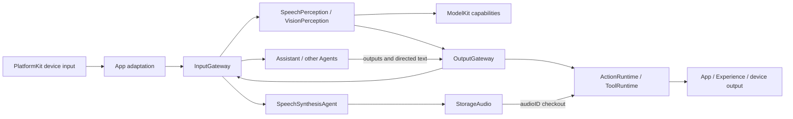

# Current architecture and scope

Purpose: explain present cross-module ownership and dependency direction. [MobileHarness/README.md](../MobileHarness/README.md) is the target technical plan; [Repository-Structure.md](Repository-Structure.md) maps it to physical targets. Exact module APIs, capacities and cleanup rules live in the corresponding source-directory README. [Roadmap.md](Roadmap.md) tracks pending work. The original `Technical_Design.docx` and historical `Tech_Design.md` remain unchanged design sources.

## Dependency direction

```text
App → Agents / Gateway / Actions / ActionRuntime / Tools / ToolRuntime / PlatformKit / ModelKit capabilities / StorageAudio
Gateway → AgentCore / ActionRuntime / ToolRuntime
Agents → AgentCore / ModelKit / StorageAudio
Actions → AgentCore / ActionRuntime / StorageAudio
StorageAudio → Storage / AgentCore / ModelKit
Storage → Foundation
ActionRuntime / Tools / ToolRuntime → AgentCore
ModelKitRuntime → ModelKit
ModelKit adapters → ModelKit / separate backends / platform SDKs
AgentCore → Foundation
ModelKit → Foundation / supported system frameworks
```

App assembles and injects services. AgentCore is independent of UI, concrete Agents, model engines and device adapters. ModelKit is an independent capability layer; its provider/default assembly stays inside ModelKitDefaults. Storage is independent of business and model types; StorageAudio is the PCM adapter shared by synthesis and playback. The current Storage contract is in [Storage README](../MobileHarness/Storage/README.md), with speech-specific behavior in [StorageAudio README](../MobileHarness/Storage/Audio/README.md). Disk and durable storage are future stages.

## Signal and execution flow



External inputs and tool results enter through InputGateway; Agent outputs pass through OutputGateway. Static publish and explicit directed send are validated against JSON v4 communication policy. Gateway routes and validates but does not own pending Agent message queues. Each Agent owns its inbox and overflow policy. OutputGateway validates resolved ActionCall/ToolCall; Channel scheduling applies only to Actions, while Tools execute directly. See [communication](../MobileHarness/AgentCore/Communication/README.md), [Gateway](../MobileHarness/Gateway/README.md), [Agents](../MobileHarness/Agents/README.md) and [Action scheduling](../MobileHarness/Gateway/Output/Scheduling/README.md) for current contracts. [ADR 0048](adr/0048-direct-signal-admission.md) explains direct admission, and [ADR 0042](adr/0042-show-pose-completion-tool.md) explains the completion-only skeleton Tool.

SpeechPerception owns VAD/ASR and recognition-caption Actions; Assistant owns conversational text segmentation and submits segments to the independent SpeechSynthesisAgent. It emits `Speech.speak(audioID)` only after synthesis request admission. Synthesis may proceed alongside scheduled playback; the Action owns actual playback completion. The App coordinates session and source cleanup, while the cache enforces owner scope and expiry. See the [voice acceptance guide](Voice.md), the [synthesis Agent README](../MobileHarness/Agents/SpeechSynthesis/README.md), the [playback README](../MobileHarness/Actions/Speech/README.md), [ADR 0055](adr/0055-synthesis-agent-audio-handles.md) and [ADR 0056](adr/0056-storage-audio-migration.md).

VisionPerception owns camera pose interpretation and produces display/gaze behavior through declared Tool/Action paths; it does not control the camera hardware. PlatformKit owns device I/O, ModelKit owns model processing, and Experience owns presentation. [ADR 0039](adr/0039-platform-capability-domains.md) records that domain boundary. Physical robot safety cannot depend on iOS background execution.

## Current limits of scope

✅ Static subscription, directed delivery, shared speech/vision perception, serial synthesis, bounded process-local audio handles, Channel Action scheduling, direct Tools and model lifecycle are implemented. Module READMEs state their exact limits and failure behavior.

❌ General request/reply, durable messaging/storage, cross-model scheduling, Channel takeover, robot control and sustained physical-device acceptance remain open. [Roadmap.md](Roadmap.md) owns milestone status; dated [ADRs](adr/README.md) preserve decisions without becoming duplicate current specifications.
