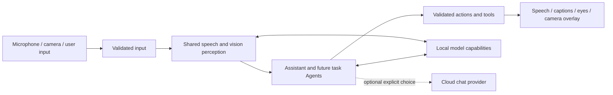

# MobileHarness architecture

> Current status (2026-09-30): user confirmed iPhone LLM conversation control. Broad BLE discovery and foreground recovery are implemented; acceptance of these latest UX changes remains pending.

MobileHarness turns device signals into Agent decisions and observable actions. An iPhone is the current host: it captures audio and camera frames, runs local perception and language models, and presents speech, captions, eyes and camera overlays. A configured cloud chat provider is optional. The project is designed to add more Agents and external devices, with supervised NexArm USB diagnostics and a bounded foreground iPhone BLE control path.

## How the current system works

- **Perception is shared.** Speech recognition and pose estimation produce observations that other Agents can consume. Camera preview remains available independently of voice-model readiness.
- **Agents decide behavior.** The conversational Assistant handles recognized speech and produces text, speech and presentation requests. An independent synthesis Agent prepares speech audio while playback follows the accepted Action order.
- **Outputs are explicit.** Gateways validate incoming signals and requested behavior. Actions provide scheduled behavior such as speech playback and captions; Tools provide direct functions such as skeleton display.
- **Capabilities stay separate.** ModelKit supplies model processing, PlatformKit handles device input/output, the UI module owns pages and interaction state, and App connects those parts. Current speech audio uses a bounded process-local cache; user settings use synchronized cached local persistence. General persistent media and memory remain planned.

The current repository implementation and source-to-target map are documented in the [internal technical plan](../MobileHarness/README.md#project-structure); exact contracts live in the module READMEs linked from its [module design](../MobileHarness/README.md#part-ii--module-design). This page describes behavior and boundaries for external readers; it does not define code-level limits or target dependencies.

## Current scope

✅ Local speech perception, conversational replies, synthesis and playback, camera pose perception, eye expressions/gaze, captions and explicit cloud chat selection have implementation and automated checks. The [voice acceptance guide](Voice.md) and dated validation reports distinguish test evidence from physical-device experience.

❌ Durable memory, general cross-Agent request/reply, unattended robot motion control, continuous background execution and sustained iPhone latency/thermal acceptance remain open. Future work is tracked in the [roadmap](Roadmap.md); historical decisions are in the [ADR index](adr/README.md). Physical robot safety would have to be enforced by the external controller, not by an iPhone App remaining active in the background.

User settings persist on this device, while credentials remain in protected device storage. The current design does not synchronize settings across devices. [ADR 0057](adr/0057-local-settings-storage.md) records the storage decision; the [Storage README](../MobileHarness/Storage/README.md) owns the implementation contract.

Default speech now uses local MOSS-TTS-Nano Core ML (beta) behind the same capability and audio-cache boundary. Kokoro is no longer selected or packaged, following repeated device crashes. [ADR 0058](adr/0058-moss-tts-nano.md) records the replacement; device acceptance remains pending.

Cloud settings allow blank credentials and an omitted endpoint (official OpenAI URL fallback). Registration remains local; authentication and provider compatibility errors surface during discovery or generation. See the updated [ADR 0053](adr/0053-settings-live-chat.md).

StorageAudio production PCM cache defaults to 8 MiB per handle (32 live handles; 256 MiB aggregate PCM ceiling, allocated on demand). This matches the synthesis Agent’s per-request output limit and accommodates approximately 43.7 seconds of MOSS 48 kHz mono Float32 audio. Overflow remains explicit; see ADR 0058.

Settings includes [conversation history](../MobileHarness/UI/Settings/README.md) for actual Assistant exchanges. It preserves original user text, received model fragments, exact request context and error status in local durable storage. Current conversation context uses its latest ten completed rounds across voice sessions and App restarts. Start New archives it, creates an empty context and generates an archived title; pending titles can be retried. Stored markup is inspected without execution. This replaces the former single-turn raw-output test; it helps inspect wait failures but does not prove scheduler timing. See [ADR 0060](adr/0060-persistent-conversation-history.md).

Action scheduling now uses task-local nested wait groups: each wait joins its parent's prefix, preserves Channel FIFO/concurrency internally, and releases the parent's suffix only after closure and completion. Equal Channel names no longer imply a shared cross-task FIFO; device-module exclusion remains process-wide. [ADR 0059](adr/0059-structured-wait-scheduling.md) records the protocol and migration. Tools and speech synthesis prefetch remain outside these Action groups.

## Agent configuration and internal behavior

✅ JSON v5 declares model-callable Actions grouped by Channel, native function Tools and unchanged communication policy. Fixed speech/caption/transcript/gaze/overlay behaviors and their permissions are code-owned. Model parsers cannot resolve internal operations; all outputs still cross OutputGateway. See [ADR 0061](adr/0061-agent-json-v5.md). ❌ Full JSON Schema and provider-native Tool deltas remain unimplemented.

ChatRequest output budgets are optional: normal Assistant calls omit max_tokens for provider defaults; local Qwen bounds generation by remaining context. Historical explicit budgets remain readable. Parser and execution capacity limits still apply.

## Source ownership

Actions and Tools each include their Runtime subdirectory in a single compilation target. Shared contracts live in Agents/Core but retain the independent AgentCore target to preserve acyclic StorageAudio/Gateway dependencies; see [ADR 0063](adr/0063-module-directory-consolidation.md). SwiftUI pages, page state and interaction interfaces now live in the sibling UI module under [ADR 0064](adr/0064-app-ui-boundaries.md). Runtime flow and behavior are unchanged.

## App and UI boundary

AppAssembly owns application composition. App/Composition builds the graph, Lifecycle owns voice/camera scopes and cleanup, Workflows coordinates settings/history/diagnostic operations, and Adapters connects validated effects to native devices and presentation state. UI is an independent sibling target containing pages, observable state and operation protocols. It imports shared record values only; pages do not own application runtimes, stores, model sessions or players. See [ADR 0064](adr/0064-app-ui-boundaries.md).

The current lifecycle owners are VoiceSessionCoordinator, CameraCoordinator and VisionSession. ApplicationRuntime creates Assistant with the shared journal; CurrentChatCapability resolves the selected chat binding for conversation and title requests. Both speech and chat diagnostic execution belong to AppWorkflows. UI may own short-lived rendering/load tasks or await an injected diagnostic operation; long-lived voice/camera ownership stays in App. Directory/file inventories live in the [App](../MobileHarness/App/README.md) and [UI](../MobileHarness/UI/README.md) READMEs.

## Action implementation contracts

✅ App now validates Action implementation definitions against assembled Agent capabilities before producers start. Invocation derives from one envelope; scheduler admission assigns an execution ID. Shared argument readers and separated runtime/scheduling/domain errors support consistent Actions. A bounded, payload-free diagnostic ring records execution phases and conservative effect status; it does not alter scheduling or produce Agent feedback. See [ADR 0065](adr/0065-action-runtime-contracts.md).

❌ Continuous activity owners, persistent resource leases, execution/cleanup deadlines and full business Action style migration remain outstanding. UI state acceptance still does not await animation, and speech still awaits playback completion.

## Action feedback and resource ownership

✅ [ADR 0066](adr/0066-action-results-resource-leases.md) adds correlated ActionResult feedback through InputGateway and a single process-wide resource authority shared by declared Action/Tool/host paths. Results describe the handler completion boundary; ongoing ActivityEvent is separate. Message retry never repeats effects. Ownership binds Agent incarnation/session; group takeover gates, stops and joins before granting, with faulted gates on uncertain cleanup. Camera capture uses a renewable lease.

❌ Generic activity management, other device resource migration, durable delivery, physical watchdogs and real-device acceptance remain pending; these replace the corresponding stage-1 future-work items above.

## Behavior assembly ownership

✅ [ADR 0067](adr/0067-domain-owned-behavior-assembly.md) moves concrete behavior definitions into Action/Tool domain modules. A pure BehaviorAssembly target under App/Composition/Behaviors constructs and validates both registries; App supplies typed effects and retains device/runtime lifetime. Agent permissions remain independent. ❌ This does not provide dynamic discovery or new device capabilities.

## Canonical Action entry audit

✅ [ADR 0068](adr/0068-canonical-action-entrypoints.md) completes the current UI/Speech entry standard. Speech transport validation belongs to Actions; its host capability receives a typed UUID. Playback cleanup is joined before failure returns. ❌ No new device/animation functionality is implied.

## Storage core/domain layout

✅ Storage now separates generic mechanisms in its root from Audio and Chat domains. StorageChat depends on Storage; UI imports only shared chat values. Source relocation preserves journal data and runtime semantics. See [ADR 0069](adr/0069-storage-core-domain-layout.md).

❌ Image/video/semantic-memory storage and cross-device synchronization remain planned.

## NexArm supervised diagnostic

An opt-in NexArm Action now delegates through a typed host binding to an actor-owned PlatformKit USB controller on macOS. The hardware test composes both gateways and the Action scheduler with Assistant JSON declaring the bounded base Action. Completion is controller-reported position convergence; uncertain effects block subsequent motion. The built-in domain catalog requires a typed base callback; Mac test composition binds USB; iPhone composition now binds BluetoothWorkflow (ADR 0071). This is a supervised diagnostic exception, not unattended robot control. See [ADR 0070](adr/0070-nexarm-usb-diagnostic.md).

## Foreground NexArm Bluetooth

Settings now discovers supported NexArm devices, verifies firmware, remembers one selected device and exposes explicit disconnect/forget. AppAssembly retains one workflow/connection across page navigation and injects its motion handler into the existing Action module. CoreBluetooth stays in PlatformKit; UI contains only state and control interfaces. Both Gateways and the domain Action remain on the conversation execution path. Foreground loss cancels subsequent legs and closes the connection without pretending to stop an already committed motor command. [ADR 0071](adr/0071-nexarm-iphone-ble.md) defines bounds and acceptance limits.

Bluetooth disconnect cleanup is scoped to robot work. The global voice/session barrier is used only before explicitly arming a replacement connection; see ADR 0071. Vision consumes terminal Action receipts before image-only validation.

NexArm readiness verifies firmware once per live controller/connection, permits at most four read-only queries for explicitly missing AT32 information, and never retries a transport failure or motion. BLE exchange deadline is five seconds based on measured device latency; see ADR 0071.

NexArm native connection and control readiness are separate. An explicit missing AT32 version retains the link but rejects motor Actions; a user-requested verification may establish readiness on that same connection after the requested indication described below. Rejected Actions do not replay. Other verification failures still close the link (ADR 0071).

Explicit NexArm connection now includes user-requested physical feedback after verification: one arm reset and a bounded ID5 gesture. AppWorkflows owns the indication task and readiness transition; PlatformKit separates ATT write acknowledgment from sampled physical convergence. Cancellation joins the committed leg and prevents remaining commands (ADR 0071).

Current NexArm BLE policy supersedes the earlier missing-version-only blocking behavior: App selects the explicit NexArm 1.0.2 compatibility profile, requires valid stationary telemetry for the known missing-AT32 response, and reports the unavailable version honestly. Reset and ID5 ±8°/center feedback must complete before ready. Controller default remains strict; no motion/transport retry or persistent firmware attestation is added. See revised ADR 0071.

Current Bluetooth UX supersedes the previous version-based compatibility gate: normal App connections use service/pose/gesture validation without querying firmware. Discovery lists BLE advertisements regardless of name/service (128-row bound), prioritizing NexArm names. Root-owned foreground recovery reconnects the saved verified UUID once per activation, performs read-only validation and never replays motions. Manual disconnect/forget and uncertainty disable persisted recovery. The user has confirmed the iPhone conversation-control path; the new scan/recovery UX remains to be accepted on device. See revised ADR 0071.

## NexArm entertainment skills (2026-09-30)

NexArm entertainment Actions use one typed host binding and the existing root-owned BLE motion lifecycle. PlatformKit owns bounded preset keyframes; neither model output nor Actions can supply arbitrary servo trajectories. All gestures share NexArm exclusion and cancel without replay. See [ADR 0072](adr/0072-nexarm-entertainment-skills.md).

## Peripheral detail controls

✅ 蓝牙外设 connects to a detail page for sampled arm state, existing gesture presets, explicit reset and six bounded motor sliders. UI owns presentation only; root AppWorkflows owns manual admission and shares the controller/motion lifecycle with conversation Actions. Explicit host device controls do not synthesize Agent messages. See [ADR 0073](adr/0073-peripheral-detail-controls.md). ❌ Six-motor physical acceptance remains pending.

## Unconfirmed motion is separate from connection failure

✅ NexArm motion uncertainty no longer discards a live Bluetooth controller. The workflow releases busy admission and retains the failure result; refresh or a new explicit request uses bounded read-only stationary validation before new movement. Actual transport loss still closes control. No motion replay is introduced. See the recovery amendment in [ADR 0073](adr/0073-peripheral-detail-controls.md).

## Bluetooth discovery and recovery ownership

✅ Native discovery drops unnamed devices before retaining them, and connection clears scan results while retaining only its selected link. App forget joins disconnection and clears native, persisted and presented device state. Gesture completion is separate from validated connectivity. A transport timeout still fences the old request channel, then App may make one read-only reconnect attempt without replay. See the current lifecycle amendment in [ADR 0073](adr/0073-peripheral-detail-controls.md).

## Manual servo stream versus preset completion

✅ Six spring-return velocity controls use a root-owned latest-intent worker and a separate BLE no-response session. Manual input does not wait for arrival/telemetry and reset can preempt preset output. Preset Play retains the existing completion contract. Read observations, commanded estimates and local transport admission remain distinct. See [ADR 0074](adr/0074-nexarm-live-jog.md).

✅ NexArm entertainment Actions now execute fixed absolute preparation/body/ending poses using synchronized six-servo targets and native acceleration. Every waypoint is observed; final home requires stable telemetry. Explicit reset retains priority over playback. See [ADR 0075](adr/0075-nexarm-fixed-choreography.md). ❌ Physical choreography acceptance remains pending.

✅ [ADR0076](adr/0076-nexarm-controller-preset-transport.md) replaces unverified raw broadcast preset writes with the established CMD51 controller path. Six target writes overlap motion; whole-pose feedback still determines completion. Reset does not require a completion reply.

✅ [ADR0077](adr/0077-nexarm-calibrated-pose-choreography.md) replaces nominal encoder-based performance admission/completion with fixed Cartesian poses through the working whole-arm CMD50 path. Phone base sway now uses the same performance engine. ❌ New full motion sequences await physical acceptance.

✅ Mac USB and iPhone BLE share `NexArmWritableLink` and the exact same preset controller. Native absolute CMD8 replaces host-measured increment compensation; all seven presets now have USB physical feedback acceptance. See [ADR0078](adr/0078-nexarm-shared-physical-validation.md) and the [acceptance record](NexArm_Physical_Acceptance.md). ❌ BLE timing/visual quality remain separate.

✅ 2026-09-30: shared NexArm jog planner uses bounded acceleration/jerk, finite look-ahead, 30 ms scheduling and native servo position writes without per-write pose queries. Tests cover smoothing, duplicate suppression, six-axis streaming, congestion and reset preemption. See [ADR 0079](adr/0079-nexarm-smooth-jog.md). ❌ BLE physical cadence/visual smoothness require phone acceptance.

✅ [ADR 0080](adr/0080-nexarm-independent-motion-results.md): explicit preset admission no longer depends on previous completion/recovery feedback. New actions retain their own completion checks. ❌ Physical failure recovery acceptance remains pending.

✅ [ADR0081](adr/0081-settings-immediate-test-control.md) separates immediate preemptible settings tests from unchanged completion-based channel actions. ❌ Settings send status does not assert physical completion.

✅ [ADR0082](adr/0082-nexarm-observation-watchdogs.md) adds continuous pose reception, notification-first channel completion, limited query fallback and independent silence/total deadlines. Settings live tests remain unchanged. ❌ Device-side watchdog and action-ID completion require firmware support.

✅ Dance timeout correction: the fixed overall channel deadline sums all per-segment motion and settling budgets, preserving2s feedback silence and per-segment limits. Previously one shared3s margin truncated a healthy multi-frame dance before its ending. Settings playback and pose tolerances are unchanged.

## Unified Action execution presentation

✅ [ADR0083](adr/0083-action-execution-presentation.md) adds scheduler-owned execution observation independent of Agent result delivery. AppWorkflows maps bounded full snapshots to UI-only channel summaries and recent history. All active work remains tracked; terminal retention is100 records. Cancellation pending remains visible until handler cleanup joins. ❌ Device-specific progress and durable history are not provided.

✅ Action display includes every scheduled Action. Fixed internal UI updates use immediate Tools outside the observation stream. Invalid Action arguments are distinguished from physical-device failures; the execution panel uses native Liquid Glass on supported iOS versions.

### Action / Tool presentation boundary correction

✅ Every scheduled Action is observable; there are no module/source filters. Fixed UI updates are completion-only Tools with explicit append/replacement semantics; model expression remains an Action. Failure descriptions come from the thrown error, bounded in the scheduler snapshot, while machine codes remain metadata. See [ADR0083](adr/0083-action-execution-presentation.md). ❌ Native model Tool output and physical-phone visual acceptance remain separate follow-up work.

### Single-motor head gestures

✅ Nod and head shake use a calibrated-home preparation and native motor4/5 trajectories. Channel arrival checks encoders with the same freshness/deadline policy; Settings remains send-only with bounded nominal targets. The shared transport admits only the new bounded motor command. ❌ Physical acceptance of these added gestures remains pending. See [NexArm](../MobileHarness/PlatformKit/Connectivity/NexArm/README.md).

✅ LLM output buffering is decoupled from consumer speed: cloud/local chat retain pending events without a count cap and drain them in order after generation. Generation/response bounds and downstream execution limits remain. See [ADR 0084](adr/0084-llm-output-buffering.md).

Head gestures cross from Cartesian trajectory control to native motor control. The shared NexArm controller keeps observing while requiring a fresh arrival sample after the ready trajectory duration before that handoff; strict final arrival and bounded watchdogs remain. A distinct ready target precedes native writes so the ending home is a new Cartesian request. See the [physical acceptance evidence](NexArm_Physical_Acceptance.md) and [controller contract](../MobileHarness/PlatformKit/Connectivity/NexArm/README.md).

## Cohesive Action files (2026-09-30)

✅ Related short Action entries now share domain files. Non-callable registrations, capability interfaces, types and resource services live in domain Support subdirectories; shared infrastructure remains in Actions/Runtime. Public symbols, paths, permissions, completion and scheduling contracts remain unchanged. The [Action standard](../MobileHarness/Actions/README.md) owns source-layout rules.

❌ This source reorganization adds no device behavior or runtime contract.

✅ Speech PCM lifetime now follows its originating reply: no queued/ready cache expiry. After Gateway joins all reply Actions, App clears remaining source/input audio; interruption closes session audio. Played segments release immediately. See [ADR 0085](adr/0085-reply-owned-speech-audio.md).

✅ The unused NexArm wrist diagnostic Action and test-only Agent have been removed. Hardware diagnostics use direct controller tests; the eight production NexArm Actions retain their existing Agent/Gateway path. Runtime ActionDiagnostics remains scheduler-owned execution history, not a callable diagnostic Action. See ADR 0070.

## Domain-owned Action display metadata

✅ ActionDefinition owns a validated human-readable name, copied into shared execution records at admission. Root Workflow forwards scheduler snapshots; UI computes generic statuses/styles and preserves exact Channel names. Neither Workflow nor UI enumerates concrete Actions. Observation is separate from Agent outputs and ActionResult delivery. See [ADR 0086](adr/0086-action-display-metadata.md).

❌ This does not add localization resources, durable audit delivery or per-device progress.

## Tool source organization

✅ Tool entries are grouped by domain, with non-entry registration/interfaces/types/policy under domain Support and the built-in catalog under Runtime. Tools remains one independent target depending only on AgentCore; direct returning/completion execution, cancellation and InputGateway feedback contracts are unchanged. ❌ This source migration adds no scheduler, live health probe or native model Tool transport.

✅ Conversation NexArm completion now requires a fresh stable arrival after each segment’s nominal trajectory duration, extending the head-only handoff protection to whole-arm gestures. Observation and watchdogs remain active throughout. See the [controller contract](../MobileHarness/PlatformKit/Connectivity/NexArm/README.md#all-segment-trajectory-handoff) and ADR 0082. ❌ Reported celebration/dance motor2 oscillation requires physical BLE acceptance.

Speech playback now waits for synthesis progress without an independent PCM read timeout. The synthesis Agent retains its 60-second execution deadline; failures, cancellation, capacity bounds and hardware drain watchdogs remain explicit. See [ADR 0087](adr/0087-speech-producer-deadline.md).

✅ NexArm Cartesian conversation gestures now share Settings frame generation and nominal playback timing, then observe final home before releasing whole-Action ownership. Intermediate waypoint arrival is no longer part of their completion contract; head gestures retain calibrated per-segment control. See [ADR0088](adr/0088-nexarm-settings-matched-playback.md). ❌ Physical jitter acceptance is pending.

NexArm performance completion now verifies the arm axes independently of gripper position: XYZ/pitch/roll and motors1–5 retain their existing convergence and stability requirements. Generic arrival tracking remains strict by default; outbound gesture packets are unchanged. See [ADR0089](adr/0089-nexarm-arm-completion-scope.md).

### NexArm arm-only output (ADR0090)

All arm gestures and home/reset exclude the gripper at packet level, not only arrival checks. PlatformKit prepares a bounded connection-local read-only IK table and compiles shared Settings/Channel geometry into synchronous writes explicitly listing IDs1–5. AppWorkflows prepares this capability before live admission and preserves motor6 in command estimates. Explicit manual gripper jogging remains independent. There is no six-axis fallback; see [ADR0090](adr/0090-nexarm-arm-only-motion-packets.md).

## NexArm feedback execution — 2026-10-01

✅ NexArm motion now uses motor-scoped plans with one controller owner, common Settings/Channel execution, feedback-driven advancement, bounded skip-and-report for missed segments and connection-level feedback watchdog priority. Action definitions remain dependency-injected; PlatformKit does not import AgentCore. See ADR0091.

❌ Sustained real-device acceptance remains pending.

## Atomic composition — ADR0092

✅ ADR0092 separates Action execution termination from success: structured child reports, resource-union composition and Channel failure isolation. Device feedback loss is a leaf outcome; cancellation is an explicit control path.

❌ Sustained real-device acceptance and durable result delivery remain outstanding.

✅ NexArm business gestures, localized names, motion completion and error-collection policies belong to Actions/NexArm/Support. PlatformKit is the foundational connection/protocol/native-command SDK with no business dependencies. Settings and Channel consume the same injected Action controller through AppWorkflows. See [ADR0093](adr/0093-nexarm-platform-action-boundary.md).

✅ PlatformKit audit further separates native capabilities from policy: Actions owns manual jog/reset behavior; AppWorkflows owns Bluetooth presentation of structured transport failures and device ordering; App adapters own preview layout. Audio/vision acquisition and conversion remain foundational capabilities. See the current [NexArm technical design](../MobileHarness/Actions/NexArm/README.md).

## Arrival completion and behavior metadata (ADR0094)

Actions own per-motor arrival profiles and dynamic execution budgets. Arrival succeeds on fresh in-tolerance feedback; only off-target failure uses stability. Runtime deadlines cancel and join handlers, preserving child reports. `@Action`/`@Tool` generate explicit definition factories through the isolated BehaviorDefinitions compiler plugin; App injection and Agent JSON permissions are unchanged. See [ADR0094](adr/0094-arrival-profiles-and-behavior-macros.md).

The cleanup in [ADR0095](adr/0095-remove-retired-device-and-behavior-code.md) removes unused generic device placeholders and isolates historical polling diagnostics in Tests. PlatformKit/Core currently contains documentation only; actual authorization remains in the concrete adapters.

Actions and Tools now own Contracts directories and have no AgentCore dependency. Gateway translates Agent intents and delivery results; App projects UI display data and adapts stored audio. See [ADR0096](adr/0096-behavior-owned-contracts.md).

## Audio storage identity boundary — ADR0097

✅ StorageAudio depends only on Storage and ModelKit; consumers pass opaque source strings instead of AgentID. Source/session/input authorization and cancellation behavior are preserved. See [ADR0097](adr/0097-storage-audio-opaque-owner.md).

❌ ModelKit PCM type extraction and new physical-device acceptance are not included.
