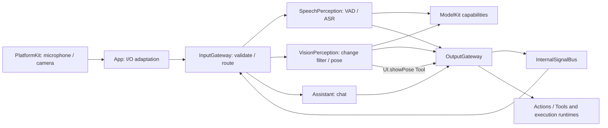

# 架构与当前范围

目标技术方案为 MobileHarness/README.md。原始 Technical_Design.docx 和历史 Tech_Design.md 保留；目录与例外见 Repository-Structure.md。当前感知与通信边界以 ADR 0040 为准，历史 ADR 中的 Gateway 模型适配与未实现 Bus 状态已被取代。

## 依赖方向

```text
App → Agents / Gateway / Actions / ActionRuntime / Tools / ToolRuntime / PlatformKit / model capabilities
Gateway → AgentCore / ActionRuntime / ToolRuntime
Agents → AgentCore / ModelKit
Actions → AgentCore / ActionRuntime / ModelKit
ActionRuntime → AgentCore
Tools → AgentCore
ToolRuntime → AgentCore
ModelKitRuntime → ModelKit
ModelKit adapters → ModelKit / separate backends / platform SDKs
AgentCore → Foundation
ModelKit → Foundation / Synchronization / supported core data frameworks
```

Gateway 不依赖 ModelKit、Agents、PlatformKit。ModelKit 是独立能力 SDK，不依赖 AgentCore 或业务层。模型 provider/default bindings 只由 ModelKitDefaults 内部组装，App 提供资源根目录；生产共享一个 ModelManager，每模型仅一个活动操作，不支持通用跨模型调度。

## 输入、感知和业务



AgentInput 是统一输入契约，区分内容与来源，携带会话、来源实例、时间/序号、因果关联和接纳期限。AgentCore 音频为有界 PCM，图像可携带受控附件，App 提供 ModelKit 转换器；感知结果仅携带结构化观测，不重复携带媒体。

SpeechPerception 管理 VAD/ASR 会话、分段与合并；partial 为共享感知事件，字幕由独立 UI.setTranscript Action 更新，非空 final 每轮发布一次供 Assistant 订阅。VisionPerception 接纳图像、执行原有灰度筛选并共享一次姿态推理，VisionPerception 自行生成六人以内的 UI.showPose Tool；Photographer 仅保留运镜业务规划，不参与当前运行。相机预览独立于推理与语音模型准备。

生产语音继续使用 Nemotron + Silero、Qwen3.5-2B MLX 与系统 TTS，视觉继续使用现有 YOLO26n-Pose；没有新增 provider 或回退。模型不可用明确报错。

## 静态订阅与定向投递

所有 Agent 配置使用 JSON v4，动作、工具、Channel、文本映射和通信声明只在配置中定义。输入契约、订阅的来源/主题与发送权限由 App 启动时校验。错误传播，不使用 try! 或硬编码 fallback。

publish 按 contract/source/topic 精确匹配；send 指定目标，无需订阅但仍检查权限、输入支持、实例、会话、期限及容量。ToolResult 保持原 Agent/session 定向回送。内部事件通过绑定身份端口经 OutputGateway → Bus → InputGateway，不经过模型 XML 或 ToolCall 语法。

最新状态仅适用于 pose/partial；普通离散事件与动作不可静默替换。接纳回执按目标返回结果，不代表处理或动作完成。请求/回复、动态订阅、持久化、重试和通用健康监督尚未实现。详见 AgentCore/Bus/README.md。

## 生命周期与容量

ApplicationRuntime 在语音模型准备前即可创建共享 manager、policy、bus 与双 Gateway。相机、语音使用独立 session；会话停止先关闭感知发布入口，取消并等待该会话的模型/传输清理，再取消消费者及其动作。旧 incarnation 不会路由到新实例。

语音原始 inbox 与 ASR 队列分别最多 128 项/64000 样本；每轮 60 秒。识别/回复期间保持原有采集抑制，动作全部完成后等待 350 ms 恢复。停止清空当前会话上下文；模型权重保留由 ModelManager 管理。

VisionPerception 原始帧最多一项处理中、一项最新等待。过期观测不开始处理。Vision 保留最多 300 人的通用坐标，VisionPerception 的显示投影单独限制六人显示，不能将显示筛帧策略当作避碰采样保证。

Bus 最多 128 活动操作、256 分支、8 MiB 载荷、64 目标 worker、256 状态通道、256 会话，每次最多 16 接收者。一般事件 16 KiB、姿态 256 KiB；默认离散接纳期限 10 秒，pose 1 秒、partial 2 秒，硬上限 60 秒。完整队列算法与溢出策略归各目录 README。

## 输出与执行

FunctionTokenParser/AgentGenerator 属于 AgentCore/Generation；Agent 内解析局部别名，仅输出已解析 ActionCall/ToolCall。自然文本按配置分句映射 say/print；Channel 栈和默认 Channel 保持现有行为。ToolCall 是独立原生协议，生产模型原生 tool delta 仍未接入。

OutputGateway 对调用复核并交给 Action/Tool runtime。ChannelScheduler 每 Channel 默认 32 项（含执行中），最多 16 活跃 Channel、64 来源输入记录；满时失败。同 Channel 等待真实动作完成，不同 Channel 可并行，同模块物理资源互斥。assistant.finished 等待其动作完成后才恢复收音。

## 当前验证与后续范围

✅ 编译级模块边界、JSON v4、事件传输、共享感知和 App 接线已实现。测试覆盖两个消费者仅一次推理、语音 final/partial、取消失效、独立会话关闭、慢接收者、超时和最新状态替换。

❌ 真实 iPhone 持续音视频体验、热状态、时延与精度需单独验收。ReflexAgent、深度/人脸接入、机器人动作、Channel takeover、设备端保护和硬实时保证均不在本次实现范围；物理安全不能依赖 iOS 后台运行。

✅ 识别字幕由 SpeechPerception 声明并发出 UI.setTranscript Action，经 OutputGateway / ActionRuntime 调用 App handler；partial 更新、识别完成置空均走行为通路。speech 信号保留感知语义，App 观察只做阶段协调与 final 日志，不再修改识别字幕。停止仍即时清理界面并拒绝旧会话动作。

✅ 严格 UI 行为边界：SpeechPerception 负责识别字幕与阶段 UI Actions；Assistant 订阅 speech.phase，在本轮首次起音时发出原子的 beginReplyTurn。App 的 Signal 观察仅做采集接纳与日志，不修改 UI。运行时取消/失败监督与用户、系统生命周期清理独立于业务调用。

✅ UI.showPose 使用无回流 Tool：VisionPerception 解析 JSON 中的工具别名，OutputGateway 校验后直接调用 ToolRuntime，等待 MainActor 覆盖画面，不进入 Channel，不生成 ToolResult。Void 执行失败向调用链抛出；普通数据 Tool 仍经 InputGateway 回流。见 ADR 0042。

✅ ADR 0043 引入会话内 ConversationTurn 与输出序号：长句分段不换轮；Assistant 原子 beginReplyTurn；SpeechPerception finishTranscript 封闭识别字幕。UI.print 不再改变播放状态，播放中状态来自真实播放器活动。

✅ VisionPerception 的推理、观测发布和显示消费解耦：一项活动推理 + 一项最新待推理帧；一项活动发布 + 一项最新待发布观测；一项活动显示 Tool + 一项最新待显示骨架。只合并可替换的感知/显示状态，不改变 Gateway 协议或物理命令语义。App 默认最长刷新间隔 100ms，在有新帧时避免灰度阈值饥饿。见 ADR 0044。

✅ Audio spectrum telemetry (ADR 0045): PlatformKit exposes PCM frequency analysis and the current player buffer render cursor. App retains one bounded latest microphone window and two 32-band snapshots; Experience draws them without time-generated waves. This extends device telemetry only; Gateway/Agent presentation contracts are unchanged.

✅ ADR 0046 replaces the UI.express emoji callback payload with a typed semantic emotion. Experience maps it to stable, continuously interpolated eye geometry. Gateway routes, Action path, session/turn admission and completion semantics are unchanged.

✅ ADR 0047 removes the legacy Input/Routing abstraction and submit API. External publish requires CommunicationPolicy; send names its target, including ToolResult return. Policy-free construction retains explicit directed admission only; no input defaults to Assistant. Production JSON routing, Bus queues and per-target receipts are unchanged.
