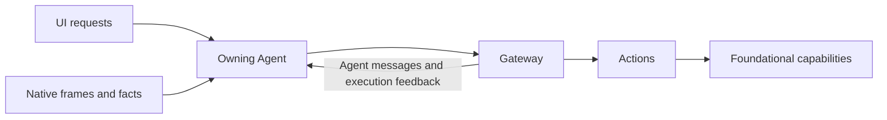

# Architecture

Agents directly consume typed UI container requests, native PlatformKit streams and model/device/failure observations. UI, PlatformKit, ModelKit and Storage remain independent. Input observation and business execution have separate capabilities and owners.

User and model decisions share registered Actions, resource ownership, cancellation and genuine completion. Local inputs retain lightweight request/session/generation/turn/causal context and do not become external Signals. Agent communication and execution feedback keep their bound transport authority.

Each Agent owns its constructor-injected UI subscriptions independently of pages and joins cleanup; the application root assembles and starts/stops the owners. UI request receipts distinguish acceptance from business completion; State contains limited public facts with one owning writer. Raw frames, queues and full AgentContext remain private. Direct delivery never automatically retries a failed effect or claims physical completion.

App 每个作用域缓存唯一 AgentContainer，通过一个 agents 生命周期节点管理它。七个稳定角色容器分别拥有会话、注册与清理；共享 AgentRuntime 只装配通信／执行图。依赖顺序与公开接口见 [Agents 当前契约](../MobileHarness/Agents/README.md#agent-container)，实施状态和独立验收见 [容器计划](requirements/technical/Agent-Containers-Plan.md)。

The complete current module graph, source ownership, speech/camera/history/model/resource flows and lifecycle contracts are maintained in [the overall technical design](../MobileHarness/README.md). Local interfaces and limits belong to each module README. [ADR 0218](adr/0218-direct-container-input.md) records the change in input boundaries; [validation](validation/Direct-Container-Input.md) separates automated, build and physical evidence.

Native PCM and camera subscriptions are owned by the perception Agents. Capture execution owners pass neither streams nor per-frame callbacks: they control hardware and wait for the role input lifetime. SpeechPerception applies half-duplex admission and processing before pulling the next native packet; only low-frequency measurements leave the role.

Actions owns native voice capture/playback, diagnostic capture and voice presentation. Agents owns consent, direct input consumption, model work and role/output lifetime. Their injected role lifecycle contracts carry no PCM or frame transport; low-frequency microphone measurements are presented by an Actions service with UI/capture-generation fencing.

Home gestures and diagnostic start/stop requests are typed Container inputs owned by SpeechPerception and ApplicationControl. Actions neither create roles nor publish back into UI request sources. Registration and bound output consumers precede input admission; initialization never opens devices or loads models.

Complete history queries execute through the private History.Conversation.readFull endpoint with a request-owned typed result attachment. Gateway transports it only after producer/permission checks, for local non-model calls without delegated scope or mixed media. Four actual read workers retain joined cancellation; model preview functions and Skill exposure remain unchanged.

Business interaction feedback and activity projection services compile in Actions. Camera, resource and connection observers belong to their actual Agents. The explicit simulator build variant excludes the unsupported default CoreAI dependency; simulator capability unavailability is explicit, while device/macOS providers remain real.
