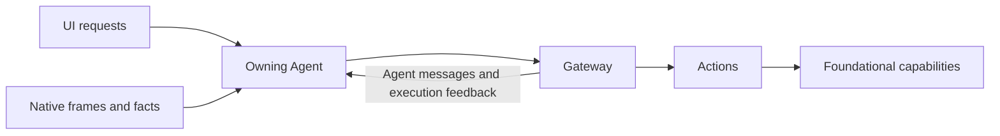

# Architecture

Agents directly consume typed UI container requests, native PlatformKit streams and model/device/failure observations. Perception roles turn sensory input into semantic role messages; cognitive roles consume those messages through Gateway or receive already typed local intent directly. Internal messages can also originate from any authorized role without new sensor input. The [source/perception/cognition/execution overview](../MobileHarness/README.md#native-input-and-internal-signals) distinguishes those paths and their feedback. UI, PlatformKit, ModelKit and Storage remain independent. Input observation and business execution have separate capabilities and owners.

User and model decisions share registered Actions, resource ownership, cancellation and genuine completion. Local inputs retain lightweight request/session/generation/turn/causal context and do not become external Signals. Agent communication and execution feedback keep their bound transport authority.

Each Agent owns its constructor-injected UI subscriptions independently of pages and joins cleanup; the application root assembles and starts/stops the owners. UI request receipts distinguish acceptance from business completion; State contains limited public facts with one owning writer. Raw frames, queues and full AgentContext remain private. Direct delivery never automatically retries a failed effect or claims physical completion.

App caches one ActionsContainer, GatewayContainer and AgentContainer per registration scope. Foundations → executionBindings → Actions → Gateway → Agents → homePreparation defines readiness; inverse cleanup retains all host ports until Gateway and Actions join. Actions owns canonical registration, pure preparation, validation and business/native execution; Agents owns role/Skill/Task authorization; Gateway owns neutral endpoint/envelope/scope admission, communication, scheduling, resources and delivery. Domains, modules and individual actions remain composable business library values without containers. The module APIs and ownership rules are defined in the [overall technical design](../MobileHarness/README.md).

The complete current module graph, source ownership, speech/camera/history/model/resource flows and lifecycle contracts are maintained in [the overall technical design](../MobileHarness/README.md). Local interfaces and limits belong to each module README. [ADR 0218](adr/0218-direct-container-input.md) records the change in input boundaries; [validation](validation/Direct-Container-Input.md) separates automated, build and physical evidence.

Native PCM and camera subscriptions are owned by the perception Agents. Capture execution owners pass neither streams nor per-frame callbacks: they control hardware and wait for the role input lifetime. SpeechPerception applies half-duplex admission and processing before pulling the next native packet; only low-frequency measurements leave the role.

Actions owns native voice capture/playback, diagnostic capture and voice presentation. Agents owns consent, direct input consumption, model work and role/output lifetime. Their injected role lifecycle contracts carry no PCM or frame transport; low-frequency microphone measurements are presented by an Actions service with UI/capture-generation fencing.

Home gestures and diagnostic start/stop requests are typed Container inputs owned by SpeechPerception and ApplicationControl. Actions neither create roles nor publish back into UI request sources. Registration and bound output consumers precede input admission; initialization never opens devices or loads models.

Complete history queries execute through the private History.Conversation.readFull endpoint with a request-owned typed result attachment. Agents authorizes the producer and request; Gateway transports it after neutral endpoint/scope checks, for local non-model calls without delegated scope or mixed media. Four actual read workers retain joined cancellation; model preview functions and Skill exposure remain unchanged.

Business interaction feedback and callable presentation compile in Actions. Passive activity projection that interprets Agent/Task evidence compiles in Agents/Support. Camera, resource and connection observers belong to their actual Agents. The explicit simulator build variant excludes the unsupported default CoreAI dependency; simulator capability unavailability is explicit, while device/macOS providers remain real.

Window presentation is a UI-root capability above persistent Face/navigation. Typed controls travel through ApplicationControl and Gateway to Window Actions; domain lifecycle ports keep capture cleanup and photo decisions in Actions/Camera. Camera.Capture.open composes window presentation with native readiness. Window State reports presentation identity/focus/mode only. See [window implementation](../MobileHarness/Actions/UI/Navigation/README.md) and [approved scope](requirements/Face-Window-Island-Plan.md).

Background vision/following and photo-window demand independently reuse one PlatformKit Camera. Actions releases capture only after both demands close; minimizing hides photo rendering without withdrawing demand. UI presentation ordering determines lens control, and Actions enforces the same holder before calling Foundation switching. Camera native phase/running/facing State is owned by platform.vision.camera; UI intent and presentation are separate facts.

Photo/video share the same Camera window and Foundation capture session. Camera Actions owns countdown, configuration, recording completion and pending-media decisions. Recording joins listening pause before native microphone reservation; terminal native cleanup releases audio before generation-fenced listening restoration. Storage publishes a bounded file-backed movie and separately records App album inclusion; UI plays only a supplied local URL. Background invalidates listening restoration and joins recording finalization, while minimized windows retain recording with an activity label. See [Camera](../MobileHarness/Actions/Camera/README.md) and [validation](validation/Window-Camera.md).

UI根统一前台IslandHost与系统ActivityKit呈现；Actions只发布中立内容、可选detail和阶段身份。只有目标Task投影详情，通用组件拥有前台动效/挂载，系统拥有原生动效，两端失败独立。频谱仅更新前台，不提交逐帧Action。Widget白名单导航回App已有入口，设备生命周期仍由其原有所有者管理。

内容接口重构采用primary/secondary指标与可选detail(text,thumbnail)：有效详情默认展开，手动收起保留内容；优先级整体切换活动并保存各自展示偏好。缩略图本轮仅App内有界显示，系统保留图标/文字。交互与动效由UI组件统一拥有；见[实施计划](requirements/Face-Window-Island-Plan.md)。

## UI interaction paths

Choose the interaction path by responsibility. Presentation-only interactions update local UI state directly. Business data queries, mutations, persistence, device operations and domain lifecycle coordination go through the responsible Agent → Gateway → Actions. Touch and voice are input methods; both use the same business execution path when requesting the same operation. UI handlers submit business intent rather than performing business operations. Both paths use UI-owned rendering. See [Two UI interaction paths](../MobileHarness/README.md#two-ui-interaction-paths).
