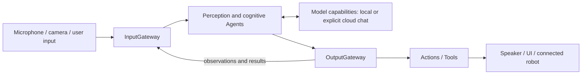

# MobileHarness architecture

MobileHarness uses an iPhone as the host for a **Signal → Cognition → Action** loop. Microphone/camera input becomes observations; stateful Agents use model capabilities to interpret them and select behavior. Validated Actions and Tools produce speech, presentation and connected-device effects.

## Perception and cognition

SpeechPerception and VisionPerception share recognition/pose processing and publish typed observations. Assistant combines recognized input with retained conversation context and produces a streaming response. SpeechSynthesis is a separate directed service preparing PCM; playback follows scheduled Actions.

Agents own their cognitive state and processing. Communication carries trusted source, session and causal context. Gateways validate admission and requested behavior, while Agent inboxes own pending messages.

## Scheduled behavior and direct functions

Actions represent scheduled skills such as speech playback, expression changes and NexArm movement. Channels order Actions within a task; nested wait groups synchronize that task's stages. Shared module/resource coordination prevents conflicting execution.

Tools provide direct functions such as captions, gaze, skeleton display and runtime information. A Tool's registered contract selects result feedback or completion-only behavior. Both kinds cross validated output dispatch; presentation state acceptance and physical completion are distinct boundaries.

## Host, presentation and foundations

| Owner | Responsibility |
| --- | --- |
| App | Compose capabilities and concrete behavior bindings; own voice/camera/application lifecycle and feature effects. |
| UI | Render state and collect user intent through typed operations. |
| ModelKit | Expose processing capabilities; separate management, default assembly and concrete model adapters. |
| PlatformKit | Own capture, native output, connections, device protocol and feedback. |
| Storage | Retain settings/conversation records and bounded transient audio handles. |
| Types | Share immutable value contracts, currently audio values. |

UI pages do not own model/device sessions. Long-lived work belongs to App lifecycle owners and runtime services. ActionRuntime and ToolRuntime are independent execution targets; Gateway depends on their contracts rather than concrete behavior domains. ModelKit and PlatformKit share Types without depending on each other.

## Conversation, settings and devices

Conversation records persist locally across voice sessions and restarts. New Conversation archives the current record before title generation; browsing history cannot replay behavior. Settings persist locally, credentials use the device Keychain, and App supplies provider/title/preview operations to narrow feature workflows.

The default pipeline uses local recognition, synthesis, pose and chat models. Explicit cloud configuration selects an OpenAI-compatible chat capability and sends its chat context to that provider; other perception/output remains local. Model configuration and resource acquisition share a process-wide manager.

Foreground camera perception and NexArm BLE control are implemented. Robot behavior/completion policy belongs to Actions; connection and native command/feedback belong to PlatformKit. Settings and Agent-selected movement share the same Action implementation. Autonomous camera motion belongs to the separate [Photographer proposal](Photographer-Proposal.md).

## Design and evidence entry points

The [technical design](../MobileHarness/README.md) defines dependencies and full technical flows. [Module responsibilities](../MobileHarness/README.md#part-ii--module-responsibilities) link the internal contracts. [Concepts](Concepts.md) explains terminology; [Requirements](Requirements.md) describes user outcomes. [Roadmap](Roadmap.md) lists pending directions, while [validation documents](README.md#experiments-tests-and-acceptance) record observed results.

Camera.open/close/flip Tools request the App camera owner through a typed capability after active Assistant session validation. The same foreground permission and capture lease lifecycle governs UI and Tool controls; Tool dispatch does not create a second device owner.

Cloud chat supports native function declarations from Agent JSON v5. Complete calls are resolved by the Agent and dispatched through OutputGateway; local chat remains text-only. Tool results use the existing InputGateway feedback contract, without automatic model continuation.

Photographer subscribes to VisionPerception pose observations and emits internal Robot.aim through OutputGateway. App binds the foreground BLE workflow; Actions owns aim mapping and admission, while PlatformKit supplies native command encoding. Transport acceptance does not establish physical arrival.

Tracking Tool resource metadata now admits motors1–5 at OutputGateway before the App sender. Composition supplies Photographer construction; lifecycle owns activation and partial-failure cleanup. Failed possible writes require explicit Action-controller recovery without replay.

VisionPerception and Photographer share observations but have independent execution failure scopes. A rejected Robot.aim does not stop showPose. BLE connectivity and control verification are separate states; query timeout retains connectivity while quarantining control queries until reconnect.

✅ Agent fault isolation: delivery failures are receipts; output execution failures are correlated results. Photographer suppresses commands while control is unavailable. Explicit stop/cancellation and invalid startup configuration remain lifecycle/assembly contracts.

Expression Actions have explicit lifetime contracts: UI.express awaits one target transition and restoration; UI.setExpression commits the persistent base. App retains one invocation-fenced override/animation waiter; UI reports transaction completion and visibility. Gaze/following remains a Tool. See [ADR0104](adr/0104-expression-perform-and-state.md).

## Local model resource separation

✅ First release bundles a versioned model catalog rather than inference artifacts; Settings requests download/removal through App into ModelKit Management. Management owns verification and safe mutation; App injects generic Storage primitives and the separate concrete ModelKitHub adapter, preserving Management’s ModelKit-only dependency. Resource admission spans quiescence/unload and disk deletion. Settings/history remain available without weights. See the [technical workflow](../MobileHarness/README.md#local-model-resource-acquisition-and-removal) and [Management current contract](../MobileHarness/ModelKit/Management/README.md#local-model-resources--current-contract).

Conversation history now retains actual native Tool declarations/calls and App-observed Gateway outcomes separately from generation state. Optional usage values retain provider/backend input/generated/total token counts. UI reads StorageChat values only; no history replay is introduced. See [ADR0106](adr/0106-conversation-tool-diagnostics.md).

✅ Local-resource refinement: compact schema-v2 repository/selection declarations replace per-file links/hashes. ModelKitHub wraps swift-huggingface 0.9.0 outside Management; App injects it. Storage-backed receipts record actual installed files/sizes. ✅ HF native background transfers preserve generations/completed files and available resume data. ❌ Full iPhone/server-resume acceptance remains pending (ADR 0108). See [ADR0105](adr/0105-local-model-resource-management.md).

Local artifact completion has two outcomes: atomic installation publication and transfer-index bookkeeping. A valid settled installation receipt remains authoritative even when task-index persistence fails. App stores the non-sensitive authoritative transfer snapshot through atomic Storage replacement with afterFirstUnlock protection; ordinary revision-checked document clients keep their existing policy.

Installation receipts derive relative paths after normalizing both the trusted directory and enumerated child URLs. This handles native /var and /private/var aliases without relaxing descendant safety checks. The exact earlier staging-prefix receipt defect has a validation-gated migration; unrelated/corrupt receipts remain failures.

✅ Nemotron multilingual recognition uses FluidAudio Core ML with a shared macOS/iOS 2240 ms artifact layout; fresh recurrent state belongs to each leased session. Management provisions resources, App/Storage publishes revision receipts, and Settings exposes incompatible-revision deletion. See ADR 0107.

✅ Native iOS background sessions now carry HF model file transfers. ModelKitHub owns persisted file plans, three active tasks/package and delegate advancement; Management preserves generations on failure/relaunch. App handles OS events and bounded preparation; Storage owns installation publication. See ADR 0108.

✅ [ADR 0109: Optional downloaded speech and modern Apple fallback](adr/0109-system-speech-fallback.md) implements persisted speech-only switching, artifact-aware Defaults facades, SpeechAnalyzer/AssetInventory ASR, Apple PCM TTS and independent energy VAD. ❌ Physical-phone end-to-end acceptance remains pending.

✅ 2026-10-03 user acceptance: phone background downloading now continues successfully and observed speed improved. ❌ Forced-quit/system termination, signed-URL expiry and large-file range-resume traces remain unverified.

✅ Apple ASR input now applies bounded backpressure instead of failing on a burst of pre-roll PCM. The real Chinese fixture test sends 137-sample packets without pacing and verifies final recognition and lease reuse. ❌ Phone ASR/TTS acceptance remains pending.

✅ Single-leaf Action failure presentation retains the captured bounded description; ModelKit capability errors preserve associated diagnostic reasons through LocalizedError. Speech SDK errors do not become business dependencies.

✅ Apple TTS resolves the production auto locale to zh-CN when text contains Han characters, otherwise en-US. Explicit locales retain their requested language/region, with zh/en script aliases normalized. Missing voices remain an explicit error with the resolved language. Consecutive real TTS integration uses auto rather than an explicit zh-CN fixture.

✅ [ADR 0110: Feature model settings and native Apple VAD](adr/0110-feature-model-settings-and-native-vad.md) groups model UI by task, splits validated custom speech choices, preserves the download backend and integrates internal native VAD. Silero or Energy supplies silence endpoint scores independently of ASR because native normal activity events were unavailable. ❌ Physical settings/voice acceptance remains pending.

Model invocation resolution failures (unknown Action/Tool alias or invalid parameters) are non-executable rejected outputs. Assistant continues the turn; OutputGateway retains them in its existing bounded execution results alongside runtime errors. Structural parsing failures and limits still terminate generation.

✅ [ADR 0111: Independent ASR/VAD selection](adr/0111-independent-asr-vad-selection.md) decouples the ASR switch from automatic Silero/Energy selection. Nemotron alone satisfies custom recognition prerequisites; Silero removal preserves ASR preference. ❌ Sustained device combination acceptance remains pending.

✅ Model source selection now automatically persists from the model section, with no network restriction toggle or explicit save action. App normalizes cellular permission to true and migrates legacy restrictions; OS permission remains authoritative. YOLO retains its fixed GitHub source. Endpoint save failure rejects download admission and preserves the draft; download queues and background transport are unchanged.

✅ ADR0103 failure isolation refinement: retained Action reports preserve later exceptions; invocation/resource rejection is call-local; Tools distinguish execution and feedback failures, with joined cooperative deadlines and task-scoped cancellation. ❌ Uncooperative handlers and physical acceptance remain outstanding.

✅ Function-defined timeout takes precedence over Runtime defaults: Action keeps request-dependent budget resolvers (including NexArm); Tool stores optional Duration in its definition/registry and @Tool factories. Unspecified Actions/Tools use30 seconds; invalid explicit declarations fail without fallback. ❌ Deadlines cannot forcibly interrupt uncooperative cleanup.
