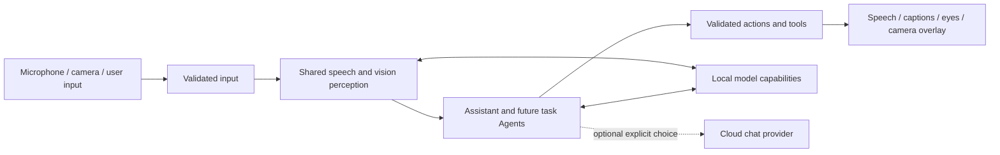

# MobileHarness architecture

MobileHarness turns device signals into Agent decisions and observable actions. An iPhone is the current host: it captures audio and camera frames, runs local perception and language models, and presents speech, captions, eyes and camera overlays. A configured cloud chat provider is optional. The project is designed to add more Agents and external devices, but robot control is not implemented today.

## How the current system works

- **Perception is shared.** Speech recognition and pose estimation produce observations that other Agents can consume. Camera preview remains available independently of voice-model readiness.
- **Agents decide behavior.** The conversational Assistant handles recognized speech and produces text, speech and presentation requests. An independent synthesis Agent prepares speech audio while playback follows the accepted Action order.
- **Outputs are explicit.** Gateways validate incoming signals and requested behavior. Actions provide scheduled behavior such as speech playback and captions; Tools provide direct functions such as skeleton display.
- **Capabilities stay separate.** ModelKit supplies model processing, PlatformKit handles device input/output, the UI module owns pages and interaction state, and App connects those parts. Current speech audio uses a bounded process-local cache; user settings use synchronized cached local persistence. General persistent media and memory remain planned.

The current repository implementation and source-to-target map are documented in the [internal technical plan](../MobileHarness/README.md#project-structure); exact contracts live in the module READMEs linked from its [module design](../MobileHarness/README.md#part-ii--module-design). This page describes behavior and boundaries for external readers; it does not define code-level limits or target dependencies.

## Current scope

✅ Local speech perception, conversational replies, synthesis and playback, camera pose perception, eye expressions/gaze, captions and explicit cloud chat selection have implementation and automated checks. The [voice acceptance guide](Voice.md) and dated validation reports distinguish test evidence from physical-device experience.

❌ Durable memory, general cross-Agent request/reply, physical robot motion, continuous background execution and sustained iPhone latency/thermal acceptance remain open. Future work is tracked in the [roadmap](Roadmap.md); historical decisions are in the [ADR index](adr/README.md). Physical robot safety would have to be enforced by the external controller, not by an iPhone App remaining active in the background.

✅ Photographer subscribes to the published pose and can emit internal `Robot.aim`. The Action completes when the injected sender accepts one six-position frame. The camera session starts the subscriber with arm control off, so it does not open Wi-Fi or move hardware. See [ADR 0070](adr/0070-photographer-aim.md).

User settings persist on this device, while credentials remain in protected device storage. The current design does not synchronize settings across devices. [ADR 0057](adr/0057-local-settings-storage.md) records the storage decision; the [Storage README](../MobileHarness/Storage/README.md) owns the implementation contract.

Default speech now uses local MOSS-TTS-Nano Core ML (beta) behind the same capability and audio-cache boundary. Kokoro is no longer selected or packaged, following repeated device crashes. [ADR 0058](adr/0058-moss-tts-nano.md) records the replacement; device acceptance remains pending.

Cloud settings allow blank credentials and an omitted endpoint (official OpenAI URL fallback). Registration remains local; authentication and provider compatibility errors surface during discovery or generation. See the updated [ADR 0053](adr/0053-settings-live-chat.md).

StorageAudio production PCM cache defaults to 8 MiB per handle (32 live handles; 256 MiB aggregate PCM ceiling, allocated on demand). This matches the synthesis Agent’s per-request output limit and accommodates approximately 43.7 seconds of MOSS 48 kHz mono Float32 audio. Overflow remains explicit; see ADR 0058.

Settings includes [conversation history](../MobileHarness/UI/Settings/README.md) for actual Assistant exchanges. It preserves original user text, received model fragments, exact request context and error status in local durable storage. Current conversation context uses its latest ten completed rounds across voice sessions and App restarts. Start New archives it, creates an empty context and generates an archived title; pending titles can be retried. Stored markup is inspected without execution. This replaces the former single-turn raw-output test; it helps inspect wait failures but does not prove scheduler timing. See [ADR 0060](adr/0060-persistent-conversation-history.md).

Action scheduling now uses task-local nested wait groups: each wait joins its parent's prefix, preserves Channel FIFO/concurrency internally, and releases the parent's suffix only after closure and completion. Equal Channel names no longer imply a shared cross-task FIFO; device-module exclusion remains process-wide. [ADR 0059](adr/0059-structured-wait-scheduling.md) records the protocol and migration. Tools and speech synthesis prefetch remain outside these Action groups.

## Agent configuration and internal behavior

✅ JSON v5 declares model-callable Actions grouped by Channel, native function Tools and unchanged communication policy. Fixed speech/caption/transcript/gaze/overlay behaviors and their permissions are code-owned. Model parsers cannot resolve internal operations; all outputs still cross OutputGateway. See [ADR 0061](adr/0061-agent-json-v5.md). ❌ Full JSON Schema and provider-native Tool deltas remain unimplemented.

ChatRequest output budgets are optional: normal Assistant calls omit max_tokens for provider defaults; local Qwen bounds generation by remaining context. Historical explicit budgets remain readable. Parser and execution capacity limits still apply.

## Source ownership

Actions and Tools each include their Runtime subdirectory in a single compilation target. Shared contracts live in Agents/Core but retain the independent AgentCore target to preserve acyclic StorageAudio/Gateway dependencies; see [ADR 0063](adr/0063-module-directory-consolidation.md). SwiftUI pages, page state and interaction interfaces now live in the sibling UI module under [ADR 0064](adr/0064-app-ui-boundaries.md). Runtime flow and behavior are unchanged.

## App and UI boundary

AppAssembly owns application composition. App/Composition builds the graph, Lifecycle owns voice/camera scopes and cleanup, Workflows coordinates settings/history/diagnostic operations, and Adapters connects validated effects to native devices and presentation state. UI is an independent sibling target containing pages, observable state and operation protocols. It imports shared record values only; pages do not own application runtimes, stores, model sessions or players. See [ADR 0064](adr/0064-app-ui-boundaries.md).

The current lifecycle owners are VoiceSessionCoordinator, CameraCoordinator and VisionSession. ApplicationRuntime creates Assistant with the shared journal; CurrentChatCapability resolves the selected chat binding for conversation and title requests. Both speech and chat diagnostic execution belong to AppWorkflows. UI may own short-lived rendering/load tasks or await an injected diagnostic operation; long-lived voice/camera ownership stays in App. Directory/file inventories live in the [App](../MobileHarness/App/README.md) and [UI](../MobileHarness/UI/README.md) READMEs.

## Action implementation contracts

✅ App now validates Action implementation definitions against assembled Agent capabilities before producers start. Invocation derives from one envelope; scheduler admission assigns an execution ID. Shared argument readers and separated runtime/scheduling/domain errors support consistent Actions. A bounded, payload-free diagnostic ring records execution phases and conservative effect status; it does not alter scheduling or produce Agent feedback. See [ADR 0065](adr/0065-action-runtime-contracts.md).

❌ Continuous activity owners, persistent resource leases, execution/cleanup deadlines and full business Action style migration remain outstanding. UI state acceptance still does not await animation, and speech still awaits playback completion.

## Action feedback and resource ownership

✅ [ADR 0066](adr/0066-action-results-resource-leases.md) adds correlated ActionResult feedback through InputGateway and a single process-wide resource authority shared by declared Action/Tool/host paths. Results describe the handler completion boundary; ongoing ActivityEvent is separate. Message retry never repeats effects. Ownership binds Agent incarnation/session; group takeover gates, stops and joins before granting, with faulted gates on uncertain cleanup. Camera capture uses a renewable lease.

❌ Generic activity management, other device resource migration, durable delivery, physical watchdogs and real-device acceptance remain pending; these replace the corresponding stage-1 future-work items above.

## Behavior assembly ownership

✅ [ADR 0067](adr/0067-domain-owned-behavior-assembly.md) moves concrete behavior definitions into Action/Tool domain modules. A pure BehaviorAssembly target under App/Composition/Behaviors constructs and validates both registries; App supplies typed effects and retains device/runtime lifetime. Agent permissions remain independent. ❌ This does not provide dynamic discovery or new device capabilities.

## Canonical Action entry audit

✅ [ADR 0068](adr/0068-canonical-action-entrypoints.md) completes the current UI/Speech entry standard. Speech transport validation belongs to Actions; its host capability receives a typed UUID. Playback cleanup is joined before failure returns. ❌ No new device/animation functionality is implied.

## Storage core/domain layout

✅ Storage now separates generic mechanisms in its root from Audio and Chat domains. StorageChat depends on Storage; UI imports only shared chat values. Source relocation preserves journal data and runtime semantics. See [ADR 0069](adr/0069-storage-core-domain-layout.md).

❌ Image/video/semantic-memory storage and cross-device synchronization remain planned.
