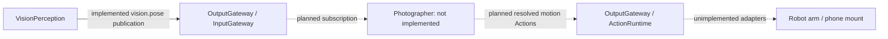

# Photographer proposal — Camera motion and composition

Status: **proposed**. This is a future product/technical direction, not a current Agent contract or implementation.

Goal: enable a robot-mounted phone to frame subjects, track movement and choose camera motion based on user intent and shared perception. A future business Agent would decide composition and motion policy, then request authorized physical-control Actions. Device-side limits, stop acknowledgement and disconnect behavior must be designed before physical movement is allowed.

Current status: [VisionPerception](../MobileHarness/Agents/VisionPerception/README.md) owns pose inference and UI.showPose skeleton feedback. There is no Photographer Agent, configuration, subscription, Action or device adapter in the current App. The former display-only actor was removed.

Before implementation, define the user-facing camera task, robot capability and permission model, motion units/limits, feedback and completion semantics, and recovery after loss of tracking or connection. Then add the necessary versioned JSON declarations and handlers following the [Agents standard](../MobileHarness/Agents/README.md). The proposed Agent should consume perception, not own YOLO or UI skeleton rendering.

## 输入、订阅与输出边界

下面的虚线图仅表示未来方向，不是已经接通的运行链路。

| 项目 | 当前状态 | 未来接入要求 |
| --- | --- | --- |
| 感知订阅 | ❌ 尚未声明 | 如使用现有姿态，应按届时的 VisionPerception 契约经 InputGateway 订阅，不能直接读取另一个 Agent 的内部状态。 |
| 用户任务 / 设备反馈等其他输入 | ❌ 无协议或实现 | 实际业务确定后声明 contract 与来源，再定义数据结构和处理策略；当前不能声称接收这些输入。 |
| 运镜、构图、跟随输出 | ❌ 无已注册 Action / Tool / Channel | 先定义实际机械能力、参数单位、限制和完成语义，再在版本化 JSON 声明，并由 App 注册实现；不得凭文档示例假设设备已执行。 |
| 共享观测 / Agent 定向消息 | ❌ 无 publications / sends 配置 | 有具体消费者后再定义，不隐式拥有发送权限。 |
| 骨架 UI | ✅ 已由 VisionPerception 实现 | `UI.showPose` 不属于 Photographer；移除或尚未实现 Photographer 不影响当前骨架显示。 |

现有姿态数据的结构、容量和新鲜度约束以 [VisionPerception 输入输出契约](../MobileHarness/Agents/VisionPerception/README.md#输入订阅与输出契约) 为准；它不提供 tracking ID、深度、机器人状态或运动命令。

未来消费者必须接受最新状态可能跳帧、空 people 表示无人、观测可能过期的事实。手机视觉刷新不提供硬实时控制保证；不能把感知数据直接当作物理控制指令。
