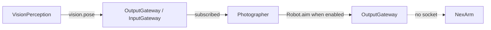

# Photographer proposal — Camera motion and composition

Status: aim subscription and the joint frame are implemented. Composition, tracking and physical motion remain proposed.

Goal: enable a robot-mounted phone to frame subjects, track movement and choose camera motion based on user intent and shared perception. Photographer decides aim from shared perception and requests an authorized Action. Device-side limits, stop acknowledgement and disconnect behavior must be designed before physical movement is allowed.

Current status: [VisionPerception](../MobileHarness/Agents/VisionPerception/README.md) owns pose inference and UI.showPose skeleton feedback. [Photographer](../MobileHarness/Agents/Photographer/README.md) subscribes to `vision.pose` and can emit `Robot.aim`. The camera session starts that subscriber with arm control off. No Wi-Fi socket is opened. See [ADR 0070](adr/0070-photographer-aim.md).

Aim already consumes `vision.pose` and does not own YOLO or skeleton rendering. Composition, tracking, motion limits and disconnect recovery still need a defined task and device acknowledgement before physical movement.

## 输入、订阅与输出边界

实线是已经接通的瞄准订阅。虚线仍是构图和真机执行。

| 项目 | 当前状态 | 未来接入要求 |
| --- | --- | --- |
| 感知订阅 | ✅ 订阅 `vision.pose` | 不能直接读取 VisionPerception 的内部状态。 |
| 用户任务 / 设备反馈等其他输入 | ❌ 无协议或实现 | 实际业务确定后声明 contract 与来源，再定义数据结构和处理策略；当前不能声称接收这些输入。 |
| 运镜瞄准 | ✅ 内部 `Robot.aim` 和六轴帧；相机会话关闭臂控制 | 构图、跟踪和真机运动仍未做。不得把未连接的套接字说成已经在动臂。 |
| 共享观测 / Agent 定向消息 | ❌ 无 publications / sends | 有具体消费者后再定义，不隐式拥有发送权限。 |
| 骨架 UI | ✅ 已由 VisionPerception 实现 | `UI.showPose` 不属于 Photographer。 |

现有姿态数据的结构、容量和新鲜度约束以 [VisionPerception 输入输出契约](../MobileHarness/Agents/VisionPerception/README.md#输入订阅与输出契约) 为准；它不提供 tracking ID、深度、机器人状态或运动命令。

未来消费者必须接受最新状态可能跳帧、空 people 表示无人、观测可能过期的事实。手机视觉刷新不提供硬实时控制保证；不能把感知数据直接当作物理控制指令。
