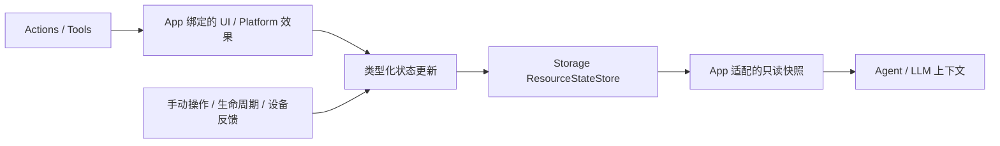

# Resource 当前状态存取计划

状态：❌ 未来计划，尚未实现。记录日期：2026-10-05。

## 目标与范围

以 resource 为单位，快速存储和读取手机 App、UI 与 Platform 设备的当前状态，供 Agent 的后续决策和 LLM 上下文使用。沿用现有模块目录、独立 target、actor 隔离和显式 capability 注入；不新增目录或 target。

本计划不记录 Action 排队、准备、执行阶段，不替代现有执行诊断。首版采用内存快照，不要求磁盘持久化或完整状态机框架。

首批属性：UI 基础/当前表情、视线、字幕；相机开关/镜头、音频播放状态；设备连接、控制可用性、已接受目标角度与实际反馈角度。领域内采用类型化属性，不以调用名称或任意字符串推断状态。

## 模块归属

| 现有位置 | 计划职责 |
| --- | --- |
| Storage/ | 通用 ResourceStateStore actor、状态记录/快照结构、版本和有界内存存取；不认识具体设备或 UI 业务字段。 |
| Actions、Tools 的现有领域目录及 Support | 定义领域属性和类型化状态写入契约；向实现注入写入能力，在实际效果发生时报告变化。 |
| App/Adapters | 绑定状态写入能力，将 UI 接受结果、Platform 原生反馈转换成状态更新；避免同一事实重复写入。 |
| App/Lifecycle、App/Workflows 的现有领域目录 | 接入手动操作、资源关闭/释放、断连和恢复等变化，保持当前状态完整。 |
| App/Composition | 创建唯一共享 Store，显式注入生产者写入端和消费者只读端；生命周期不依赖页面。 |
| Agents/Communication、Agents/Assistant | 定义 Agent 消费的状态视图，按需读取快照并组织 LLM 上下文。 |

Store 不放在 AgentCore。Storage 保持 Foundation-only；Actions/Tools 不必依赖具体 Store，App 适配双方契约。通用 ActionRuntime/ToolRuntime、Gateway 不解释领域状态。PlatformKit 继续提供原生设备事实，UI 继续接收展示值；仅在缺少必要事实或确认接口时补充对应领域接口。

## 更新与读取

- 在实际状态变化处更新，不能仅凭 Action/Tool 成功或失败推导状态。查询类 Tool 无需制造状态变化。
- UI 接受更新后记录；有限表情分别记录进入与恢复。调用失败或取消时保留已发生的效果，不自动回滚。
- 设备目标与实际反馈分开保存。目标被接受不代表物理到达；断连或反馈过期标记不可用/未知，不猜测实际位置。
- 记录必要的资源标识、版本、更新时间、有效性及来源/session/序号，拒绝旧回调覆盖新状态。具体转换规则由领域拥有。
- 读取返回一致的不可变快照，按资源直接访问，不扫描调用历史、不访问磁盘。actor 管理共享存取，UI 保持 MainActor 隔离。
- 首版仅保存当前值。实现前确定资源数、属性数、载荷大小和订阅者上限；超限显式失败，不静默丢失更新。若增加通知流，以容量一的完整最新快照合并旧通知，不承担动作队列。
- Store 是当前事实的记录视图；效果与记录之间不宣称跨设备事务原子性。更新失败需显式暴露，相关视图失效，不能继续呈现旧值为已确认事实。

Assistant 每次生成前读取相关资源快照，以数据形式加入上下文。异步状态输入若进入 Agent，仍经过 InputGateway；Agent 后续动作仍经过 OutputGateway，并在执行时重新验证权限、资源和设备可用性。首版不自动触发模型续轮或动作重试。

## Lock 与持久化

lock 可作为 resource 的只读属性，权威来源是 ResourceCoordinator 的 unlocked/locked(owner)（见 [ADR0141](adr/0141-resource-control-ownership.md)）；设备健康与执行异常分别拥有，不推导锁状态。Store 不建立第二套锁控制，本状态缓存计划不重复实现交接、释放或异常处理。

跨页面和会话共享内存状态；进程重启后重新获取事实。未来若需要落盘，复用 Storage 现有机制，物理设备状态不能因读取旧记录而被视为已确认。

## 实施阶段与验收

1. ❌ Storage 基础契约与 UI 状态接入：表情、视线、字幕；验证一致快照、顺序和恢复。
2. ❌ App/设备状态接入：相机、播放、BLE、目标/反馈；验证部分失败、取消、手动操作、断连及过期。
3. ❌ Assistant 状态上下文：按需选择、限定大小，验证状态仅作为数据，不被重新解析执行。

实施时更新所有被修改目录的 README（含 Mermaid 设计说明）、边界检查、MobileHarness/README.md、架构决策和 Roadmap。测试放在根 Tests/ 的现有目录。运行 scripts/check.sh 和完整 Xcode 可用时的 scripts/build-ios.sh，明确报告不可用或失败的检查。保留 docs/Technical_Design.docx 原始设计源。
