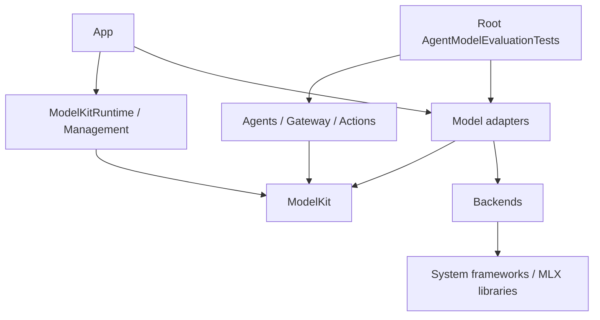

# ADR 0033: ModelKit inside the project

Status: accepted.

ModelKit remains a foundation module in this project, not a separately packaged SDK. Root Package.swift declares every target and pins backend libraries. The base ModelKit target has no target or third-party product dependency. ModelKitRuntime depends only on ModelKit; concrete adapters depend on capability contracts and their backend targets. Only the MLX backend links external MLX/Tokenizer products. App composition selects models and handles platform notifications.

Management owns registration, typed acquisition, memory policy and lifecycle. Core owns shared media values, capability/session contracts and managed resource admission. Backends owns native/library execution. Language and Speech own model capabilities, without business orchestration.

All tests live under root Tests. Qwen35Tests validates the adapter without Agent dependencies. AgentModelEvaluationTests explicitly depends on Agents and AgentCore, owns its scenario data and runs only when enabled. Moving a test does not duplicate production source or register production Actions in test code.

The boundary check in scripts/check.sh scans production imports, root target dependencies, in-module package/test directories and directory READMEs. It rejects business/UI imports and dependencies in ModelKit. SwiftPM also checks target cycles.

- ✅ One project package, one production source tree, root tests and checked dependency direction.
- ✅ English purpose/goals/status READMEs for all source directories.
- ❌ Independent SDK distribution and physical-device acceptance are outside this migration.

## Validation

- ✅ scripts/check.sh passes source/target boundary checks, directory README checks, formatting, root tests and project metadata validation.
- ✅ Qwen35Tests passes real Mac inference, cancellation, unload/reload and tokenizer parity from its root Tests location.
- ✅ AgentModelEvaluationTests completes 30 prompt/scenario records through its independent entry point. This validates execution and resources, not semantic quality.
- ✅ All four simulator schemes and the signed physical App build pass using the root package.
- ✅ Xcode source references resolve; the ModelKit directory contains only Core, Management, Backends, Language, Speech and README.md.
- ❌ This change has not been installed or acceptance-tested on iPhone.
