# 0035 — Tracking Agent and Robot Actions (Milestone 1: Minimal Aim Loop)

Status: design only. No Swift source is added by this record; every module it touches contains a documentation-only README with an all-❌ implementation status.

## Context

The product target is a camera rig where an iPhone running MobileHarness is mounted on a RoArm‑M2‑family arm (exact axis count pending hardware confirmation: full 4‑axis, or the 3‑axis variant with the wrist/hand joint physically removed, as seen in the distilled reference experience at `arm/smart_capture.md`). The phone's own camera is the vision sensor; there is no separate pan/tilt gimbal and no external inference host — both perception and control run inside this App.

`arm/smart_capture.md` documents a previously shipped Python system solving the same physical problem (camera+arm tracking rig). It is valuable prior art for the *algorithms* (target selection, PD-style aim control, open-loop gain compensation for small step commands) but its process/module boundaries do not apply here: MobileHarness requires the pipeline to be expressed as `Signal → Agent (bounded, cancellable actor) → ActionCall (Channel-scheduled)`, per [MobileHarness/README.md](../../MobileHarness/README.md) sections 6–24 and 28.

## Decision

### Scope: Milestone 1 only

Single-target detection → aim-point control → arm reorientation. Explicitly out of scope for this record: multi-target union/composition, auto-zoom, the recording state machine, face recognition/anti-hijack ReID, and the orbit/patrol/headcount motion planners described in `smart_capture.md` sections 2, 6, 7 and 8. Those remain candidate follow-up ADRs.

### Pipeline and module boundaries

```mermaid
flowchart LR
    CAM["iPhone camera<br/>PlatformKit/Camera (planned)"] -->|ImageFrame| GW["Gateway/Input<br/>frame sampling only"]
    GW -->|"AgentInput(payload: .image)"| TA["TrackingAgent<br/>Agents/Tracking (planned)"]
    TA -->|"PersonDetectionCapability.detect(frame:)"| VIS["ModelKit/Vision<br/>Apple Vision adapter (planned)"]
    VIS -->|PersonDetectionResult| TA
    TA -->|"resolved ActionCall(Actions.Robot.aim, channel: arm)"| OG[OutputGateway]
    OG --> CS[ChannelScheduler]
    CS --> AR[ActionRuntime]
    AR -->|"RobotActions.aim(invocation:, send:)"| ACT["Actions/Robot (planned)"]
    ACT -->|"send(base, shoulder, invocation)"| ADAPT["RoArm WiFi/HTTP adapter<br/>PlatformKit/ExternalDevice (planned)"]
    ADAPT -->|"GET http://arm.local/js?json={T:1041,...}"| ARM[RoArm-M2 controller]
```

Detection happens **inside the Agent**, not inside Gateway. Architecture section 4.2's video example only performs frame sampling in the Gateway ("Video Stream → Frame Sampling → Image Signal → Vision Agent"); model inference for vision, like `ChatCapability` inference for `AssistantAgent`, is an Agent-owned capability call. Gateway/Input's responsibility here is bounded frame-rate throttling and wrapping a captured frame into `AgentInput`, nothing more.

| Directory | New content this record designs | Status |
| --- | --- | --- |
| `MobileHarness/Agents/Tracking/` | Deterministic (non-LLM) `TrackingAgent`: consumes image input, calls detection, runs single-target aim control, emits `ActionCall` | ❌ design only |
| `MobileHarness/Actions/Robot/` | `RobotActions.aim`, closure-injected like `UIActions.express` | ❌ design only |
| `MobileHarness/PlatformKit/ExternalDevice/` | `RobotArmControl` unified abstraction protocol; RoArm WiFi/HTTP adapter target (concrete Swift deferred) | ❌ design only |
| `MobileHarness/PlatformKit/Camera/` | Capture design bridging AVFoundation to a bounded `ImageFrame` producer | ❌ design only |
| `MobileHarness/ModelKit/Vision/` | `PersonDetectionCapability` protocol; Apple Vision-backed adapter (concrete Swift deferred) | ❌ design only |

See each directory's README for its detailed algorithm, bounds and Mermaid diagram; this record only fixes the cross-cutting decisions below.

### Key decisions

1. **ActionCall completion means "command sent," not "arm settled."** RoArm‑M2's `CMD_XYZT_DIRECT_CTRL` (`{"T":1041,...}`) and the joint-angle command family are non-blocking at the firmware boundary; `Actions.Robot.aim` documents its completion contract as "the HTTP request to the arm controller received a response," never "the physical joint reached the target." This is required because `ChannelScheduler` runs one job per channel to completion before starting the next (`Gateway/Output/Scheduling/README.md`); a per-frame tracking loop that waited for physical settling would exhaust the channel's 32-job bound within a fraction of a second. See `Actions/Robot/README.md`.
2. **Transport is WiFi + HTTP JSON, not serial or BLE.** RoArm‑M2 exposes the same `{"T":...}` command set over `GET http://<ip>/js?json={...}` (`arm/roarm_m2-main/RoArm-M2_python/http_simple_ctrl.py`). iOS has no first-class serial API; `PlatformKit/Device/DeviceCapability.swift` already anticipates this by declaring `.localNetwork` and `.bluetooth` cases. `RobotArmControl` (the new unified abstraction, see decision 3) is therefore **not** built on the existing byte-oriented `ExternalDeviceTransport` protocol — that contract fits a persistent serial/BLE stream, not a request/response HTTP call. `ExternalDeviceTransport` is unchanged and remains available for a future serial/BLE device.
3. **A unified arm abstraction hides the 3-axis/4-axis decision from Agent and Action code**, mirroring `smart_capture.md` section 5.1. `Actions/Robot` and `TrackingAgent` depend only on `RobotArmControl { aim(base:shoulder:) async throws; home() async throws; emergencyStop() async; ... }` using **logical** angles. Per `smart_capture.md` section 5.4, if the final hardware is the 3-axis variant, its firmware's built-in Cartesian IK no longer matches the physical kinematic chain, and the concrete adapter must drive joint angles directly with its own calibration table and open-loop gain compensation instead of trusting `CMD_XYZT_DIRECT_CTRL`; if it is the full 4-axis arm, the adapter may trust firmware IK directly. Either way the swap is isolated to one adapter file behind `RobotArmControl`.
4. **Actions.Robot.aim is closure-injected, like `UIActions.express`/`SpeechActions.speak`'s `play` callback — not a new PlatformKit dependency on the `Actions` target.** `Actions` does not gain a dependency on `PlatformKit`; App's composition root binds the closure to a concrete `RobotArmControl` instance, matching the existing pattern where device/presentation side effects cross an injected `@Sendable` callback rather than a module import.
5. **Detection uses Apple Vision (`VNDetectHumanBodyPoseRequest`/`VNDetectHumanRectanglesRequest`), not a converted custom model, for Milestone 1.** No model weights to manage, no ModelKit backend/adapter split needed beyond the existing `Vision`/CoreImage system frameworks. `ModelKit/Vision`'s `PersonDetectionCapability` protocol is defined so a future custom CoreML detector (matching `smart_capture.md`'s model_hub-based detector) can replace the adapter without changing `TrackingAgent`.
6. **Control logic is deterministic, not LLM-driven.** Per section 32's stated invariant ("receiving a signal does not require model inference"), `TrackingAgent` never calls `ChatCapability` and never uses `FunctionTokenParser`/`AgentGenerator`. It resolves the `aim` alias once from its own `CapabilityRegistry` (built from `Tracking.agent.json`, per `Agents/README.md`) and constructs `ActionCall` values directly from computed control output. `textActions` is empty; `aim` is `hidden: true` because no model ever sees it.
7. **`InputPayload` gains an `.image` case rather than waiting for the full generic `Signal`/`SignalType`/`SignalAdapter` migration.** `AgentCore/AgentInput.swift` already reserves this ("Media adapters will add timestamped frame/chunk payloads in P2"), and `InputKind` already declares `.image`/`.video` cases that are currently unused. Extending the existing `InputPayload` enum is strictly additive and does not block on the larger Gateway/Input Signal migration tracked as ❌ in `Gateway/Input/README.md`.
8. **Rate limiting is the Agent's job, not the Channel's.** `TrackingAgent` throttles emitted `ActionCall`s by a minimum interval and a minimum aim-target delta (mirroring `smart_capture.md` section 4.2's dead-zone/hysteresis design), so a 15–30 fps detection loop does not attempt to enqueue an `ActionCall` every frame. `ChannelScheduler`'s explicit-failure-on-full behavior (never silently drop) is intentionally preserved as the backstop, not relied on as the primary throttle.
9. **Channel name is `arm`.** There is no separate gimbal in this hardware topology, so the `head`/`body`/`motion` split shown as an example in architecture section 20 collapses to one channel; the arm is one physical resource with one owner at a time.

### Deferred / explicitly not decided here

- Exact RoArm variant (3-axis vs. 4-axis) — blocks writing the concrete `PlatformKit/ExternalDevice` adapter, not the `RobotArmControl` protocol shape or `Actions/Robot` contract.
- Exact joint/angle physical limits — the Action performs only generic finite-value validation; hard physical clamping is the concrete adapter's responsibility once hardware is confirmed.
- Whether the arm exposes its own WiFi access point or joins the phone's network — affects `PlatformKit/Camera`+`ExternalDevice` App composition (Local Network permission flow) but not this record's module boundaries.
- Channel Lock enforcement ([ADR 0029](0029-channel-lock.md)) remains unimplemented; Milestone 1 assumes `TrackingAgent` is the only writer of the `arm` channel and does not yet need runtime-enforced exclusivity against a future manual-control path.

## Consequences

- `Actions`, `Agents`, `ModelKit` and `PlatformKit` each gain one new documentation-only subdirectory (`Robot`, `Tracking`, `Vision`, `ExternalDevice`/`Camera` READMEs respectively), each excluded from its Swift target in `Package.swift`, following the existing `AgentCore/Bus` precedent for design-ahead-of-implementation directories.
- No production behavior changes. `scripts/check.sh` and `scripts/build-ios.sh` are unaffected because no `.swift` file is added.
- Implementing any of the five planned components requires a follow-up change that turns its ❌ items into ✅ ones, with tests, per `Agents/README.md` and `Actions/README.md`'s delivery checklists — this record does not authorize skipping those steps.

See [MobileHarness/Agents/Tracking/README.md](../../MobileHarness/Agents/Tracking/README.md), [MobileHarness/Actions/Robot/README.md](../../MobileHarness/Actions/Robot/README.md), [MobileHarness/PlatformKit/ExternalDevice/README.md](../../MobileHarness/PlatformKit/ExternalDevice/README.md), [MobileHarness/PlatformKit/Camera/README.md](../../MobileHarness/PlatformKit/Camera/README.md) and [MobileHarness/ModelKit/Vision/README.md](../../MobileHarness/ModelKit/Vision/README.md) for the per-module detail.
