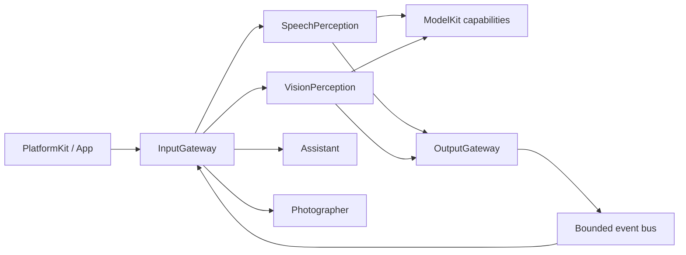

# ADR 0040 — Pure Gateway and shared perception

Status: implemented; physical-device acceptance pending.

## Decision

Gateway owns protocol validation, static routing, directed delivery and output dispatch; it has no direct ModelKit dependency. Model-assisted perception is owned by independent SpeechPerceptionAgent and VisionPerceptionAgent. ModelKit continues to own capability contracts/adapters and its shared manager; PlatformKit owns device capture/basic format conversion. App bridges their types.

Use AgentInput rather than a parallel Signal hierarchy. Add bounded PCM and typed speech/pose observations, provenance/incarnation/session/sequence, capture and causal metadata, and monotonic admission deadlines. AgentCore remains independent of both kits.

JSON v4 requires communication declarations alongside existing Action/Tool/Channel/text mappings. Static subscriptions and direct sends are implemented; direct delivery bypasses only subscription matching. Dynamic subscriptions, arbitrary payload schemas, request/reply and robot reflex execution remain deferred. Current contracts are a closed typed catalog.

ApplicationRuntime provides one shared communication assembly before voice model readiness. Voice and camera use independent sessions and Agent instances; ModelManager remains process-wide. Closing a session invalidates communication and joins only its work. Perception output reaches UI only through OutputGateway observation endpoints or configured Actions.

## Queue policy and failure semantics

Discrete events use bounded FIFO admission, explicit rejection and a finite duplicate window. Continuous states use bounded per-source/incarnation/session/contract latest slots and sequence deduplication. Pose payloads allow 256 KiB/300 people; other events allow 16 KiB. Photographer applies the separate six-person display budget. Transport accounting remains bounded by count and bytes; complete limits and algorithms are in AgentCore/Bus/README.md.

State replacement and expiration are observable. There is no retry or persistent/exactly-once guarantee. ASR final is a discrete event, partial is a latest state. Perception completion is distinct from Assistant generation or Action completion. The UI keeps the current no-barge-in conversational gating and existing 350 ms post-playback delay.

## Compatibility and migration

Migrate all bundled production configurations to v4 together; v3 is rejected. Move LiveSpeechInput/VoiceActivitySegmenter to SpeechPerception and FrameChangeFilter to VisionPerception. Remove InputGateway ASR methods and CameraInputSession. Photographer no longer accepts images or a PoseCapability. Update package mappings and Xcode navigation without duplicated sources.

Existing Action/Tool protocols, model providers, visual coordinate conventions and model weights are unchanged. The original Technical_Design.docx is preserved. Historical ADRs describe their original stages; this decision supersedes Gateway-owned perceptual adaptation and the documentation-only event bus status.

## Validation

Regression coverage includes speech final/partial behavior, shared inference across two subscribers, empty-pose clearing, latest frames, stale-session/instance fencing, explicit overflow, schema rejection, independent session closure and slow recipient deadlines. Run scripts/check.sh, all four simulator schemes and the unsigned device target. Device continuous audio/camera and thermal/latency acceptance must be recorded separately; build success is not physical acceptance.

Validation (2026-09-26): final scripts/check.sh passed, including 79 IntegrationTests, configuration and module-boundary checks. All four scripts/build-ios.sh simulator schemes passed; MobileHarnessSimulator was rebuilt after the final capture-gating fix. The unsigned MobileHarness device target built successfully. All four packaged Agent JSON resources are v4 and byte-identical to source. Original Technical_Design.docx is unchanged. Optional real-model evaluations were not enabled; no phone installation or continuous physical audio/camera/thermal acceptance was performed.
