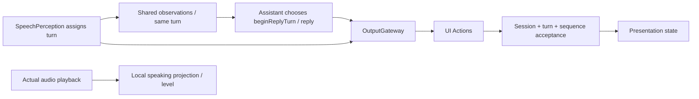

# ADR 0043 — Conversation turn presentation

Status: Implemented; device visual acceptance outstanding.

## Decision

Keep session lifecycle separate from utterance identity. SpeechPerception allocates a ConversationTurn at first confirmed onset (including onset/end within one packet), retains it across VAD segmentation, and propagates it through observations and UI Action envelopes. OutputGateway preserves it and ToolResult return carries it forward. Agent outputs have source-monotonic sequences. No model-authored turn identifiers are accepted as UI authority.

Assistant emits JSON-declared UI.beginReplyTurn once per utterance; the handler atomically resets reply and expression, preserving recognition text even if its preview arrived first. Repeated onset and final fallback cannot reset a started reply twice. SpeechPerception updates UI.setTranscript while recognizing and emits UI.finishTranscript when finish completes, including empty turns. A closed transcript never accepts a later partial in that turn. Normal reply completion retains reply/expression until next onset. User/OS stop and failure invalidate/reset local presentation.

## Acceptance and bounds

ConversationPresentation in Actions/UI owns pure acceptance state: one turn, two flags, and at most six component sequence entries. App checks the active session before using it. Only authorized producer roles and onset-capable operations can advance the ordinal; old turns, conflicting identities, duplicate begin and old sequences are ignored. Reply/expression updates require beginReplyTurn. Actual UI mutation remains in injected MainActor handlers, reached only through validated UI Actions.

UI.print only appends text. Speaking is a read-only projection of actual audio playback activity over the recognition presentation phase; it is not inferred from a generated text chunk. Model inference and runtime supervision retain their existing boundaries. No Signal observer mutates UI.

## Validation

Regression tests exercise protocol routing and deterministic acceptance for late partials, duplicate onset/reset, stale turn/expression updates, identity conflicts and ordered components. Build validation does not establish device animation or audio timing. Original Technical_Design.docx remains unchanged.
