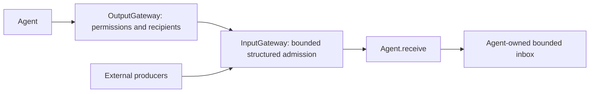

# ADR 0048 — Direct signal admission and Agent-owned inboxes

> Source layout: [ADR 0063](0063-module-directory-consolidation.md) supersedes standalone runtime targets and former top-level Core/presentation locations; the behavioral decisions below remain historical records.

> Configuration migration: [ADR 0061](0061-agent-json-v5.md) supersedes the JSON schema, hidden/text alias and all-in-JSON registration portions of this historical decision. Its other runtime contracts remain unchanged.

Accepted: 2026-09-27. Supersedes the separate transport runtime and FIFO/latest-state mechanisms of ADR 0028/0040; permission and perception boundaries remain.

## Decision

Remove InternalSignalBus entirely. Internal observations travel through AgentMessaging → OutputGateway → InputGateway → Agent.receive. External producers call InputGateway directly. AgentCore/Communication contains typed inputs, communication policy, AgentMessaging and DeliveryReport contracts, with no transport runtime.

Gateways validate, enrich and route messages. Agent-owned inboxes are the sole pending-message queues. Ordinary receive promptly admits or rejects input without awaiting inference or inbox space. Explicit lifecycle/control inputs may await cancellation cleanup. Each Agent owns queue bounds, processing order, stale-state checks and explicitly allowed coalescing; existing perception buffers remain unchanged.

## Preserved contracts and bounds

- JSON v4 static subscriptions and direct-send permissions; bound source incarnation and causal metadata.
- InputGateway validates sender/target instance, session, payload and freshness before receive.
- OutputGateway permits 16 active emissions per source. InputGateway shares 128 active operations, 256 branches and 8 MiB observation payload across external/internal calls. Observation bytes are charged per recipient; each call has at most 16 distinct targets. Schema-specific payload limits remain.
- Capacity is reserved before suspension and released when the structured call completes. Excess is rejected immediately; no waiting queue is created.
- Per-target receipts report admission or rejection, not processing completion. One receiver's rejection does not prevent other selected receivers from accepting.

## Removed mechanisms and ownership

There is no transport FIFO, worker, state replacement, duplicate cache, timeout-race task, retained task registry, per-target capacity counter or communication session registry. Message deadlines are freshness checks, not timers interrupting receive. Caller cancellation propagates to structured child calls; non-cooperative receive implementations can still delay return.

Before admission, cancellation throws. After fan-out starts, cancelled branches report rejection; already accepted work cannot be rolled back by a receipt. Agent/runtime cancellation owns that work. App stops producers and coordinates Agent/runtime cleanup; incarnation/session validation fences stale calls without a separate Bus open/close/shutdown lifecycle.

Concurrent calls, including calls to one target, have no FIFO guarantee. Sequential awaited sends or receiver-side sequence validation can establish required application ordering. Action ChannelScheduler queues remain because they coordinate executable effects and resource exclusion.

Remote Agents can later use a transport adapter when there is a concrete integration need. Cross-process communication does not by itself require a message broker. Request/reply, persistence and automatic retry remain unimplemented.

## Validation

Integration tests cover overlapping direct calls, per-source capacity and recovery, shared external/internal capacity, caller cancellation, expired parents, session and instance validation, permissions and independent receiver rejection. Existing Agent tests cover latest-frame/publication/display coalescing. Full root checks and unsigned simulator builds are required; model/device acceptance is separate.

Verified (2026-09-27): scripts/check.sh passed, including 92 IntegrationTests; scripts/build-ios.sh passed all four unsigned simulator schemes using full Xcode. Optional real-model evaluations and physical-device acceptance were not performed.
