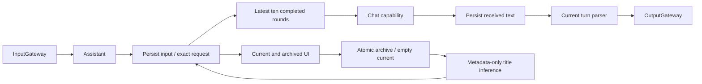

# ADR 0060 — Persistent conversation history and explicit conversation boundaries

> Configuration migration: [ADR 0061](0061-agent-json-v5.md) supersedes the JSON schema, hidden/text alias and all-in-JSON registration portions of this historical decision. Its other runtime contracts remain unchanged.

Status: implemented, 2026-09-28. Supersedes Assistant's session-scoped eight-message/1600-character history and the standalone raw-output test page. It does not change wait execution semantics.

## Decision

Record real Assistant exchanges in one App-injected, Foundation-only Storage journal. Persist original user text and the exact model request before inference, and received text fragments before parsing/Action admission. Retain completion, finish reason, cancellation, provider/parser errors and App-observed execution failures. Records are evidence of received data; they do not claim an unseen response suffix or physical completion. ModelKit stays independent; Agents gain the base Storage dependency in addition to StorageAudio.

Logical conversations survive voice start/stop and process restart. Requests use the latest ten completed rounds of the current conversation (user confirmed ten rounds, not ten individual messages). Original XML/whitespace is preserved as context, never replayed through the parser. Failed/cancelled/interrupted rounds are retained for inspection but excluded from future requests. Provider token/byte limits remain authoritative, with explicit errors instead of silent trimming.

Settings → 历史记录 replaces the single-turn raw-output generator. It separates current and past conversations and exposes user/raw model data, actual context and non-executing wait/Channel interpretation. Current title is the latest user input. Start New joins production cleanup, atomically archives the current nonempty conversation and creates an empty current one. A separate title-only model request summarizes bounded, evenly spaced excerpts and stores the result on the archive. Failure or cancellation preserves the archive and offers retry. Title responses never enter Action parsing or the ordinary conversation context.

## Bounds and ownership

One process-wide actor, one bounded revision-checked document, no pending write queue or automatic eviction. The journal supports one current conversation, 64 archives, 256 turns per conversation and a 32 MiB document. Per-turn raw retention is 256 KiB/8192 fragments, while production generation retains its existing 2000-byte limit. Errors preserve admitted prefixes; quota rejection is explicit. Completed records and original user data are never silently replaced. Archived deletion requires explicit user action. Exact contracts live in [Storage](../../MobileHarness/Storage/README.md), [Assistant](../../MobileHarness/Agents/Assistant/README.md) and [history UI](../../MobileHarness/UI/Settings/README.md).

## Consequences and validation

✅ Durable restart, raw-prefix fidelity, ten-round selection, conversation reset, parser failure, cancellation, title isolation and explicit capacity failures have automated coverage. Original Technical_Design.docx stays unchanged. Existing production input/output Gateway routes remain mandatory; reading stored markup never executes it.

❌ This does not fix or establish GPT-4.1 wait instruction-following, capture provider-hidden data, implement semantic memory/cross-device synchronization, or prove device latency. Whole-document writes on received fragments are bounded but require future device performance measurement; they trade write volume for immediate diagnostic durability. New records begin only after this version is used; prior in-memory conversations cannot be recovered.
