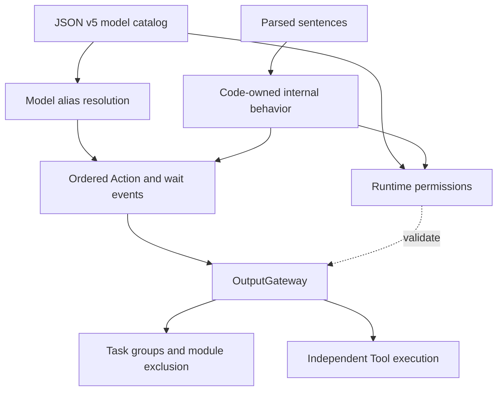

# ADR 0061 — Channel-grouped model catalogs and code-owned internal behavior

Status: Accepted, 2026-09-28.

## Context

JSON v4 described every output as a model-like capability, including fixed speech/caption mapping, reply initialization, transcript display and pose presentation. Hidden entries duplicated parameter prose/examples and remained callable through alias resolution despite being absent from prompts. This mixed model affordances with trusted Agent implementation policy.

## Decision

JSON v5 has required `version`, `id`, `actions`, `tools`, `communication` fields. Actions are grouped by Channel; the group supplies the default, with empty arrays supporting Channel-only declarations. Remove separate channels, textActions, hidden and per-entry defaultChannel. Do not introduce textOutput/internal JSON sections. Reject obsolete versions and fields instead of maintaining two production formats.

Model-callable Actions keep alias, path, doc, parameters and examples. Tools use OpenAI Chat Completions function declarations; the function name binds the explicit App handler. Current transport supports string object properties and optional enums, not full JSON Schema or native model Tool deltas. Unsupported schemas fail. No Tool metadata enters the XML system prompt.

Each Agent defines fixed internal behavior with typed InternalAction/InternalTool permissions: paths, required/optional names and Action Channel, without model aliases or prose. The descriptor assembles these with the JSON model catalog. Alias resolution searches only the model catalog; OutputGateway permits checks validate both explicit catalogs and code-owned internal grants. Device implementation handlers remain in App. This supersedes the earlier requirement that every internal output must be declared in JSON; it does not permit direct UI/platform calls.

Assistant injects a bounded text-mapping callback into the shared generator. Existing sentence splitting and boundary flushing produce speech preparation and caption calls. Before dispatch, synthesis admission replaces the speech text call with audioID playback at exactly the same position and Channel. The Gateway authorizes only playback audioIDs. All generated Actions count toward existing limits; wait/module exclusion/cancellation semantics are unchanged. Diagnostic previews use the same code-owned text policy without execution.

## Consequences and verification

✅ All four bundled Agent resources migrate together. Perception Agents have empty model catalogs and code-owned presentation grants. Synthesis retains only communication policy. Assistant JSON contains express, Display/Speech groups and the runtimeInfo Tool.

✅ Tests cover strict v5 decoding, obsolete fields, grouped alias/default behavior, native Tool schema retention and enum checks, internal permissions versus model resolution, speech conversion/wait ordering, streaming fragmentation, perception outputs and durable conversation history.

❌ Full JSON Schema, provider-native Tool generation and live-model/device acceptance are separate work. Physical-device effects and platform permissions are not guaranteed by a configuration schema. Original docs/Technical_Design.docx is preserved.

Validation: repository checks passed with 140 IntegrationTests; all four unsigned iOS simulator schemes built with full Xcode. Optional real-model evaluation was skipped. No device installation or live-model acceptance is implied.
