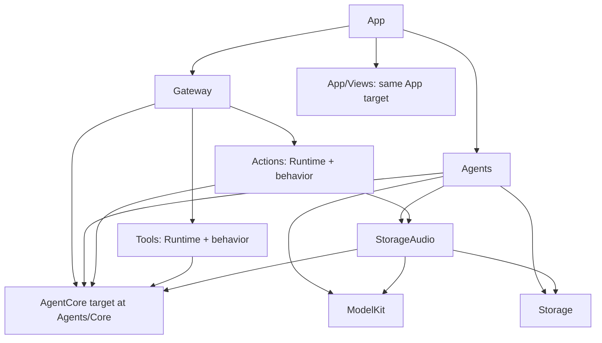

# ADR 0063 — Consolidate behavior runtimes, Agent source ownership and App views

Status: Accepted, 2026-09-28.

## Decision

- Move ActionRuntime to Actions/Runtime and compile registries, execution and behaviors in the single Actions target. Consumers import Actions.
- Move ToolRuntime to Tools/Runtime and compile direct execution and behaviors in the single Tools target. Consumers import Tools.
- Move shared Agent contracts to Agents/Core. Retain the independent AgentCore target and exclude Core from the business Agents target. A single combined target would create Agents → StorageAudio → Agents and expose concrete Agent/model dependencies to Gateway. Source ownership is unified without changing that foundational boundary.
- Move Experience to App/Views. Views is conventional SwiftUI terminology that covers pages and shared components. App owns compilation, lifecycle and injected services; Views does not become a package target.

Gateway now depends on Actions and Tools, using only their Runtime APIs. Behavior calls remain explicitly bound by App; Gateway does not invoke UIActions, SpeechPlayback, UITools or SystemTools directly. The source boundary checker enforces this narrower API usage and continues checking the relocated AgentCore source. ModelKit remains independent. No compatibility runtime targets, duplicated files or re-export shims remain.

## Preserved contracts

✅ InputGateway → Agent → OutputGateway → Action scheduler / Tool executor remains unchanged. Action Channel FIFO, nested wait, module exclusion, cancellation and completion retain their implementations. Tools still follow their independent path. Agent JSON resources, history data paths, model resources and UI navigation remain unchanged.

✅ Root Package.swift maps the same source into acyclic targets; Xcode references and navigator groups follow physical locations without changing build membership. Tests remain under root Tests. Module READMEs and current technical maps are updated; historical ADR links point to relocated documents.

❌ No new device behavior, model integration, scheduling policy, runtime queue or physical acceptance claim. The original docs/Technical_Design.docx remains untouched.

Validation: repository checks passed, including 142 IntegrationTests; all four iOS simulator schemes built with full Xcode. An audit of 194 Swift implementation files found only import/format changes, with no business implementation changes. Local documentation links were checked for newly broken targets. Device installation was not performed in this migration.
