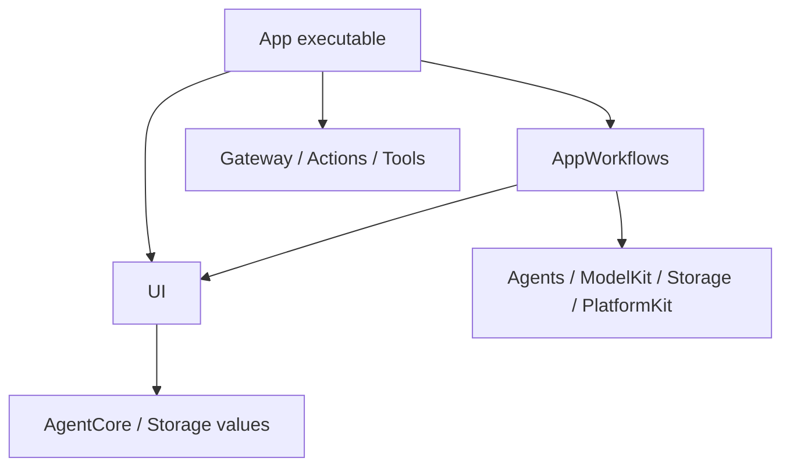

# ADR 0064 — Separate App ownership and UI

Status: Accepted, 2026-09-29. Supersedes the App/Views portion of ADR 0063.

## Context

The former Views directory contained App coordinator references, history/model workflows and a diagnostic player. AppSettings mixed editable form state with configuration transactions. RuntimePresentation exposed many independently optional closures. Moving paths alone could not express ownership or ensure acyclic compilation.

## Decision

- App remains the application host. Composition constructs the graph; Lifecycle owns running voice/camera scopes; Workflows owns cross-module settings/history/diagnostic operations; Adapters connects runtime/platform contracts to UI values.
- UI is a sibling, independent SwiftPM target. It contains MainActor pages/state and operation protocols. Its only project dependencies are AgentCore (overlay values) and Storage (conversation values); no App, concrete Agent, Gateway, Actions/Tools, model or device services are accessible.
- Use UI as the directory and module name: it covers views, page state and user interaction, grouped by feature. Actions/UI and Tools/UI remain behavior namespaces in separate modules and update page state only through App-bound handlers.
- Compile App/Workflows as AppWorkflows for isolated tests and package reuse by the executable; do not compile those sources a second time in App. It implements interfaces declared by UI. App composition injects its store loader, model factory, player and settings-change barriers.
- AppAssembly owns a lazy ApplicationRuntime and passes it explicitly to voice/vision sessions. There is no ApplicationRuntime.shared lookup. ModelKitDefaults retains its existing process-wide ModelManager and provider assembly responsibility.
- Bind one complete typed voice endpoint and one complete camera endpoint. Binding rejects an occupied role; unbinding checks owner identity. Endpoints are weak and create no queue. Session owners release them after producer/executor cleanup.
- Keep native camera-layer and image-attachment adapters in App. UI receives native preview view content without importing PlatformKit. UI semantic expression conversion also lives in App.
- ApplicationRuntime owns the Assistant factory directly; the single-method AgentBootstrap wrapper is removed. VoiceSessionCoordinator and VisionSession name their actual running scopes. CurrentChatCapability lives in Adapters; Debug chat diagnostic execution lives in Workflows. AppAssembly supplies the resource root consistently to all assembly paths.

Arrows above are compile-time dependencies. Injected callbacks point back to App implementations at runtime without creating a reverse compile-time dependency.

## Preserved behavior

External input/ToolResult still crosses InputGateway; Agent output still crosses OutputGateway. Agent JSON, model defaults, Channel/wait ordering, module exclusion and handler completion are unchanged. App remains responsible for producer-before-executor cancellation, session/turn fencing and joining cleanup. Storage paths/formats remain unchanged; archive/reset commits before title inference and cancellation leaves a retryable archive. Saving configuration remains independent of page navigation and preserves existing rollback. Diagnostic model/playback use remains explicitly labeled and separate from production execution.

Settings/history/speech workflows have one active mutation/run slot and no pending operation queue. The stateless Debug chat diagnostic is awaited by its page task and has no internal queue. Existing model, journal, audio, Agent and Gateway bounds continue to apply. UI state replacement is presentation data, never a substitute for Action completion. iOS views compile only on iOS; state/interfaces and history workflows are tested on macOS with controlled completion signals.

✅ Independent compilation and static checks prohibit UI service construction and App imports. Regression tests cover archive-before-title, overlapping-operation rejection, cancellation/retry and form-save lifetime.

❌ Multi-window isolation, background runtime supervision, non-cooperative cancellation and physical-device acceptance remain outside this change. The original Technical_Design.docx is unchanged.
