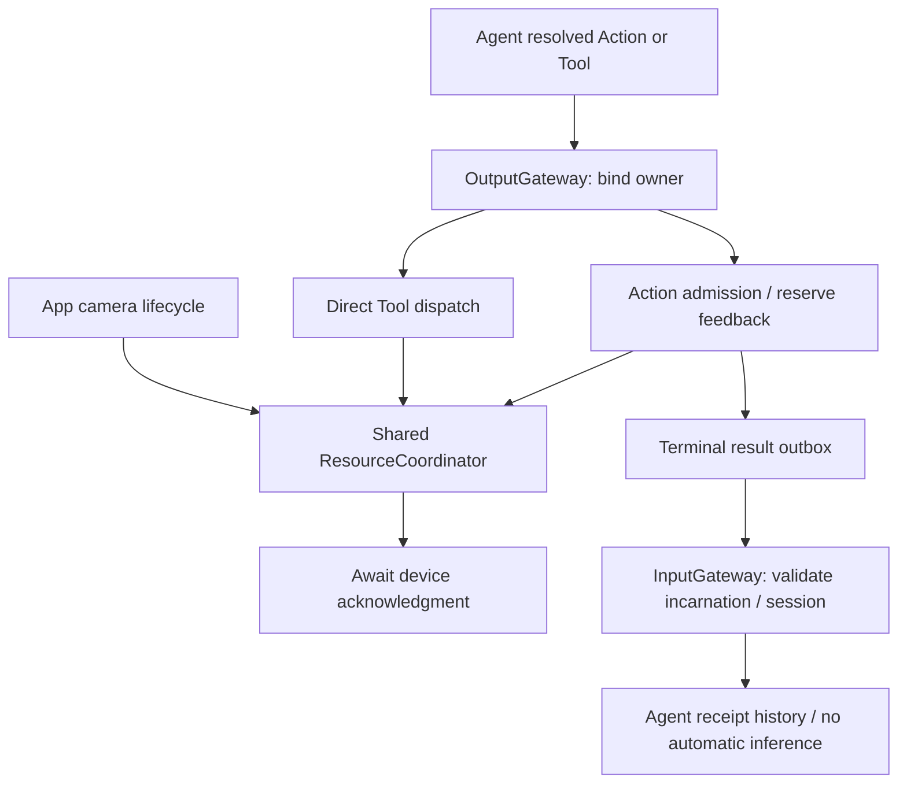

# ADR 0066 — Action terminal feedback and resource leases

Status: accepted, implementation stage 2 (2026-09-29). Supersedes the future-work portions of ADR 0065 concerning terminal feedback and resource arbitration; original design documents remain unchanged.

Current resource ownership contract: [ADR0141](0141-resource-control-ownership.md) supersedes the persistent faulted/explicit-recovery policy below. Caller-independent acknowledgment, configured preemption and existing execution/result isolation remain current.

## Context and decision

An Action admission receipt cannot describe execution completion. A state-setting or activity-start call may return while its effect remains active, so Channel/module exclusion alone cannot protect a physical resource. Tool and host paths must share the same resource authority.

✅ AgentCore now defines ExecutionOwner (Agent ID, incarnation, session), typed ActionCompletion, ActionResult, ActivityEvent and ResourceLease/ResourceControl values without importing Gateway. Actions validates completion kind; finite/state/update return completed, start/stop return an activity ID owned by the injected service. Existing finite/state Void handlers adapt to completed.

✅ ChannelScheduler reserves a terminal feedback slot before admission. Its bounded outbox records execution status separately from delivery status and releases scheduling lanes before sending through InputGateway. Failed admission throws directly. Feedback defaults to failuresOnly for opted-in Agents; terminal mode includes success. Retries preserve execution identity and never invoke the Action again. Current business Agents store receipts in bounded deduplicating history without invoking a model. Runtime-only delivery checks current target incarnation/session and rejects spoofed public input.

✅ App assembles one ResourceCoordinator actor. Definitions describe actual conflict domains and stop acknowledgments. Protected Actions and Tools execute through the same fence; persistent ownership uses separately acquired renewable leases. Acquisition validates the whole requested set, gates all affected resources, revokes intersecting leases as whole groups, stops devices and joins old users/queued work before regrant. Failure/timeout leaves the group faulted until explicit recovery after old cleanup finishes. Owner and session shutdown begin device cleanup concurrently with cancellation/join, avoiding circular waits.

✅ Production camera capture is the first integration: one AppleCamera shared by composition/lifecycle, 60-second lease renewed every 10 seconds, centralized stop acknowledgment, lease-fenced start and stale cleanup isolation. CameraCoordinator retains its latest host ActivityEvent. No model-callable recording function was added.

## Bounds and failure policy

Results: default 512 reserved/pending slots (1–1024), reject full before effects; one delivery worker/callback, 1-second attempt deadline, at most four attempts, 10-second terminal TTL. Delivery history retains 256 records; Agent inbox defaults to 128 (1–512); history evicts oldest with counts. A noncooperative timed-out callback is retained until it finishes; further messages may expire. Cancellation closes corresponding feedback. Delivery acceptance is distinct from business processing.

Resources: 64 definitions, 128 permitted owners per definition, 8 resources/request, 32 leases, 256 active uses and 32 retained cleanup attempts; excess rejects. No lock wait queue. Leases last at most 60 seconds. Cleanup deadline defaults to 5 seconds (maximum 30); timed-out workers remain tracked and resources remain blocked. AgentManager admits at most four stop observers.

## Consequences and outstanding work

✅ Execution results express notStarted, unknown or contractCompleted effects rather than claiming failure rolled back a physical effect. Old lease IDs cannot release or renew newer ownership. Device stop remains a real injected acknowledgment, not cancellation alone.

❌ No durable outbox, crash recovery or global exactly-once delivery. No generic activity registry/event outbox, automatic model recovery, priority/fairness queue, per-Action execution deadlines or hardware watchdog. Audio and robot resources remain unmigrated. Lease expiry relies on the process running and is not physical robot safety. Domain Action namespace/file/signature cleanup and true animation/physical completion acceptance remain pending.

Validation: [ActionLifecycleTests](../../Tests/IntegrationTests/ActionLifecycleTests.swift) exercises controlled acknowledgment, retry, takeover, expiry, owner closure and fault recovery. Full repository and simulator build outcomes are recorded in Roadmap; physical-device acceptance is separate.
