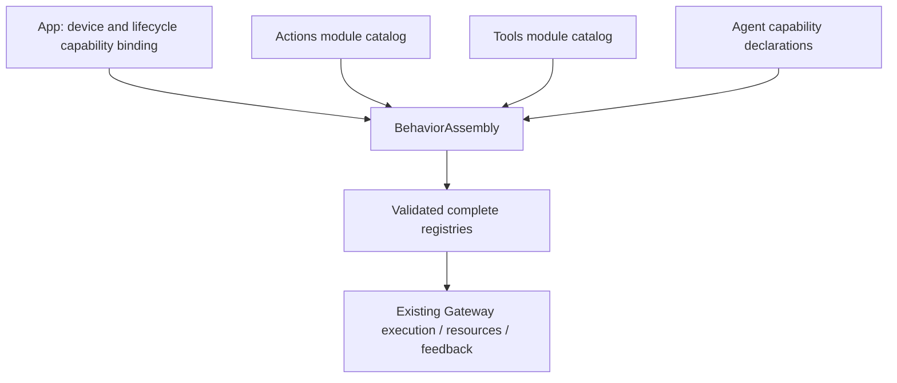

# ADR 0067 — Domain-owned behavior definitions and capability assembly

Status: accepted and implemented, 2026-09-29.

## Decision

App previously listed every ActionDefinition and registered each Tool asynchronously. RuntimePresentation also invoked individual UIActions/UITools helpers. This forced ordinary behavior additions to touch the host and distributed domain ownership across composition and adapters.

✅ Actions and Tools now own explicit module protocols, domain definition lists and built-in catalogs. ActionModules lists Speech/UI; ToolModules lists System/UI. Typed domain capability protocols describe required effects. Domain handlers retain parsing/validation and completion/resource metadata. The host adapter implements semantic operations without invoking individual behavior helpers.

✅ BehaviorAssembly is a separate SwiftPM target under App/Composition/Behaviors, depending only on AgentCore, Actions and Tools. The physical location keeps it within section 37 composition ownership; its build boundary makes it independently testable. The host binds existing playback/presentation/pose capabilities once and supplies Agent capability catalogs. Assembly builds complete registries and validates model/internal Action and Tool coverage synchronously. Agent permissions remain Agent-owned and do not follow automatically from registered implementations.

✅ Existing paths, parameters, finite/state completion boundaries, Tool returning/completion distinctions and Channel/wait/resource behavior remain unchanged. ToolRegistry gains atomic module construction and coverage validation; production no longer uses the prepareTools task. Existing explicit dynamic registration APIs remain compatible for isolated runtimes, with identifier validation.

## Limits and extension rule

Maximum 32 modules per catalog, 256 Action definitions, 128 Tool definitions and 128 Agent capability catalogs per assembly; overflow throws before exposure. Tool names/resources follow the existing 1–64-byte capability identifier grammar and maximum eight resource declarations. No new queues or long-lived tasks.

Adding a function uses its implementation and domain list; adding a domain uses its library's built-in catalog. App remains unchanged when existing capabilities suffice. New device primitives, permissions or lifecycle ownership can require a host adapter/binding change. No reflection or generic string/Any command dispatch is introduced merely to conceal that requirement.

## Validation and remaining work

✅ BehaviorAssemblyTests covers production Agent coverage, validation before effects, returning/completion Tool contracts, duplicate/invalid/bounded catalogs, missing internal implementations and extension modules without an App host. Repository boundary checks reject per-function registration and concrete UI behavior invocation in App.

❌ Domain filename/signature exceptions not needed for this migration remain documented. Audio/robot resource mapping, generic activity management, durable result delivery and physical acceptance remain the ADR 0066 follow-up work. Capability protocols currently reside in their consuming domains; a shared protocol target should be introduced only when multiple consumers actually need one, without adding devices to AgentCore.
