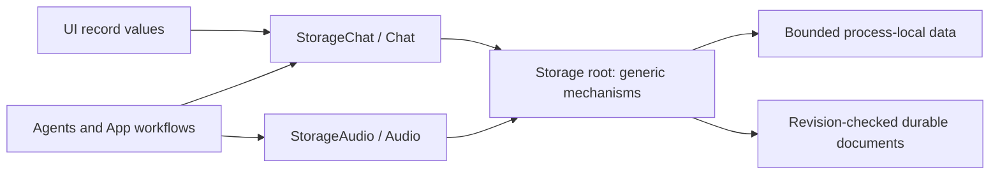

# ADR 0069 — Storage core and domain directories

Status: accepted and implemented, 2026-09-29.

The Storage root mixed generic stream/lease/document mechanisms with conversation business schemas and policies. Audio already had a domain directory. The outer layer should express reusable storage mechanisms; domain data belongs in domain directories.

✅ Storage root retains BoundedMemoryStream, MemoryLeaseStore and LocalDocumentStore. ConversationHistory.swift moves to Chat/, compiled separately as StorageChat depending only on Storage. Audio/ remains StorageAudio depending on Storage, AgentCore and ModelKit values. Core excludes both domain directories. UI consumes StorageChat values only; Agents/App import domain APIs where required. No re-export hides the separation.

✅ Only source/build ownership changes: public type names, on-disk locations, schema versions, capacity/expiry/retention and synchronization algorithms are unchanged. No data migration or new runtime queue is needed. Existing core, chat, speech and workflow tests validate these boundaries.

❌ Image/, Video/ and Memory/ are future domain plans, created only with concrete implementations. Memory refers to semantic memory records/retrieval, distinct from the existing generic MemoryLeaseStore RAM primitive. Generic disk eviction and remote synchronization are not implemented. App settings payloads remain App-owned consumers of LocalDocumentStore.
