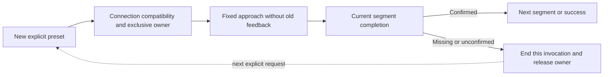

# 0080 — Independent NexArm motion results

Date: 2026-09-30. Status: implemented.

The user requires a missing or unconfirmed result to belong only to its invocation. Previously Workflow called recoverState before each preset; the controller also latched faults and required stationary feedback before sending. A physically usable connected arm could therefore reject every subsequent request.

A new explicit performGesture still validates arguments, exclusive ownership and connection compatibility, but clears the previous result and sends its fixed approach without querying old motion. Approach takes 3000ms because origin feedback is optional for admission; body and final durations remain 800/1200ms. Each segment still waits for its own observed arrival. Failure stops remaining segments and returns uncertainty, never automatic replay or claimed success. The next explicit request can start independently. Diagnostic primitives and explicit read-only refresh retain their existing contracts. A disconnected transport still needs connection recovery.

✅ Regression coverage includes failed write followed by another explicit write, current feedback still required, and Workflow starting while old telemetry is unavailable. Existing reset/cancellation/concurrency checks remain. ❌ No physical hold cancellation or anti-oscillation behavior is introduced. USB acceptance of earlier presets does not validate this changed admission policy.
