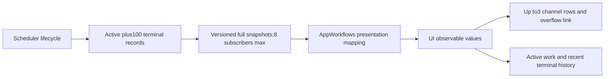

# 0083 — Unified Action execution presentation

Date: 2026-09-30. Status: implemented.

## Decision

Replace the home screen's Bluetooth-specific motion message with a projection of actual scheduler lifecycle for all channels. Scheduler admission, execution start, cancellation request and joined completion are authoritative. Observation is independent of model generation, Bluetooth write admission and Agent-directed ActionResult policy.

Shared values live in AgentCore/Output without dependencies on UI, Actions or Gateway. ChannelScheduler exclusively owns a ledger keyed by execution ID, retaining all active records under scheduler admission bounds and100 terminal records. Terminal eviction increments a counter; it never evicts scheduled work. Terminals are immutable. Phase changes are synchronous actor mutations; cancellation requests do not become terminal until handler cleanup returns.

At most8 subscribers receive an initial full snapshot and versioned full replacements through bufferingNewest(1). Slow consumers cannot block execution; coalescing does not require replaying deltas because every snapshot is complete within retention bounds. Terminated subscribers are removed; shutdown joins work before finishing streams. This is a process-local observation API, not durable delivery.

ApplicationRuntime owns ActionActivityWorkflow and injects the stream; no Gateway import reaches UI or AppWorkflows. The workflow maps paths to product names and displays bounded error.localizedDescription captured from the thrown error, without retaining call parameters or Error instances. This mapping does not register callable Actions. UI groups by channel without pretending that concurrent inputs form a global FIFO. Successful/cancelled summaries hide after3s, failures remain until dismissed/superseded, and retained details remain available. The next explicit same-channel execution supersedes old summary results. Dismissal only changes presentation.

## Completion and scope

Finite success means its handler contract completed; state success means accepted setting; activity start/stop reflects typed completion. Cancellation pending means ending current work, not physically stopped. Settings manual tests bypass channel Actions and continue reporting sent, not arrived. Ordinary cancellation never implies physical rollback or emergency stop.

✅ Tests cover observation independence, concurrency, queueing, cancellation joins, coalescing, bounded retention, immutable terminals, failure projection and UI visibility. ❌ Device-specific progress, persistent per-conversation history, firmware stops and physical-phone visual acceptance remain separate. Agent feedback policy and Action effects are unchanged.

Validation: `scripts/check.sh` passed, including249 IntegrationTests and the4 new presentation workflow tests; all four `scripts/build-ios.sh` simulator schemes passed. Signed iPhone build2026093016 succeeded. The actual home components were visually checked on an iPhone18 Pro simulator with explicitly labeled synthetic data. This does not claim physical-device interaction or live Action acceptance.

## Product visibility refinement

Every admitted ActionCall is projected, regardless of module or source. ToolCalls never enter the scheduler ledger. Fixed UI.print, transcript/voice phase, turn reset and gaze effects are completion-only Tools; they retain session/turn/sequence validation. print appends sentence chunks; setTranscript replaces the full current preview. Shared generation emits ordered Action/Tool events, and Tools are not wait-group members. Model-selected UI.express intentionally remains a scheduled Action and is visible until native model Tool transport is supported.

Use native Liquid Glass for the iOS26+ footer with an earlier-system fallback. Failures carry both optional machine classification and up to512 characters of the actual thrown error.localizedDescription. LocalizedError belongs at the throw site; no separate per-Action error-description catalog is required. ActionDefinition.completion describes the success contract and is unrelated to failure wording. Invalid arguments must not be misrepresented as a disconnected device or audio-engine failure.
