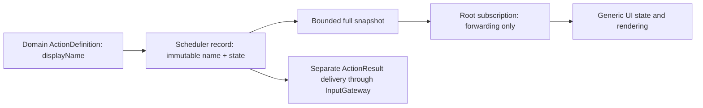

# ADR 0086 — Domain-owned Action display metadata

Date: 2026-09-30. Status: accepted.

## Context

ActionActivityWorkflow contained centralized ActionPath and Channel string switches. A new Action required unrelated presentation changes, unknown Channels lost their identity, and cancellation wording assumed robot-specific behavior. The existing root-owned snapshot subscription already separates UI observation from Agent output and result delivery.

## Decision

Require displayName on ActionDefinition and validate nonblank content with a 256 UTF-8 byte bound in ActionRegistry. Domain Support registrations own the name beside the handler. At admission, copy it into immutable AgentCore.ActionExecutionRecord metadata. This shared value remains independent of Actions/UI and survives terminal history without registry lookup. Agent JSON v5 and permission catalogs remain unchanged.

Retain scheduler-owned full versioned snapshots, initial-state delivery, bufferingNewest(1), eight-observer admission and bounded active/history records. They describe retained current state, not every transition. Observation failure never blocks execution. ActionResult still follows its separate InputGateway delivery contract.

ActionActivityWorkflow owns root-lifetime observation, forwarding and subscription failure state only. UI computes titles from record.displayName, shows exact Channel strings and derives status/icons from generic execution/completion semantics. Cancelling says “正在取消”; terminal cancellation says “执行前已取消” or “已取消”, without implying a physical stop or rollback. UI retains existing display aggregation/hiding/dismissal policy; equal Channel names across tasks are not a shared FIFO.

## Consequences and validation

✅ New actions using existing injected capabilities need no presentation-layer mapping. Display metadata is a String, not a SwiftUI type or model parameter. No additional target, dependency, queue or reflection registry is introduced. ActionDefinition and ActionExecutionRecord constructors intentionally require metadata; all current production/test callers are migrated.

✅ Tests cover invalid names, unfamiliar domain metadata through the whole observation chain, preserved raw Channels, generic completion/cancellation and existing snapshot/history contracts.

❌ Current domain names are Chinese strings. Resource-backed localization, durable auditing and per-device progress remain future work. No physical-device acceptance is asserted by this refactor.

Validation: complete repository checks and all four unsigned simulator schemes passed. Integration coverage includes 260 tests; workflow coverage includes 10 tests. Optional real-model/device tests were not enabled.
