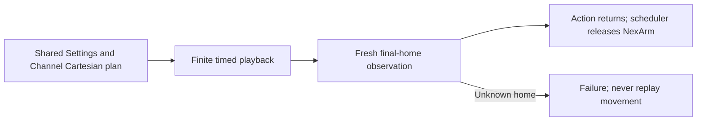

# 0088 — Settings-matched NexArm Cartesian playback

Date: 2026-09-30. Status: implemented; physical acceptance pending.

## Evidence and decision

The user reports that repeated Settings celebration/dance is smooth, while the same named conversation gestures produce apparent motor2 oscillation. Comparing production paths found shared body poses but different preparation/endings, per-frame feedback gates and motion-time CMD11 queries. Scheduler module exclusion already waits for handler completion. This evidence motivates aligning execution before changing mechanical parameters; it does not identify which difference causes the oscillation.

Cartesian Channel presets now share the Settings frame factory, including400/800/600ms durations. They send on nominal deadlines from actual admission, without intermediate arrival waits or motion-time position queries. One observation session fences takeover; after the final home duration, fresh stable home is required before the Action returns and the next NexArm Action can start. Older telemetry cannot satisfy this final observation. This replaces the Cartesian parts of ADR0082 and its all-segment handoff amendment, and the earlier requirement in ADR0081 to leave Channel playback unchanged. It retains ADR0080 independent new-request admission.

One controller operation, up to20 immutable frames, explicit busy rejection; no new queue. Each frame has1s backpressure admission, actual-admission-relative timing and no catch-up. Final observation has2s silence/3s completion limits; total budget sums nominal durations,1s admission per frame and3s observation. Cancellation joins the in-flight finite frame and final observation if entered, then discards unsent work explicitly. No torque, calibration, speed or amplitude changes.

Nod/shake retain measured calibration and their established Cartesian-to-native handoff; replacing that with Settings nominal encoder centers would be a different change. Settings still reports sent and supports latest-request replacement; Channel retains whole-Action ownership and verified final-home reporting.

✅ Tests verify Settings/Channel packet equivalence and cadence for tilt/celebrate/dance, no motion-time queries, fresh final observation, silent/cached-feedback failure, bounded congestion, cancellation, takeover and module exclusion through real Action handlers.

❌ Intermediate waypoints are no longer individually confirmed for Cartesian playback. Final home does not prove the full physical path, motor2 smoothness, clearance or an emergency stop. Existing physical logs describe earlier revisions; phone BLE validation is pending.
