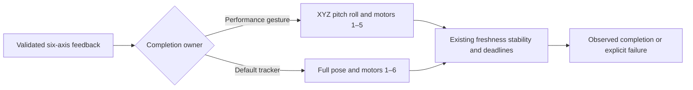

# ADR 0089 — NexArm performance completion covers arm axes

Date: 2026-10-01. Status: accepted.

## Evidence and problem

The user reported frequent incomplete actions, sometimes visibly home, after the intermediate-wait jitter repair. Supervised USB celebration sent all six frames, including home, then timed out. Final feedback was XYZ[199,1,197]mm, pitch−1.2°, roll0°, claw−6°. The arm pose met existing tolerances; the claw failed the hard-coded0°±2° predicate. A head preparation uses that predicate too and can therefore stop before native sweeps. This is separate from the intermediate-holding jitter diagnosed previously. The user clarified that gripper completion should not determine performance-action success.

## Decision

The shared arrival tracker accepts an explicit `includeClaw` flag, defaulting to true. The performance controller's arrival routine selects false for Cartesian final home and all head preparation/native/final observations. Pose predicates then cover XYZ, pitch and roll; native encoder targets and stability cover motors1–5. Input validity still requires all six pose/encoder values. General tracking and independent diagnostics remain strict unless explicitly scoped otherwise.

No motion packet, gripper target, frame cadence, arm tolerance, nominal handoff gate, freshness rule, silence deadline, completion budget or cancellation behavior changes. Actions continue awaiting the whole controller operation; registrations document arm completion without claiming claw arrival. Future gripper Actions must verify their own declared target rather than inherit this scope.

## Verification and limits

Deterministic tests cover biased/moving gripper feedback, Cartesian and native joint targets, default strict tracking, retained arm instability rejection and target/deadline failures. A production-controller test verifies a complete gesture and unmodified measured gripper telemetry. Hardware run results belong in NexArm_Physical_Acceptance.md.

This does not diagnose why the claw remains offset, fix its mechanics/calibration, remove its existing command field, or certify grasping or emergency stopping. The reported phone incidents cannot all be attributed to one captured USB failure; continued failures require their own evidence.
