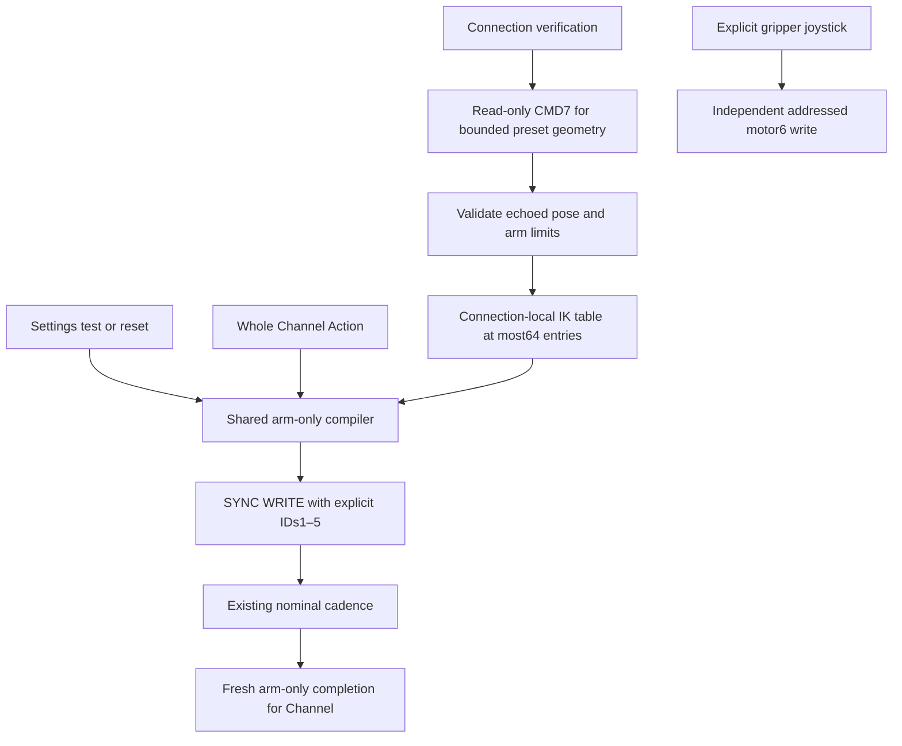

# ADR 0090 — NexArm gestures and home never address the gripper

Date: 2026-10-01. Status: accepted.

## Purpose and decision

The user clarified that every performance gesture and home/reset operation excludes the gripper. ADR0089 excluded claw convergence from completion, but CMD8/CMD54 still supplied a claw target. Holding the last measured claw value would still command it and does not satisfy this requirement.

PlatformKit now prepares a connection-local device IK table with read-only CMD7 before motion. Responses must match the requested XYZ/pitch/roll and provide valid arm encoder targets. The table has a hard limit of64 entries (overflow is an error); it is published only after all preset geometry is prepared successfully. There is no fallback to whole-device motion when IK fails. CMD8-shaped frames are internal geometry intents, not permitted live/observed transport packets.

The shared `NexArmArmPlan` compiles each geometric endpoint to one raw servo SYNC WRITE: broadcast ID254, instruction131, register41, seven bytes per explicitly listed motor. Only IDs1,2,3,4,5 are listed. Position limits, acceleration30, nonzero speed1...1400, exact packet length and unique ordered IDs are validated by both live and observed allowlists. A48-byte write must fit the native transport MTU; no unsafe fallback or split write is attempted. Speeds derive from endpoint distance and nominal duration with20% time allowance for acceleration/deceleration, capped at1400. This is joint-space endpoint motion, not the previous firmware Cartesian interpolation; smoothness requires physical acceptance.

Settings and Channel use the same compiler. Cartesian preset timing remains ready400/body800/home600 with no intermediate queries or stability waits; final Channel completion still observes fresh arm home. Native head sweeps retain calibrated preparation and their existing arrival gates. Reset and connection indication use an arm-only two-second home target; connection wrist indications address ID5 only. Bounded diagnostic wrist/base moves now address ID5/ID1 directly. No production gesture/reset emits CMD8, CMD50 or CMD54. These low-level protocol values remain representable for geometry/read-only calculation and historical test data.

Manual Settings motor6 jogging remains an explicitly selected, independent operation. Automatic arm completion and readiness stability cover motors1–5; feedback still validates and exposes all six encoders. Settings command estimates update only addressed arm motors, preserve the gripper estimate and are never presented as measured telemetry. Reconnection discards the IK table. No calibration, torque, PID, firmware or gripper control setting is modified.

## Verification and outstanding work

✅ Deterministic coverage rejects injected motor6 entries, whole-device transport commands, invalid IK and missing preparation; checks claw-independent packets, arm-only home, shared Settings/Channel timing, cancellation and completion gates. Opt-in historical six-axis causal variants are disabled for physical dispatch.

✅ USB arm-only home, celebration and dance reached home with claw remaining−6°. Detailed evidence and subsequent acceptance belong in `docs/NexArm_Physical_Acceptance.md`.

❌ Device-side emergency-stop/watchdog certification, load-dependent smoothness, and long-duration BLE endurance remain outside this change. Host receipt or command duration is not proof of physical stop or intermediate waypoint arrival.
