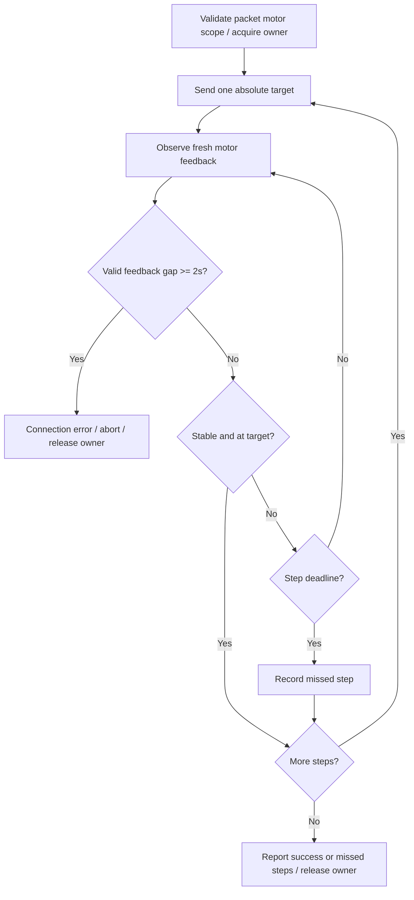

# 0091 — NexArm motor-scoped feedback execution

Status: implemented; physical acceptance pending.

Context: whole-arm head preparation affected unrelated motors. Fixed-duration playback and final-only verification did not implement the requested prompt feedback progression. Earlier per-segment waits reproduced jitter, so the new bounded progression must be validated on hardware and must not be assumed to cure every mechanical symptom.

Decision: ## Current motor-scoped execution (2026-10-01, ADR0091)

Purpose: share one feedback-driven executor between Settings and conversation actions. Design goals: restrict commands and arrival checks to declared motors, advance promptly, distinguish target failure from connection failure.

✅ `NexArmSingleMotorActions.swift` defines nod (motor4) and shake-head (motor5): own calibrated home, sweeps, own home. `NexArmCompositeActions.swift` owns composite geometry and read-only IK compilation. `NexArmMotionPlan.swift` validates every packet against its `lockedMotors`, bounds plans to 20 steps, and tracks fresh encoder convergence. Composites and explicit reset own motors1–5; gripper6 is never commanded or checked by these actions. `resetArm` / `NexArm.reset` is the independent whole-arm reset.

✅ Settings and Channel use `NexArmController.execute`. Each step sends one absolute target (speed1400, acceleration30); firmware drives the motor. There is no host-generated stream of incremental positions or mandatory nominal-duration sleep. Two fresh post-send samples spanning at least100ms, variation≤2 counts and target error≤16 counts complete the step. The physical feed is approximately5Hz, so confirmation normally needs at least200ms; cached pre-send feedback cannot complete a step. An unchanged off-target stream remains a target failure, not a connection failure.

✅ Intermediate deadline2000ms and final deadline3000ms are maximum observation windows, not mandatory waits. A missed intermediate target is recorded and the next target overwrites it. At Action end, any missed segments produce `targetsNotReached`; successful final home does not erase them. A two-second valid-feedback gap has higher priority: abort, stop subsequent writes and report connection instability without query fallback. BLE monitors this while idle too. Fresh feedback restores readiness but never replays an action. Cancellation stops future writes; it cannot physically stop an already issued target.

✅ Connection-scoped read-only compatibility/IK preparation and explicit diagnostic refresh can still query. Production motion observation never polls CMD11. Motor ownership is controller-local with capacity-one action admission; Settings keeps one replaceable pending request and joins the old owner before starting its replacement. This is not a migration to Gateway ResourceCoordinator or support for parallel disjoint-motor actions.

Developer rules: declare every motor an action can address; never add full-arm home to a single-motor action, include claw6 in reset, add query-on-timeout fallback, use old cached feedback as completion, or insert nominal beat sleeps. Build finite plans rather than custom arrival loops. Do not resend a committed packet on feedback timeout. The legacy supervised `nudgeWrist` and `shakeBase` diagnostic APIs retain their historical query-based routines; App actions do not use those routines.

❌ Physical acceptance of this new fast progression, sustained BLE use, independent stop detection and Gateway-wide motor resource arbitration remain outstanding. Earlier fixed-cadence/final-only sections below are historical and superseded by this section.

Consequences: an action may execute its final home but still report missed intermediate targets; callers must not automatically retry. Reported encoder stability is not independent proof of zero velocity. Firmware speed/acceleration controls remain bounded; no PID, torque or calibration changes are made.

### Supervised USB evidence for ADR0091

Nod completed all six motor4 targets and returned to encoder1248 (target1238). Shake-head issued only motor5 targets and returned to2050 (target2048); the first run reported missed segments3/5 because the initial1500ms ceiling expired just before a second stable sample. Motor1/2/3 stayed exactly2047/2087/1196 throughout both actions; claw was not commanded (reported jitter1119…1122 is independent). The intermediate ceiling is now2000ms to include the measured large-sweep travel plus the next5Hz stability sample, with no minimum waiting period. The failed sequence was not automatically replayed. This trace verifies command scope and encoder feedback, not visual absence of vibration.

### Validation and remaining measured error

✅ `scripts/check.sh` passed with full Xcode Swift6.4, including277 IntegrationTests; `scripts/build-ios.sh` passed all four simulator schemes. Signed device build2026100104 passed.

✅ Supervised USB dance exercised all8 segments and returned home. Segments2/4/6/7 reported `targetsNotReached`: motor3 remained stable21…26 counts short of target while feedback stayed healthy, exceeding the16-count tolerance. This validates skip-and-report and final return; it is **not** an all-targets acceptance pass. No tolerance, torque or calibration was changed to hide that result. The operator reported no motor2 vibration during the head/dance trials.

❌ Motor3 loaded-position accuracy and long-duration iPhone BLE acceptance remain outstanding. The corrected2000ms head deadline has simulated coverage and measured timing rationale; no automatic physical replay of the failed shake-head sequence was performed.
