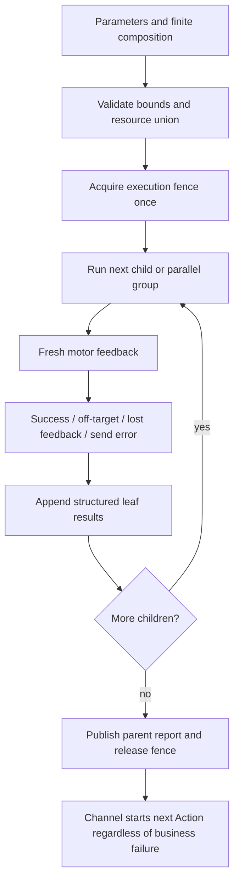

# 0092 — Atomic actions and composed results

Status: implemented; simulated and bounded USB validation complete.

Context: the user requires atom-level failure to terminate only that atom, retain its diagnostic result and continue compositions and later Channel Actions. Feedback loss and stable off-target positions have equal business-error status.

## Current contract — atomic outcomes and composition (ADR0092)

Purpose: compose finite actions while retaining all child outcomes. Design goals: motor-scoped ownership, prompt passive-feedback completion, isolated failures and bounded result memory.

✅ Single-motor move/reset definitions live in Actions/NexArm/NexArmMotorActions.swift, with the packet encoder/options/completion policy in PlatformKit/Connectivity/NexArm/NexArmMotorActions.swift. NexArmSimpleActions.swift defines head sweeps; NexArmCompositeActions.swift defines complex geometry compiled through the same atomic encoder. Native position, speed1…1400 and acceleration1…254 are validated; no unspecified packet bytes are exposed as duration/deceleration. Default arm homes come from connection-local IK; explicit software home configuration can include motor6, which remains excluded from whole-arm reset and performances.

✅ Each motor tracks its own fresh post-command feedback. Default tolerance16counts, stable variation2counts and stable window100ms; stable off-target feedback ends that leaf after600ms. Movement has a finite upper bound; no nominal beat sleep. Feedback silence is an ordinary leaf error, just like target failure. It ends the affected leaves and fast-fails subsequent unavailable-device steps without queries, blind writes or replay. Each step retains motor, target, last observation, failure and whether it started. User cancellation stops future writes and records remaining leaves as not started.

✅ ActionComposition validates sequence/parallel/repeat/delay trees before effects: depth≤8, total reserved leaf results≤256, repeated count≤32, delay≤30seconds, resource union≤8. Parallel nodes cannot overlap resources. Report-producing leaves reserve their maximum result count before execution. Sequential failures do not throw out of the parent. Reports preserve child paths; partial failure remains failure feedback under failuresOnly. The robot adapter passes its entire motor report through this composition boundary.

✅ ActionResult carries a structured ActionReport, including partialFailure. Scheduler terminal failure releases its lane and wait barrier without cancelling other accepted actions or fencing later admission. Unexpected handler throws become failed results; user/session cancellation remains explicit. A single per-invocation report store preserves adapter details through cancellation. Delivery retries still retry messages only. Session closure can close delivery; terminal execution history and pending result delivery are distinct.

✅ Parameter-dependent resource resolution maps move/reset to the requested motor, nod to4, shake-head to5 and existing Cartesian composites to1–5. Parent executions own the union; children inherit ResourceExecutionContext rather than reacquiring locks. Production registers all six motor resources. Settings and manual control share the same coordinator through an injected workflow closure; manual streaming reserves all six because inputs can change during the stream. The controller still serializes the device transport. Resource cleanup cancels and joins software work; it does not claim a physical emergency stop.

Developer rules: use finite validated compositions and typed motion options; declare the resource union; never swallow a child failure, reinterpret it as success, silently truncate reports, retry a failed device command, add full-arm preparation to a single-motor action or let a normal business failure cancel unrelated Channel work. Explicit delays belong to composition. Capacity violations are reported rather than silently dropping results. Swift cancellation is cooperative; a hung uncooperative handler cannot be forcibly terminated and must not release a resource as though hardware had stopped.

❌ Persistent result delivery, independently verified physical stop, calibrated load compensation and arbitrary firmware configuration are not implemented. Hardware/phone acceptance of ADR0092 is recorded separately. Earlier fail-fast/fixed-cadence statements below describe superseded contracts.

## ADR0092 validation — 2026-10-01

✅ Full `scripts/check.sh` passed, including286 IntegrationTests, UI report presentation tests, architecture checks and formatting. `scripts/build-ios.sh` passed all four simulator schemes. Signed iPhone build2026100105 passed.

✅ Opt-in supervised USB atomic-group test passed in1.58seconds: motors4/5 moved together with speed800 and acceleration50, then each reset to its calibrated home. All four atomic results succeeded. Targets/observations: motor4 1318/1318 then1238/1248; motor5 2128/2126 then2048/2051. Motors1–3 stayed2047/2088/1196. Gripper6 received no command. No motion-time queries, firmware/calibration writes or failure replay were used.

❌ This does not establish loaded-position accuracy, long-duration BLE behavior or a physical emergency-stop guarantee. Previously measured motor3 off-target positions remain reportable failures, not silently widened tolerances.

✅ Installed build2026100105 on iPhone17Pro and independently read back the same bundle version. The first readback hit a transient CoreDevice/RSD error; refreshing device discovery and retrying the read-only query succeeded. No app launch or motion replay was performed during installation.
