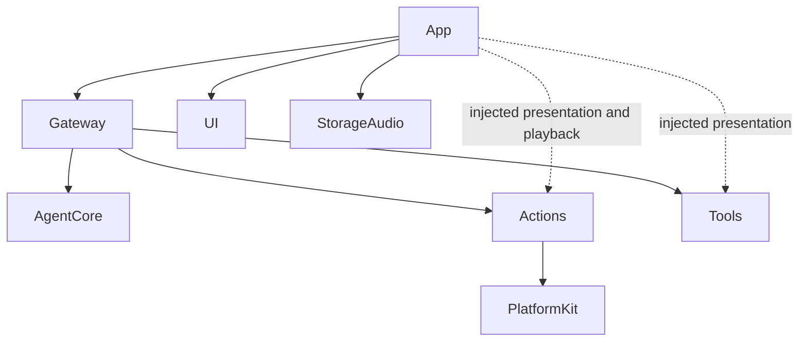

# ADR 0096 — Behavior-owned execution contracts

Status: accepted and implemented, 2026-10-02.

## Decision

Actions and Tools own their public execution contracts under their respective Contracts directories. They do not import AgentCore, Gateway, App, UI or each other. No shared-contract module is introduced. Definitions, macros, resource requirements, argument readers and results remain with the capability provider; Runtime implements execution and composition.

AgentCore retains call intents and delivery observations. Gateway translates them explicitly, validates caller identity, and holds scheduling metadata in ScheduledAction. Only ActionInvocation crosses into Actions. Resource leases, Channel queues and feedback routing remain above execution. Ordinary failures still complete the current action and permit later accepted actions; explicit cancellation still joins cleanup.

App owns conversation-source acceptance, stored-audio ownership adaptation and UI result projection. Actions/Tools can invoke injected presentation capabilities. UI renders its own ActionActivityItem values and never imports execution modules. Tool pose payloads are converted at the App boundary.

## Consequences

✅ Actions and Tools can compile without AgentCore. Their contracts are not aliases to Agent values. Translation preserves IDs, context, resources, structured failures and result delivery; enum mappings are exhaustive.

✅ Source/dependency guards reject reverse imports. Macro registration stays explicit. Robot geometry, tolerance profiles, completion rules and timing calculations are unchanged.

❌ Independent distribution as published libraries, cross-process serialization and durable replay are not implemented. These are directory boundaries within the existing targets.
