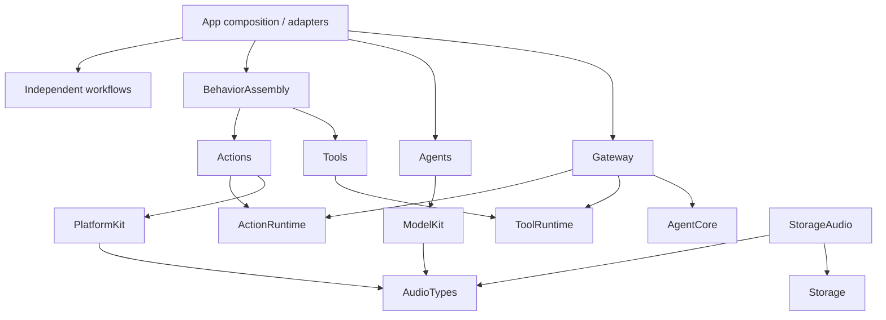

# ADR 0098 — Independent runtime, workflow and audio boundaries

## Decision

Keep the section37 physical layout while compiling Actions/Runtime (including Contracts) as ActionRuntime and Tools/Runtime as ToolRuntime. Concrete catalogs/macros remain in Actions/Tools; ToolPoseOverlay belongs to Tools/UI/Support. Gateway imports runtime contracts only. BehaviorAssembly constructs bounded registries and immutable startup Tool paths without AgentCore; Gateway.BehaviorCoverage validates model/internal permissions synchronously before producers start.

Compile six real application workflow domains separately. AppWorkflows is only a convenience export facade. Settings injects validated provider preparation/application/discovery; History injects title generation and preview. App adapters bind the existing ModelKitDefaults/OpenAI and Agent implementations. Lifecycle receives immutable role-specific runtime dependencies and composition-supplied Agent factories. Robot binding bodies move unchanged to NexArmBehaviorAdapter.

AudioTypes owns existing PCM values and MicrophoneFrame. StorageAudio depends only on Storage/AudioTypes; ModelKit and PlatformKit consume the shared values. ModelKit forwarding constructors preserve original labels and CapabilityError failures. PlatformKit capture format and PCM byte conversion are unchanged.

## Preserved contracts

✅ No changes to Agent JSON, callable paths, permissions, parameters, default models, persistent schemas, credentials, limits, overflow policy, scheduling, motion plans, producer-first cancellation, reply lifetime or resource ownership. Sources compile once; no duplicate runtime or media implementations. Boundary validation checks the full target graph for cycles and guards the new leaf/runtime/workflow boundaries.

❌ No DI framework, global resolver, new feature, background supervision, physical-stop guarantee, persistence migration or phone deployment is introduced. Real-provider/device acceptance remains separate.
