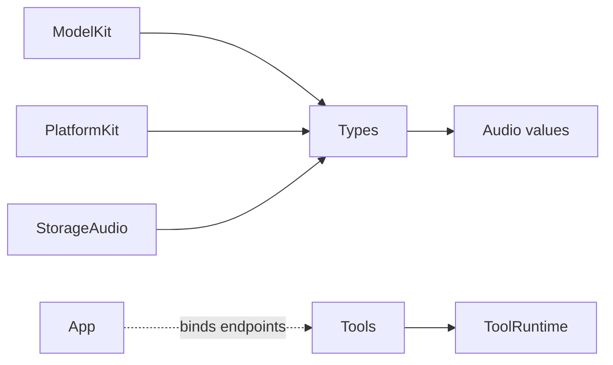

# ADR0099 — Shared Types grouped by category

Date: 2026-10-02. Status: accepted. Supersedes ADR0098’s audio-only target/directory naming.

## Context and decision

Shared value contracts should have a common home rather than one top-level module per media kind. Rename AudioTypes to Types and move existing values to Types/Audio, without changing constructors, validation limits, error mapping or ownership. Types has no project dependencies. ModelKit, PlatformKit and StorageAudio depend on Types. Keep compatibility exports in their owning SDKs.

ImageFrame and NativeImageBuffer remain in ModelKit/Core until extraction has concrete shared consumers. Add future shared categories only with implemented values; do not create empty directories.

Current Tools implements System/UI functions through host-injected endpoints and does not depend on PlatformKit. Future concrete device Tool domains may consume PlatformKit; ToolRuntime must remain independent of device and business SDKs.

## Consequences

Update Package.swift, imports, Xcode navigation, README compilation map and boundary checks together. Audio behavior and business flow are preserved. The technical plan includes the current compilation graph; future device Tool dependencies must be added only when their implementation requires them.
