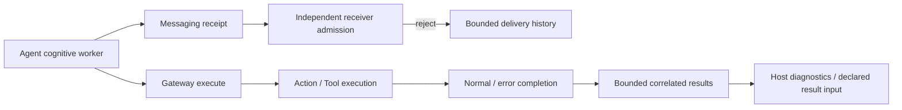

# ADR0103 — Agent failure isolation and execution outcomes

Status: accepted, 2026-10-02.

An optional pose subscriber, message rejection or completion Tool exception previously terminated unrelated producers or App sessions. Photographer also emitted arm commands while control feedback was unavailable.

Agents remain actors with independent processing state. Production communication uses publishResult/sendResult: ordinary routing failures become DeliveryReport outcomes; explicitly cancelled work stops. Each port retains128 receipts with counted oldest eviction. Assistant skips dependent playback if synthesis admission fails; SpeechPerception resets its listening turn if final delivery fails; VisionPerception continues visualization regardless of subscriber/routing failure. SpeechSynthesis already retains failures per audio request and continues its serial worker.

Photographer owns offline suppression via an injected read-only control-availability capability. It consumes poses while unavailable, emits no Robot.aim and clears its previous aim baseline. Reconnection uses a fresh observation. App adapts Bluetooth state; Tools still cross Gateway, and device/resource checks reject a disconnect racing with dispatch.

Completion and returning Tool handlers convert ordinary exceptions into correlated error ToolResponse values. Successful completion-only Tools remain nil. Gateway delivers feedback only to a source declaring ToolResult input; other outcomes remain in diagnostics. Production output consumers use OutputGateway.execute, which returns ordinary validation/admission/barrier failures rather than throwing into session supervision. Low-level dispatch remains a strict validation API. Explicit task cancellation propagates; an independently cancelled operation is an error outcome. Final controls join admitted Actions, and executionResults exposes bounded output outcomes alongside terminal Action records. Output history retains256 entries and counts oldest eviction; existing Action history bounds remain in force.

App observes each Agent's failure separately. SpeechPerception failure stops its capture and recognition work without cancelling Assistant or SpeechSynthesis. Vision failure stops its input work and presents a vision error without removing Photographer. Explicit user/session shutdown still joins all owned work. Assembly/configuration errors remain strict and cannot silently grant permissions or substitute configuration.

✅ Regression tests cover offline Photographer suppression, message failure receipts, completion Tool error outcomes, following independent output and explicit cancellation.

❌ Sustained hardware disconnect/reconnect and live voice-service fault injection remain physical acceptance work. Histories are in-memory and not durable recovery logs.

Completion-only Tool errors remain execution outcomes and do not inject a new model-facing ToolResult; only returning Tools route data feedback.

Assistant terminal output failure likewise retains perception/synthesis registration until host cancellation; recognition resume failure remains recognition-local. The idle lifetime wait has capacity1, no producer and no queued business work.

2026-10-03 extension: unknown model Action/Tool aliases and invalid invocation parameters are isolated per call. Agents resolve aliases and emit non-executable CallRejection values; Gateway checks the corresponding output permission and records them through existing OutputExecutionResult retention. Action rejection is an output failure, Tool rejection is a correlated error ToolResponse. No rejected call reaches a handler or consumes a scheduler execution slot; existing valid calls and wait boundaries remain ordered. Assistant persists failed native Tool history and continues generation. Rejected calls count against existing generation/output bounds. Structural parser errors, forbidden Channels, configuration failures and cancellation stay strict.

✅ Integration regressions cover same-turn continuation, mixed valid/rejected Actions inside waits, native Tool argument decoding and common error result retention. ❌ Automatic correction and real-provider acceptance remain deferred.

2026-10-03 refinement: Action invocation/resource admission failures remain local; all ActionSchedulingError cases (including capacity and limits), identity/communication failures and true task cancellation still cancel the owning Action tree. Stored child reports retain a later execution exception or cancellation instead of masking it. ToolExecutor merges completion/returning exception handling and uses the function-defined Tool timeout first, otherwise a cooperative30-second Runtime fallback (explicit executor fallback override up to300 seconds), joining cleanup before releasing ownership. Calling-task cancellation propagates; independent handler cancellation becomes an error outcome. Tool feedback failure preserves the handler result and is recorded separately. Rejected native Tool history-write failure emits a nonterminal output error rather than replacing the original rejection. Conversation admission/raw durability failures remain strict. No automatic replay or forced termination is introduced.
